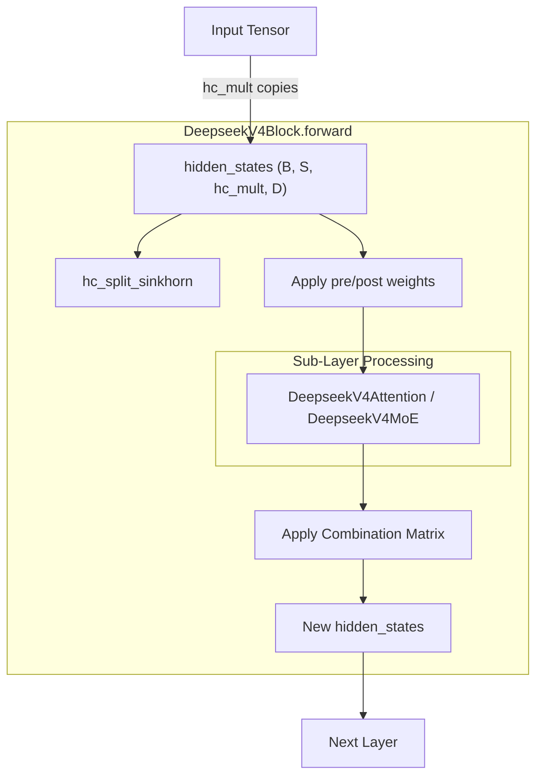
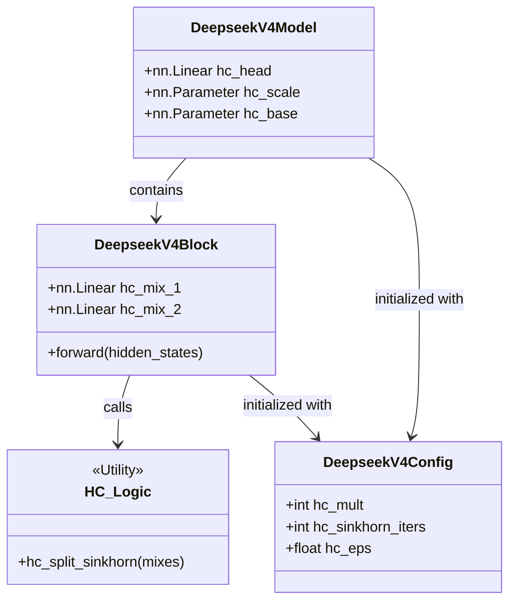

<!-- source: DeepWiki mcp.deepwiki.com · repo huggingface/nanowhale · page 2.2 Hyper-Connections · fetched 2026-10-26 -->

# Hyper-Connections

Relevant source files

The following files were used as context for generating this wiki page:

- [configuration_deepseek_v4.py](configuration_deepseek_v4.py)
- [modeling_deepseek_v4.py](modeling_deepseek_v4.py)

Hyper-Connections (HC) is a core architectural innovation in DeepSeek-V4 that replaces standard residual connections with a multi-copy hidden state mechanism. Instead of a single residual stream, the model maintains `hc_mult` parallel copies of the hidden state, which are dynamically mixed and updated at each layer using weights derived from Sinkhorn normalization.

## Overview and Purpose

In a standard Transformer, the update rule is $x_{l+1} = x_l + \text{SubLayer}(x_l)$. Hyper-Connections expand this by maintaining a hidden state $X \in \mathbb{R}^{B \times S \times \text{hc\_mult} \times D}$. At each layer, the model generates "pre-connection" weights, "post-connection" weights, and a "combination matrix" to route information between these parallel streams.

The implementation in `nanowhale` focuses on:
1.  **Multi-copy state**: Expanding the hidden dimension by a factor of `hc_mult` [configuration_deepseek_v4.py:55-55]().
2.  **Dynamic Routing**: Using a linear projection to generate mixing scores [modeling_deepseek_v4.py:516-518]().
3.  **Sinkhorn Normalization**: Ensuring the combination matrix is doubly stochastic to maintain numerical stability across many layers [modeling_deepseek_v4.py:110-123]().

### Data Flow within DeepseekV4Block

The lifecycle of the hidden states within a single `DeepseekV4Block` involves splitting the multi-copy state, applying the sub-layers (Attention or MoE), and then recombining the outputs.

**Sources:** [modeling_deepseek_v4.py:511-550]()

## Implementation Details

### hc_split_sinkhorn

The `hc_split_sinkhorn` function is responsible for transforming raw scores into normalized weights. It processes a "mixes" tensor of size `[B, S, (2 + hc_mult) * hc_mult]` [modeling_deepseek_v4.py:85-100]().

*   **Pre-connection weights (`pre`)**: A sigmoid-activated vector of size `hc_mult` used to scale the input to the sub-layer [modeling_deepseek_v4.py:102-107]().
*   **Post-connection weights (`post`)**: A sigmoid-activated vector (scaled by 2) used to scale the output of the sub-layer [modeling_deepseek_v4.py:103-108]().
*   **Combination Matrix (`comb`)**: A square matrix of size `[hc_mult, hc_mult]` that defines how information is exchanged between the `hc_mult` copies [modeling_deepseek_v4.py:104-111]().

### Sinkhorn Normalization

To ensure the combination matrix `comb` does not cause exponential growth or decay of activations, it undergoes Sinkhorn iterations. This process forces the matrix to be nearly doubly stochastic (rows and columns sum to 1).

1.  **Initial Softmax**: Applied along the last dimension [modeling_deepseek_v4.py:114-114]().
2.  **Row/Column Normalization**: Iteratively dividing by the sum of the respective dimension [modeling_deepseek_v4.py:115-121]().
3.  **Stability**: An `eps` (default `1e-6`) is added to denominators to prevent division by zero [modeling_deepseek_v4.py:116-121]().

**Sources:** [modeling_deepseek_v4.py:85-123](), [configuration_deepseek_v4.py:116-118]()

## Lifecycle within DeepseekV4Block

The `DeepseekV4Block` manages two Hyper-Connection stages: one for the attention sub-layer and one for the MoE/FFN sub-layer.

| Step | Code Entity | Action |
| :--- | :--- | :--- |
| **Score Generation** | `self.hc_mix_1` | Linear projection from `hidden_size` to scores [modeling_deepseek_v4.py:516-518](). |
| **Normalization** | `hc_split_sinkhorn` | Produces `pre`, `post`, and `comb` [modeling_deepseek_v4.py:521-523](). |
| **Input Scaling** | `hidden_states * pre` | Scales the `hc_mult` copies before the sub-layer [modeling_deepseek_v4.py:533-533](). |
| **Sub-layer Execution** | `self.attn(...)` | Processes the weighted copies [modeling_deepseek_v4.py:534-534](). |
| **Output Scaling** | `attn_output * post` | Scales the sub-layer residual [modeling_deepseek_v4.py:535-535](). |
| **Combination** | `torch.matmul(comb, ...)` | Mixes the copies according to the Sinkhorn matrix [modeling_deepseek_v4.py:536-536](). |

This sequence is repeated for the MoE layer (`hc_mix_2`) [modeling_deepseek_v4.py:540-549]().

**Sources:** [modeling_deepseek_v4.py:511-550]()

## Final Contraction: hc_head

Because the internal layers operate on `hc_mult` copies, the final output of the transformer stack must be contracted back to a single `hidden_size` vector before the language modeling head. This is handled by `self.hc_head` in the `DeepseekV4Model` class.

*   **Function**: A linear layer that maps from `hc_mult * hidden_size` back to `hidden_size` [modeling_deepseek_v4.py:623-623]().
*   **Input**: The `hidden_states` tensor is reshaped from `[B, S, hc_mult, D]` to `[B, S, hc_mult * D]` [modeling_deepseek_v4.py:663-664]().

**Sources:** [modeling_deepseek_v4.py:623-664]()

## Numerical Stability: The bf16 NaN Issue

A known limitation in the `nanowhale` implementation is the tendency for `bfloat16` gradients to overflow, leading to `NaN` values, particularly at the small scale (110M parameters).

### Root Causes
1.  **Sinkhorn Iterations**: Repeated division and normalization in `hc_split_sinkhorn` can lead to very small or very large values if the raw scores are not well-bounded [modeling_deepseek_v4.py:119-121]().
2.  **Multi-copy Accumulation**: The dynamic mixing of `hc_mult` copies increases the variance of activations compared to standard residual streams.
3.  **Parameter Scale**: At 110M parameters, the `hidden_size` is small (e.g., 320), making the model more sensitive to the epsilon values and initialization ranges used in the HC mechanism.

To mitigate this during training, the `train_sft.py` script often falls back to `fp32` or uses strict gradient clipping.

**Sources:** [modeling_deepseek_v4.py:85-123](), [configuration_deepseek_v4.py:57-57]()

## Code Entity Map

The following diagram maps the mathematical concepts of Hyper-Connections to their specific implementations in the codebase.

**Sources:** [configuration_deepseek_v4.py:18-140](), [modeling_deepseek_v4.py:85-123](), [modeling_deepseek_v4.py:465-550](), [modeling_deepseek_v4.py:596-670]()

---

