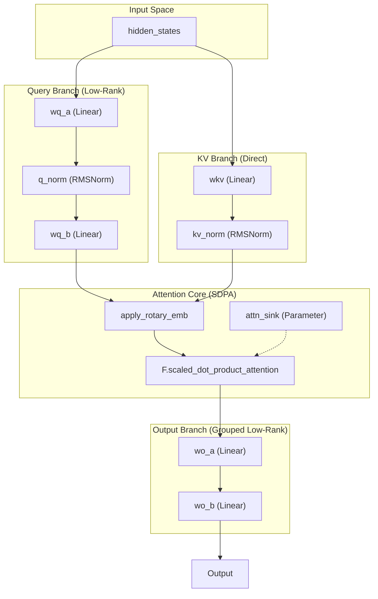
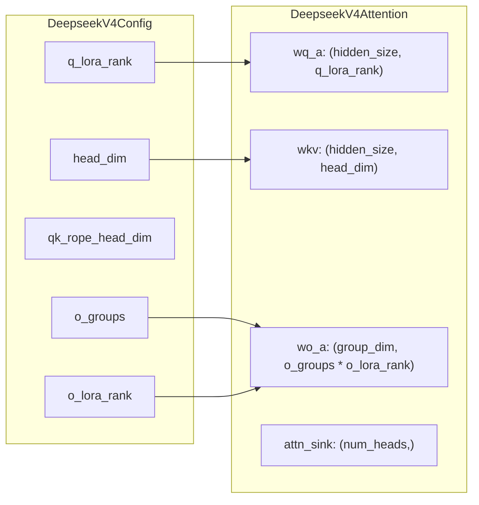

<!-- source: DeepWiki mcp.deepwiki.com · repo huggingface/nanowhale · page 2.3 Multi-Head Latent Attention (MLA / CSA) · fetched 2026-10-26 -->

# Multi-Head Latent Attention (MLA / CSA)

Relevant source files

The following files were used as context for generating this wiki page:

- [configuration_deepseek_v4.py](configuration_deepseek_v4.py)
- [modeling_deepseek_v4.py](modeling_deepseek_v4.py)

Multi-Head Latent Attention (MLA), also referred to in this codebase as **Compressed Sparse Attention (CSA)**, is a memory-efficient attention mechanism designed to reduce the KV cache bottleneck while maintaining high expressivity. In `nanowhale`, this is implemented as a low-rank projection system for Queries, Keys, Values, and Outputs, combined with a hybrid positional embedding strategy.

## Architecture Overview

The implementation in `DeepseekV4Attention` replaces standard Multi-Head Attention (MHA) with a compressed latent space. Unlike standard MHA where $K$ and $V$ grow linearly with the number of heads, MLA compresses these into a single latent vector that is shared across all heads, significantly reducing the memory footprint during inference.

### Key Components

*   **Low-Rank Q Projection**: Queries are projected into a latent space (`q_lora_rank`) before being expanded to the full head dimension.
*   **Direct KV Projection**: Keys and Values are projected into a shared latent space (`head_dim`) without a separate LoRA rank, diverging from the DeepSeek-V3 implementation.
*   **Grouped Output Projection**: The output projection is split into groups (`o_groups`) and processed via a low-rank bottleneck (`o_lora_rank`) to reduce parameter count.
*   **Hybrid RoPE/NoPE**: Each head is split into a non-positional part (NoPE) and a part that receives Rotary Positional Embeddings (RoPE).

### Data Flow: Natural Language to Code Entities

The following diagram maps the mathematical flow of the attention mechanism to the specific code entities in `modeling_deepseek_v4.py`.

**MLA Data Flow Diagram**

**Sources:** [modeling_deepseek_v4.py:130-172](), [modeling_deepseek_v4.py:173-200]()

---

## Implementation Details

### Latent Projections

The Queries are processed through a two-step projection to reduce the number of parameters while maintaining the rank of the attention matrix.
1.  **`wq_a`**: Projects `hidden_size` to `q_lora_rank` [modeling_deepseek_v4.py:156]().
2.  **`q_norm`**: Applies `DeepseekV4RMSNorm` to the latent Query [modeling_deepseek_v4.py:157]().
3.  **`wq_b`**: Expands the latent Query to `num_heads * head_dim` [modeling_deepseek_v4.py:158]().

For Keys and Values, `nanowhale` uses a direct projection `wkv` to a single shared latent head of size `head_dim` [modeling_deepseek_v4.py:161](). This is a specific V4 optimization that differs from V3's `kv_lora_rank` [configuration_deepseek_v4.py:11]().

### Hybrid Positional Embeddings (RoPE + NoPE)

The `head_dim` is partitioned into two segments:
*   **NoPE (Non-Positional Embedding)**: The first `head_dim - qk_rope_head_dim` dimensions are used for content-based matching without positional information [configuration_deepseek_v4.py:98]().
*   **RoPE (Rotary Positional Embedding)**: The final `qk_rope_head_dim` dimensions receive positional encoding via `apply_rotary_emb` [modeling_deepseek_v4.py:63-79]().

### Grouped Output Projection

To manage the complexity of projecting back to the hidden dimension, the output uses a grouped low-rank strategy:
1.  The concatenated head outputs are divided into `o_groups` [modeling_deepseek_v4.py:151]().
2.  **`wo_a`**: Projects each group to a shared `o_lora_rank` [modeling_deepseek_v4.py:167]().
3.  **`wo_b`**: Projects the combined latent representations back to `hidden_size` [modeling_deepseek_v4.py:168]().

**Entity Mapping: Configuration to Model**

**Sources:** [configuration_deepseek_v4.py:41-45](), [modeling_deepseek_v4.py:141-172]()

---

## Attention Sink

The model includes a learnable `attn_sink` parameter of shape `(num_heads,)` [modeling_deepseek_v4.py:171](). This parameter provides a stable "sink" for attention scores, allowing the model to attend to a null-like position to avoid forcing attention onto irrelevant tokens in the sequence.

## Configuration Parameters

The following table summarizes the MLA-specific parameters in `DeepseekV4Config`:

| Parameter | Description | Default (110M) |
| :--- | :--- | :--- |
| `q_lora_rank` | Latent dimension for Query compression | 1024 |
| `head_dim` | Total dimension per head (NoPE + RoPE) | 512 |
| `qk_rope_head_dim` | Dimension allocated to RoPE within each head | 64 |
| `o_groups` | Number of groups for the output projection | 8 |
| `o_lora_rank` | Latent dimension for Output compression | 1024 |
| `sliding_window` | Local attention window size | 128 |

**Sources:** [configuration_deepseek_v4.py:41-46](), [configuration_deepseek_v4.py:95-101]()

---

