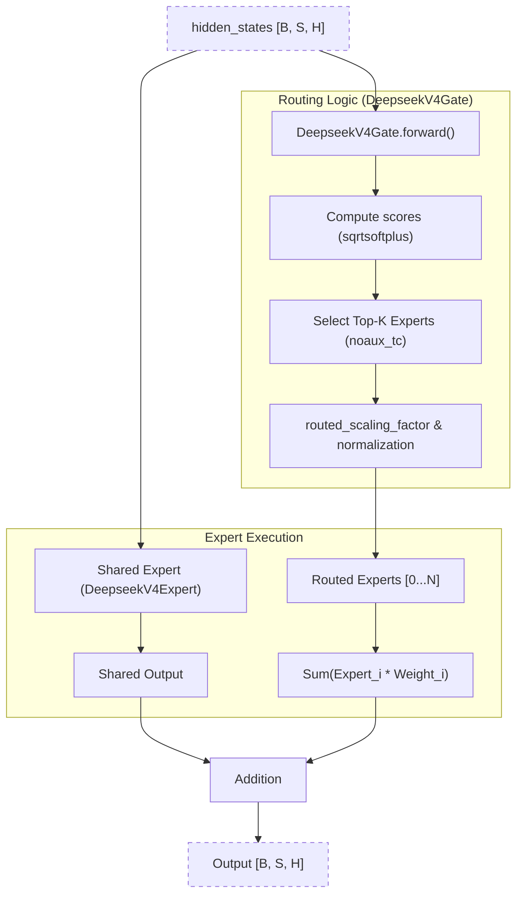
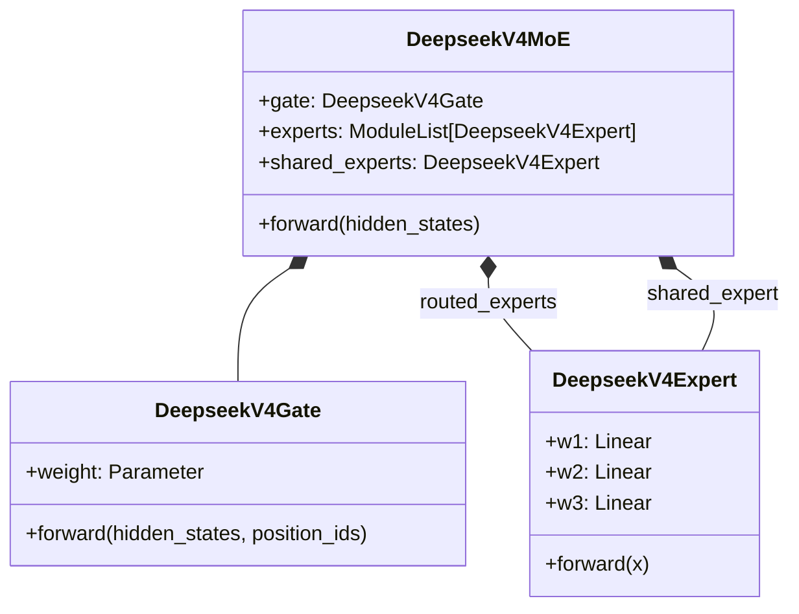

<!-- source: DeepWiki mcp.deepwiki.com · repo huggingface/nanowhale · page 2.4 Mixture-of-Experts (MoE) · fetched 2026-10-26 -->

# Mixture-of-Experts (MoE)

Relevant source files

The following files were used as context for generating this wiki page:

- [configuration_deepseek_v4.py](configuration_deepseek_v4.py)
- [modeling_deepseek_v4.py](modeling_deepseek_v4.py)

The Mixture-of-Experts (MoE) subsystem in `nanowhale` implements the sparse feed-forward network (FFN) architecture introduced in DeepSeek-V4. It replaces the standard dense FFN in specific layers with a combination of routed experts and a shared expert to maximize parameter efficiency and model capacity.

## Architecture Overview

The MoE layer consists of three primary components:
1.  **DeepseekV4Gate**: A routing mechanism that selects the top-k experts for each token.
2.  **DeepseekV4Expert**: Individual SwiGLU-based MLP experts.
3.  **Shared Expert**: A non-sparse MLP that processes every token to capture common knowledge.

### Data Flow Diagram

The following diagram illustrates the flow of a hidden state through the `DeepseekV4MoE` module.

**Sources:** [modeling_deepseek_v4.py:331-365](), [modeling_deepseek_v4.py:378-410]()

---

## DeepseekV4Gate: The Router

The `DeepseekV4Gate` class is responsible for mapping tokens to experts. It supports two routing strategies: hash-based routing for early layers and learned routing for deeper layers.

### Scoring and Selection
*   **Scoring Function**: Uses `sqrtsoftplus` to compute raw expert scores [configuration_deepseek_v4.py:35](), [modeling_deepseek_v4.py:302]().
*   **Top-K Selection**: Employs the `noaux_tc` method (No-Auxiliary-Loss Top-K) to select `num_experts_per_tok` experts [configuration_deepseek_v4.py:37]().
*   **Hash-based Routing**: For the first `num_hash_layers`, routing is determined by a fixed hash of the `position_ids` rather than learned weights. This stabilizes early-stage representation learning [configuration_deepseek_v4.py:38](), [modeling_deepseek_v4.py:312-316]().

### Normalization
If `norm_topk_prob` is enabled, the selected expert scores are normalized to sum to 1 [configuration_deepseek_v4.py:87](). The final output of the routed experts is scaled by `routed_scaling_factor` (default 1.5) to balance the contribution between routed and shared experts [configuration_deepseek_v4.py:89](), [modeling_deepseek_v4.py:355]().

**Sources:** [modeling_deepseek_v4.py:285-329](), [configuration_deepseek_v4.py:82-92]()

---

## DeepseekV4Expert: SwiGLU MLP

Each expert is a SwiGLU MLP. A key feature in `nanowhale` is the `swiglu_limit`, which clips the intermediate activation to prevent numerical instability in bfloat16 training.

### Expert Structure
The expert performs the following transformation:
1.  **Gate Projection**: `w1` (Linear)
2.  **Up Projection**: `w3` (Linear)
3.  **Activation**: `SiLU(w1(x)) * w3(x)`
4.  **Limiter**: `torch.clamp(act, max=swiglu_limit)`
5.  **Down Projection**: `w2` (Linear)

| Component | Code Entity | Purpose |
| :--- | :--- | :--- |
| Gate/Up Linear | `self.w1`, `self.w3` | Projection to `moe_intermediate_size` |
| Limit Hyperparameter | `config.swiglu_limit` | Prevents activation explosions (default 10.0) |
| Down Linear | `self.w2` | Projection back to `hidden_size` |

**Sources:** [modeling_deepseek_v4.py:255-283](), [configuration_deepseek_v4.py:92]()

---

## Implementation Details

### Shared Expert
The shared expert is an instance of `DeepseekV4Expert` but with a potentially different intermediate size (`moe_intermediate_size` * `n_shared_experts`). It processes every token regardless of the gate's output [modeling_deepseek_v4.py:343-346]().

### Training with DDP
Because MoE layers are sparse, some experts might not be used in a specific training batch. When using Distributed Data Parallel (DDP), this can lead to errors because gradients are not computed for all parameters. 

To handle this, the training scripts must be initialized with `ddp_find_unused_parameters=True` or the model must ensure all expert parameters receive a gradient (e.g., via auxiliary losses or dummy gradients), though `nanowhale` primarily relies on the `noaux_tc` method and standard DDP configurations.

### Code Entity Mapping

**Sources:** [modeling_deepseek_v4.py:255](), [modeling_deepseek_v4.py:285](), [modeling_deepseek_v4.py:331]()

### Key Configuration Parameters
The MoE behavior is governed by the following fields in `DeepseekV4Config`:

*   `n_routed_experts`: Total number of sparse experts [configuration_deepseek_v4.py:31]().
*   `num_experts_per_tok`: Number of experts active per token (Top-K) [configuration_deepseek_v4.py:33]().
*   `moe_intermediate_size`: The hidden dimension within each expert [configuration_deepseek_v4.py:30]().
*   `num_hash_layers`: Number of initial layers using hash-based routing [configuration_deepseek_v4.py:38]().

**Sources:** [configuration_deepseek_v4.py:29-39]()

---

