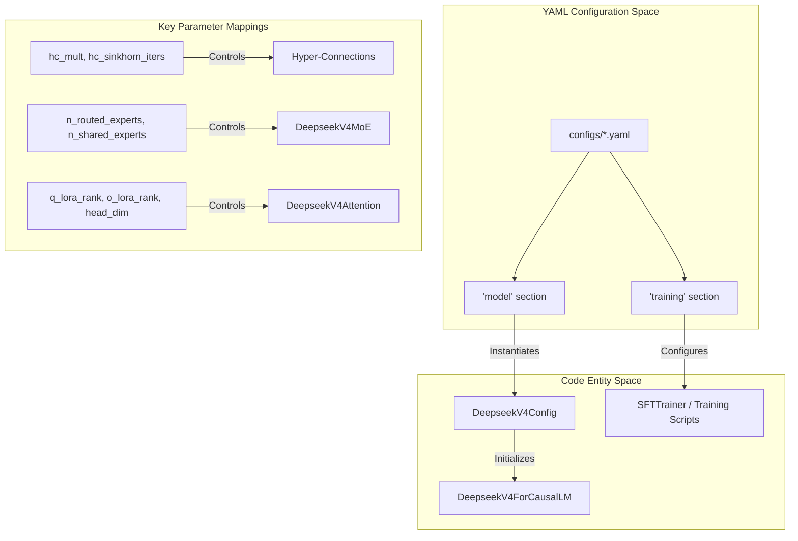
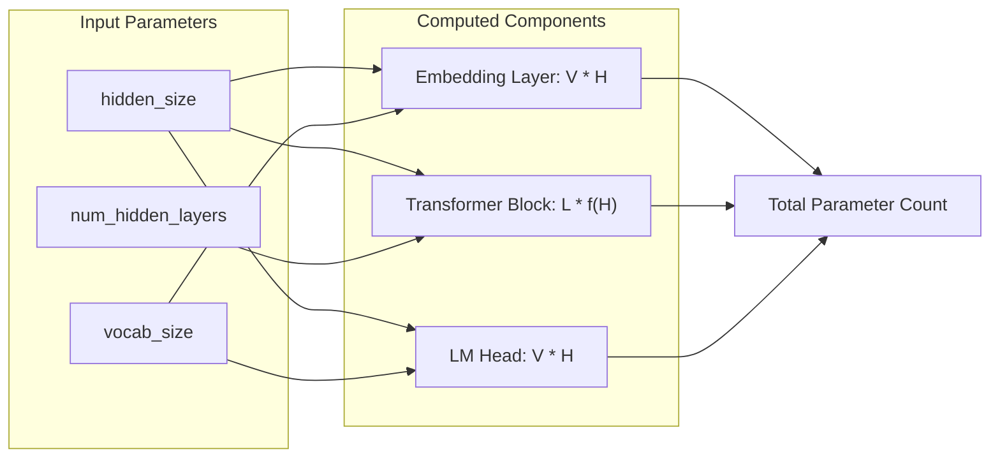

<!-- source: DeepWiki mcp.deepwiki.com · repo huggingface/nanowhale · page 3 Configuration Files · fetched 2026-10-26 -->

# Configuration Files

Relevant source files

The following files were used as context for generating this wiki page:

- [configs/debug.yaml](configs/debug.yaml)
- [configs/fallback_under_1b.yaml](configs/fallback_under_1b.yaml)
- [configs/main_100m.yaml](configs/main_100m.yaml)

The `configs/` directory serves as the central control plane for the nanowhale repository. It contains YAML files that define both the structural hyperparameters of the DeepSeek-V4 architecture and the training dynamics required to optimize them. These files bridge the gap between high-level model design and the actual instantiation of the `DeepseekV4Config` class used throughout the training pipeline.

### Configuration Hierarchy and Purpose

The repository provides three distinct configuration tiers designed for different stages of development, from rapid smoke-testing to production-grade pretraining. Each file is structured into two primary sections: `model` (architectural parameters) and `training` (optimization hyperparameters).

### Mapping Configuration to Code

The following diagram illustrates how the YAML configuration fields map to the internal components of the `DeepseekV4` model.

**Model Configuration Data Flow**

Sources: [configs/main_100m.yaml:21-52](), [configs/main_100m.yaml:54-69]()

### Model Scale Management

The `configs/` files allow for precise control over the parameter budget. A significant portion of the parameter count in nanowhale is dedicated to the embedding layer due to the large DeepSeek-V4 vocabulary.

| Configuration | Total Params | Hidden Size | Layers | Primary Use Case |
| :--- | :--- | :--- | :--- | :--- |
| `debug.yaml` | ~17M | 64 | 2 | CI/CD, smoke tests |
| `main_100m.yaml` | ~110M | 320 | 8 | Production pretraining/SFT |
| `fallback_under_1b.yaml` | ~995M | 896 | 16 | Scaling research |

The relationship between configuration parameters and the resulting model architecture is detailed in the diagram below.

**Architectural Scaling Logic**

Sources: [configs/main_100m.yaml:17-19](), [configs/debug.yaml:4-6](), [configs/fallback_under_1b.yaml:5-7]()

---

### Configuration Variants

#### [Main 100M Configuration (main_100m.yaml)](#3.1)
This is the primary production configuration used for the published checkpoints. It balances the innovations of DeepSeek-V4 (MLA, MoE, Hyper-Connections) within a ~110M parameter budget. It features a `hidden_size` of 320, 8 layers, and a 4+1 MoE structure.
For details, see [Main 100M Configuration (main_100m.yaml)](#3.1).

#### [Debug Configuration (debug.yaml)](#3.2)
A lightweight configuration designed for rapid iteration. With only ~17M parameters and a `hidden_size` of 64, it allows developers to verify that the `Hyper-Connections` and `MoE` logic function correctly without requiring significant GPU memory or time.
For details, see [Debug Configuration (debug.yaml)](#3.2).

#### [Fallback Under-1B Configuration (fallback_under_1b.yaml)](#3.3)
This configuration demonstrates how the nanowhale architecture scales toward the 1B parameter mark. It increases the `hidden_size` to 896 and the `num_hidden_layers` to 16, while also increasing the complexity of the Hyper-Connections via 10 Sinkhorn iterations.
For details, see [Fallback Under-1B Configuration (fallback_under_1b.yaml)](#3.3).

---
Sources:
- [configs/main_100m.yaml:1-70]()
- [configs/debug.yaml:1-38]()
- [configs/fallback_under_1b.yaml:1-53]()

---

