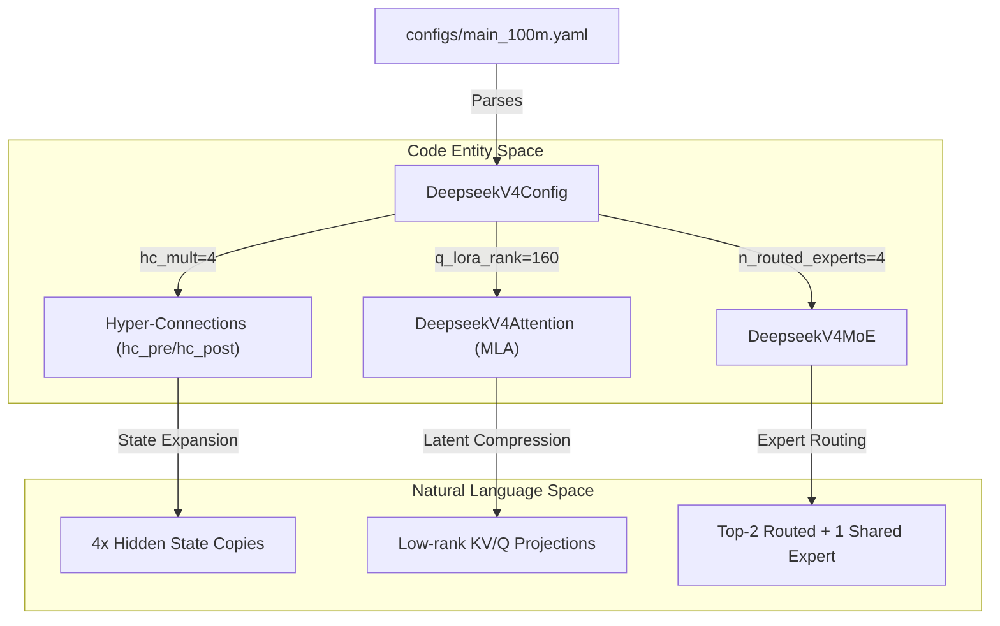
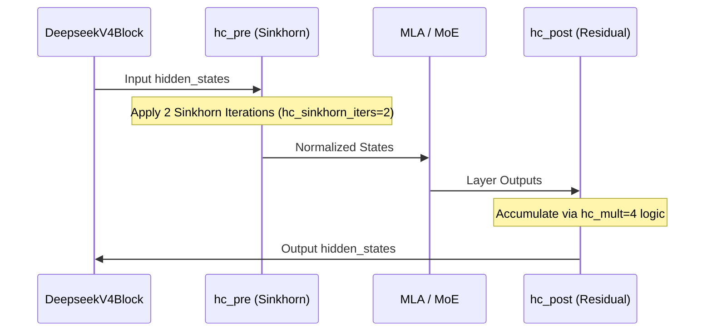

<!-- source: DeepWiki mcp.deepwiki.com · repo huggingface/nanowhale · page 3.1 Main 100M Configuration (main_100m.yaml) · fetched 2026-10-26 -->

# Main 100M Configuration (main_100m.yaml)

Relevant source files

The following files were used as context for generating this wiki page:

- [configs/main_100m.yaml](configs/main_100m.yaml)

The `main_100m.yaml` configuration defines the primary production-grade model for the nanowhale project. It specifies a ~110M parameter architecture that replicates the DeepSeek-V4 structural innovations—Multi-Head Latent Attention (MLA), Mixture-of-Experts (MoE), and Hyper-Connections—at a computationally accessible scale. This configuration is the basis for the published checkpoints and serves as the benchmark for balancing architectural complexity with training stability.

Sources: [configs/main_100m.yaml:1-20]()

## Architectural Specification

The model is designed with a `hidden_size` of 320 and 8 transformer layers. Despite the small hidden dimension, the architecture maintains high expressive power through the use of low-rank compression in both the attention and feed-forward mechanisms.

### Parameter Budget Breakdown
The total parameter count of ~110M is heavily influenced by the large vocabulary size (129,280 tokens) inherited from the DeepSeek-V4 tokenizer.

| Component | Parameter Count | Percentage |
| :--- | :--- | :--- |
| **Embeddings** | ~41M | ~37% |
| **Non-embedding** | ~69M | ~63% |
| **Total** | **~110M** | **100%** |

Sources: [configs/main_100m.yaml:5-19](), [configs/main_100m.yaml:22-24]()

### Multi-Head Latent Attention (MLA)
The attention mechanism uses a compressed latent space to reduce KV cache requirements while maintaining performance.
*   **Query Compression**: Uses `q_lora_rank: 160` to project queries into a lower-dimensional space before expanding to the head dimension.
*   **Head Geometry**: `head_dim` is set to 96, split into 32 dimensions for Rotary Positional Embeddings (RoPE) and 64 dimensions for non-positional (NoPE) features.
*   **Output Grouping**: To optimize the output projection, the model uses `o_groups: 2` with an `o_lora_rank: 80`.

Sources: [configs/main_100m.yaml:8-10](), [configs/main_100m.yaml:31-35]()

### Mixture-of-Experts (MoE)
The FFN layer is replaced by a MoE structure that utilizes both routed and shared experts.
*   **Expert Configuration**: 4 routed experts and 1 shared expert.
*   **Routing**: Employs `top-2` routing (`num_experts_per_tok: 2`) using the `sqrtsoftplus` scoring function.
*   **Scaling**: A `routed_scaling_factor: 1.5` is applied to the output of the routed experts.
*   **FFN Architecture**: Each expert is a SwiGLU MLP with an intermediate size of 640.

Sources: [configs/main_100m.yaml:11-12](), [configs/main_100m.yaml:27-30](), [configs/main_100m.yaml:41-42]()

## Hyper-Connections and Data Flow

The configuration implements Hyper-Connections, which involve maintaining multiple copies of the hidden state and normalizing them via Sinkhorn iterations. In this 100M setup, `hc_mult` is set to 4, meaning the model tracks four parallel streams of hidden states.

### Data Flow Diagram: Config to Implementation
This diagram illustrates how the `main_100m.yaml` parameters map to the `DeepseekV4Config` and subsequent model instantiation.

Sources: [configs/main_100m.yaml:31-37](), [modeling_deepseek_v4.py:1-50]()

### Hyper-Connection Life Cycle
The `hc_mult` parameter defines the width of the Hyper-Connection bus. The `hc_sinkhorn_iters` parameter controls the normalization intensity.

Sources: [configs/main_100m.yaml:36-37](), [modeling_deepseek_v4.py:840-880]()

## Training Hyperparameters

The configuration specifies a pretraining regime designed for the FineWeb-Edu dataset, targeting 2.6B tokens over 5000 steps.

### Training Schedule
| Parameter | Value |
| :--- | :--- |
| **Max Steps** | 5000 |
| **Learning Rate** | 6.0e-4 |
| **LR Scheduler** | Cosine |
| **Warmup Ratio** | 0.03 (150 steps) |
| **Batch Size** | 8 per device |
| **Grad Accumulation** | 4 |
| **Precision** | bf16 |

### Optimization Settings
The configuration enables `gradient_checkpointing` to manage the memory overhead of the Hyper-Connections and MoE layers. It uses the AdamW optimizer with `beta1: 0.9` and `beta2: 0.95`, and a `weight_decay` of 0.1 to prevent overfitting during the short pretraining window.

Sources: [configs/main_100m.yaml:54-70]()

---

