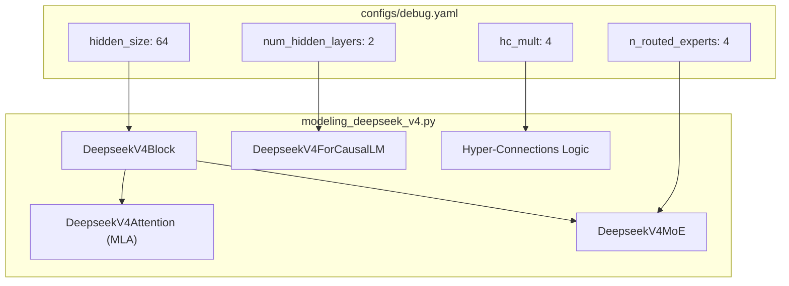

<!-- source: DeepWiki mcp.deepwiki.com · repo huggingface/nanowhale · page 3.2 Debug Configuration (debug.yaml) · fetched 2026-10-26 -->

# Debug Configuration (debug.yaml)

<details>
<summary>Relevant source files</summary>

The following files were used as context for generating this wiki page:

- [configs/debug.yaml](configs/debug.yaml)

</details>


The `debug.yaml` configuration serves as the primary smoke-test suite for the `nanowhale` repository. It defines a minimal version of the DeepSeek-V4 architecture designed to validate the entire training pipeline—from model instantiation to forward/backward passes—without requiring significant GPU memory or time [configs/debug.yaml:1-2]().

## Purpose and Scope

The debug configuration facilitates rapid iteration by providing a "lightweight" model that fits on consumer-grade hardware or even CPU-only environments for basic logic checks. It is specifically used to:
1.  **Verify Architectural Logic**: Ensures that the complex interactions between Multi-Head Latent Attention (MLA), Mixture-of-Experts (MoE), and Hyper-Connections (HC) are mathematically sound and do not trigger shape mismatches [configs/debug.yaml:3-28]().
2.  **Pipeline Validation**: Tests the `train_pretrain.py` and `train_sft.py` scripts, including data loading and gradient accumulation, over a short 50-step window [configs/debug.yaml:30-38]().
3.  **Parameter Efficiency**: Demonstrates the impact of the large DeepSeek-V4 vocabulary on small-scale models. Despite having only 2 layers and a hidden size of 64, the model reaches ~17M parameters, largely due to the 129,280-token embedding matrix [configs/debug.yaml:4-6]().

## Model Architecture Specifications

The debug model scales down every major component of the DeepSeek-V4 architecture while maintaining the structural integrity of the "Hyper-Connections" and "MLA" subsystems.

| Feature | Debug Value | Description |
| :--- | :--- | :--- |
| `hidden_size` | 64 | Base dimensionality for all layers [configs/debug.yaml:5](). |
| `num_hidden_layers` | 2 | Minimal depth to test inter-layer Hyper-Connections [configs/debug.yaml:6](). |
| `hc_mult` | 4 | Multiplier for Hyper-Connection hidden state expansion [configs/debug.yaml:18](). |
| `n_routed_experts` | 4 | Number of experts available for routing in MoE layers [configs/debug.yaml:10](). |
| `num_experts_per_tok`| 2 | Top-k routing for the MoE gate [configs/debug.yaml:12](). |
| `q_lora_rank` | 32 | Low-rank projection dimension for MLA [configs/debug.yaml:13](). |

### Data Flow and Component Association

The following diagram illustrates how the `debug.yaml` parameters map to the core classes within the modeling implementation.

**Debug Config to Code Entity Mapping**

Sources: [configs/debug.yaml:3-21](), [modeling_deepseek_v4.py:1255-1270]()

## Training Hyperparameters

The `training` block in `debug.yaml` is optimized for execution speed rather than convergence. It uses a very small sequence length and batch size to ensure the model can be tested on devices with limited VRAM.

*   **Sequence Length**: Limited to 256 tokens to minimize the KV cache and attention matrix size [configs/debug.yaml:31]().
*   **Steps**: Fixed at 50 steps with a 5-step warmup, providing just enough telemetry to observe loss decrease and learning rate scheduling [configs/debug.yaml:35-36]().
*   **Precision**: `bf16: true` is enabled by default to verify compatibility with BFloat16 hardware, though the small scale of the debug model makes it less susceptible to the NaN issues seen in the 100M variant [configs/debug.yaml:37]().

### Execution Flow in Smoke Test

The debug configuration is typically invoked via the `--debug` flag in training scripts or by passing the file path directly.

**Smoke Test Training Loop**
```mermaid
sequenceDiagram
    participant CLI as train_pretrain.py
    participant YAML as debug.yaml
    participant CFG as DeepseekV4Config
    participant MDL as DeepseekV4ForCausalLM
    participant OPT as Optimizer (AdamW)

    CLI->>YAML: Load configuration
    YAML->>CFG: Initialize hyperparameters
    CFG->>MDL: Instantiate ~17M param model
    loop 50 Steps
        CLI->>MDL: Forward Pass (max_seq_len=256)
        MDL->>CLI: Calculate Cross-Entropy Loss
        CLI->>OPT: Backward Pass & Step
    end
    CLI->>CLI: Save debug checkpoint
```
Sources: [configs/debug.yaml:30-38](), [train_pretrain.py:180-210]()

## Key Implementation Details

### Parameter Breakdown
Despite its "debug" status, the model is not trivial. The `vocab_size` of 129,280 [configs/debug.yaml:4]() means the embedding layer alone accounts for:
$129,280 \times 64 \approx 8.27 \text{ million parameters}$
This represents nearly 50% of the total model size, a characteristic inherited from the full DeepSeek-V4 architecture where the tokenizer is optimized for multilingual performance rather than parameter count at small scales.

### Hyper-Connections (HC)
The debug config sets `hc_sinkhorn_iters: 5` [configs/debug.yaml:19](). This ensures that the Sinkhorn normalization logic in `DeepseekV4Block` is executed multiple times per pass, allowing developers to catch any iterative computation errors or vanishing gradients early in the development cycle.

Sources: [configs/debug.yaml:1-38](), [modeling_deepseek_v4.py:1080-1110]()

---

