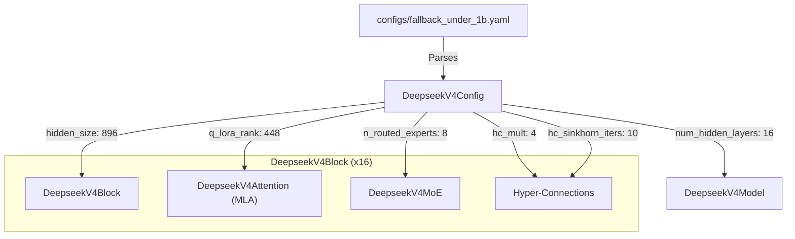
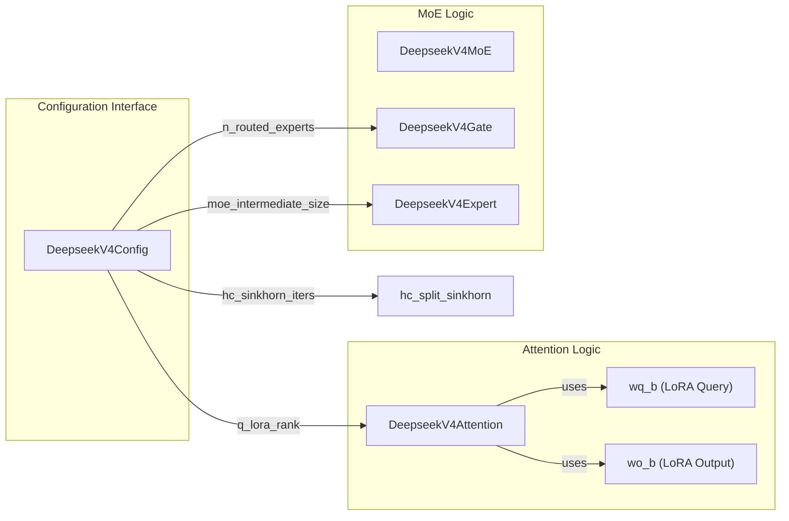

<!-- source: DeepWiki mcp.deepwiki.com · repo huggingface/nanowhale · page 3.3 Fallback Under-1B Configuration (fallback_under_1b.yaml) · fetched 2026-10-26 -->

# Fallback Under-1B Configuration (fallback_under_1b.yaml)

Relevant source files

The following files were used as context for generating this wiki page:

- [configs/fallback_under_1b.yaml](configs/fallback_under_1b.yaml)

The `fallback_under_1b.yaml` configuration defines the upper bound of the `nanowhale` architecture's scaling within the constraints of a 1-billion parameter budget. While the primary research focus of the repository is the 110M parameter model, this configuration serves as a "fallback" or "large-scale" variant, reaching approximately **995M parameters** [configs/fallback_under_1b.yaml:1-2](). It doubles the layer count and significantly increases the hidden dimension and MoE capacity compared to the main 100M configuration.

## Architectural Scaling Strategy

To scale from 110M to ~995M parameters while maintaining the DeepSeek-V4 architectural innovations (MLA, MoE, and Hyper-Connections), this configuration adjusts several key dimensions:

*   **Width and Depth**: The `hidden_size` is increased to 896 (up from 320 in the 100M model) and the `num_hidden_layers` is doubled to 16 [configs/fallback_under_1b.yaml:6-7]().
*   **MoE Expansion**: The number of routed experts is increased to 8, supported by a `moe_intermediate_size` of 1792 [configs/fallback_under_1b.yaml:10-11]().
*   **Hyper-Connection Stability**: To handle the increased depth and width, the `hc_sinkhorn_iters` is increased to 10 (from 2 in the 100M model) to ensure better convergence of the Sinkhorn normalization during the state contraction phase [configs/fallback_under_1b.yaml:20]().

### Configuration Parameters Summary

| Category | Parameter | Value |
| :--- | :--- | :--- |
| **Global** | `hidden_size` | 896 |
| | `num_hidden_layers` | 16 |
| | `vocab_size` | 129,280 |
| **MLA** | `q_lora_rank` | 448 |
| | `head_dim` | 256 |
| | `o_groups` | 4 |
| **MoE** | `n_routed_experts` | 8 |
| | `n_shared_experts` | 1 |
| | `num_experts_per_tok` | 2 |
| **Hyper-Connections**| `hc_mult` | 4 |
| | `hc_sinkhorn_iters` | 10 |

**Sources:** [configs/fallback_under_1b.yaml:5-20]()

## Data Flow and Component Interaction

The following diagram illustrates how the `fallback_under_1b.yaml` parameters drive the instantiation of the `DeepseekV4Model` and its constituent blocks.

### Logic Flow: Config to Model Instantiation
This diagram bridges the YAML configuration space to the `DeepseekV4` class hierarchy.

**Sources:** [configs/fallback_under_1b.yaml:6-20](), [modeling_deepseek_v4.py:1124-1140]()

## Scaling the MoE and MLA Subsystems

### Mixture-of-Experts (MoE) Scaling
In the fallback configuration, the MoE subsystem is scaled to provide higher capacity without a linear increase in per-token compute. 
*   **Routing**: It utilizes the `noaux_tc` (No-Auxiliary-Loss Top-K) method [configs/fallback_under_1b.yaml:26]() with a `routed_scaling_factor` of 1.5 [configs/fallback_under_1b.yaml:25]().
*   **Expert Count**: With 8 routed experts and 1 shared expert, the model maintains the "sparse" efficiency of DeepSeek-V4 while providing enough parameters to capture more complex patterns than the 100M variant.

### Multi-Head Latent Attention (MLA) Scaling
The MLA implementation (referred to as Compressed Sparse Attention or CSA in the codebase) uses a high compression ratio to manage the KV cache.
*   **Rank Projections**: The `q_lora_rank` is set to 448, exactly half of the `hidden_size`, maintaining a balanced bottleneck for query compression [configs/fallback_under_1b.yaml:14]().
*   **Output Grouping**: The `o_groups` parameter is set to 4, which controls the grouped linear projection in the `DeepseekV4Attention` output phase [configs/fallback_under_1b.yaml:17]().

### Hyper-Connection Complexity
The Hyper-Connection mechanism in this configuration is significantly more robust. By increasing `hc_sinkhorn_iters` to 10, the model ensures that the `hc_split_sinkhorn` function [modeling_deepseek_v4.py:166-215]() reaches a more stable doubly-stochastic matrix, which is critical for maintaining gradient flow in a 16-layer architecture with an `hc_mult` of 4 [configs/fallback_under_1b.yaml:19-20]().

### System Component Mapping
This diagram maps the YAML settings to the specific classes and methods that process them within `modeling_deepseek_v4.py`.

**Sources:** [configs/fallback_under_1b.yaml:10-20](), [modeling_deepseek_v4.py:461-480](), [modeling_deepseek_v4.py:848-860]()

## Training Hyperparameters

The training regime for the Under-1B model is extended compared to the 100M model to account for the larger parameter count:

*   **Steps**: Increased to 10,000 steps [configs/fallback_under_1b.yaml:49]().
*   **Batch Size**: `per_device_train_batch_size` of 4 with `gradient_accumulation_steps` of 8, resulting in an effective batch size of 32 per GPU [configs/fallback_under_1b.yaml:39-40]().
*   **Precision**: `bf16: true` is utilized [configs/fallback_under_1b.yaml:48]().
*   **Optimization**: A learning rate of 3.0e-4 with a cosine scheduler and a 3% warmup ratio [configs/fallback_under_1b.yaml:41-47]().
*   **Memory Management**: `gradient_checkpointing` is enabled by default to fit the 16-layer, 896-hidden-size model into standard GPU memory (e.g., A100/H100) during training [configs/fallback_under_1b.yaml:52]().

**Sources:** [configs/fallback_under_1b.yaml:37-53]()

---

