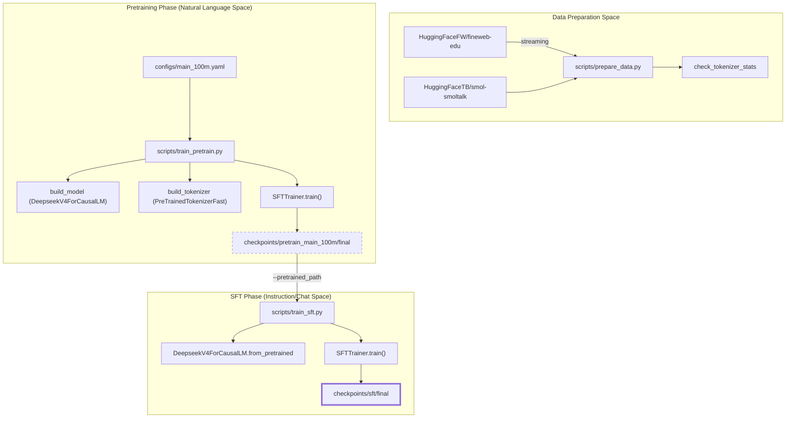

<!-- source: DeepWiki mcp.deepwiki.com · repo huggingface/nanowhale · page 4 Training Pipeline · fetched 2026-10-26 -->

# Training Pipeline

<details>
<summary>Relevant source files</summary>

The following files were used as context for generating this wiki page:

- [scripts/prepare_data.py](scripts/prepare_data.py)
- [scripts/train_pretrain.py](scripts/train_pretrain.py)
- [scripts/train_sft.py](scripts/train_sft.py)

</details>


The training pipeline for `nanowhale` is designed to take a model from random initialization through large-scale pretraining on educational web data, followed by supervised fine-tuning (SFT) for conversational alignment. The process utilizes the `trl` library's `SFTTrainer` for both stages, leveraging efficient data packing and hardware optimizations.

### Training Lifecycle Overview

The following diagram illustrates the flow of data and model state through the training ecosystem.

**Training Workflow and Code Entity Map**

Sources: [scripts/prepare_data.py:1-62](), [scripts/train_pretrain.py:1-183](), [scripts/train_sft.py:1-133]()

---

### 4.1 Data Preparation
Before initiating a training run, the `scripts/prepare_data.py` utility is used to inspect the datasets and verify tokenizer efficiency. This stage ensures that the `FineWeb-Edu` dataset (used for pretraining) and the `SmolTalk` dataset (used for SFT) are correctly formatted and that the tokenizer's compression ratio is optimal for the target parameters.

Key utilities include:
*   `preview_fineweb_edu`: Inspects educational scores and token counts for pretraining samples [scripts/prepare_data.py:11-23]().
*   `preview_smoltalk`: Visualizes conversation turns (role/content) for instruction tuning [scripts/prepare_data.py:25-36]().
*   `check_tokenizer_stats`: Calculates average characters per token to ensure the 129,280-sized vocabulary is performing efficiently [scripts/prepare_data.py:38-57]().

For details, see [Data Preparation](#4.1).

---

### 4.2 Pretraining
Pretraining is handled by `scripts/train_pretrain.py`. It initializes a `DeepseekV4ForCausalLM` from scratch using a YAML configuration [scripts/train_pretrain.py:33-40](). The script uses `SFTTrainer` with `packing=True` to maximize throughput on the `FineWeb-Edu` stream [scripts/train_pretrain.py:104-105]().

**Pretraining Execution Flow**
```mermaid
sequenceDiagram
    participant CLI as "train_pretrain.py"
    participant CFG as "DeepseekV4Config"
    participant MDL as "DeepseekV4ForCausalLM"
    participant OPT as "torch.compile"
    participant TRN as "SFTTrainer"

    CLI->>CFG: Initialize with YAML model_cfg
    CFG->>MDL: Instantiate random weights
    CLI->>OPT: Wrap model for 1.77x speedup
    CLI->>TRN: Configure adamw_torch_fused & packing
    TRN->>MDL: 5000 Steps / 2.6B Tokens
    MDL->>CLI: save_model("final")
```
Sources: [scripts/train_pretrain.py:63-70](), [scripts/train_pretrain.py:101-138](), [scripts/train_pretrain.py:174-179]()

For details, see [Pretraining (train_pretrain.py)](#4.2).

---

### 4.3 Supervised Fine-Tuning (SFT)
The SFT phase, implemented in `scripts/train_sft.py`, transforms the pretrained base model into a chat-aligned assistant using the `SmolTalk` dataset [scripts/train_sft.py:51-54](). 

Key technical aspects include:
*   **Weight Loading**: Uses `from_pretrained` to load the pretraining checkpoint [scripts/train_sft.py:42]().
*   **Precision Handling**: While pretraining often uses `bf16`, SFT may require `fp32` fallback if Hyper-Connection Sinkhorn iterations produce NaNs [scripts/train_sft.py:71]().
*   **Optimization**: Employs a cosine learning rate scheduler with a 5% warmup over 3000 steps [scripts/train_sft.py:68-70]().

For details, see [Supervised Fine-Tuning (train_sft.py)](#4.3).

---

### Training Configuration Summary

| Feature | Pretraining (`train_pretrain.py`) | SFT (`train_sft.py`) |
| :--- | :--- | :--- |
| **Dataset** | `HuggingFaceFW/fineweb-edu` | `HuggingFaceTB/smol-smoltalk` |
| **Trainer** | `SFTTrainer` (packing=True) | `SFTTrainer` |
| **Optimizer** | `adamw_torch_fused` | `adamw_torch_fused` |
| **Max Steps** | 5000 (standard) | 3000 |
| **DDP Config** | `ddp_find_unused_parameters=True` | `ddp_find_unused_parameters=True` |

Sources: [scripts/train_pretrain.py:101-138](), [scripts/train_sft.py:57-91]()

---

