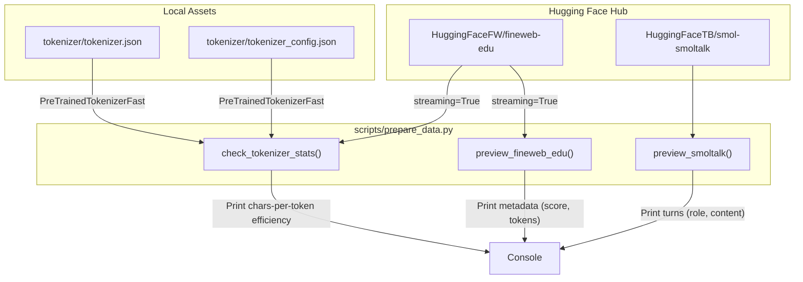
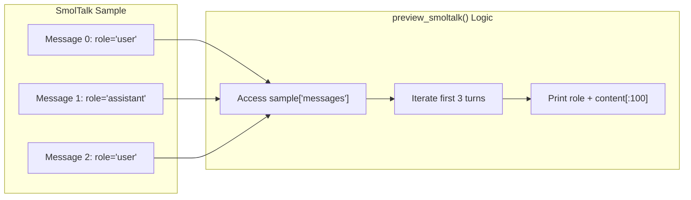

<!-- source: DeepWiki mcp.deepwiki.com · repo huggingface/nanowhale · page 4.1 Data Preparation · fetched 2026-10-26 -->

# Data Preparation

Relevant source files

The following files were used as context for generating this wiki page:

- [scripts/prepare_data.py](scripts/prepare_data.py)
- [tokenizer/tokenizer.json](tokenizer/tokenizer.json)
- [tokenizer/tokenizer_config.json](tokenizer/tokenizer_config.json)

This page documents the data preparation utilities found in `scripts/prepare_data.py`. These tools are used to validate and preview the datasets (FineWeb-Edu and SmolTalk) and the tokenizer before initiating pretraining or supervised fine-tuning (SFT) runs.

## Overview of Data Preparation

The `nanowhale` pipeline relies on two primary datasets:
1.  **FineWeb-Edu**: Used for pretraining. It contains high-quality educational web content with associated quality scores and token counts.
2.  **SmolTalk**: Used for Supervised Fine-Tuning (SFT). It contains multi-turn conversations with specific roles (user/assistant).

The `scripts/prepare_data.py` script provides diagnostic functions to ensure data integrity and measure the efficiency of the `DeepSeek-V4` tokenizer on these specific distributions [scripts/prepare_data.py:1-62]().

### Data Flow Diagram

The following diagram illustrates how the preparation script interacts with the Hugging Face Hub and local tokenizer artifacts to provide previews and statistics.

**Data Preview and Stats Flow**

Sources: [scripts/prepare_data.py:11-57](), [tokenizer/tokenizer.json:1-255](), [tokenizer/tokenizer_config.json:1-8]()

---

## Pretraining Data: FineWeb-Edu

The function `preview_fineweb_edu` loads the `HuggingFaceFW/fineweb-edu` dataset in streaming mode to minimize memory overhead [scripts/prepare_data.py:14](). It specifically extracts metadata fields that are useful for filtering or quality assessment during the actual pretraining phase.

| Field | Description | Code Reference |
| :--- | :--- | :--- |
| `score` | Educational quality score (provided by FineWeb-Edu) | [scripts/prepare_data.py:20]() |
| `token_count` | Pre-calculated token count for the sample | [scripts/prepare_data.py:21]() |
| `text` | The raw text content of the sample | [scripts/prepare_data.py:18]() |

Sources: [scripts/prepare_data.py:11-23]()

---

## SFT Data: SmolTalk

The `preview_smoltalk` function inspects the structure of the `HuggingFaceTB/smol-smoltalk` dataset [scripts/prepare_data.py:28](). This dataset is organized into multi-turn conversations, which is critical for verifying that the `apply_chat_template` logic in later stages will correctly handle the roles.

**Conversation Structure Inspection**

Sources: [scripts/prepare_data.py:25-36]()

---

## Tokenizer Efficiency Analysis

Before committing to a training run, `check_tokenizer_stats` is used to calculate the "chars-per-token" metric [scripts/prepare_data.py:38-57](). This is a key performance indicator for the tokenizer, as it determines how much information is packed into the model's fixed context window.

### Implementation Details
1.  **Tokenizer Loading**: Loads a `PreTrainedTokenizerFast` from the local `tokenizer/` directory [scripts/prepare_data.py:40]().
2.  **Sampling**: Iterates through the first 100 samples of FineWeb-Edu [scripts/prepare_data.py:48]().
3.  **Metrics Calculation**:
    *   `total_tokens`: Cumulative length of `tok.encode(text)` [scripts/prepare_data.py:51-52]().
    *   `total_chars`: Cumulative length of raw strings [scripts/prepare_data.py:53]().
    *   **Efficiency**: `total_chars / total_tokens` [scripts/prepare_data.py:56]().

### Tokenizer Artifacts
The script utilizes the `DeepSeek-V4` tokenizer configuration, which features a large vocabulary of 129,280 tokens [scripts/prepare_data.py:42]().

*   **BOS Token**: `<｜begin▁of▁sentence｜>` (ID: 0) [tokenizer/tokenizer.json:8]()
*   **EOS Token**: `<｜end▁of▁sentence｜>` (ID: 1) [tokenizer/tokenizer.json:17]()
*   **Pad Token**: Mapped to the EOS token in the configuration [tokenizer/tokenizer_config.json:6]().

Sources: [scripts/prepare_data.py:38-57](), [tokenizer/tokenizer.json:1-32](), [tokenizer/tokenizer_config.json:1-8]()

---

