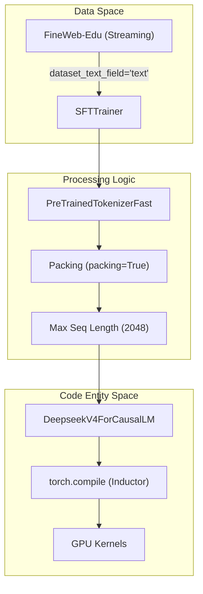
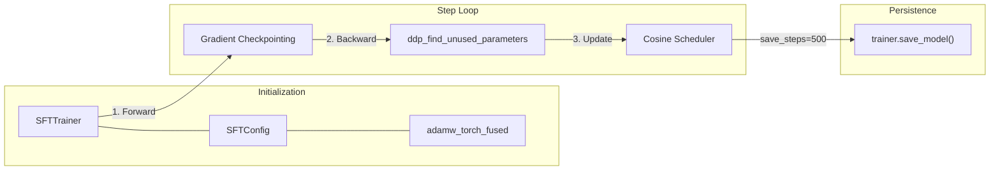

<!-- source: DeepWiki mcp.deepwiki.com · repo huggingface/nanowhale · page 4.2 Pretraining (train_pretrain.py) · fetched 2026-10-26 -->

# Pretraining (train_pretrain.py)

Relevant source files

The following files were used as context for generating this wiki page:

- [configs/main_100m.yaml](configs/main_100m.yaml)
- [scripts/train_pretrain.py](scripts/train_pretrain.py)

The `scripts/train_pretrain.py` script facilitates the from-scratch pretraining of the nanowhale architecture. It leverages the Hugging Face `TRL` library's `SFTTrainer` in a specialized configuration to handle raw text streaming and token packing, optimized for high-throughput training on the FineWeb-Edu dataset.

### Execution and CLI Arguments

The script supports both single-GPU execution and multi-GPU distributed training via `accelerate` [scripts/train_pretrain.py:4-6]().

| Argument | Type | Description |
| :--- | :--- | :--- |
| `--config` | `str` | Path to the YAML configuration file (e.g., `configs/main_100m.yaml`) [scripts/train_pretrain.py:52](). |
| `--debug` | `flag` | Enables smoke-testing with a tiny subset (200 rows) of the dataset and reduced steps [scripts/train_pretrain.py:53, 76-86](). |
| `--output_dir` | `str` | Directory for checkpoints; defaults to `checkpoints/pretrain_<config_name>` [scripts/train_pretrain.py:54, 72](). |
| `--resume_from_checkpoint` | `str` | Path to a previous checkpoint to continue training [scripts/train_pretrain.py:56, 174](). |

**Sources:** [scripts/train_pretrain.py:51-57](), [scripts/train_pretrain.py:72-87]()

---

### Model and Tokenizer Initialization

The script registers the custom `DeepseekV4Config` and `DeepseekV4ForCausalLM` classes with the Hugging Face `Auto` classes to ensure compatibility with the `SFTTrainer` [scripts/train_pretrain.py:24-25]().

#### `build_model(model_cfg)`
This helper instantiates the model with random weights based on the provided YAML configuration [scripts/train_pretrain.py:33-39](). It utilizes `torch.set_float32_matmul_precision('high')` to optimize performance on Ampere and newer GPUs [scripts/train_pretrain.py:64]().

#### `build_tokenizer(tokenizer_path)`
Loads the `PreTrainedTokenizerFast` from the local `tokenizer/` directory [scripts/train_pretrain.py:42-44](). Crucially, it sets the `pad_token` to the `eos_token` if not already defined, ensuring compatibility with batching and packing logic [scripts/train_pretrain.py:45-47]().

**Sources:** [scripts/train_pretrain.py:24-48](), [scripts/train_pretrain.py:64-69]()

---

### Training Implementation and Data Flow

The pretraining pipeline uses `HuggingFaceFW/fineweb-edu` in streaming mode to handle the large dataset volume without local storage overhead [scripts/train_pretrain.py:89-93]().

#### Pretraining Data Pipeline
The diagram below illustrates how raw text from FineWeb-Edu is transformed into packed sequences for the model.

**Data Transformation to Model Input**

**Sources:** [scripts/train_pretrain.py:89-93](), [scripts/train_pretrain.py:104-105](), [scripts/train_pretrain.py:153-158](), [scripts/train_pretrain.py:67]()

---

### Optimizations and Performance

The script incorporates several critical optimizations to achieve efficient throughput:

1.  **torch.compile**: The model is wrapped in `torch.compile(model)` if CUDA is available [scripts/train_pretrain.py:67](). This provides a significant speedup (reported at ~1.77x) by fusing kernels and reducing CPU overhead.
2.  **Fused AdamW**: The optimizer is set to `adamw_torch_fused` via `SFTConfig` [scripts/train_pretrain.py:132]().
3.  **Gradient Checkpointing**: Enabled by default (`gradient_checkpointing=True`) with `use_reentrant=False` to save VRAM at the cost of re-computing activations during the backward pass [scripts/train_pretrain.py:118-119]().
4.  **DDP Handling**: Since the MoE architecture contains experts that may not be active for all tokens in a batch, `ddp_find_unused_parameters` is set to `True` to prevent the training loop from hanging during gradient synchronization [scripts/train_pretrain.py:137]().

**Sources:** [scripts/train_pretrain.py:66-68](), [scripts/train_pretrain.py:118-119](), [scripts/train_pretrain.py:132](), [scripts/train_pretrain.py:137]()

---

### Training Configuration (100M Run)

The primary pretraining run targets 5,000 steps, which equates to approximately 2.6 billion tokens given the batch size and sequence length settings in `configs/main_100m.yaml`.

| Parameter | Value | Source |
| :--- | :--- | :--- |
| **Max Steps** | 5000 | [configs/main_100m.yaml:66]() |
| **Max Sequence Length** | 2048 | [configs/main_100m.yaml:55]() |
| **Global Batch Size** | 32 (8 batch * 4 accum) | [configs/main_100m.yaml:56-57]() |
| **Learning Rate** | 6.0e-4 (Cosine) | [configs/main_100m.yaml:58, 63]() |
| **Precision** | bfloat16 | [configs/main_100m.yaml:65]() |
| **Warmup Ratio** | 0.03 | [configs/main_100m.yaml:64]() |

#### Training Lifecycle
The following diagram maps the `SFTTrainer` lifecycle to the specific configuration parameters used in the pretraining script.

**Trainer Lifecycle and Config Mapping**

**Sources:** [scripts/train_pretrain.py:101-138](), [scripts/train_pretrain.py:174-177](), [configs/main_100m.yaml:54-70]()

---

