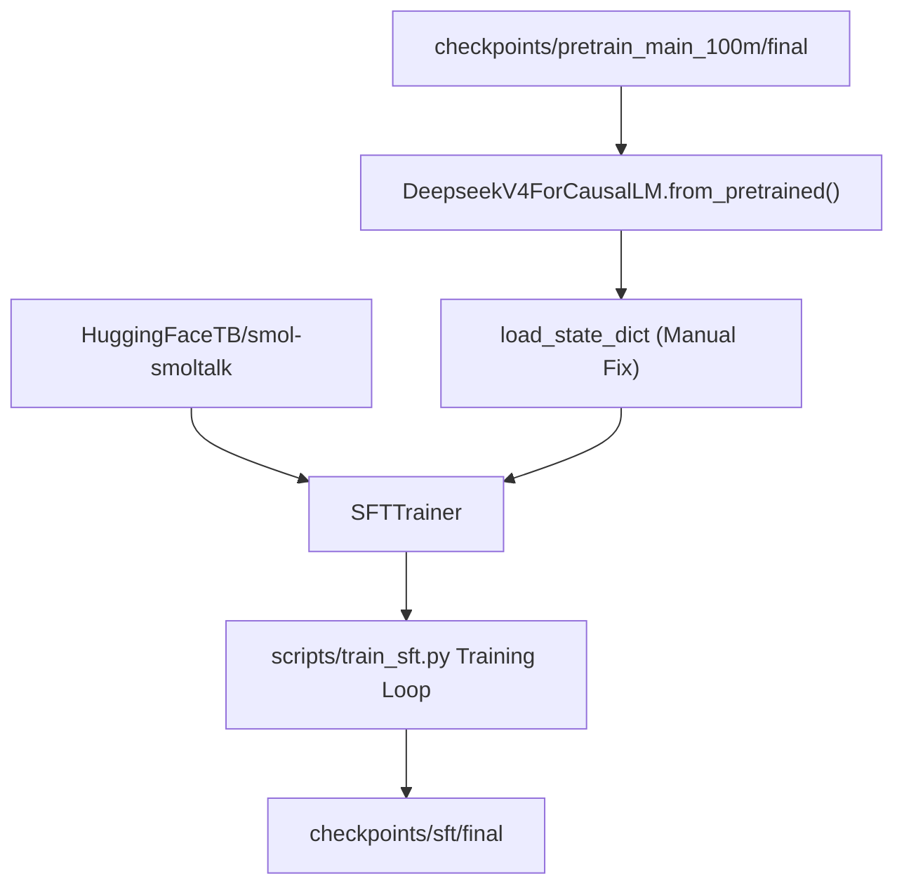
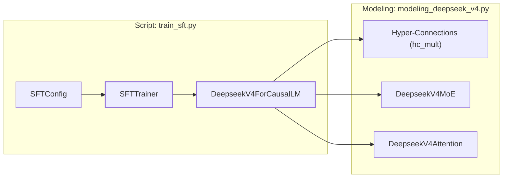

<!-- source: DeepWiki mcp.deepwiki.com · repo huggingface/nanowhale · page 4.3 Supervised Fine-Tuning (train_sft.py) · fetched 2026-10-26 -->

# Supervised Fine-Tuning (train_sft.py)

Relevant source files

The following files were used as context for generating this wiki page:

- [SUMMARY.md](SUMMARY.md)
- [scripts/train_sft.py](scripts/train_sft.py)

The Supervised Fine-Tuning (SFT) phase aligns the pretrained `DeepseekV4ForCausalLM` model with conversational capabilities using the `HuggingFaceTB/smol-smoltalk` dataset [scripts/train_sft.py:53-53](). This stage transforms the base model, which predicts the next token in general text, into a chat-aligned assistant capable of following instructions and maintaining dialogue structure [SUMMARY.md:27-27]().

## Overview of the SFT Script

The `scripts/train_sft.py` script utilizes the `trl.SFTTrainer` to perform instruction tuning [scripts/train_sft.py:106-111](). It requires a path to a pretrained model checkpoint and outputs a chat-ready model.

### Key CLI Arguments
The script supports several arguments to control the fine-tuning process:
*   `--pretrained_path`: Required path to the base model checkpoint [scripts/train_sft.py:29-30]().
*   `--max_steps`: Total training steps (default: 3000) [scripts/train_sft.py:33-33]().
*   `--lr`: Learning rate (default: 2e-5) [scripts/train_sft.py:36-36]().
*   `--batch_size`: Per-device training batch size (default: 4) [scripts/train_sft.py:34-34]().

**Sources:** [scripts/train_sft.py:27-38](), [SUMMARY.md:108-116]()

## Data Flow and Implementation

The SFT process involves loading the pretrained weights, processing the SmolTalk dataset, and executing a training loop with specific optimizations for the MoE architecture.

### Logic Flow: Pretrain to SFT
The following diagram illustrates the transition from the pretrained checkpoint to the fine-tuned model.

**Pretraining to SFT Transition**

**Sources:** [scripts/train_sft.py:41-42](), [scripts/train_sft.py:53-53](), [SUMMARY.md:21-25]()

### Implementation Details
*   **Model Registration**: The script registers `DeepseekV4Config` and `DeepseekV4ForCausalLM` with the Hugging Face `Auto` classes to allow seamless loading via `AutoModelForCausalLM` [scripts/train_sft.py:23-24]().
*   **The load_state_dict Workaround**: A critical discovery during development was that `from_pretrained` occasionally re-initializes weights due to custom architecture quirks [SUMMARY.md:25-25](). For reliable deployment, manual `load_state_dict` is recommended [SUMMARY.md:128-128]().
*   **FP32 Fallback**: While pretraining utilized `bf16`, the SFT run encountered `NaN` issues. This was attributed to the Hyper-Connections architecture at a small scale producing values that overflowed the `bf16` range, necessitating a fallback to `fp32` for stability [SUMMARY.md:25-25](), [SUMMARY.md:129-129]().

**Sources:** [scripts/train_sft.py:22-25](), [SUMMARY.md:21-25](), [SUMMARY.md:128-130]()

## Training Configuration

The `SFTConfig` is tuned for conservative alignment rather than aggressive learning [scripts/train_sft.py:60-60]().

| Parameter | Value | Description |
| :--- | :--- | :--- |
| `learning_rate` | `2e-5` | Conservative rate for instruction alignment [scripts/train_sft.py:63-63]() |
| `lr_scheduler_type` | `cosine` | Smooth decay over 3000 steps [scripts/train_sft.py:68-68]() |
| `warmup_ratio` | `0.05` | 5% warmup (150 steps) [scripts/train_sft.py:69-69]() |
| `optim` | `adamw_torch_fused` | Performance-optimized AdamW [scripts/train_sft.py:86-86]() |
| `ddp_find_unused_parameters` | `True` | Required because MoE has inactive experts per-pass [scripts/train_sft.py:90-90]() |

**Sources:** [scripts/train_sft.py:57-91]()

## Code Entity Space: Training Components

The following diagram maps the training script's logic to the specific classes and variables defined in the codebase.

**SFT Component Mapping**

**Sources:** [scripts/train_sft.py:106-111](), [modeling_deepseek_v4.py:1016-1030](), [modeling_deepseek_v4.py:1120-1135]()

## Results and Metrics

The 3000-step run on SmolTalk resulted in a model that understands conversational structure (lists, paragraphs, and explanations), though it remains limited by its 110M parameter scale [SUMMARY.md:27-27]().

### SFT Performance (3,000 Steps)
| Metric | Start | End |
| :--- | :--- | :--- |
| **Train Loss** | 15.41 | 10.22 |
| **Eval Loss** | 2.873 | 2.607 |
| **Token Accuracy** | 36.2% | 48.5% |
| **English Perplexity** | 13.62 | 12.90 |

The evaluation loss converged steadily (2.873 → 2.607) without signs of overfitting [SUMMARY.md:112-117]().

**Sources:** [SUMMARY.md:108-125]()

---

