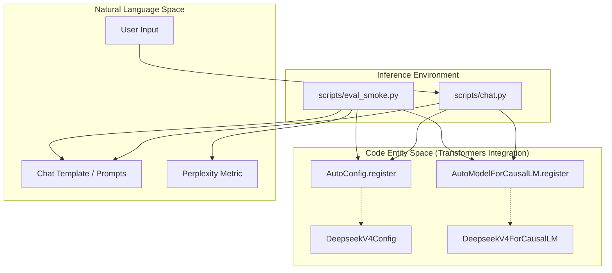
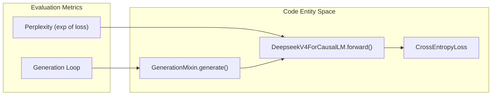

<!-- source: DeepWiki mcp.deepwiki.com · repo huggingface/nanowhale · page 6 Inference & Evaluation · fetched 2026-10-26 -->

# Inference & Evaluation

Relevant source files

The following files were used as context for generating this wiki page:

- [scripts/chat.py](scripts/chat.py)
- [scripts/eval_smoke.py](scripts/eval_smoke.py)

The nanowhale repository provides specialized scripts for interacting with and validating the DeepSeek-V4 architecture. These tools handle the registration of custom model classes into the Hugging Face ecosystem, manage stateful chat interactions, and provide a multi-stage validation pipeline to ensure architectural integrity after training.

The inference and evaluation suite is designed to handle the specific requirements of the model, such as `bfloat16` precision loading and the unique `DeepseekV4Config` parameters.

### Inference & Evaluation Overview

The following diagram illustrates the relationship between the evaluation scripts, the model architecture, and the Hugging Face Transformers library.

**Inference and Evaluation Flow**

**Sources:** [scripts/chat.py:13-14](), [scripts/eval_smoke.py:13-14]()

---

## Interactive Chat CLI (chat.py)

The `scripts/chat.py` script provides a terminal-based interface for real-time interaction with trained models. It utilizes `AutoConfig` and `AutoModelForCausalLM` registration patterns to enable the loading of the custom `DeepseekV4` architecture [scripts/chat.py:13-14]().

Key features include:
*   **Stateful Messaging**: Maintains a `messages` list to provide context for multi-turn conversations [scripts/chat.py:33-41]().
*   **Template Handling**: Uses `tokenizer.apply_chat_template` with a manual fallback for models without a pre-configured template [scripts/chat.py:43-46]().
*   **Generation Control**: Supports standard sampling parameters including `temperature`, `top_p`, and `max_new_tokens` [scripts/chat.py:21-23]().

For detailed CLI arguments and implementation specifics, see [Interactive Chat CLI (chat.py)](#6.1).

**Sources:** [scripts/chat.py:1-65]()

---

## Smoke Evaluation (eval_smoke.py)

The `scripts/eval_smoke.py` script serves as a comprehensive validation suite to verify that a model checkpoint is functional across its entire lifecycle. It executes a six-stage pipeline ranging from tokenizer verification to perplexity calculation [scripts/eval_smoke.py:27-106]().

The evaluation pipeline includes:
1.  **Tokenizer Validation**: Checks vocabulary size and special token IDs [scripts/eval_smoke.py:27-33]().
2.  **Config Integrity**: Verifies hyperparameters like `hidden_size` and `num_hidden_layers` [scripts/eval_smoke.py:35-41]().
3.  **Model Loading**: Ensures weights can be loaded into `bfloat16` and reports total parameter counts [scripts/eval_smoke.py:43-49]().
4.  **Generation Test**: Runs the model against five standard reference prompts [scripts/eval_smoke.py:51-68]().
5.  **Chat Template Test**: Validates the formatting of user/assistant turns [scripts/eval_smoke.py:70-84]().
6.  **Perplexity (PPL)**: Calculates the exponential of the average cross-entropy loss on a held-out sample text [scripts/eval_smoke.py:87-106]().

For details on the specific metrics and reference prompts used, see [Smoke Evaluation (eval_smoke.py)](#6.2).

**Sources:** [scripts/eval_smoke.py:1-114]()

---

### System Integration Diagram

The following diagram maps the evaluation logic to the underlying model components.

**Evaluation to Model Mapping**

**Sources:** [scripts/eval_smoke.py:63-64](), [scripts/eval_smoke.py:99-104]()

---

