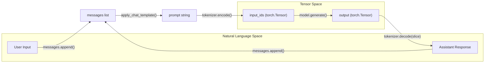

<!-- source: DeepWiki mcp.deepwiki.com · repo huggingface/nanowhale · page 6.1 Interactive Chat CLI (chat.py) · fetched 2026-10-26 -->

# Interactive Chat CLI (chat.py)

<details>
<summary>Relevant source files</summary>

The following files were used as context for generating this wiki page:

- [scripts/chat.py](scripts/chat.py)

</details>


The `scripts/chat.py` script provides a command-line interface (CLI) for interactive engagement with trained `nanowhale` models. It supports stateful multi-turn conversations, utilizes Hugging Face's `transformers` ecosystem for generation, and handles the registration of the custom DeepSeek-V4 architecture to enable seamless loading from local paths.

### CLI Arguments and Initialization

The script uses `argparse` to configure the inference environment and sampling parameters.

| Argument | Type | Default | Description |
| :--- | :--- | :--- | :--- |
| `--model_path` | `str` | **Required** | Local directory containing model weights and configuration. |
| `--device` | `str` | `cuda` or `cpu` | Hardware device for model execution [scripts/chat.py:20-20](). |
| `--max_new_tokens` | `int` | `200` | Maximum number of tokens to generate per response [scripts/chat.py:21-21](). |
| `--temperature` | `float` | `0.7` | Controls randomness in sampling (higher is more creative) [scripts/chat.py:22-22](). |
| `--top_p` | `float` | `0.9` | Nucleus sampling threshold [scripts/chat.py:23-23](). |

**Sources:**
- [scripts/chat.py:18-24]()

---

### Architecture Registration & Loading

Because `DeepseekV4Config` and `DeepseekV4ForCausalLM` are custom classes within the repository, they must be registered with the Hugging Face `Auto` classes to be recognized during the `from_pretrained` call.

1.  **Registration**: The script registers the custom configuration and model classes using `AutoConfig.register` and `AutoModelForCausalLM.register` [scripts/chat.py:13-14]().
2.  **Model Loading**: The model is loaded using `torch.bfloat16` precision to match the training format [scripts/chat.py:28-28]().
3.  **Evaluation Mode**: The model is moved to the target device and set to `.eval()` mode to disable dropout and ensure deterministic behavior in layers like Sinkhorn normalization [scripts/chat.py:29-29]().

#### System Initialization Flow
The following diagram illustrates how the CLI initializes the `nanowhale` environment.

"CLI Initialization and Registration"
```mermaid
graph TD
    subgraph "Registry Space"
        AC["AutoConfig"]
        AM["AutoModelForCausalLM"]
    end

    subgraph "Code Entity Space"
        DV4C["DeepseekV4Config"]
        DV4M["DeepseekV4ForCausalLM"]
    end

    START["scripts/chat.py"] --> REG["Register Classes"]
    REG --> |"register('deepseek_v4', ...)"| AC
    REG --> |"register(DeepseekV4Config, ...)"| AM
    
    AC -.-> |"identifies"| DV4C
    AM -.-> |"instantiates"| DV4M

    DV4C --- [configuration_deepseek_v4.py:10-10]
    DV4M --- [modeling_deepseek_v4.py:11-11]
```

**Sources:**
- [scripts/chat.py:10-14]()
- [scripts/chat.py:27-29]()

---

### Conversation Lifecycle

The script maintains a `messages` list to store the history of the conversation, allowing for multi-turn context [scripts/chat.py:33-33]().

#### 1. Prompt Preparation
The script attempts to use the tokenizer's chat template if available. If `tokenizer.chat_template` is missing, it falls back to a basic string formatting:
*   **Template Path**: Calls `tokenizer.apply_chat_template` with `add_generation_prompt=True` [scripts/chat.py:44-44]().
*   **Fallback Path**: Joins messages with newlines and appends an `assistant:` suffix [scripts/chat.py:46-46]().

#### 2. Generation Loop
The core generation occurs within a `torch.no_grad()` block to prevent memory accumulation from gradient tracking [scripts/chat.py:49-49]().

*   **Sampling**: The `model.generate` method is called with `do_sample=True` [scripts/chat.py:53-53]().
*   **Padding**: The `pad_token_id` is explicitly set to `tokenizer.eos_token_id` to ensure correct termination behavior [scripts/chat.py:56-56]().

#### 3. Decoding and State Update
The script decodes only the newly generated tokens by slicing the output tensor using the input length: `output[0][input_ids.shape[1]:]` [scripts/chat.py:59-59](). The resulting string is printed and appended to the `messages` list as the `assistant` role [scripts/chat.py:61-61]().

#### Data Flow: User Input to Response
This diagram shows the transformation of data from natural language to tensor space and back.

"Chat Data Flow"


**Sources:**
- [scripts/chat.py:33-33]()
- [scripts/chat.py:41-48]()
- [scripts/chat.py:50-61]()

---

### Implementation Details

| Component | Logic | Reference |
| :--- | :--- | :--- |
| **Input Handling** | Trims whitespace and checks for exit commands (`quit`, `exit`, `q`). | [scripts/chat.py:35-37]() |
| **Tokenization** | Uses `PreTrainedTokenizerFast` for efficient encoding. | [scripts/chat.py:27-27]() |
| **Decoding** | `skip_special_tokens=True` is used to hide `<｜end▁of▁sentence｜>`. | [scripts/chat.py:59-59]() |
| **Context** | The entire history in `messages` is re-processed every turn. | [scripts/chat.py:41-61]() |

**Sources:**
- [scripts/chat.py:27-61]()

---

