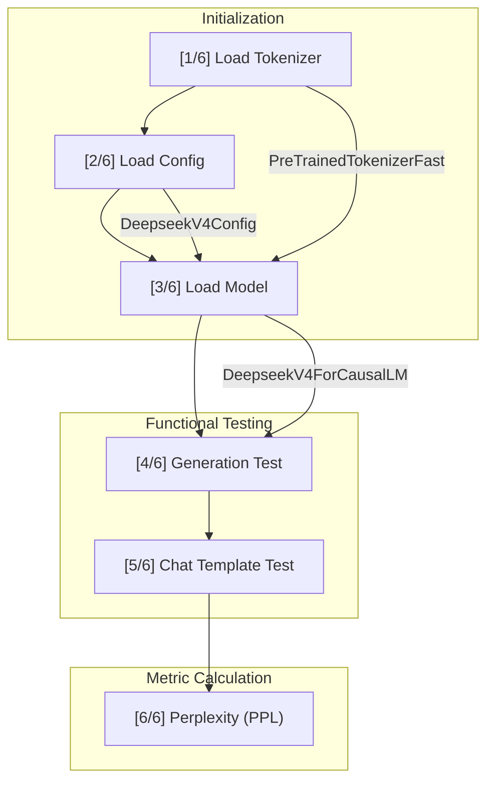
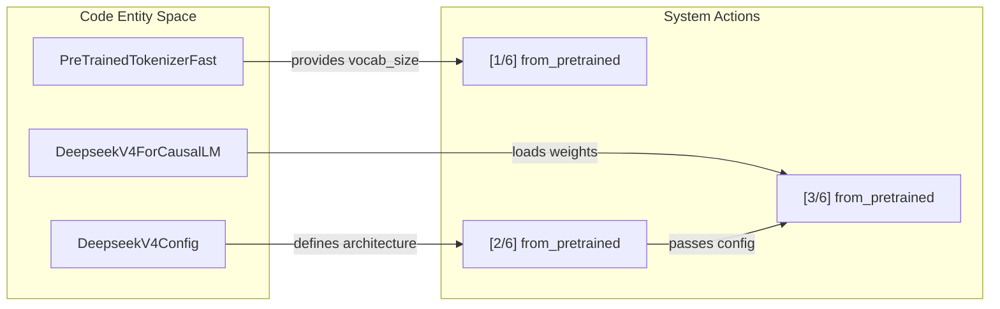
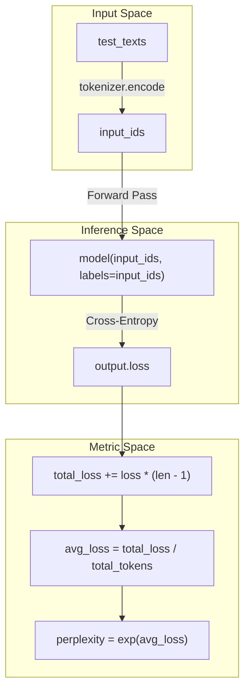

<!-- source: DeepWiki mcp.deepwiki.com · repo huggingface/nanowhale · page 6.2 Smoke Evaluation (eval_smoke.py) · fetched 2026-10-26 -->

# Smoke Evaluation (eval_smoke.py)

Relevant source files

The following files were used as context for generating this wiki page:

- [scripts/eval_smoke.py](scripts/eval_smoke.py)

The `scripts/eval_smoke.py` script serves as the primary validation utility for the **nanowhale** project. It implements a six-stage pipeline designed to verify that a trained model checkpoint is functional, correctly registered with the Hugging Face `transformers` ecosystem, and capable of generating coherent text. This script is used to confirm the integrity of both the pretraining and SFT (Supervised Fine-Tuning) phases before more intensive benchmarks are run.

### Pipeline Architecture

The script follows a linear execution flow that mirrors the typical loading process of a production inference environment. It utilizes `AutoConfig` and `AutoModelForCausalLM` to ensure that the custom `DeepseekV4` classes are correctly mapped and discoverable [scripts/eval_smoke.py:13-14]().

**Validation Pipeline Overview**

**Sources:** [scripts/eval_smoke.py:27-107]()

---

### Implementation Details

#### 1. Model Registration and Loading
The script begins by registering the `DeepseekV4Config` and `DeepseekV4ForCausalLM` classes with the Hugging Face `Auto` classes [scripts/eval_smoke.py:13-14](). This allows the model to be loaded via `from_pretrained()` without needing the local modeling files in the same directory, provided `trust_remote_code=True` is used or the classes are manually registered as seen here.

The model is loaded in `torch.bfloat16` to match the training precision and moved to the target device (defaulting to `cuda` if available) [scripts/eval_smoke.py:45-46]().

#### 2. Reference Prompts and Generation
The generation test [scripts/eval_smoke.py:52-69]() uses five diverse prompts to verify the model's ability to continue text across different domains:
*   **Philosophy:** "The meaning of life is"
*   **Narrative:** "Once upon a time in a land far away,"
*   **Idiomatic:** "The quick brown fox"
*   **Technical:** "Python is a programming language that"
*   **Scientific:** "In mathematics, the Pythagorean theorem states that"

Generation is performed using `model.generate()` with sampling enabled (`do_sample=True`, `temperature=0.8`, `top_p=0.9`) [scripts/eval_smoke.py:63-64]().

#### 3. Chat Template Validation
For SFT models, the script validates the `chat_template` attribute of the tokenizer. It applies the template to a standard user message [scripts/eval_smoke.py:73-76]() to ensure the special tokens (e.g., `<｜begin▁of▁sentence｜>`) are correctly inserted before generation [scripts/eval_smoke.py:79-80]().

#### 4. Perplexity Calculation
The final stage calculates the model's perplexity on a small held-out set of factual statements [scripts/eval_smoke.py:89-93]().

**Perplexity Calculation Logic**
The script manually calculates perplexity as the exponential of the average cross-entropy loss across all tokens in the test set.
1.  **Forward Pass:** The model is called with `labels=input_ids` to trigger internal loss calculation [scripts/eval_smoke.py:99]().
2.  **Weighted Sum:** The loss for each sample is multiplied by the number of predicted tokens (`seq_len - 1`) to get a total sum of losses [scripts/eval_smoke.py:100]().
3.  **Averaging:** The total loss is divided by the total number of tokens across all samples [scripts/eval_smoke.py:103]().
4.  **Exponential:** Perplexity is derived via `torch.exp(avg_loss)` [scripts/eval_smoke.py:104]().

**Sources:** [scripts/eval_smoke.py:13-14](), [scripts/eval_smoke.py:45-46](), [scripts/eval_smoke.py:53-64](), [scripts/eval_smoke.py:94-106]()

---

### Code-to-System Mapping

The following diagrams bridge the gap between the high-level evaluation stages and the specific code entities involved.

**Model Loading & Configuration Flow**

**Sources:** [scripts/eval_smoke.py:29-45]()

**Metric Calculation Data Flow**

**Sources:** [scripts/eval_smoke.py:89-106]()

---

### Reported Benchmark Scores

Based on the official project documentation, the `eval_smoke.py` script yields the following perplexity results for the 110M parameter checkpoints on the reference test set:

| Checkpoint | Average Loss | Perplexity (PPL) |
| :--- | :--- | :--- |
| **Pretrain** (`smol-deepseek-v4-100m-pretrain`) | ~2.61 | **13.62** |
| **SFT** (`smol-deepseek-v4-100m`) | ~2.56 | **12.90** |

The lower perplexity of the SFT model reflects its alignment with the conversational and factual structures present in the test set.

**Sources:** [scripts/eval_smoke.py:105-106]() (Calculation logic), Project Overview (Reference values).

---

