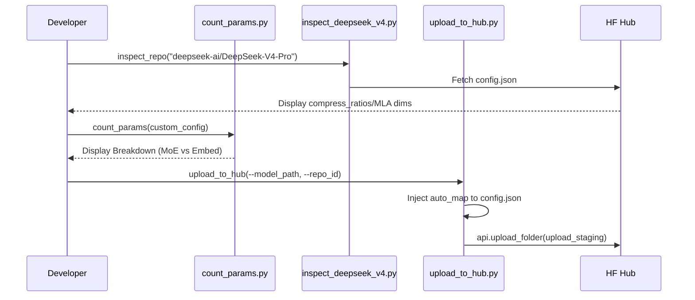

<!-- source: DeepWiki mcp.deepwiki.com · repo huggingface/nanowhale · page 7 Developer Utilities · fetched 2026-10-26 -->

# Developer Utilities

<details>
<summary>Relevant source files</summary>

The following files were used as context for generating this wiki page:

- [scripts/count_params.py](scripts/count_params.py)
- [scripts/inspect_deepseek_v4.py](scripts/inspect_deepseek_v4.py)
- [scripts/upload_to_hub.py](scripts/upload_to_hub.py)

</details>


The `nanowhale` repository includes a suite of diagnostic and deployment scripts designed to manage the complexity of the DeepSeek-V4 architecture at small scales. These utilities handle the calculation of parameter budgets across MoE and MLA components, verify upstream configurations from the Hugging Face Hub, and automate the deployment of trained checkpoints with support for `trust_remote_code`.

### Utility System Overview

The developer utilities bridge the gap between local model experimentation and public model deployment. They ensure that the architectural constraints (such as the high embedding-to-parameter ratio) are accounted for before training begins and that the resulting artifacts are correctly mapped for the Hugging Face ecosystem.

**Utility Workflow and Code Associations**

```mermaid
graph TD
    subgraph "Local Development Space"
        [scripts/count_params.py] --> |"instantiates"| [modeling_deepseek_v4.py:DeepseekV4ForCausalLM]
        [scripts/count_params.py] --> |"analyzes"| [configuration_deepseek_v4.py:DeepseekV4Config]
    end

    subgraph "Hugging Face Hub Space"
        [scripts/inspect_deepseek_v4.py] --> |"downloads"| [config.json]
        [scripts/upload_to_hub.py] --> |"pushes"| [HfApi.upload_folder]
    end

    [scripts/upload_to_hub.py] -.-> |"injects auto_map"| [config.json]
    [scripts/upload_to_hub.py] -.-> |"copies"| [modeling_deepseek_v4.py]
```
Sources: [scripts/count_params.py:9-10](), [scripts/upload_to_hub.py:45-60](), [scripts/inspect_deepseek_v4.py:10-35]()

---

### Parameter Counting

The script `scripts/count_params.py` provides a detailed breakdown of the model's parameter distribution. This is critical for `nanowhale` because the large DeepSeek-V4 vocabulary (129,280 tokens) consumes a significant portion of the 110M parameter budget. The utility categorizes parameters into Embeddings, Attention (MLA), FFN/MoE, Hyper-Connections (HC), and Normalization layers.

It uses a scaling heuristic to estimate MoE sizes, specifically noting that most parameters reside in the experts ($N_{experts} \times 3 \times hidden \times inter\_dim$ per layer). The script iterates through various configurations, ranging from a ~400K parameter debug model to a ~800M parameter variant.

For details, see [Parameter Counting (count_params.py)](#7.1).

Sources: [scripts/count_params.py:9-51](), [scripts/count_params.py:64-79]()

---

### Architecture Inspection

To ensure architectural parity with the full-scale models, `scripts/inspect_deepseek_v4.py` provides a tool for inspecting official DeepSeek-V4 repositories. It uses the `inspect_repo(repo_id)` function to list and filter repository files, separating metadata from large weight shards.

This utility is primarily used to verify `config.json` parameters such as `compress_ratios` and MoE routing logic from `deepseek-ai/DeepSeek-V4-Pro` and `deepseek-ai/DeepSeek-V4-Flash`, ensuring the `nanowhale` implementation remains consistent with upstream architectural decisions.

For details, see [Architecture Inspection (inspect_deepseek_v4.py)](#7.2).

Sources: [scripts/inspect_deepseek_v4.py:10-35](), [scripts/inspect_deepseek_v4.py:38-39]()

---

### Hub Upload and Deployment

The `scripts/upload_to_hub.py` script automates the process of making the model compatible with the Hugging Face `transformers` library. It handles the creation of a `upload_staging` directory, copies necessary `.safetensors` and `.json` files, and crucially injects an `auto_map` into the `config.json`.

By copying `modeling_deepseek_v4.py` and `configuration_deepseek_v4.py` directly into the repository, it enables `trust_remote_code=True` support, allowing users to load the custom architecture without local file dependencies. This script was used to publish the two primary checkpoints: `cmpatino/smol-deepseek-v4-100m-pretrain` and `cmpatino/smol-deepseek-v4-100m`.

For details, see [Hub Upload (upload_to_hub.py)](#7.3).

Sources: [scripts/upload_to_hub.py:35-60](), [scripts/upload_to_hub.py:64-68]()

---

### Developer Tooling Relationship

The following table summarizes the primary role of each utility in the development lifecycle:

| Script | Primary Function | Key Code Entity |
| :--- | :--- | :--- |
| `count_params.py` | Architectural budgeting | `count_params()` |
| `inspect_deepseek_v4.py` | Upstream verification | `inspect_repo()` |
| `upload_to_hub.py` | Deployment & Compatibility | `HfApi.upload_folder` |

**System Interaction Diagram**


Sources: [scripts/count_params.py:9-13](), [scripts/inspect_deepseek_v4.py:25-34](), [scripts/upload_to_hub.py:50-60]()

---

