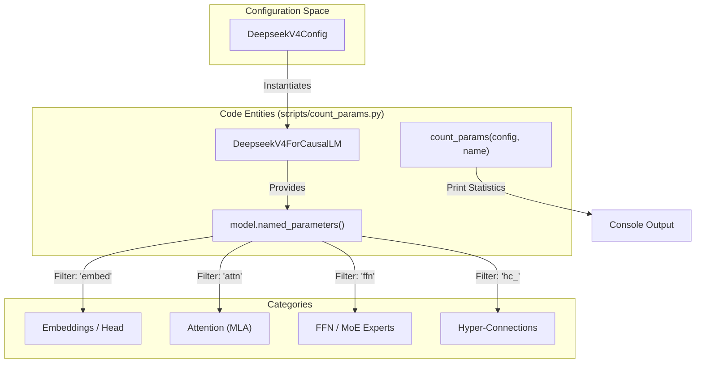
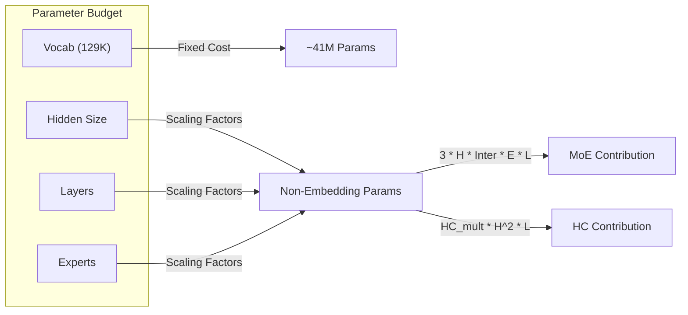

<!-- source: DeepWiki mcp.deepwiki.com · repo huggingface/nanowhale · page 7.1 Parameter Counting (count_params.py) · fetched 2026-10-26 -->

# Parameter Counting (count_params.py)

Relevant source files

The following files were used as context for generating this wiki page:

- [scripts/count_params.py](scripts/count_params.py)

The `scripts/count_params.py` script serves as the primary utility for calculating and analyzing the parameter distribution of various model configurations. It allows developers to verify the impact of architectural decisions—such as the number of experts, latent attention ranks, and Hyper-Connection multipliers—on the total parameter budget before committing to training.

### Implementation Overview

The script utilizes the `DeepseekV4Config` and `DeepseekV4ForCausalLM` classes to instantiate "ghost" models (models initialized without loading weights) to count elements in their parameter tensors.

#### The `count_params` Function
The core logic resides in `count_params(config, name)`, which performs the following operations:
1.  **Model Instantiation**: Creates a `DeepseekV4ForCausalLM` instance based on the provided `DeepseekV4Config` [scripts/count_params.py:10]().
2.  **Global Counting**: Calculates the total number of elements (`numel`) across all model parameters [scripts/count_params.py:11]().
3.  **Embedding Separation**: Isolates parameters associated with `embed` and `lm_head` to distinguish between vocabulary-dependent weights and the transformer backbone [scripts/count_params.py:12-13]().
4.  **Categorical Breakdown**: Filters `named_parameters()` to categorize weights into specific architectural subsystems [scripts/count_params.py:40-48]().

#### Parameter Categorization Logic
The script breaks down the non-embedding parameters into four distinct categories:

| Category | Filter Criterion | Description |
| :--- | :--- | :--- |
| **Attention** | `'attn'` (excluding `'hc'`) | MLA/CSA projections, KV compression, and output matrices [scripts/count_params.py:40](). |
| **FFN/MoE** | `'ffn'` (excluding `'hc'`) | SwiGLU experts, MoE gate, and shared experts [scripts/count_params.py:41](). |
| **HC** | `'hc_'` | Hyper-Connection state projections and Sinkhorn-related weights [scripts/count_params.py:42](). |
| **Norm** | `'norm'` | Layer normalization and RMSNorm parameters [scripts/count_params.py:43](). |

**Sources:**
- [scripts/count_params.py:9-51]()

---

### Data Flow and System Interaction

The following diagram illustrates how `count_params.py` interacts with the model definition to generate the parameter report.

**Parameter Counting Data Flow**

**Sources:**
- [scripts/count_params.py:10-48]()
- [modeling_deepseek_v4.py:1152-1155]() (For `DeepseekV4ForCausalLM` reference)

---

### Scaling Heuristics

The script highlights a key architectural insight regarding Mixture-of-Experts (MoE) scaling: the majority of parameters in a nanowhale model reside within the experts.

#### The MoE Heuristic
The parameter count for the Feed-Forward Network (FFN) per layer is dominated by the formula:
`N_experts × 3 × hidden_size × intermediate_size` [scripts/count_params.py:64-65]().

*   **3x Factor**: Accounts for the three linear layers in a SwiGLU expert (gate, up, and down projections).
*   **Example**: With `hidden_size=384` and `moe_intermediate_size=768`, a single expert contains ~884K parameters. An 8-expert configuration thus contributes ~7M parameters per layer to the FFN category alone [scripts/count_params.py:65]().

**Sources:**
- [scripts/count_params.py:64-66]()

---

### Configuration Range

The script documents a range of configurations used to find the optimal balance for the ~100M parameter target. These range from minimal debug setups to larger variants approaching 1B parameters.

| Config Name | Hidden Size | Layers | Experts | Est. Total Params |
| :--- | :--- | :--- | :--- | :--- |
| **debug** | 64 | 2 | 4 | ~400K [scripts/count_params.py:54-61]() |
| **~50M** | 256 | 6 | 4 | ~50M [scripts/count_params.py:72]() |
| **~100M_v2** | 384 | 10 | 8 | ~100M [scripts/count_params.py:74]() |
| **~200M** | 512 | 12 | 8 | ~200M [scripts/count_params.py:76]() |
| **~800M** | 1024 | 16 | 8 | ~800M [scripts/count_params.py:78]() |

All configurations (except the minimal debug) utilize the full `vocab_size=129280` [scripts/count_params.py:83](), which significantly impacts the embedding parameter count (~41M parameters dedicated to the tokenizer).

**Model Scaling Relationship**

**Sources:**
- [scripts/count_params.py:71-79]()
- [scripts/count_params.py:82-102]()

---

