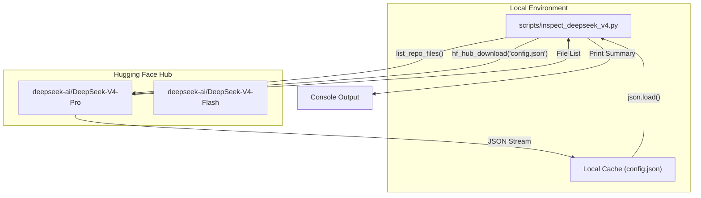
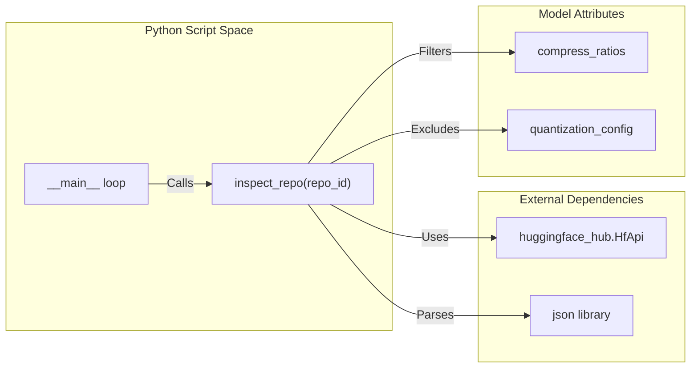

<!-- source: DeepWiki mcp.deepwiki.com · repo huggingface/nanowhale · page 7.2 Architecture Inspection (inspect_deepseek_v4.py) · fetched 2026-10-26 -->

# Architecture Inspection (inspect_deepseek_v4.py)

Relevant source files

The following files were used as context for generating this wiki page:

- [scripts/inspect_deepseek_v4.py](scripts/inspect_deepseek_v4.py)

The `scripts/inspect_deepseek_v4.py` script is a diagnostic utility designed to probe the repository structure and architectural configurations of upstream DeepSeek-V4 models hosted on the Hugging Face Hub. It serves as a verification tool to ensure that the `nanowhale` implementation remains aligned with the official DeepSeek-V4 specifications, specifically regarding Multi-head Latent Attention (MLA) compression ratios and model metadata.

### Remote Repository Inspection Logic

The script utilizes the `huggingface_hub` library to interact with remote repositories without requiring a full model download. The core logic resides in the `inspect_repo(repo_id)` function [scripts/inspect_deepseek_v4.py:10-35]().

#### File Filtering and Listing
The script retrieves a complete file list using `list_repo_files` [scripts/inspect_deepseek_v4.py:15](). To provide a clean overview of the repository's metadata and configuration, it implements a filtering mechanism:
*   **Metadata Files:** Files that do not start with the prefix `model-` (e.g., `config.json`, `tokenizer.json`, `generation_config.json`) are printed individually [scripts/inspect_deepseek_v4.py:18-19]().
*   **Weight Shards:** Files prefixed with `model-` are identified as weight shards and are summarized by count rather than listed individually to avoid terminal clutter [scripts/inspect_deepseek_v4.py:21-22]().

#### Configuration Parsing
The script downloads the `config.json` file to a local cache using `hf_hub_download` [scripts/inspect_deepseek_v4.py:25](). It then parses the JSON content to display model hyperparameters. Special handling is applied to large arrays to maintain readability:
*   **compress_ratios:** Instead of printing the entire array (which corresponds to per-layer compression settings in DeepSeek-V4), it summarizes the list by showing only the first two and last two elements along with the total length [scripts/inspect_deepseek_v4.py:33-34]().
*   **General Keys:** Other configuration keys are printed directly to the console [scripts/inspect_deepseek_v4.py:32]().

### Data Flow and Interaction

The following diagram illustrates how `inspect_deepseek_v4.py` interacts with the Hugging Face Hub API to extract architectural details.

**Upstream Inspection Data Flow**

**Sources:** [scripts/inspect_deepseek_v4.py:7-35]()

### Code Entity Mapping

This diagram maps the functional components of the inspection script to the specific code entities and external dependencies.

**Entity Mapping: Inspection Logic**

**Sources:** [scripts/inspect_deepseek_v4.py:10-39]()

### Target Repositories

The script is configured to inspect two primary upstream models to validate the `nanowhale` configuration parameters [scripts/inspect_deepseek_v4.py:38-39]():

| Repository ID | Purpose of Inspection |
| :--- | :--- |
| `deepseek-ai/DeepSeek-V4-Pro` | Verifying full-scale MLA compression ratios and layer counts. |
| `deepseek-ai/DeepSeek-V4-Flash` | Comparing lightweight architecture variants against `nanowhale`'s 100M target. |

This inspection process was critical during the development of `DeepseekV4Config` [modeling/configuration_deepseek_v4.py:11-131]() to ensure that the `q_lora_rank` and `kv_lora_rank` logic implemented in the `nanowhale` codebase correctly mirrored the scaling behavior of the official DeepSeek-V4 models.

**Sources:** [scripts/inspect_deepseek_v4.py:37-40]()

---

