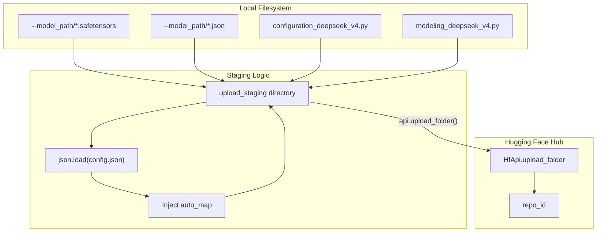
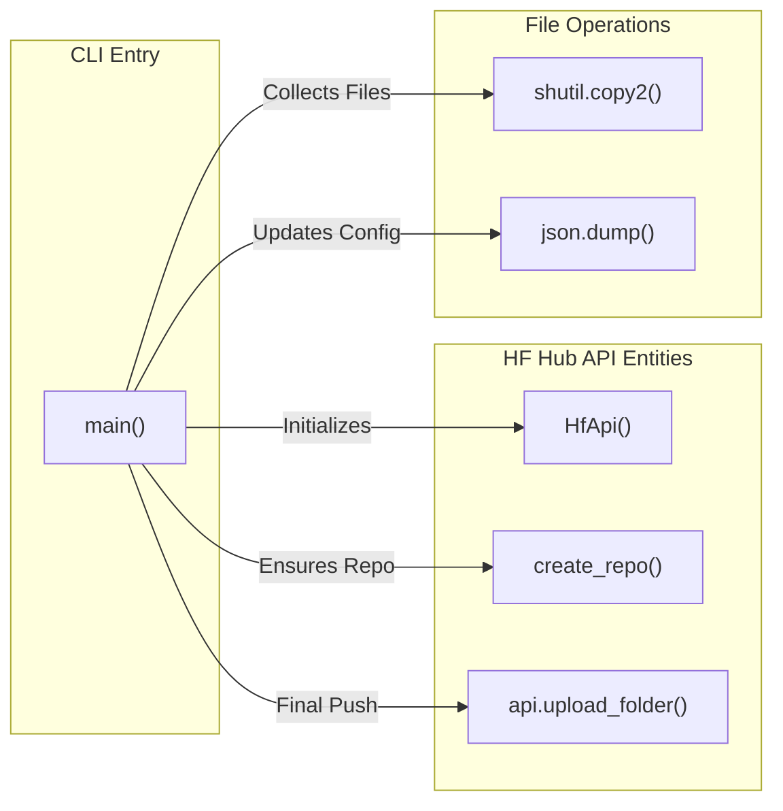

<!-- source: DeepWiki mcp.deepwiki.com · repo huggingface/nanowhale · page 7.3 Hub Upload (upload_to_hub.py) · fetched 2026-10-26 -->

# Hub Upload (upload_to_hub.py)

<details>
<summary>Relevant source files</summary>

The following files were used as context for generating this wiki page:

- [scripts/upload_to_hub.py](scripts/upload_to_hub.py)

</details>


The `scripts/upload_to_hub.py` utility is responsible for packaging and deploying trained model checkpoints to the Hugging Face Hub. It ensures that the necessary custom architecture files are included and that the configuration is correctly modified to support `trust_remote_code=True`, allowing users to load the `DeepseekV4` architecture without manual registration [scripts/upload_to_hub.py:1-17]().

## Overview of CLI Arguments

The script uses `argparse` to handle repository creation and data transfer parameters [scripts/upload_to_hub.py:20-26]().

| Argument | Type | Description |
| :--- | :--- | :--- |
| `--model_path` | `str` | Local directory containing the checkpoint files (`.safetensors`, `config.json`, etc.) [scripts/upload_to_hub.py:21-22](). |
| `--repo_id` | `str` | The target Hugging Face repository identifier (e.g., `cmpatino/smol-deepseek-v4-100m`) [scripts/upload_to_hub.py:23-24](). |
| `--private` | `flag` | If set, creates the repository as private [scripts/upload_to_hub.py:25](). |

### Sources:
- [scripts/upload_to_hub.py:20-26]()

## Upload Staging Process

The script does not upload files directly from the training output directory. Instead, it creates a temporary `upload_staging` subdirectory to assemble the final package [scripts/upload_to_hub.py:35-36]().

### 1. File Selection
The script iterates through the `--model_path` and copies only relevant artifacts:
*   Weights: `.safetensors` files [scripts/upload_to_hub.py:40]().
*   Metadata: `.json` and `.txt` files [scripts/upload_to_hub.py:40]().

### 2. Custom Code Injection
To support the `transformers` library's `trust_remote_code` feature, the script copies the local modeling and configuration files into the staging area:
*   `configuration_deepseek_v4.py` [scripts/upload_to_hub.py:45-48]().
*   `modeling_deepseek_v4.py` [scripts/upload_to_hub.py:45-48]().

### 3. Auto-Map Injection
The script modifies the `config.json` file in the staging directory to include an `auto_map` key. This mapping instructs the Hugging Face `Auto` classes which local classes to instantiate [scripts/upload_to_hub.py:50-60]().

```json
"auto_map": {
    "AutoConfig": "configuration_deepseek_v4.DeepseekV4Config",
    "AutoModelForCausalLM": "modeling_deepseek_v4.DeepseekV4ForCausalLM"
}
```

### Data Flow: Staging to Hub

The following diagram illustrates how local files are gathered into the `upload_staging` entity before being pushed to the `HfApi`.

**Staging and Upload Flow**


### Sources:
- [scripts/upload_to_hub.py:35-71]()

## Implementation Details

The script utilizes the `huggingface_hub` library to interact with the Hub API. It first ensures the repository exists via `create_repo` [scripts/upload_to_hub.py:32]() and then performs a bulk upload of the staging directory using `api.upload_folder` [scripts/upload_to_hub.py:64-68]().

### Code Entity Association

The following diagram maps the logical upload steps to the specific Python entities and functions used in the script.

**Code Entity Mapping**


### Published Repositories
This script was used to publish the two primary checkpoints for the `nanowhale` project:
1.  `cmpatino/smol-deepseek-v4-100m-pretrain`: The base model after 5000 steps on FineWeb-Edu.
2.  `cmpatino/smol-deepseek-v4-100m`: The final SFT model after 3000 steps on SmolTalk.

### Sources:
- [scripts/upload_to_hub.py:10]()
- [scripts/upload_to_hub.py:28-32]()
- [scripts/upload_to_hub.py:41-48]()
- [scripts/upload_to_hub.py:59-60]()
- [scripts/upload_to_hub.py:64-68]()

---

