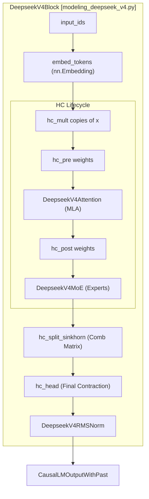
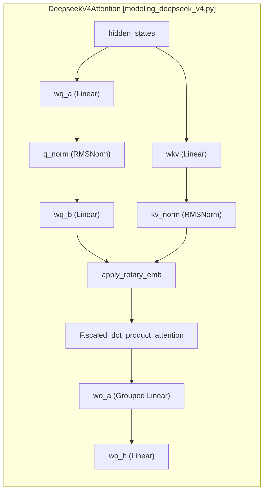

<!-- source: DeepWiki mcp.deepwiki.com · repo huggingface/nanowhale · page 8 Glossary · fetched 2026-10-26 -->

# Glossary

Relevant source files

The following files were used as context for generating this wiki page:

- [README.md](README.md)
- [SUMMARY.md](SUMMARY.md)
- [configs/main_100m.yaml](configs/main_100m.yaml)
- [configuration_deepseek_v4.py](configuration_deepseek_v4.py)
- [modeling_deepseek_v4.py](modeling_deepseek_v4.py)
- [scripts/train_pretrain.py](scripts/train_pretrain.py)
- [tokenizer/tokenizer_config.json](tokenizer/tokenizer_config.json)

This glossary defines the technical terms, architectural components, and domain-specific concepts used throughout the **nanowhale** codebase. It serves as a reference for engineers to map conceptual terminology to specific implementation details in the code.

## Core Architectural Concepts

### Hyper-Connections (HC)
A mechanism that maintains multiple copies of the hidden state and uses a dynamic routing mechanism (Sinkhorn) to combine them. This allows for more expressive state transitions than standard residual connections.
*   **Implementation**: Defined in the `hc_split_sinkhorn` function [modeling_deepseek_v4.py:85-124]() and integrated into the `DeepseekV4Block` [modeling_deepseek_v4.py:276-320]().
*   **Key Parameters**: `hc_mult` (number of copies), `hc_sinkhorn_iters` (normalization iterations) [configuration_deepseek_v4.py:55-56]().
*   **Known Issue**: At small scales, the dynamic scaling in HC can cause overflows in `bfloat16`, necessitating the use of `float32` [README.md:114-115]().

### Multi-Head Latent Attention (MLA)
Also referred to in this codebase as **Compressed Sparse Attention (CSA)**. It reduces KV cache requirements by using low-rank projections for Queries and a shared latent vector for Keys and Values.
*   **Implementation**: The `DeepseekV4Attention` class [modeling_deepseek_v4.py:130-241]().
*   **Key Components**: 
    *   `wq_a` / `wq_b`: Low-rank Query projection [modeling_deepseek_v4.py:156-158]().
    *   `wkv`: Direct KV projection [modeling_deepseek_v4.py:161]().
    *   `wo_a` / `wo_b`: Grouped low-rank output projection using `o_groups` [modeling_deepseek_v4.py:166-168]().

### Mixture-of-Experts (MoE)
A sparse transformer architecture where only a subset of "experts" (MLPs) are activated for each token.
*   **Implementation**: Managed by the `DeepseekV4MoE` class [modeling_deepseek_v4.py:388-444]().
*   **Routing**: Uses `DeepseekV4Gate` [modeling_deepseek_v4.py:326-385]() with `sqrtsoftplus` scoring and `noaux_tc` (no auxiliary loss, top-k) selection [configs/main_100m.yaml:41-43]().
*   **Experts**: Uses `DeepseekV4Expert` which implements a SwiGLU MLP [modeling_deepseek_v4.py:244-263]().

### Multi-Token Prediction (MTP)
A feature intended to predict the next $n$ tokens simultaneously to improve training efficiency. 
*   **Implementation**: `DeepseekV4MTP` class [modeling_deepseek_v4.py:469-503]().
*   **Status**: While implemented, it is typically disabled or set to 1 layer for the 100M scale models [README.md:19]().

---

## Technical Terms & Abbreviations

| Term | Definition | Code Pointer |
| :--- | :--- | :--- |
| **MLA** | Multi-Head Latent Attention. | `DeepseekV4Attention` [modeling_deepseek_v4.py:130]() |
| **CSA** | Compressed Sparse Attention (DeepSeek-V4's evolution of MLA). | `DeepseekV4Config` docstring [configuration_deepseek_v4.py:8]() |
| **HC** | Hyper-Connections. | `hc_split_sinkhorn` [modeling_deepseek_v4.py:85]() |
| **NoPE** | Non-shared Positional Embeddings (the part of the head dimension without RoPE). | `nope_head_dim` [configuration_deepseek_v4.py:98]() |
| **RoPE** | Rotary Positional Embeddings. | `apply_rotary_emb` [modeling_deepseek_v4.py:63]() |
| **Sinkhorn** | An iterative normalization algorithm used to produce doubly stochastic matrices in HC. | `hc_split_sinkhorn` [modeling_deepseek_v4.py:119-122]() |
| **SwiGLU** | The activation function used in experts (Swish-Gated Linear Unit). | `DeepseekV4Expert` [modeling_deepseek_v4.py:255]() |

---

## System Architecture Mapping

The following diagrams bridge the gap between high-level concepts and the specific Python entities in the repository.

### Diagram 1: Forward Pass Data Flow
This diagram tracks how a hidden state `x` is transformed through a single `DeepseekV4Block`.

**Sources**: [modeling_deepseek_v4.py:276-320](), [modeling_deepseek_v4.py:535-580](), [modeling_deepseek_v4.py:85-124]()

### Diagram 2: Attention Subsystem (MLA/CSA)
This diagram maps the components of the `DeepseekV4Attention` class.

**Sources**: [modeling_deepseek_v4.py:130-241](), [configuration_deepseek_v4.py:41-46]()

---

## Configuration Glossary

The `DeepseekV4Config` class [configuration_deepseek_v4.py:18]() contains several domain-specific parameters:

*   **`q_lora_rank`**: The compression dimension for Query vectors [configuration_deepseek_v4.py:95]().
*   **`o_groups`**: Number of groups for the output projection, used to reduce parameter count in the final linear layer of attention [configuration_deepseek_v4.py:99]().
*   **`routed_scaling_factor`**: A multiplier applied to the output of routed experts in MoE [configuration_deepseek_v4.py:89]().
*   **`swiglu_limit`**: A capping value for SwiGLU activations to prevent instability [configuration_deepseek_v4.py:92]().
*   **`compress_ratios`**: A list of ratios defining sliding window or compression settings per layer [configuration_deepseek_v4.py:107]().

**Sources**: [configuration_deepseek_v4.py:18-140](), [configs/main_100m.yaml:21-52]()