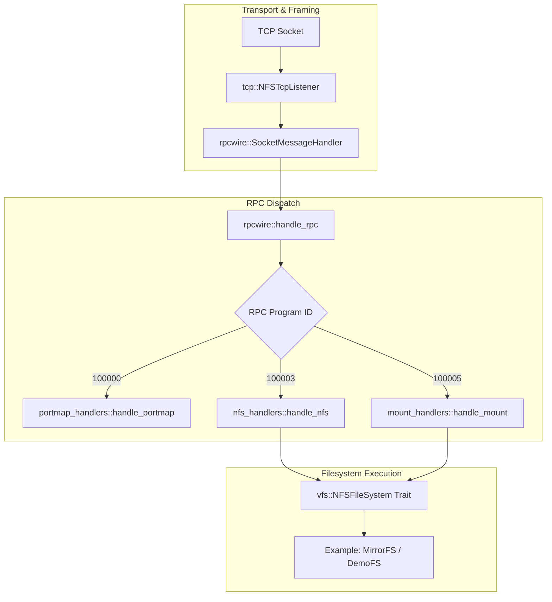
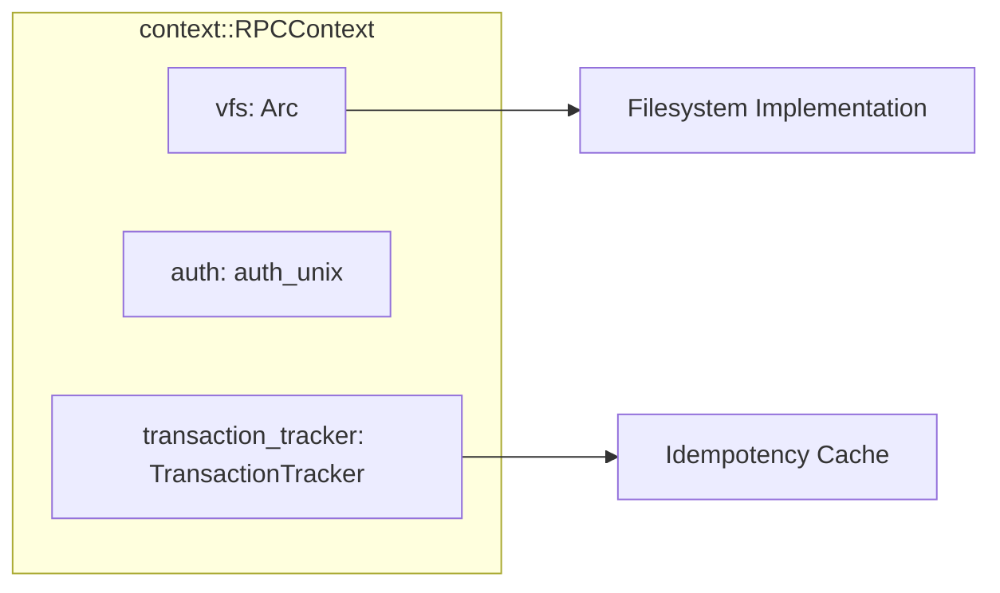

<!-- source: DeepWiki mcp.deepwiki.com · repo huggingface/nfsserve · page 1 Overview · fetched 2026-10-26 -->

# Overview

Relevant source files

The following files were used as context for generating this wiki page:

- [Cargo.toml](Cargo.toml)
- [README.md](README.md)
- [src/lib.rs](src/lib.rs)

`nfsserve` is a high-level, functional implementation of an **NFSv3 (Network File System version 3)** server written in Rust. It is designed to provide a user-mode filesystem API that is truly cross-platform by leveraging the native NFS clients built into Linux, macOS, and Windows [README.md:1-9]().

Unlike FUSE, which requires specialized drivers on non-Linux platforms, `nfsserve` allows developers to expose arbitrary data structures as filesystems by simply implementing a Rust trait. The operating system handles caching, metadata eviction, and robust network retries, while `nfsserve` manages the protocol-level complexities [README.md:11-21]().

## Key Design Goals

*   **Cross-Platform Compatibility**: Use the ubiquitous NFSv3 protocol to avoid platform-specific filesystem drivers [README.md:8-10]().
*   **User-Mode Flexibility**: Provide a `vfs::NFSFileSystem` trait that allows any backing store (in-memory, remote API, local disk) to be mounted as a drive [README.md:53-60]().
*   **Performance and Reliability**: Utilize `tokio` for asynchronous I/O and handle the historical robustness requirements of NFS clients [README.md:14-16](), [Cargo.toml:24-24]().
*   **Simplicity**: Provide a "localhost" server experience where a simple mount command connects the OS to the Rust process [README.md:20-21]().

## System Architecture

The system is structured as a layered protocol stack. It begins with a TCP transport layer that handles raw byte streams, moves through an RPC dispatch layer, and finally executes filesystem operations via the VFS.

### Protocol Stack and Code Mapping

The following diagram illustrates how network requests transition from raw bytes into filesystem logic, mapping conceptual stages to specific code entities.

**Diagram: Request Flow from Network to VFS**

**Sources:** [src/lib.rs:3-24](), [src/rpcwire.rs:97-99](), [README.md:108-117]()

### Major Subsystems

1.  **Transport (TCP/RPC)**: The `tcp` module manages the listener and socket lifecycle [src/tcp.rs:21-21](). The `rpcwire` module implements RFC 1057 Record Marking, fragment reassembly, and the initial decoding of SUN RPC messages [README.md:97-99]().
2.  **Serialization (XDR)**: All protocol messages are encoded using External Data Representation (XDR). The `xdr` module provides the serialization and deserialization routines required for the protocol [src/xdr.rs:7-7](), [README.md:95-95]().
3.  **Protocol Handlers**:
    *   **Portmap**: A legacy mechanism for service discovery [README.md:121-129]().
    *   **Mount**: Handles the initial handshake and exports [README.md:102-102]().
    *   **NFSv3**: Implements the core filesystem operations like `READ`, `WRITE`, `LOOKUP`, and `GETATTR` [README.md:103-103]().
4.  **Virtual File System (VFS)**: The bridge between the NFS protocol and custom logic. Users implement the `NFSFileSystem` trait to define how file IDs and handles map to their data [src/vfs.rs:23-23](), [README.md:56-60]().

### Context and State Management

Every connection is associated with an `RPCContext`. This object tracks the state of the connection, including authentication credentials and the specific VFS implementation being served.

**Diagram: RPCContext and Transaction Tracking**

**Sources:** [src/context.rs:3-3](), [src/transaction_tracker.rs:22-22](), [README.md:93-94]()

## Implementation Status

| Feature | Status | Notes |
| :--- | :--- | :--- |
| **NFSv3 Core** | Functional | Supports READ, WRITE, LOOKUP, READDIRPLUS, etc. [README.md:3-4]() |
| **Mount Protocol** | Partial | Supports basic mounting and export listing [README.md:65-66]() |
| **Portmapper** | Minimal | Implements `PMAPPROC_GETPORT` for compatibility [README.md:131-137]() |
| **Windows Support** | Experimental | Functional on Windows 11 Pro; some legacy polling issues [README.md:72-74]() |
| **Symlinks** | Limited | Link creation is currently not supported [README.md:69-69]() |

## Further Reading

For more detailed information on specific components, please refer to the following pages:

*   **[Getting Started](#1.1)**: Learn how to add the dependency, build the project, and use the `mount` command on different operating systems.
*   **[Project Structure and Module Map](#1.2)**: A deep dive into the crate's internal organization and available feature flags like `strict` and `demo`.

---

