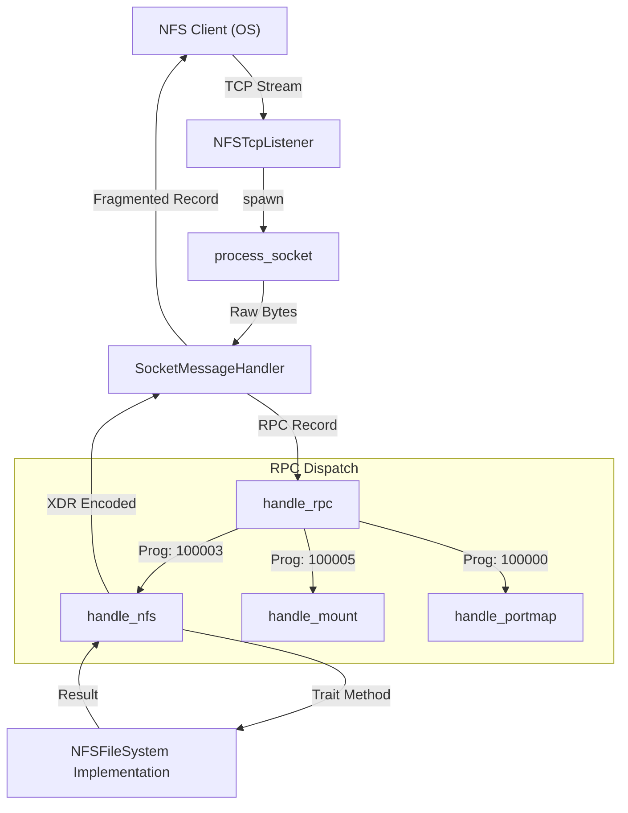
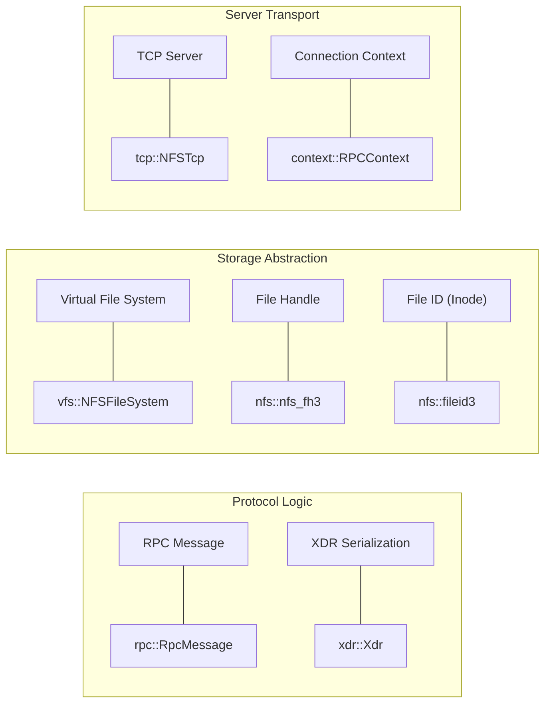

<!-- source: DeepWiki mcp.deepwiki.com · repo huggingface/nfsserve · page 1.1 Getting Started · fetched 2026-10-26 -->

# Getting Started

<details>
<summary>Relevant source files</summary>

The following files were used as context for generating this wiki page:

- [Cargo.toml](Cargo.toml)
- [README.md](README.md)
- [examples/demo.rs](examples/demo.rs)
- [examples/mirrorfs.rs](examples/mirrorfs.rs)

</details>


The `nfsserve` library provides a user-mode NFSv3 server implementation in Rust. Its primary purpose is to enable cross-platform user-mode filesystem mounts by leveraging the native NFS clients built into Linux, macOS, and Windows, avoiding the need for specialized FUSE drivers [README.md:1-21]().

## Adding as a Dependency

To use `nfsserve` in your Rust project, add it to your `Cargo.toml`. The library depends on `tokio` for its async runtime and `byteorder` for XDR serialization [Cargo.toml:20-29]().

```toml
[dependencies]
nfsserve = "0.11.0"
# Required for the async-trait implementation of VFS
async-trait = "0.1.9"
tokio = { version = "1", features = ["net", "io-util", "sync", "rt"] }
```

### Feature Flags

The crate defines two primary feature flags:
*   **`strict`**: Enables stricter linting or protocol checks [Cargo.toml:35]().
*   **`demo`**: Required to run the included examples. It enables `tracing-subscriber`, `intaglio` (for path interning), and the multi-threaded Tokio runtime [Cargo.toml:36]().

## Building and Running Examples

The project includes two main examples that demonstrate how to implement the `NFSFileSystem` trait:
1.  **DemoFS**: A simple in-memory filesystem [examples/demo.rs:75-78]().
2.  **MirrorFS**: A local filesystem proxy that mirrors a host directory over NFS [examples/mirrorfs.rs:30-37]().

### Running the Demo
To host an NFS server on `localhost:11111` using the in-memory filesystem:
```bash
cargo build --example demo --features demo
./target/debug/examples/demo
```
Sources: [README.md:28-32](), [Cargo.toml:39-43]()

## Mounting the Server

Once the server is running, use the following platform-specific commands to mount the exported filesystem. Note that the server usually listens on a non-standard port (e.g., 11111), so the `port` and `mountport` options are critical [README.md:131-133]().

### Linux
```bash
mkdir demo
mount.nfs -o user,noacl,nolock,vers=3,tcp,wsize=1048576,rsize=131072,actimeo=120,port=11111,mountport=11111 localhost:/ demo
```
Sources: [README.md:34-38]()

### macOS
```bash
mkdir demo
mount_nfs -o nolocks,vers=3,tcp,rsize=131072,actimeo=120,port=11111,mountport=11111 localhost:/ demo
```
Sources: [README.md:40-44]()

### Windows
Requires Windows Pro/Enterprise (Home edition lacks the NFS client).
```cmd
mount.exe -o anon,nolock,mtype=soft,fileaccess=6,casesensitive,lang=ansi,rsize=128,wsize=128,timeout=60,retry=2 \\127.0.0.1\ X:
```
Sources: [README.md:46-49]()

## Implementation Overview

To create a custom server, you must implement the `NFSFileSystem` trait. This trait defines how NFS procedures (like `LOOKUP`, `READ`, `WRITE`) interact with your backing storage [README.md:53-61]().

### Data Flow: From Socket to VFS
The following diagram illustrates how a network request is dispatched through the system layers to the VFS implementation.

**Request Dispatch Pipeline**

Sources: [README.md:91-103](), [README.md:108-120](), [examples/mirrorfs.rs:15]()

### Entity Mapping: Natural Language to Code
This diagram maps logical NFS concepts to the specific structs and traits used in the codebase.

**System Entity Map**

Sources: [README.md:142-153](), [examples/demo.rs:5-7](), [examples/mirrorfs.rs:14-16]()

## Key Implementation Requirements

When implementing `NFSFileSystem`, the two most critical aspects are:

1.  **64-bit ID Association**: Every file system object (file, directory, symlink) must be uniquely identifiable by a `u64` (`fileid3`) [README.md:58-60]().
2.  **File Handles (`nfs_fh3`)**: The server converts these IDs into opaque handles. By default, `nfsserve` provides a mechanism to map between `fileid3` and `nfs_fh3` [README.md:142-150]().
3.  **Pagination**: The `readdir` and `readdirplus` methods require careful implementation of cookies to support paginated directory listings [README.md:60-61]().

### Example: Starting a Service
```rust
let fs = DemoFS::default();
let listener = NFSTcpListener::bind(&"127.0.0.1:11111".to_string(), fs).await?;
listener.handle_incoming().await?;
```
Sources: [examples/demo.rs:250-255](), [examples/mirrorfs.rs:15]()

---

