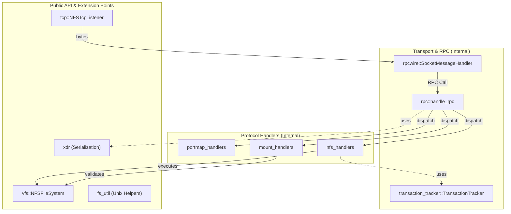
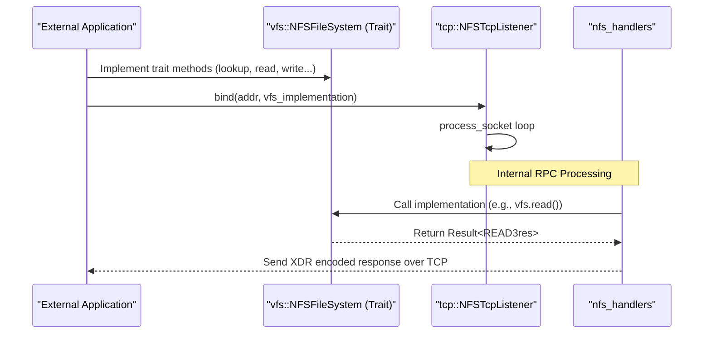

<!-- source: DeepWiki mcp.deepwiki.com · repo huggingface/nfsserve · page 1.2 Project Structure and Module Map · fetched 2026-10-26 -->

# Project Structure and Module Map

Relevant source files

The following files were used as context for generating this wiki page:

- [Cargo.toml](Cargo.toml)
- [src/lib.rs](src/lib.rs)

This page details the crate layout of `nfsserve`, describing the organization of its source code, the distinction between public and internal modules, and the configuration of feature flags. It serves as a guide for developers to understand how the library is structured and how it is consumed by external users.

## Crate Layout and Public API

The `nfsserve` crate is organized into a modular structure that separates the low-level RPC transport and XDR serialization from the high-level NFS protocol logic and Virtual File System (VFS) abstractions.

### Source Tree (`src/`)

The source code is divided into several functional areas, with a clear boundary between internal implementation details and the public API required to implement a custom filesystem.

| Module | Exposure | Responsibility |
|:---|:---|:---|
| `tcp` | **Public** | Handles TCP connection lifecycles and the listener loop [src/lib.rs:21](). |
| `vfs` | **Public** | Defines the `NFSFileSystem` trait and file handle management [src/lib.rs:23](). |
| `nfs` | **Public** | Contains NFSv3 protocol structures and constants [src/lib.rs:15](). |
| `xdr` | **Public** | Serialization framework for External Data Representation [src/lib.rs:7](). |
| `fs_util` | **Public** | Unix-specific filesystem helpers (excluded on Windows) [src/lib.rs:18-19](). |
| `rpc` / `rpcwire` | Internal | Implements RFC 1057 Record Marking and RPC dispatch [src/lib.rs:4-5](). |
| `mount` | Internal | Implements the MOUNT protocol (RFC 1813 Appendix I) [src/lib.rs:9-10](). |
| `portmap` | Internal | Implements a minimal Portmapper (RFC 1057) [src/lib.rs:12-13](). |
| `context` | Internal | Manages per-connection state and shared resources [src/lib.rs:3](). |

### Examples (`examples/`)

The repository includes concrete implementations of the `NFSFileSystem` trait to demonstrate library usage. These are excluded from the core library build but can be run using the `demo` feature flag [Cargo.toml:39-48]().

*   **`demo.rs`**: An in-memory filesystem (`DemoFS`) showing how to manage file entries in a `Vec` [Cargo.toml:42]().
*   **`mirrorfs.rs`**: A local filesystem proxy that mirrors a host directory to an NFS export [Cargo.toml:47]().

**Sources:** [src/lib.rs:1-24](), [Cargo.toml:39-48]()

---

## Module Map and Data Flow

The following diagram illustrates the relationship between the internal modules and the public extension points.

### System Module Interconnectivity

**Sources:** [src/lib.rs:3-24](), [src/tcp/mod.rs:1-50](), [src/rpc/mod.rs:1-20]()

---

## Feature Flags

The crate uses feature flags to manage dependencies and compiler behavior.

### `strict`
When enabled, this flag triggers `#![deny(warnings)]` [src/lib.rs:1](). This is primarily used in CI pipelines to ensure code quality and prevent the introduction of unused variables or deprecated calls.

### `demo`
This feature is required to run the provided examples and enables several optional dependencies [Cargo.toml:36]().
*   **`tracing-subscriber`**: Enables logging output for the demo servers [Cargo.toml:31]().
*   **`tokio/rt-multi-thread`**: Required for the multi-threaded runtime used in examples [Cargo.toml:36]().
*   **`intaglio`**: Used by `MirrorFS` for efficient path interning [Cargo.toml:32]().

**Sources:** [Cargo.toml:34-37](), [src/lib.rs:1]()

---

## External Consumption Pattern

External users interact with `nfsserve` by implementing the `NFSFileSystem` trait and passing it to the `NFSTcpListener`.

### Implementation Flow

### Dependency Usage
To use `nfsserve`, a user adds it to their `Cargo.toml` [Cargo.toml:1-3](). The library relies on `tokio` for its async runtime and `byteorder` for XDR data manipulation [Cargo.toml:21-24]().

**Sources:** [src/lib.rs:21-23](), [Cargo.toml:20-29]()

---

