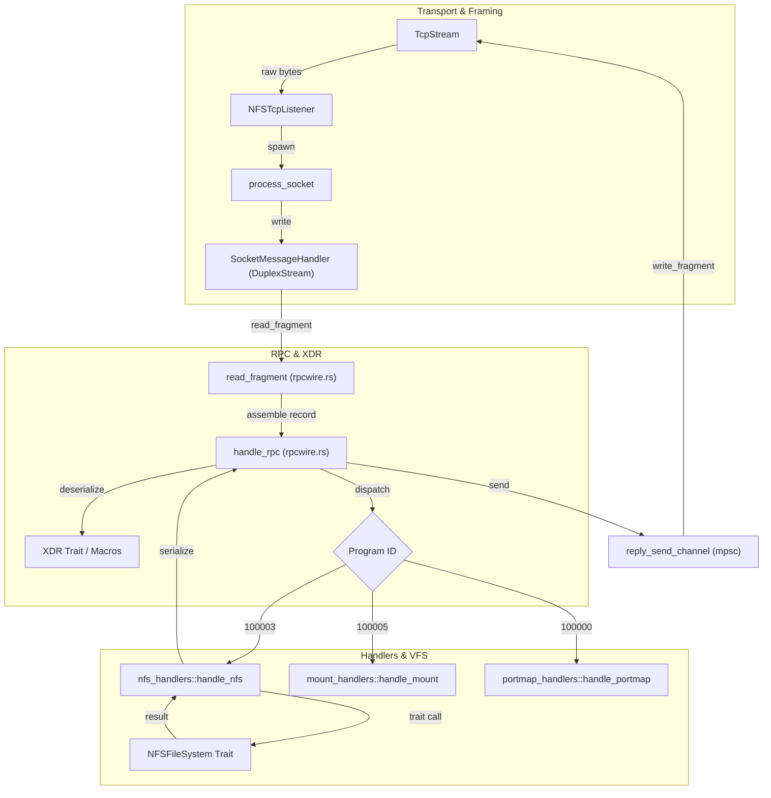

<!-- source: DeepWiki mcp.deepwiki.com · repo huggingface/nfsserve · page 2 Core Architecture · fetched 2026-10-26 -->

# Core Architecture

Relevant source files

The following files were used as context for generating this wiki page:

- [README.md](README.md)
- [src/lib.rs](src/lib.rs)
- [src/rpcwire.rs](src/rpcwire.rs)

The `nfsserve` library implements a layered protocol stack that transforms raw TCP byte streams into high-level virtual filesystem operations. This architecture allows the server to bridge the gap between low-level network communication and the abstract `NFSFileSystem` trait.

### Protocol Layering Overview

The system follows a strict hierarchical processing pipeline:
1.  **Transport Layer**: Manages TCP connections and raw byte buffering.
2.  **RPC Framing**: Handles RFC 1057 Record Marking to delimit messages within the stream.
3.  **RPC Dispatch**: Deserializes the SUN RPC call, verifies credentials, and routes the request to the appropriate program handler (NFS, Mount, or Portmap).
4.  **XDR Layer**: Provides the fundamental serialization/deserialization primitives used by all upper layers.
5.  **VFS Execution**: The final destination where protocol-specific requests are translated into calls against a user-provided filesystem implementation.

### System Flow Diagram

The following diagram illustrates the lifecycle of a request as it moves through the codebase entities:

**Request Flow: From Socket to VFS**

**Sources:** [src/tcp.rs:1-120](), [src/rpcwire.rs:20-74](), [src/rpcwire.rs:126-160](), [README.md:108-119]()

---

### TCP Transport Layer
The entry point for all client connections is the `NFSTcpListener`. It manages the lifecycle of `TcpStream` instances and utilizes a 128 KB read buffer loop to ingest data. Each connection is handled in a dedicated task via `process_socket`, which sets up the internal communication channels for the RPC layer.

For details, see [TCP Transport Layer](#2.1).

**Sources:** [src/tcp.rs:14-30](), [src/tcp.rs:72-100]()

---

### RPC Wire Protocol
The `rpcwire.rs` module implements the Record Marking (RM) standard defined in RFC 1057. Because TCP is a stream protocol, `nfsserve` must manually delimit RPC messages using 4-byte fragment headers. The `SocketMessageHandler` is responsible for reassembling these fragments into complete RPC records before passing them to `handle_rpc` for dispatching.

For details, see [RPC Wire Protocol](#2.2).

**Sources:** [src/rpcwire.rs:76-106](), [src/rpcwire.rs:126-150]()

---

### XDR Serialization Framework
XDR (External Data Representation) serves as the "language" of the RPC calls. The codebase uses a custom `XDR` trait and several code-generation macros (`xdr_struct!`, `xdr_enum_serde!`) to ensure that Rust structures are serialized into the BigEndian, 4-byte aligned format required by the NFS protocol.

For details, see [XDR Serialization Framework](#2.3).

**Sources:** [src/xdr.rs:1-50](), [README.md:85-86]()

---

### Request Context and Transaction Tracking
Every request is accompanied by an `RPCContext`. This structure carries vital metadata including the `NFSFileSystem` implementation, `AUTH_UNIX` credentials, and a `TransactionTracker`. The tracker is critical for protocol correctness, as it detects retransmitted XIDs (Transaction IDs) from the client to prevent executing non-idempotent operations (like `REMOVE`) multiple times.

For details, see [Request Context and Transaction Tracking](#2.4).

**Sources:** [src/context.rs:14-25](), [src/rpcwire.rs:40-45](), [src/transaction_tracker.rs:1-20]()

---

### Architectural Mapping

| Layer | Primary Code Entity | Responsibility |
| :--- | :--- | :--- |
| **Transport** | `NFSTcpListener` [src/tcp.rs:14]() | TCP accept loop and IP binding. |
| **Framing** | `read_fragment` [src/rpcwire.rs:94]() | RFC 1057 fragment reassembly. |
| **Dispatch** | `handle_rpc` [src/rpcwire.rs:20]() | Routing by Program ID (NFS/Mount/Portmap). |
| **Auth** | `auth_unix` [src/rpc.rs:40]() | Parsing UID/GID from RPC headers. |
| **State** | `TransactionTracker` [src/transaction_tracker.rs:8]() | Idempotency and retransmission detection. |
| **Logic** | `nfs_handlers` [src/nfs_handlers.rs:10]() | Translating NFS procedures to VFS calls. |

**Sources:** [src/rpcwire.rs:20-74](), [src/tcp.rs:14-30](), [src/lib.rs:1-24]()

---

