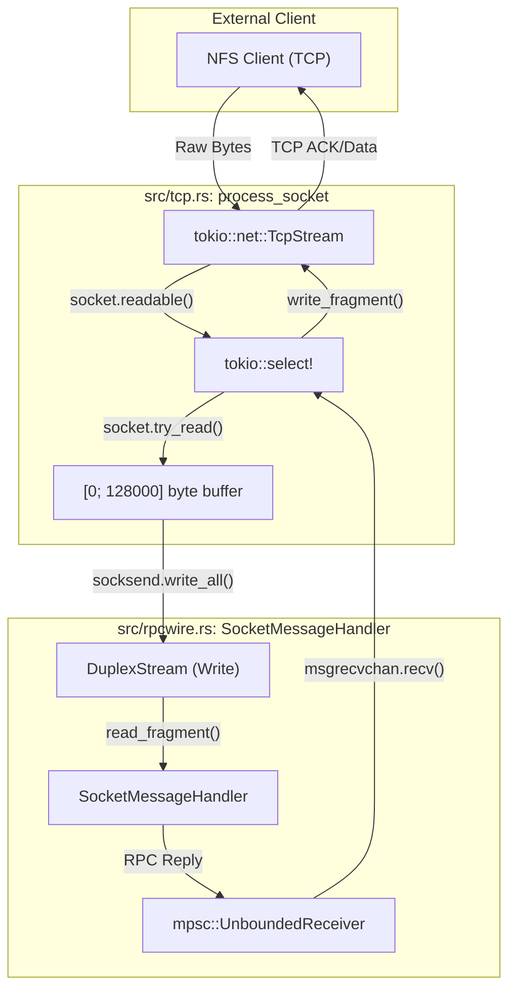
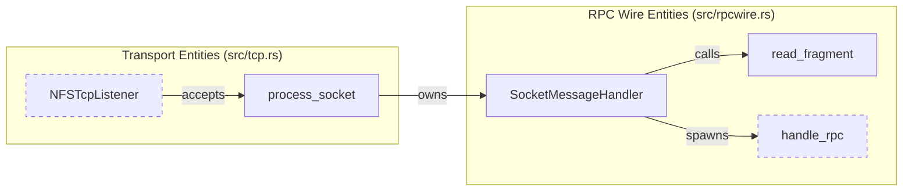

<!-- source: DeepWiki mcp.deepwiki.com · repo huggingface/nfsserve · page 2.1 TCP Transport Layer · fetched 2026-10-26 -->

# TCP Transport Layer

Relevant source files

The following files were used as context for generating this wiki page:

- [src/rpcwire.rs](src/rpcwire.rs)
- [src/tcp.rs](src/tcp.rs)

The TCP Transport Layer is the entry point for all network communication in `nfsserve`. It is responsible for binding to network interfaces, accepting incoming TCP connections, and managing the lifecycle of each socket. This layer bridges the gap between raw byte streams and the structured RPC messages required by the higher layers of the protocol stack.

## NFSTcpListener

The `NFSTcpListener` struct is the primary orchestrator for the transport layer [src/tcp.rs:19-26](). It encapsulates the `tokio::net::TcpListener` and holds the necessary context to initialize new connections, including the virtual filesystem (VFS) implementation, the transaction tracker, and mount signaling channels.

### Auto IP Binding
A unique feature of the listener is its ability to automatically bind to a local IP address when the string `"auto"` is provided to the `bind` function [src/tcp.rs:117-138](). This is particularly useful in environments like Windows where specific loopback IPs might be required for mounting.

The `generate_host_ip` function creates IPs in the `127.88.x.x` range [src/tcp.rs:28-30](). The `bind` logic attempts to bind to these generated IPs sequentially (up to 32 tries) until a successful bind occurs [src/tcp.rs:118-138]().

### Connection Lifecycle
The main execution loop resides in `handle_forever` [src/tcp.rs:196-214](). 
1. **Accept**: The listener waits for a new TCP connection [src/tcp.rs:198]().
2. **Context Creation**: For every connection, a new `RPCContext` is instantiated, cloning the VFS handle and the `TransactionTracker` [src/tcp.rs:199-209]().
3. **Spawn**: The connection is handed off to `process_socket` in a new asynchronous task [src/tcp.rs:211]().

**Sources:** [src/tcp.rs:19-26](), [src/tcp.rs:28-30](), [src/tcp.rs:107-144](), [src/tcp.rs:196-214]()

## The process_socket Connection Loop

The `process_socket` function manages the bidirectional data flow for a single established `TcpStream` [src/tcp.rs:33-85](). It coordinates between the raw socket and the `SocketMessageHandler` using a internal buffering strategy.

### Read Buffer and Flow
The transport layer uses a fixed-size read buffer of **128,000 bytes** (approx. 128 KB) [src/tcp.rs:48](). 

- **Inbound Data**: Raw bytes are read from the socket using `try_read` [src/tcp.rs:50](). These bytes are immediately written into a `DuplexStream` (`socksend`) that feeds the `SocketMessageHandler` [src/tcp.rs:55]().
- **Outbound Data**: The loop monitors a receiver channel (`msgrecvchan`) for processed RPC replies [src/tcp.rs:67](). When a reply arrives, it is wrapped in an RPC record fragment via `write_fragment` and sent back over the wire [src/tcp.rs:73-77]().

### Diagram: Socket Data Flow
The following diagram illustrates how raw bytes move from the `TcpStream` into the RPC processing pipeline.

**Sources:** [src/tcp.rs:33-85](), [src/rpcwire.rs:133-148]()

## Handoff to RPC Layer

The handoff from the transport layer to the RPC layer is mediated by the `SocketMessageHandler`. This struct decouples the byte-stream nature of TCP from the message-oriented nature of RPC.

### Record Reassembly
Because TCP is a stream, RPC messages (which may span multiple fragments) must be reassembled. 
1. `process_socket` writes raw bytes into a `DuplexStream` [src/tcp.rs:55]().
2. A background task calls `SocketMessageHandler::read()` in a loop [src/tcp.rs:37-44]().
3. `read()` invokes `read_fragment`, which parses the 4-byte RFC 1057 Record Marking header to determine fragment length and whether the "Last Fragment" bit is set [src/rpcwire.rs:94-106]().
4. Once a complete record (one or more fragments) is collected in `cur_fragment`, it is dispatched to `handle_rpc` [src/rpcwire.rs:151-160]().

### Diagram: Entity Association
This diagram maps the code entities involved in the transport-to-RPC transition.

### Protocol Constants and Constraints
- **Alignment**: XDR (used by the RPC layer) requires 4-byte alignment, but the TCP layer handles raw bytes. Alignment is enforced during serialization/deserialization in the XDR layer.
- **Max Fragment Size**: While the RFC allows fragments up to $2^{31}-1$ bytes, `nfsserve` asserts that outgoing fragments are within this limit [src/rpcwire.rs:110]().
- **NoDelay**: The transport layer explicitly sets `set_nodelay(true)` on the socket to disable Nagle's algorithm, ensuring low latency for NFS operations [src/tcp.rs:35]().

**Sources:** [src/tcp.rs:33-44](), [src/rpcwire.rs:94-118](), [src/rpcwire.rs:151-170]()

---

