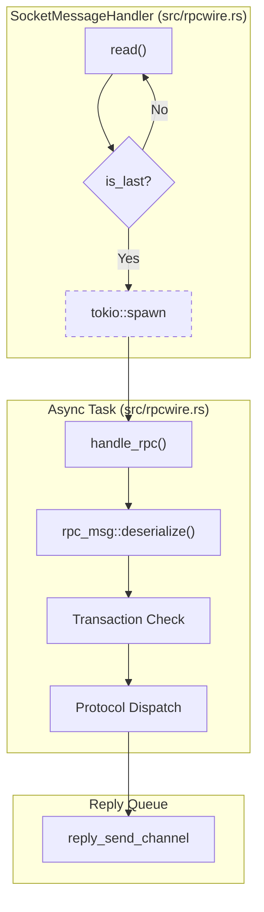
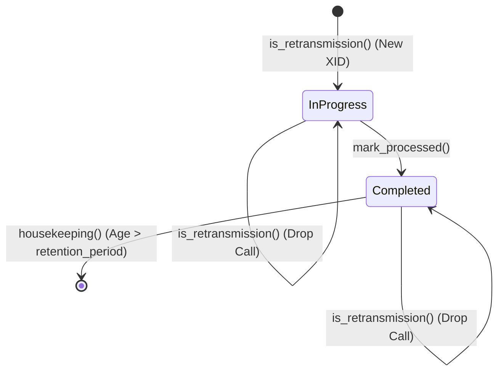

<!-- source: DeepWiki mcp.deepwiki.com · repo huggingface/nfsserve · page 2.2 RPC Wire Protocol · fetched 2026-10-26 -->

# RPC Wire Protocol

Relevant source files

The following files were used as context for generating this wiki page:

- [src/rpc.rs](src/rpc.rs)
- [src/rpcwire.rs](src/rpcwire.rs)
- [src/transaction_tracker.rs](src/transaction_tracker.rs)

The RPC Wire Protocol layer in `nfsserve` implements the Remote Procedure Call (RPC) mechanism as defined in **RFC 1057**. This layer is responsible for framing (Record Marking) over TCP, reassembling fragmented messages, dispatching calls to specific protocol handlers (NFS, Mount, Portmap), and managing transaction idempotency.

## Record Marking and Fragmentation

Because TCP is a stream-oriented transport, RPC messages must be delimited using Record Marking (RM). An RPC message is composed of one or more fragments [src/rpcwire.rs:84-85]().

### Fragment Header Structure
Each fragment is preceded by a 4-byte header [src/rpcwire.rs:95-97]():
*   **Bit 31 (MSB):** The "Last Fragment" flag. If set to 1, this is the final fragment of the RPC record [src/rpcwire.rs:98]().
*   **Bits 0-30:** The length of the fragment data in bytes [src/rpcwire.rs:99]().

### Reassembly Logic
The `read_fragment` function reads the header and the subsequent data into a buffer [src/rpcwire.rs:102-103](). The `SocketMessageHandler` loops until a fragment with the `is_last` bit is received, at which point the complete record is dispatched for processing [src/rpcwire.rs:152-157]().

**Sources:** [src/rpcwire.rs:76-118]()

## Socket Message Handling Pipeline

The `SocketMessageHandler` acts as the primary coordinator for an active TCP connection. It manages the lifecycle of reading fragments, spawning asynchronous tasks for RPC execution, and queuing replies.

### Data Flow: From Socket to Dispatch
1.  **Read:** `SocketMessageHandler::read()` extracts fragments from the `DuplexStream` [src/rpcwire.rs:151-152]().
2.  **Reassemble:** Fragments are appended to `cur_fragment` until the last fragment bit is detected [src/rpcwire.rs:153-154]().
3.  **Spawn:** A new `tokio` task is spawned to handle the complete RPC record. This allows the server to process multiple RPC calls from the same connection concurrently [src/rpcwire.rs:157-160]().
4.  **Execute:** `handle_rpc` deserializes the message and routes it [src/rpcwire.rs:20-24]().
5.  **Reply:** The result is serialized into a `write_buf` and sent back via the `reply_send_channel` [src/rpcwire.rs:168-169]().

### Code Entity Map: Socket Handling
The following diagram illustrates the relationship between the message handler, the dispatch logic, and the asynchronous task boundaries.

Title: RPC Processing Pipeline

**Sources:** [src/rpcwire.rs:126-175]()

## RPC Dispatch Logic (`handle_rpc`)

The `handle_rpc` function is the central router for all incoming RPC calls. It performs several critical validation and extraction steps before handing off to specific program handlers.

### AUTH_UNIX Credential Parsing
If the RPC call contains `AUTH_UNIX` credentials (flavor 1), the server extracts the UID, GID, and machine name [src/rpcwire.rs:29-31](). These credentials are saved into the `RPCContext` for use by the filesystem layer to enforce permissions [src/rpcwire.rs:32]().

### Program Routing
The dispatcher routes calls based on the `prog` field in the `call_body` [src/rpcwire.rs:48-65]():
| Program Constant | Value | Handler Function |
| :--- | :--- | :--- |
| `nfs::PROGRAM` | 100003 | `nfs_handlers::handle_nfs` |
| `portmap::PROGRAM` | 100000 | `portmap_handlers::handle_portmap` |
| `mount::PROGRAM` | 100005 | `mount_handlers::handle_mount` |

If a program is unknown or explicitly unsupported (like `NFS_ACL_PROGRAM`), the server returns a `PROG_UNAVAIL` reply [src/rpcwire.rs:59-64]().

**Sources:** [src/rpcwire.rs:16-74](), [src/rpc.rs:94-111]()

## Retransmission Detection

NFS clients often retransmit requests if a reply is delayed. To ensure idempotency (especially for non-idempotent operations like `REMOVE` or `RENAME`), the `TransactionTracker` monitors active and recently completed requests.

### The Transaction Tracker
The `TransactionTracker` uses a `HashMap` keyed by a tuple of `(xid, client_addr)` [src/transaction_tracker.rs:8](). 
*   **XID:** The 32-bit Transaction ID provided by the client [src/rpc.rs:157]().
*   **Client Address:** The IP address of the requester, ensuring XID collisions between different clients are handled [src/transaction_tracker.rs:24]().

### Logic Flow
1.  **Check:** `is_retransmission` is called at the start of `handle_rpc` [src/rpcwire.rs:40]().
2.  **InProgress:** If the XID is new, it is marked as `TransactionState::InProgress` [src/transaction_tracker.rs:28]().
3.  **Drop:** If the XID is already in the map, the call is dropped to avoid redundant processing [src/rpcwire.rs:44]().
4.  **Complete:** Once the handler finishes, `mark_processed` updates the state to `Completed` with a timestamp [src/transaction_tracker.rs:41]().
5.  **Housekeeping:** Periodically, entries older than the `retention_period` are purged to prevent memory leaks [src/transaction_tracker.rs:46-52]().

Title: Transaction State Transitions

**Sources:** [src/transaction_tracker.rs:5-57](), [src/rpcwire.rs:40-68]()

## Reply Queuing Pipeline

Because RPC calls are processed concurrently in separate tasks, the replies may be generated out of order. The `SocketMessageHandler` utilizes a Multi-Producer Single-Consumer (MPSC) channel to collect these replies.

1.  **Serialization:** Handlers write their responses into a `Vec<u8>` via a `Cursor` [src/rpcwire.rs:158-160]().
2.  **Channel Send:** The completed buffer is wrapped in a `Result` (`SocketMessageType`) and sent to the `reply_send_channel` [src/rpcwire.rs:168-169]().
3.  **Fragmentation for Wire:** The component that consumes the `mpsc::UnboundedReceiver` (typically the transport layer) calls `write_fragment` to add the Record Marking header back onto the response before sending it over the raw TCP socket [src/rpcwire.rs:108-118]().

**Sources:** [src/rpcwire.rs:120-148](), [src/rpcwire.rs:157-174]()

---

