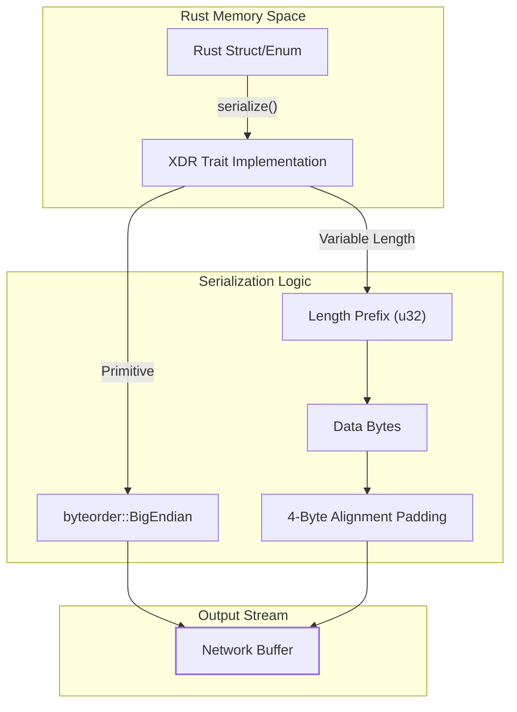
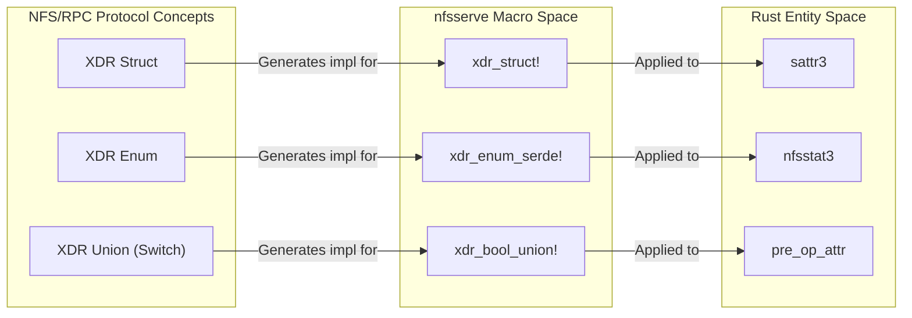

<!-- source: DeepWiki mcp.deepwiki.com · repo huggingface/nfsserve · page 2.3 XDR Serialization Framework · fetched 2026-10-26 -->

# XDR Serialization Framework

<details>
<summary>Relevant source files</summary>

The following files were used as context for generating this wiki page:

- [src/nfs.rs](src/nfs.rs)
- [src/xdr.rs](src/xdr.rs)

</details>


The External Data Representation (XDR) framework provides the serialization and deserialization backbone for `nfsserve`. It implements the standard defined in [RFC 1014](https://datatracker.ietf.org/doc/html/rfc1014) to ensure that data structures used in RPC and NFS protocols are transmitted in a platform-independent, big-endian format with strict alignment rules.

## The XDR Trait

The core of the framework is the `XDR` trait [src/xdr.rs:9-12](). Any type that needs to be transmitted over the wire must implement this trait. It defines two primary methods:
*   `serialize<R: Write>(&self, dest: &mut R)`: Writes the object to a byte stream.
*   `deserialize<R: Read>(&mut self, src: &mut R)`: Populates the object from a byte stream.

### Byte Ordering and Alignment
The framework enforces **Big Endian** byte ordering using the `byteorder` crate, aliased as `XDREndian` [src/xdr.rs:3-4](). 

A critical requirement of XDR is **4-byte alignment** [src/xdr.rs:113-118](). When variable-length data (like `Vec<u8>` or `nfsstring`) is serialized, the framework calculates the necessary padding to ensure the next object starts on a 4-byte boundary.

### XDR Serialization Flow
The following diagram illustrates how the `XDR` trait mediates between Rust memory structures and the Big-Endian wire format.

**Data Flow: Rust Entity to XDR Wire Format**

Sources: [src/xdr.rs:9-12](), [src/xdr.rs:106-131]()

---

## Primitive and Composite Implementations

The framework provides manual implementations for standard Rust types to ensure they conform to XDR specifications:

| Type | XDR Representation | Implementation Details |
| :--- | :--- | :--- |
| `bool` | 4-byte integer | `0` for false, `1` for true [src/xdr.rs:41-51]() |
| `u32` / `i32` | 4 bytes | Big-endian [src/xdr.rs:53-62](), [src/xdr.rs:75-84]() |
| `u64` / `i64` | 8 bytes | Big-endian [src/xdr.rs:64-73](), [src/xdr.rs:86-95]() |
| `[u8; N]` | N bytes | Fixed-size opaque data; no length prefix [src/xdr.rs:97-104]() |
| `Vec<u8>` | u32 + N bytes + Pad | Length-prefixed opaque data with padding [src/xdr.rs:106-131]() |
| `nfsstring` | u32 + N bytes + Pad | Wrapper around `Vec<u8>` [src/xdr.rs:133-140]() |

Sources: [src/xdr.rs:41-140]()

---

## Code Generation Macros

To reduce boilerplate when implementing the protocol, `nfsserve` uses three primary macros to automatically generate `XDR` trait implementations.

### 1. `xdr_struct!`
This macro implements `XDR` for a struct by sequentially calling `serialize`/`deserialize` on each of its fields in the order they are defined.

*   **Usage**: `xdr_struct!(StructName, field1, field2, ...);`
*   **Logic**: Iterates through the provided field identifiers and pipes them to the `dest` or `src` streams [src/xdr.rs:165-181]().

### 2. `xdr_enum_serde!`
Used for simple C-style enumerations where the value is represented as a `u32`.

*   **Logic**: It casts the enum to a `u32` during serialization [src/xdr.rs:21-23](). During deserialization, it reads a `u32` and uses `FromPrimitive` to map it back to the enum variant [src/xdr.rs:24-35]().
*   **Example**: Used for `nfsstat3` [src/nfs.rs:200]().

### 3. `xdr_bool_union!`
This macro handles a specific pattern common in NFSv3: the "Boolean Union". This is typically used for optional attributes (e.g., `pre_op_attr`).

*   **Logic**:
    *   **TRUE Case**: Serializes a `true` (4-byte `1`) followed by the data [src/xdr.rs:209-212]().
    *   **FALSE Case**: Serializes a `false` (4-byte `0`) and nothing else [src/xdr.rs:206-208]().
*   **Structure**: The macro expects a Rust enum with a `Void` variant and a data-carrying variant [src/xdr.rs:191-195]().

### Macro Association Map
This diagram maps the natural language protocol definitions to the specific Rust macros and code entities used to implement them.

**Mapping: Protocol Definitions to Code Entities**

Sources: [src/xdr.rs:165-225](), [src/nfs.rs:200](), [src/nfs.rs:434]()

---

## Data Alignment Implementation

The `Vec<u8>` implementation demonstrates the 4-byte alignment logic used throughout the framework:

```rust
// Serialization Padding Logic
let pad = ((4 - length % 4) % 4) as usize;
let zeros: [u8; 4] = [0, 0, 0, 0];
if pad > 0 {
    dest.write_all(&zeros[..pad])?;
}
```
[src/xdr.rs:113-117]()

During deserialization, the same number of bytes must be consumed from the stream and discarded to keep the read pointer aligned with the next XDR object [src/xdr.rs:126-129]().

Sources: [src/xdr.rs:1-225](), [src/nfs.rs:1-100]()

---

