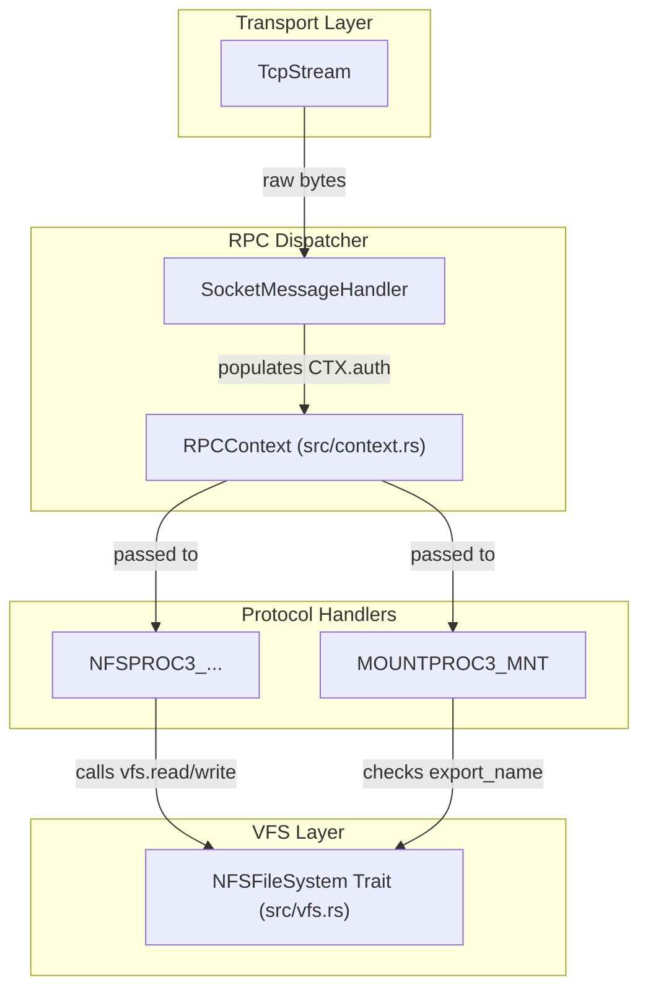
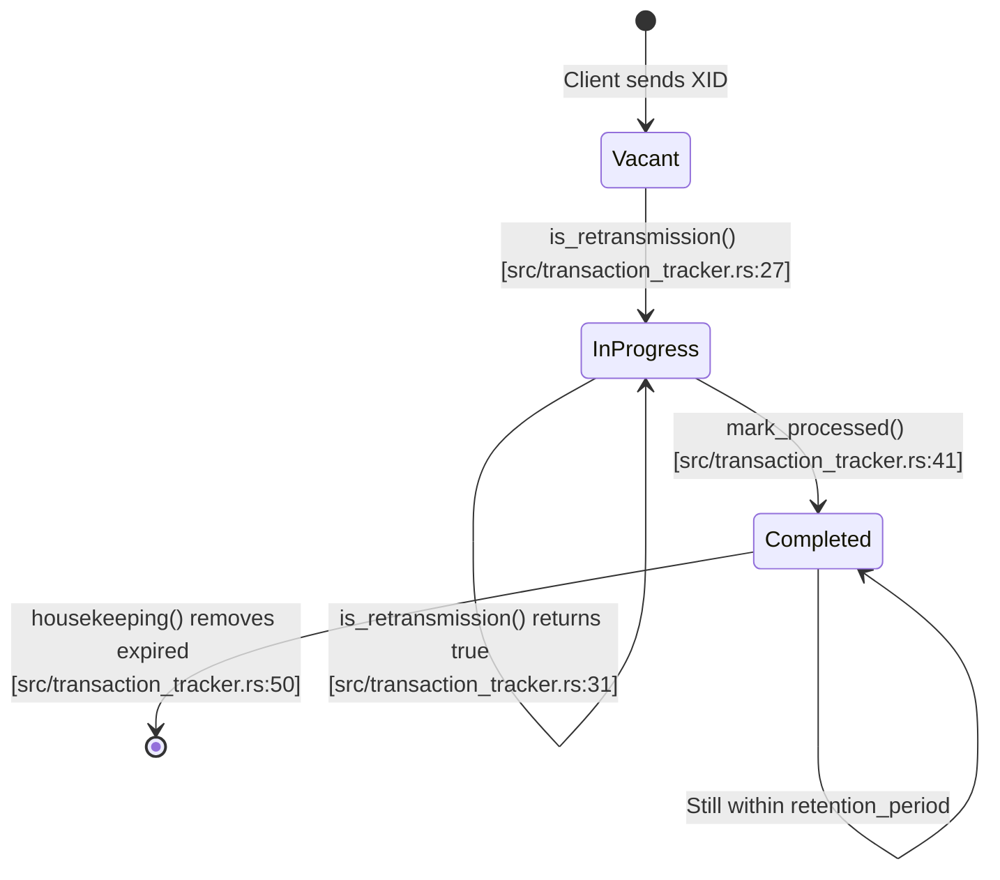

<!-- source: DeepWiki mcp.deepwiki.com · repo huggingface/nfsserve · page 2.4 Request Context and Transaction Tracking · fetched 2026-10-26 -->

# Request Context and Transaction Tracking

Relevant source files

The following files were used as context for generating this wiki page:

- [src/context.rs](src/context.rs)
- [src/transaction_tracker.rs](src/transaction_tracker.rs)

The `nfsserve` library utilizes a unified context object and a specialized transaction tracker to maintain state across the asynchronous RPC pipeline. This system ensures that filesystem operations have access to necessary metadata (credentials, port information, and VFS handles) while providing a mechanism to detect and handle RPC retransmissions from clients.

## The RPCContext Struct

The `RPCContext` is the primary container for request-scoped data. It is designed to be cloned and passed through the asynchronous task chain for every incoming connection. By wrapping heavy components like the VFS and the transaction tracker in `Arc`, the context remains cheap to clone while providing shared access to global state.

### Structure Definition
The `RPCContext` struct is defined in [src/context.rs:10-18]().

| Field | Type | Description |
| :--- | :--- | :--- |
| `local_port` | `u16` | The local port the server is listening on [src/context.rs:11](). |
| `client_addr` | `String` | The IP address and port of the remote NFS client [src/context.rs:12](). |
| `auth` | `auth_unix` | Parsed RPC AUTH_UNIX credentials (UID, GID, etc.) [src/context.rs:13](). |
| `vfs` | `Arc<dyn NFSFileSystem>` | Thread-safe reference to the underlying virtual filesystem [src/context.rs:14](). |
| `mount_signal` | `Option<mpsc::Sender<bool>>` | Channel used to signal the server when a UMNT (unmount) occurs [src/context.rs:15](). |
| `export_name` | `Arc<String>` | The name of the exported directory path [src/context.rs:16](). |
| `transaction_tracker` | `Arc<TransactionTracker>` | Shared state for detecting duplicate RPC XIDs [src/context.rs:17](). |

### Context Lifecycle and Data Flow

The following diagram illustrates how the `RPCContext` bridges the network layer to the VFS execution.

**Context Propagation Diagram**

**Sources:** [src/context.rs:9-18](), [src/vfs.rs:1-10]()

---

## Transaction Tracking and Idempotency

NFS over UDP or unreliable TCP connections may result in client retransmissions. To prevent non-idempotent operations (like `REMOVE` or `CREATE`) from being executed multiple times for the same request, `nfsserve` employs a `TransactionTracker`.

### TransactionTracker Implementation
The `TransactionTracker` uses a `HashMap` to map a unique transaction key—consisting of the RPC Transaction ID (`xid`) and the `client_addr`—to its current state [src/transaction_tracker.rs:8-9]().

#### Transaction States
A transaction can be in one of two states:
1.  **InProgress**: The request has been received and is currently being processed by the VFS [src/transaction_tracker.rs:55]().
2.  **Completed(SystemTime)**: The request processing is finished, and the completion timestamp is recorded for housekeeping purposes [src/transaction_tracker.rs:56]().

### Retransmission Detection Logic
When a request arrives, the server calls `is_retransmission(xid, client_addr)`.
- If the `(xid, client_addr)` pair is not in the map, it is inserted as `InProgress` and the function returns `false` [src/transaction_tracker.rs:27-29]().
- If the pair already exists, it returns `true`, signaling the RPC layer to handle the duplicate (usually by dropping it or returning the cached response) [src/transaction_tracker.rs:30-31]().

Once the RPC handler completes its work, it calls `mark_processed(xid, client_addr)`, which updates the state to `Completed` with the current `SystemTime` [src/transaction_tracker.rs:36-43]().

### Lazy Housekeeping Strategy
To prevent the `transactions` map from growing indefinitely, the `TransactionTracker` performs "lazy housekeeping" [src/transaction_tracker.rs:46-52](). 

Every time `is_retransmission` is called, the tracker locks the mutex and iterates through the map, removing any `Completed` transactions that are older than the configured `retention_period` [src/transaction_tracker.rs:25-26](). `InProgress` transactions are never removed during housekeeping to ensure active requests are protected [src/transaction_tracker.rs:49]().

**Transaction State Machine**

### Transaction Key Components
The tracker uniquely identifies requests using a tuple of `(u32, String)` representing:
1.  **XID**: The 32-bit transaction identifier provided in the RPC header.
2.  **Client Address**: The source address of the client, ensuring that XID collisions between different clients do not interfere with each other [src/transaction_tracker.rs:24]().

**Sources:** [src/transaction_tracker.rs:6-17](), [src/transaction_tracker.rs:19-33](), [src/transaction_tracker.rs:36-43](), [src/transaction_tracker.rs:46-57]()

---

