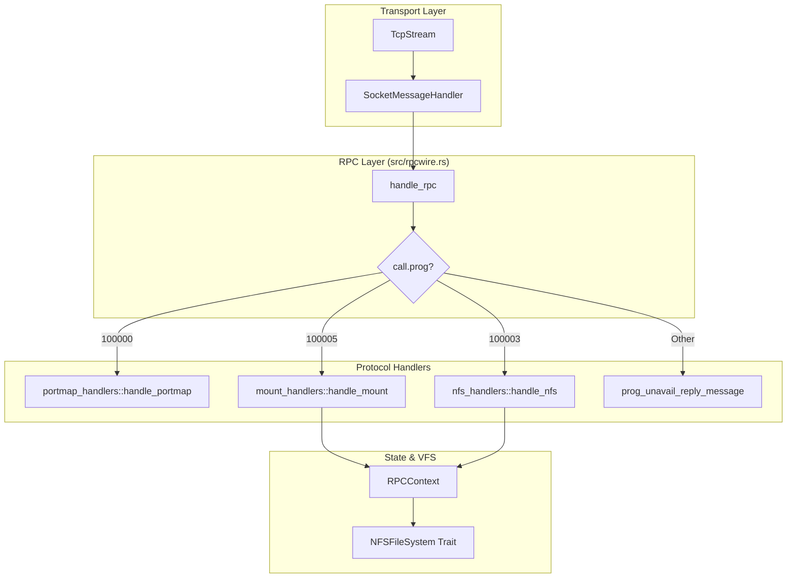

<!-- source: DeepWiki mcp.deepwiki.com · repo huggingface/nfsserve · page 3 Protocol Handlers · fetched 2026-10-26 -->

# Protocol Handlers

Relevant source files

The following files were used as context for generating this wiki page:

- [src/lib.rs](src/lib.rs)
- [src/rpcwire.rs](src/rpcwire.rs)

The `nfsserve` library implements the NFS v3 stack by dispatching RPC calls to specific program handlers. The dispatcher identifies the requested service by its RPC Program Number and routes the request to the appropriate handler module.

### RPC Dispatch Logic

The primary entry point for protocol multiplexing is the `handle_rpc` function in `src/rpcwire.rs`. After validating the RPC version and checking for retransmissions via the `TransactionTracker`, the dispatcher selects a handler based on the `prog` field in the RPC call header.

#### Dispatch Mapping

| RPC Program | Program Number | Handler Function | Description |
|:---|:---|:---|:---|
| **Portmap** | `100000` | `handle_portmap` | Helper service for port discovery. |
| **Mount** | `100005` | `handle_mount` | Handles initial authentication and file handle acquisition. |
| **NFS** | `100003` | `handle_nfs` | The core filesystem operation protocol (v3). |

The dispatcher also explicitly ignores and returns `PROG_UNAVAIL` for auxiliary programs often requested by modern clients, such as `NFS_ACL` (`100227`), `NFS_ID_MAP` (`100270`), and `NFS_METADATA` (`200024`) [src/rpcwire.rs:54-65]().

### Handler Selection Architecture

The following diagram illustrates how a raw byte stream is transformed into a specific protocol procedure call.

**RPC Dispatch Flow**

Sources: [src/rpcwire.rs:20-74](), [src/lib.rs:9-16]()

---

### [Portmap Handler](#3.1)
The Portmap handler provides a "fake" portmapper implementation. Since `nfsserve` typically runs the Mount and NFS services on the same TCP port, the Portmap handler simply directs clients to the current listener's port. It implements `PMAPPROC_GETPORT` and `PMAPPROC_NULL` while rejecting state-altering calls like `SET` or `UNSET`.

For details, see [Portmap Handler](#3.1).

### [Mount Handler](#3.2)
The Mount handler implements the MOUNT v3 protocol (RFC 1813). It acts as the gatekeeper for the filesystem, validating export paths requested by the client and returning the initial root file handle. It also handles export listing and provides a signaling mechanism (`mount_signal`) to track active mounts.

For details, see [Mount Handler](#3.2).

### [NFS v3 Handler](#3.3)
The NFS v3 handler is the most complex component, implementing the core filesystem operations. It translates RPC procedures (like `READ`, `WRITE`, `LOOKUP`, and `READDIRPLUS`) into method calls on the `NFSFileSystem` trait. It manages Weak Cache Consistency (WCC) data and ensures that filesystem capabilities (e.g., read-only status) are enforced at the protocol level.

For details, see [NFS v3 Handler](#3.3).

---

### Protocol Entity Mapping

This table maps the high-level protocol concepts to the specific internal modules and constants used in the code.

| Protocol Concept | Code Constant / Module | Source File |
|:---|:---|:---|
| **NFS Program ID** | `nfs::PROGRAM` (100003) | [src/nfs.rs]() |
| **Mount Program ID** | `mount::PROGRAM` (100005) | [src/mount.rs]() |
| **Portmap Program ID** | `portmap::PROGRAM` (100000) | [src/portmap.rs]() |
| **RPC Context** | `RPCContext` | [src/context.rs]() |
| **NFS Dispatcher** | `handle_nfs` | [src/nfs_handlers.rs]() |
| **Mount Dispatcher** | `handle_mount` | [src/mount_handlers.rs]() |
| **Portmap Dispatcher** | `handle_portmap` | [src/portmap_handlers.rs]() |

Sources: [src/rpcwire.rs:48-53](), [src/lib.rs:3-23]()

---

