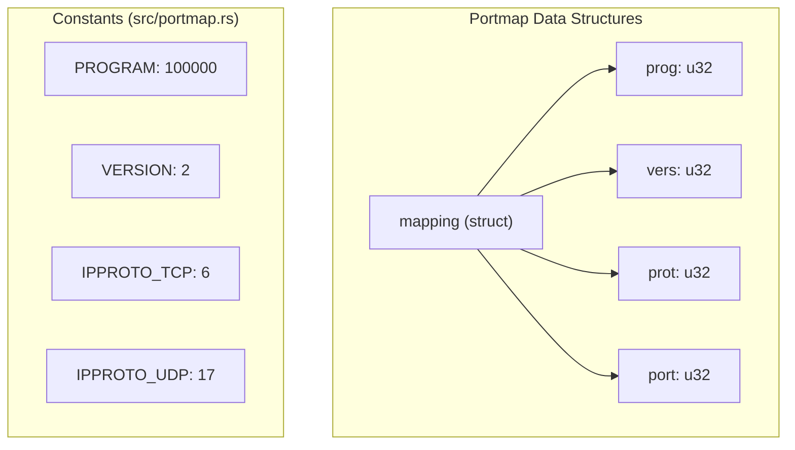
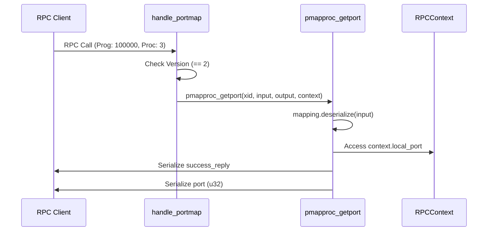

<!-- source: DeepWiki mcp.deepwiki.com · repo huggingface/nfsserve · page 3.1 Portmap Handler · fetched 2026-10-26 -->

# Portmap Handler

Relevant source files

The following files were used as context for generating this wiki page:

- [src/portmap.rs](src/portmap.rs)
- [src/portmap_handlers.rs](src/portmap_handlers.rs)

The Portmap handler in `nfsserve` implements a subset of the Portmapper protocol (RPC program 100000) as defined in **RFC 1057 Appendix A** [src/portmap_handlers.rs:13-25](). In a standard NFS environment, the portmapper (or `rpcbind`) is a separate service that helps clients discover which TCP/UDP ports other RPC services (like `mountd` or `nfsd`) are listening on.

In `nfsserve`, the Portmap handler is "fake" in that it is embedded directly into the same process and listener as the NFS and Mount services. It exists primarily to satisfy clients that attempt to query the portmapper on the same port they initially connected to.

## Portmap Program Definition

The handler uses the `PortmapProgram` enum to represent the procedures defined in the specification.

| Procedure | Value | Status | Description |
| :--- | :--- | :--- | :--- |
| `PMAPPROC_NULL` | 0 | Implemented | Standard RPC ping/connectivity test. |
| `PMAPPROC_SET` | 1 | `proc_unavail` | Registers a new port mapping. Unsupported. |
| `PMAPPROC_UNSET` | 2 | `proc_unavail` | Unregisters a port mapping. Unsupported. |
| `PMAPPROC_GETPORT` | 3 | Implemented | Returns the port for a given program/version/protocol. |
| `PMAPPROC_DUMP` | 4 | `proc_unavail` | Lists all registered mappings. Unsupported. |
| `PMAPPROC_CALLIT` | 5 | `proc_unavail` | Indirect RPC call through the portmapper. Unsupported. |

Sources: [src/portmap_handlers.rs:29-38](), [src/portmap_handlers.rs:54-60]()

### Portmap Mapping Structure
The `mapping` struct is the primary data structure for Portmap queries, containing the program number, version, protocol (TCP/UDP), and port [src/portmap.rs:15-21]().

Sources: [src/portmap.rs:15-25]()

## Request Dispatching

The entry point for Portmap requests is `handle_portmap`. It performs a version check against `portmap::VERSION` (v2) before dispatching to specific procedure handlers [src/portmap_handlers.rs:40-51]().

1.  **Version Validation**: If the requested version does not match, it returns a `prog_mismatch_reply_message` [src/portmap_handlers.rs:47-51]().
2.  **Procedure Mapping**: It converts the `u32` procedure ID into a `PortmapProgram` enum using `FromPrimitive` [src/portmap_handlers.rs:52]().
3.  **Execution**: 
    *   `PMAPPROC_NULL` and `PMAPPROC_GETPORT` are routed to their respective functions [src/portmap_handlers.rs:55-56]().
    *   All other procedures return `proc_unavail_reply_message` [src/portmap_handlers.rs:57-59]().

Sources: [src/portmap_handlers.rs:40-62]()

## Procedure Implementations

### PMAPPROC_NULL
This procedure takes no arguments and returns an empty successful RPC reply. It is used by clients to verify that the Portmapper service is alive and reachable [src/portmap_handlers.rs:64-71]().

### PMAPPROC_GETPORT
This is the core of the "fake" portmapper design. When a client asks for the port of a program (such as the Mount or NFS program), `nfsserve` ignores the specific program requested and returns its own `local_port` [src/portmap_handlers.rs:76-90]().

*   **Data Flow**:
    1.  The handler deserializes a `mapping` struct from the input stream [src/portmap_handlers.rs:82-83]().
    2.  It serializes a successful RPC header to the output stream [src/portmap_handlers.rs:85]().
    3.  It retrieves the `local_port` from the `RPCContext` [src/portmap_handlers.rs:86]().
    4.  It serializes this port as a `u32` to the output [src/portmap_handlers.rs:88]().

This behavior ensures that if a client connects to `nfsserve` and asks "Where is the NFS service?", the server responds "Right here on this same port."

Sources: [src/portmap_handlers.rs:40-62](), [src/portmap_handlers.rs:76-90]()

## Unsupported Procedures
Procedures such as `PMAPPROC_SET`, `PMAPPROC_UNSET`, and `PMAPPROC_DUMP` return `proc_unavail` [src/portmap_handlers.rs:57-59](). 

The design rationale is that `nfsserve` is a specialized, single-purpose NFS server. It does not act as a general-purpose system portmapper; it only provides enough Portmapper functionality to satisfy NFS clients that expect a portmapper to be co-located with the service. Since the service mapping is static (everything is on the same port), registration (`SET`/`UNSET`) and complex listing (`DUMP`) are unnecessary.

Sources: [src/portmap_handlers.rs:54-60]()

---

