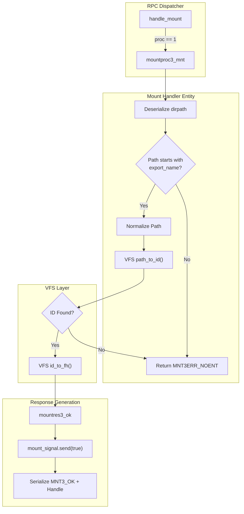
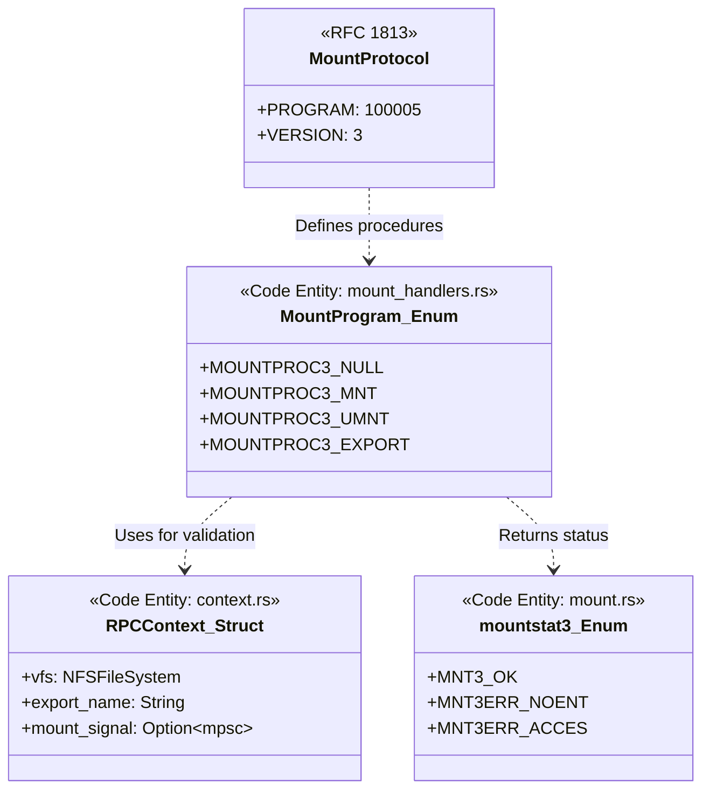

<!-- source: DeepWiki mcp.deepwiki.com · repo huggingface/nfsserve · page 3.2 Mount Handler · fetched 2026-10-26 -->

# Mount Handler

Relevant source files

The following files were used as context for generating this wiki page:

- [src/mount.rs](src/mount.rs)
- [src/mount_handlers.rs](src/mount_handlers.rs)

The Mount Handler implements the MOUNT v3 protocol as specified in **RFC 1813 Appendix I** [src/mount_handlers.rs:13-24](). It serves as the entry point for NFS clients to obtain an initial file handle for a specific exported directory. Once a client successfully "mounts" a path, it uses the returned file handle to transition to the main NFS v3 protocol.

### Protocol Overview

The Mount protocol operates on Program `100005`, Version `3` [src/mount.rs:15-16](). It is handled by the `handle_mount` function, which dispatches incoming RPC calls to specific procedure implementations [src/mount_handlers.rs:39-59]().

| Procedure | Name | Description |
| :--- | :--- | :--- |
| 0 | `MOUNTPROC3_NULL` | Ping the server to check availability [src/mount_handlers.rs:61-68](). |
| 1 | `MOUNTPROC3_MNT` | Validate a path and return a root file handle [src/mount_handlers.rs:78-122](). |
| 2 | `MOUNTPROC3_DUMP` | Returns a list of current mounts (Not fully implemented) [src/mount_handlers.rs:32](). |
| 3 | `MOUNTPROC3_UMNT` | Signals that a client has unmounted a path [src/mount_handlers.rs:176-192](). |
| 4 | `MOUNTPROC3_UMNTALL` | Signals that all paths are unmounted [src/mount_handlers.rs:194-207](). |
| 5 | `MOUNTPROC3_EXPORT` | Returns the list of exported filesystems [src/mount_handlers.rs:158-174](). |

### Mount Request Pipeline (MOUNTPROC3_MNT)

The `mountproc3_mnt` function is the core of the mount handler. It performs path validation against the configured export and interacts with the VFS to generate the initial file handle.

**Mount Logic Flow:**
1.  **Path Extraction**: Deserializes the `dirpath` from the XDR input [src/mount_handlers.rs:84-85]().
2.  **Export Validation**: Checks if the requested path starts with the `context.export_name` [src/mount_handlers.rs:88]().
3.  **Path Normalization**: Strips the export prefix and ensures the path is formatted correctly for the VFS (e.g., leading `/`) [src/mount_handlers.rs:89-93]().
4.  **VFS Lookup**: Calls `context.vfs.path_to_id(&path)` to verify the directory exists and retrieve its internal ID [src/mount_handlers.rs:101]().
5.  **Handle Generation**: Converts the ID to an `fhandle3` using `context.vfs.id_to_fh(fileid)` [src/mount_handlers.rs:103]().
6.  **Signaling**: If a `mount_signal` channel exists in the `RPCContext`, it sends `true` to notify the application of a successful mount [src/mount_handlers.rs:110-112]().
7.  **Response**: Returns `MNT3_OK` along with the file handle and supported authentication flavors (`AUTH_NULL`, `AUTH_UNIX`) [src/mount_handlers.rs:104-115]().

#### Mount Procedure Data Flow
The following diagram traces a mount request from the RPC dispatcher through the VFS.

**Title: Mount Procedure Logic**

Sources: [src/mount_handlers.rs:39-122](), [src/context.rs:7-15]()

### Export Listing (MOUNTPROC3_EXPORT)

The `mountproc3_export` procedure allows clients to discover what filesystems are available for mounting. In `nfsserve`, this is currently limited to returning the single `export_name` defined in the `RPCContext` [src/mount_handlers.rs:162-174]().

The response follows the RFC structure for an `exportnode`:
*   `ex_dir`: The directory path (from `context.export_name`) [src/mount_handlers.rs:168]().
*   `ex_groups`: A list of client groups (hardcoded to `false`/empty) [src/mount_handlers.rs:170]().
*   `ex_next`: Pointer to the next export (hardcoded to `false`/empty) [src/mount_handlers.rs:172]().

Sources: [src/mount_handlers.rs:124-174]()

### Unmount Signaling

While the Mount protocol is technically stateless (the server doesn't strictly need to track unmounts for NFS v3 to function), `nfsserve` provides a mechanism to signal the host application when a client unmounts.

*   **MOUNTPROC3_UMNT**: Triggered when a client unmounts a specific path. It sends `false` via the `mount_signal` [src/mount_handlers.rs:176-192]().
*   **MOUNTPROC3_UMNTALL**: Triggered when a client signals it is unmounting all paths. It also sends `false` via the `mount_signal` [src/mount_handlers.rs:194-207]().

### Error Handling and Status Codes

The handler uses the `mountstat3` enum to communicate success or failure to the client [src/mount.rs:29-40]().

| Error Code | Value | Description |
| :--- | :--- | :--- |
| `MNT3_OK` | 0 | Success [src/mount.rs:30]() |
| `MNT3ERR_NOENT` | 2 | Export or directory does not exist [src/mount.rs:32]() |
| `MNT3ERR_ACCES` | 13 | Permission denied [src/mount.rs:34]() |
| `MNT3ERR_NOTDIR` | 20 | Attempted to mount a non-directory [src/mount.rs:35]() |
| `MNT3ERR_SERVERFAULT` | 10006 | Internal server error [src/mount.rs:39]() |

#### Entity Mapping: Protocol to Implementation
This diagram maps the RFC-defined protocol entities to the Rust types and functions in the codebase.

**Title: Mount Protocol Entity Mapping**

Sources: [src/mount.rs:15-41](), [src/mount_handlers.rs:28-37](), [src/context.rs:7-15]()

---

