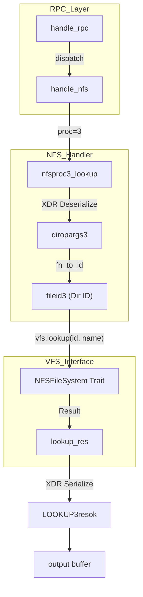
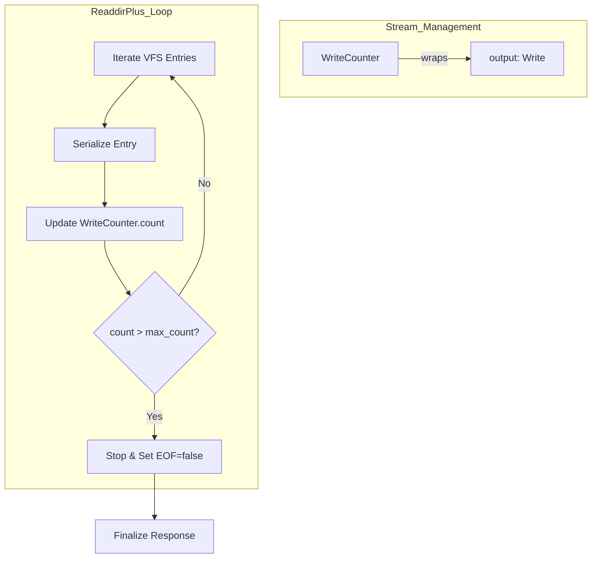

<!-- source: DeepWiki mcp.deepwiki.com · repo huggingface/nfsserve · page 3.3 NFS v3 Handler · fetched 2026-10-26 -->

# NFS v3 Handler

Relevant source files

The following files were used as context for generating this wiki page:

- [src/nfs.rs](src/nfs.rs)
- [src/nfs_handlers.rs](src/nfs_handlers.rs)
- [src/write_counter.rs](src/write_counter.rs)

The NFS v3 Handler is the core logic engine of `nfsserve`, responsible for implementing the procedures defined in RFC 1813. It dispatches incoming RPC calls to specific handler functions, interacts with the `NFSFileSystem` trait to perform I/O, and manages the serialization of complex NFS response structures including Weak Cache Consistency (WCC) data.

## Dispatch Logic

The entry point for all NFS operations is `handle_nfs` [src/nfs_handlers.rs:118-162](). It verifies the NFS version [src/nfs_handlers.rs:125-129]() and maps the RPC procedure number to the `NFSProgram` enum [src/nfs_handlers.rs:130-130]().

### NFS v3 Procedure Mapping

| Procedure | Enum Variant | Handler Function |
| :--- | :--- | :--- |
| 0 | `NFSPROC3_NULL` | `nfsproc3_null` |
| 1 | `NFSPROC3_GETATTR` | `nfsproc3_getattr` |
| 2 | `NFSPROC3_SETATTR` | `nfsproc3_setattr` |
| 3 | `NFSPROC3_LOOKUP` | `nfsproc3_lookup` |
| 4 | `NFSPROC3_ACCESS` | `nfsproc3_access` |
| 6 | `NFSPROC3_READ` | `nfsproc3_read` |
| 7 | `NFSPROC3_WRITE` | `nfsproc3_write` |
| 8 | `NFSPROC3_CREATE` | `nfsproc3_create` |
| 12 | `NFSPROC3_REMOVE` | `nfsproc3_remove` |
| 13 | `NFSPROC3_RMDIR` | `nfsproc3_remove` (shared logic) |
| 14 | `NFSPROC3_RENAME` | `nfsproc3_rename` |
| 17 | `NFSPROC3_READDIRPLUS`| `nfsproc3_readdirplus` |
| 19 | `NFSPROC3_FSINFO` | `nfsproc3_fsinfo` |

**Sources:** [src/nfs_handlers.rs:89-162]()

## Procedure Implementations

### Metadata and Traversal
*   **GETATTR**: Retrieves file attributes (`fattr3`). It converts the `nfs_fh3` handle to an internal ID via `context.vfs.fh_to_id` before calling the VFS [src/nfs_handlers.rs:188-220]().
*   **LOOKUP**: Searches for a filename within a directory handle. It returns the file handle and attributes of the found object, along with the directory's post-op attributes [src/nfs_handlers.rs:223-281]().
*   **ACCESS**: Checks access permissions (READ, LOOKUP, MODIFY, EXTEND, DELETE) based on the caller's credentials [src/nfs_handlers.rs:356-407]().

### Data Operations
*   **READ**: Reads data from a file. It enforces `VFSCapabilities` and handles the `count` requested by the client [src/nfs_handlers.rs:433-499]().
*   **WRITE**: Writes data to a file. It supports different stable-storage requirements (`UNSTABLE`, `DATA_SYNC`, `FILE_SYNC`) and returns a `writeverf3` [src/nfs_handlers.rs:693-792]().
*   **READDIRPLUS**: An optimized directory listing that returns both directory entries and their associated metadata in a single call to reduce RPC round-trips [src/nfs_handlers.rs:608-691]().

### Filesystem Management
*   **FSINFO**: Returns static information about the filesystem, such as maximum read/write sizes and preferred alignment [src/nfs_handlers.rs:501-554]().
*   **FSSTAT**: Returns dynamic information, including total/free disk space and inode counts [src/nfs_handlers.rs:569-606]().

**Sources:** [src/nfs_handlers.rs:188-792](), [src/nfs.rs:101-198]()

## Weak Cache Consistency (WCC) Data

NFS v3 uses WCC data to help clients maintain cache consistency. This consists of `pre_op_attr` (attributes before the operation) and `post_op_attr` (attributes after).

The handler frequently uses the `wcc_data` struct [src/nfs.rs:420-424](). For operations like `REMOVE` or `WRITE`, the handler captures the initial state, performs the VFS action, and then captures the final state to populate this structure [src/nfs_handlers.rs:854-918]().

### Data Flow: NFS Handler to VFS
This diagram illustrates how a `NFSPROC3_LOOKUP` request is dispatched through the handler into the VFS trait.

Title: Lookup Procedure Data Flow

**Sources:** [src/nfs_handlers.rs:118-162](), [src/nfs_handlers.rs:223-281]()

## Capabilities and Constraints

### VFSCapabilities Enforcement
The handler respects the `VFSCapabilities` flags provided by the VFS implementation [src/vfs.rs:13-20]().
*   If `read_only` is true, operations like `SETATTR`, `WRITE`, `CREATE`, and `REMOVE` return `NFS3ERR_ROFS` [src/nfs_handlers.rs:815-819]().
*   The `max_read_size` and `max_write_size` reported in `FSINFO` are derived from these capabilities [src/nfs_handlers.rs:528-531]().

### Response Size Limiting
To prevent memory exhaustion and respect RPC limits, `nfsserve` uses a `WriteCounter` [src/write_counter.rs:6-9]() to track the size of serialized responses.

In `nfsproc3_readdirplus`, the handler wraps the output stream in a `WriteCounter` and checks the `bytes_written` during entry iteration. If the size exceeds the client's requested `max_count`, the handler terminates the entry list early and sets the `EOF` flag to false [src/nfs_handlers.rs:661-681]().

Title: Response Size Limiting Logic

**Sources:** [src/write_counter.rs:6-43](), [src/nfs_handlers.rs:661-681]()

---

