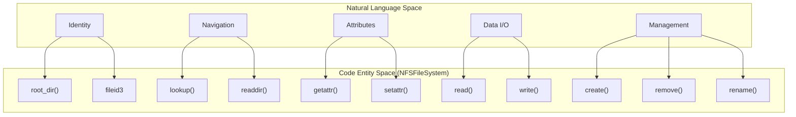
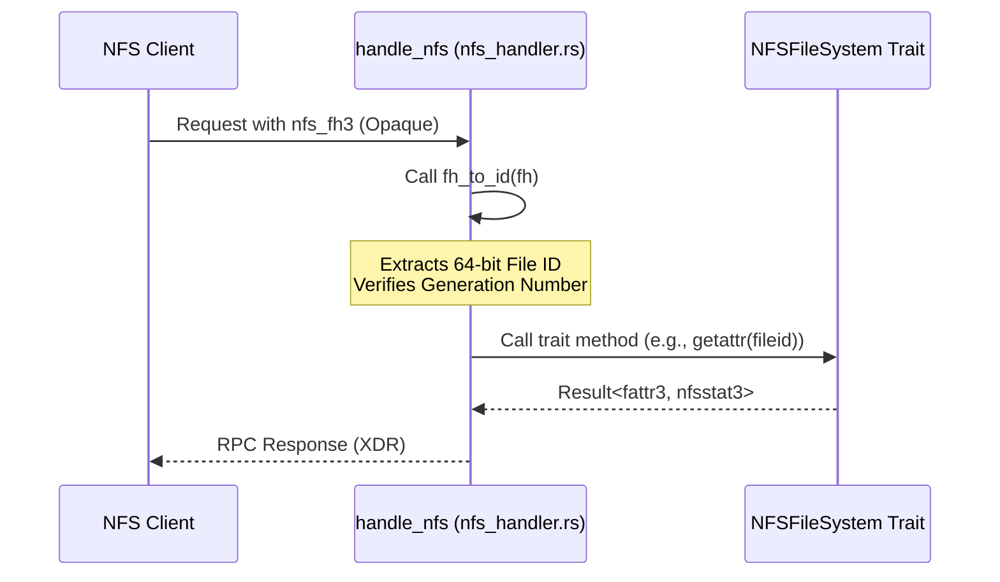

<!-- source: DeepWiki mcp.deepwiki.com · repo huggingface/nfsserve · page 4.1 NFSFileSystem Trait Reference · fetched 2026-10-26 -->

# NFSFileSystem Trait Reference

Relevant source files

The following files were used as context for generating this wiki page:

- [src/nfs.rs](src/nfs.rs)
- [src/vfs.rs](src/vfs.rs)

The `NFSFileSystem` trait is the primary extension point for `nfsserve`. It defines the interface that any backend (e.g., in-memory, local disk, or remote API) must implement to be exposed as an NFSv3 share. This page provides a technical reference for the trait methods, the file handle generation scheme, and the pagination model.

## Trait Definition and Core Concepts

The trait is defined as an `#[async_trait]` to allow for non-blocking I/O operations in backends.

### File Identification (fileid3)
In `nfsserve`, files are uniquely identified by a 64-bit `fileid3` (equivalent to a Unix inode number) [src/vfs.rs:71-71](). The value `0` is reserved and must not be used by implementations [src/vfs.rs:93-93]().

### Opaque File Handles and Generation Numbers
NFS clients communicate using opaque file handles. `nfsserve` automatically constructs these handles by combining a 64-bit **Generation Number** and the 64-bit **File ID** [src/vfs.rs:72-75]().

The `GENERATION_NUMBER` is initialized once at server startup using the current system time in milliseconds [src/vfs.rs:52-59](). This ensures that if the server restarts, any file handles held by clients become "stale" (NFS3ERR_STALE), preventing accidental operations on recycled IDs after a reboot [src/vfs.rs:73-74]().

### Mapping Natural Language to Code Entities

The following diagram illustrates how abstract filesystem concepts map to specific Rust entities within the `NFSFileSystem` trait.

**Entity Mapping: Filesystem Concepts to Trait Methods**

Sources: [src/vfs.rs:95-173]()

## Method Reference

### Metadata and Capabilities

| Method | Description | Implementation Notes |
| :--- | :--- | :--- |
| `capabilities()` | Returns `VFSCapabilities` (`ReadOnly` or `ReadWrite`). | Used by the NFS handler to enforce permissions at the protocol level [src/vfs.rs:97-97](). |
| `root_dir()` | Returns the `fileid3` of the root directory `/`. | This is the entry point for all client mounts [src/vfs.rs:98-99](). |
| `getattr(id)` | Returns `fattr3` (attributes) for a given ID. | **Critical Path:** Must be highly optimized as NFS clients call this frequently to check for cache invalidation [src/vfs.rs:109-111](). |
| `fsinfo(id)` | Returns `fsinfo3` (static filesystem info). | Provides info like preferred read/write sizes and link counts [src/vfs.rs:202-202](). |
| `fsstat(id)` | Returns `fsstat3` (dynamic capacity info). | Provides info on total/free space [src/vfs.rs:205-205](). |

### Directory Operations

| Method | Description | Implementation Notes |
| :--- | :--- | :--- |
| `lookup(dirid, name)` | Finds the `fileid3` of a file within a directory. | Must be fast. Used for path traversal [src/vfs.rs:107-107](). |
| `readdir(dirid, start_after, max)` | Lists directory contents with pagination. | Returns `ReadDirResult`. Uses `start_after` for deterministic pagination instead of cookies [src/vfs.rs:168-173](). |
| `readdir_simple(dirid, count)` | Simplified listing (names and IDs only). | Default implementation wraps `readdir` [src/vfs.rs:177-179](). |

### File Manipulation

| Method | Description | Error Handling |
| :--- | :--- | :--- |
| `read(id, offset, count)` | Reads data from a file. | Returns `(Vec<u8>, bool)` where bool is EOF [src/vfs.rs:121-121](). |
| `write(id, offset, data)` | Writes data to a file. | Should return `NFS3ERR_ROFS` if the filesystem is read-only [src/vfs.rs:128-128](). |
| `setattr(id, sattr3)` | Updates file attributes (mode, mtime, etc). | Returns updated `fattr3` [src/vfs.rs:115-115](). |
| `create(dirid, name, attr)` | Creates a new file. | Returns `(fileid3, fattr3)` [src/vfs.rs:133-133](). |
| `remove(dirid, name)` | Deletes a file. | [src/vfs.rs:147-147]() |
| `rename(from_dir, from_name, ...)`| Moves/renames a file or directory. | [src/vfs.rs:152-158]() |

## Data Flow: Handle Resolution

The following diagram describes the internal flow when an RPC request arrives with an opaque handle and needs to be resolved to a filesystem action.

**Logic Flow: RPC Handle to VFS Method**

Sources: [src/vfs.rs:72-75](), [src/vfs.rs:218-228]()

## Default Implementation Helpers

The trait provides several default methods for handle management that implementations usually do not need to override:

*   **`id_to_fh(id)`**: Packs a `fileid3` and the global `GENERATION_NUMBER` into a 64-byte `nfs_fh3` [src/vfs.rs:210-216]().
*   **`fh_to_id(fh)`**: Unpacks an `nfs_fh3`. It returns `NFS3ERR_STALE` if the handle's generation number does not match the server's current `GENERATION_NUMBER` [src/vfs.rs:218-228]().
*   **`path_to_id(path)`**: A helper that recursively calls `lookup` to resolve a full path (e.g., `"/a/b/c"`) into a `fileid3`. It starts from `root_dir()` and handles the leading slash [src/vfs.rs:230-249]().

## Pagination Strategy

`nfsserve` departs from the standard NFS cookie verifier scheme for simplicity:
1.  **No Cookie Verifiers**: The server does not maintain stateful verifiers for directory streams [src/vfs.rs:79-79]().
2.  **Deterministic Ordering**: Implementations of `readdir` must ensure that directory listing is deterministic so that `start_after` (the ID of the last entry seen by the client) correctly identifies the next entry in the sequence [src/vfs.rs:161-163]().
3.  **Truncation**: Because NFSv3 limits response size by bytes rather than entry count, the caller (NFS handler) may truncate the results provided by the `NFSFileSystem` implementation to fit the client's requested buffer size [src/vfs.rs:84-87]().

Sources: [src/vfs.rs:1-250](), [src/nfs.rs:1-106]()

---

