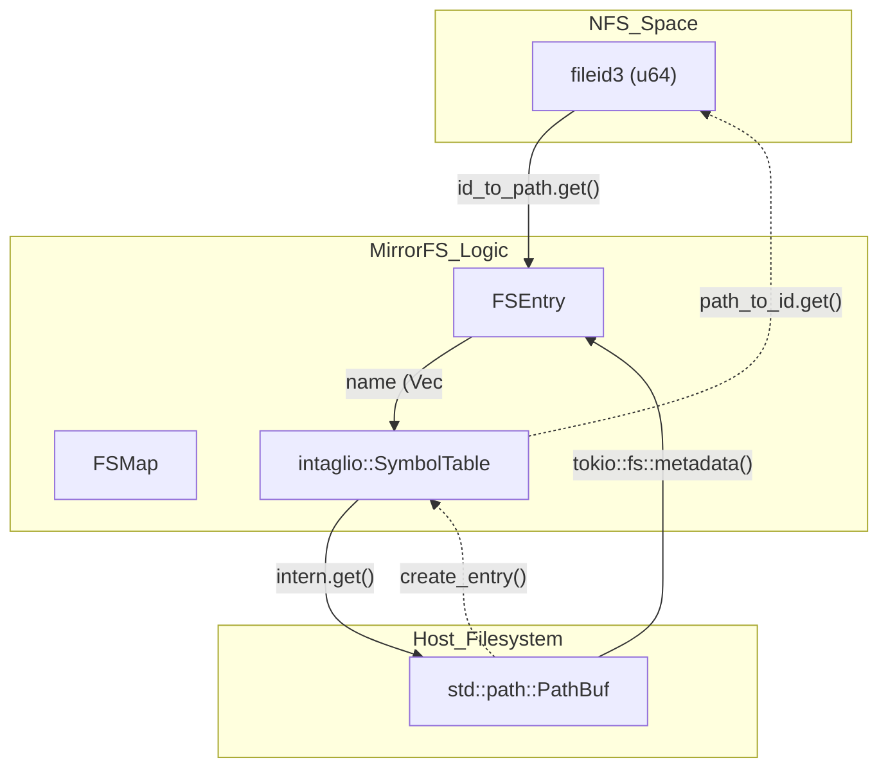
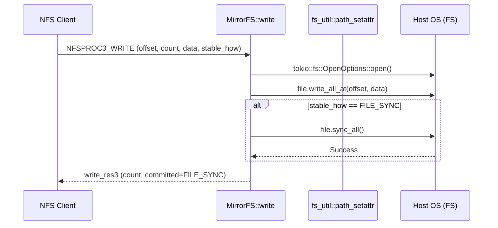

<!-- source: DeepWiki mcp.deepwiki.com · repo huggingface/nfsserve · page 4.3 MirrorFS — Local Filesystem Proxy · fetched 2026-10-26 -->

# MirrorFS — Local Filesystem Proxy

Relevant source files

The following files were used as context for generating this wiki page:

- [examples/mirrorfs.rs](examples/mirrorfs.rs)
- [src/fs_util.rs](src/fs_util.rs)

`MirrorFS` is a concrete implementation of the `NFSFileSystem` trait that acts as a proxy to the local host filesystem. Unlike `DemoFS` which is entirely in-memory, `MirrorFS` maps NFS file handles to real paths on disk, providing a bridge between the NFS protocol and standard OS file operations. It implements advanced features such as path interning for memory efficiency, just-in-time metadata refreshing, and persistent file ID mapping.

## Core Data Structures

The system relies on two primary structures to manage the relationship between the ephemeral NFS `fileid3` and the underlying host filesystem paths.

### FSMap: The ID-Path Registry
`FSMap` is the central registry for the filesystem. It maintains bidirectional mappings and handles the generation of new file IDs.

| Field | Type | Description |
|:---|:---|:---|
| `root` | `PathBuf` | The base directory on the host filesystem being exported [examples/mirrorfs.rs:32](). |
| `next_fileid` | `AtomicU64` | Thread-safe counter for generating unique `fileid3` values [examples/mirrorfs.rs:33](). |
| `intern` | `SymbolTable` | An `intaglio` symbol table used to intern `OsString` path components to reduce memory overhead [examples/mirrorfs.rs:34](). |
| `id_to_path` | `HashMap<fileid3, FSEntry>` | Maps a unique NFS file ID to its metadata and path symbols [examples/mirrorfs.rs:35](). |
| `path_to_id` | `HashMap<Vec<Symbol>, fileid3>` | Maps a sequence of interned symbols (the path) back to a file ID [examples/mirrorfs.rs:36](). |

### FSEntry: Metadata and Hierarchy
Each node in the filesystem is represented by an `FSEntry`, which caches the state of the file or directory.

*   **`name`**: A `Vec<Symbol>` representing the path components relative to the root [examples/mirrorfs.rs:23]().
*   **`fsmeta`**: The cached `fattr3` attributes (size, mtime, mode) [examples/mirrorfs.rs:24]().
*   **`children`**: For directories, a `BTreeSet<fileid3>` containing the IDs of all discovered children, used for efficient `READDIR` pagination [examples/mirrorfs.rs:27]().

### Bidirectional Mapping Flow
The following diagram illustrates how `MirrorFS` translates between the NFS Space (IDs) and the Host Space (Paths).

**Diagram: ID and Path Resolution Pipeline**

**Sources:** [examples/mirrorfs.rs:31-37](), [examples/mirrorfs.rs:66-72](), [examples/mirrorfs.rs:103-117]()

---

## State Synchronization and Refreshing

`MirrorFS` uses a "just-in-time" refresh strategy. Before most operations (like `getattr` or `lookup`), it checks if the host filesystem has changed relative to its internal cache.

### RefreshResult
The `refresh_entry` function returns a `RefreshResult` to signal how the cache was updated:
*   **`Delete`**: The file no longer exists on disk; `MirrorFS` removes it from the map [examples/mirrorfs.rs:41]().
*   **`Reload`**: The file exists but `mtime`, `size`, or `inode` has changed; the cache is updated [examples/mirrorfs.rs:44]().
*   **`Noop`**: The cached metadata is still valid [examples/mirrorfs.rs:46]().

### Metadata Validation
The system uses `fattr3_differ` to detect changes. It compares `fileid`, `mtime` (seconds and nanoseconds), `size`, and `ftype` [src/fs_util.rs:16-22](). If a file type changes (e.g., a file is replaced by a directory with the same name), the entry is treated as a deletion and the ID is expired [examples/mirrorfs.rs:134-143]().

### Symlink Safety
To prevent deadlocks or infinite loops during path resolution, `MirrorFS` uses `exists_no_traverse`. This utility calls `symlink_metadata()` to check for existence without following the link [src/fs_util.rs:27-29]().

**Sources:** [examples/mirrorfs.rs:39-47](), [examples/mirrorfs.rs:118-149](), [src/fs_util.rs:16-29]()

---

## Directory Operations and Pagination

Directory listing in NFS v3 (`READDIR` / `READDIRPLUS`) requires cookie-based pagination. `MirrorFS` implements this using a `BTreeSet` of child IDs.

1.  **Discovery**: When `refresh_dir_list` is called, it performs a `tokio::fs::read_dir` on the host path [examples/mirrorfs.rs:163]().
2.  **Interning**: Each filename is interned into the `SymbolTable` [examples/mirrorfs.rs:165]().
3.  **Pagination**: The `readdir` implementation uses the `cookie` provided by the client as a starting point for a `BTreeSet::range` query [examples/mirrorfs.rs:506-512]().
    *   If `cookie` is 0, it starts from the beginning.
    *   If `cookie` is non-zero, it uses `Bound::Excluded(cookie)` to fetch subsequent entries [examples/mirrorfs.rs:509]().

**Sources:** [examples/mirrorfs.rs:150-177](), [examples/mirrorfs.rs:490-530]()

---

## File I/O and Write Guarantees

`MirrorFS` maps NFS `READ` and `WRITE` calls to asynchronous `Tokio` file operations.

### Read Pipeline
1.  Resolves `fileid3` to a `PathBuf`.
2.  Opens the file using `tokio::fs::File`.
3.  Seeks to the requested `offset` [examples/mirrorfs.rs:408]().
4.  Reads up to `count` bytes into a buffer and returns them [examples/mirrorfs.rs:412-416]().

### Write and Sync
NFS clients can request different levels of stability (UNSTABLE, DATA_SYNC, FILE_SYNC). `MirrorFS` handles this via the `sync_all` method:
*   **Writing**: Uses `AsyncWriteExt::write_all_at` to write data to the host file [examples/mirrorfs.rs:445]().
*   **Commitment**: If the client requests `FILE_SYNC`, or during a `COMMIT` procedure, `MirrorFS` calls `file.sync_all().await` to ensure data is flushed to the physical disk [examples/mirrorfs.rs:451](), [examples/mirrorfs.rs:608]().

### Attribute Modification
Attribute updates (e.g., `CHMOD`, `CHOWN`, `TRUNCATE`) are handled by `path_setattr` and `file_setattr` in `fs_util.rs`. 
*   **Mode Unmasking**: The system ensures that files remain writable by the server by forcing the `0x80` (owner write) bit via `mode_unmask` [src/fs_util.rs:31-37]().
*   **Truncation**: Handled via `file.set_len(size)` [src/fs_util.rs:161]().

**Diagram: Write and Commit Workflow**

**Sources:** [examples/mirrorfs.rs:428-468](), [examples/mirrorfs.rs:600-615](), [src/fs_util.rs:122-178]()

---

