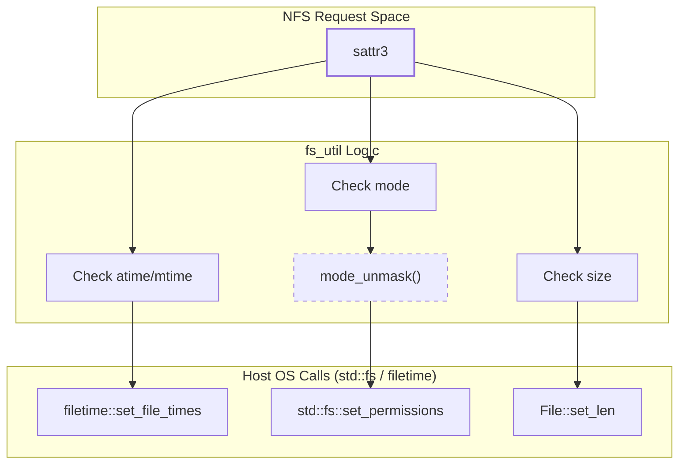
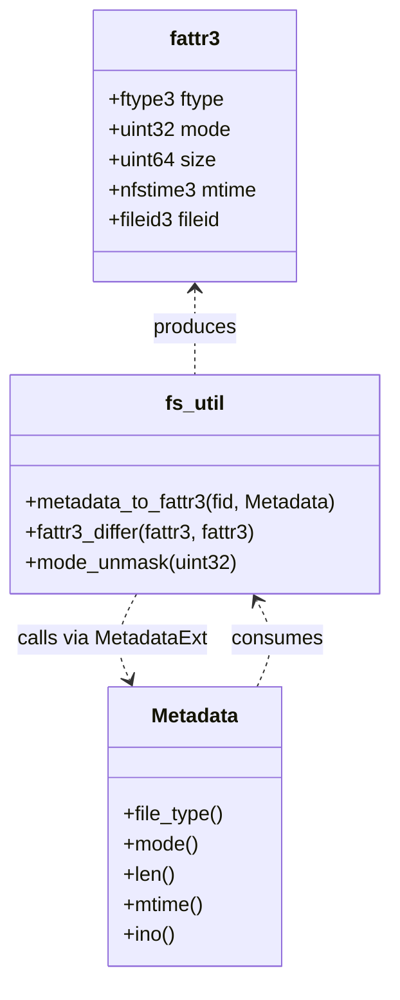

<!-- source: DeepWiki mcp.deepwiki.com · repo huggingface/nfsserve · page 4.4 Filesystem Utilities (fs_util) · fetched 2026-10-26 -->

# Filesystem Utilities (fs_util)

Relevant source files

The following files were used as context for generating this wiki page:

- [examples/mirrorfs.rs](examples/mirrorfs.rs)
- [src/fs_util.rs](src/fs_util.rs)

The `fs_util` module provides a set of helper functions designed to bridge the gap between standard Rust `std::fs` types and the NFS v3 protocol structures defined in the `nfs` module. These utilities handle metadata conversion, attribute manipulation pipelines, and safety checks for filesystem operations.

## Metadata Conversion and Comparison

The primary role of these utilities is to transform host-specific filesystem metadata into the `fattr3` structure required by the NFS v3 protocol.

### metadata_to_fattr3
The `metadata_to_fattr3` function converts a `std::fs::Metadata` object into an NFS `fattr3` structure [src/fs_util.rs:40-119](). It maps standard Unix attributes such as size, mode, UID, GID, and timestamps (`atime`, `mtime`, `ctime`) to their XDR-compatible counterparts.

*   **File Types**: It explicitly checks if the entry is a file [src/fs_util.rs:43](), symlink [src/fs_util.rs:68](), or directory [src/fs_util.rs:93]() to set the `ftype3` field.
*   **Mode Unmasking**: All modes are passed through `mode_unmask` to ensure the server retains write access [src/fs_util.rs:42]().

### Change Detection
Two functions are provided to detect changes in filesystem objects, which is critical for cache invalidation in implementations like `MirrorFS` [examples/mirrorfs.rs:130-132]().

| Function | Comparison Criteria | Source |
| :--- | :--- | :--- |
| `metadata_differ` | Inode, mtime, length, and file type. | [src/fs_util.rs:13-15]() |
| `fattr3_differ` | FileID, mtime (seconds/nseconds), size, and file type. | [src/fs_util.rs:16-22]() |

**Sources:** [src/fs_util.rs:13-119](), [examples/mirrorfs.rs:130-132]()

## Attribute Pipelines

NFS `SETATTR` requests use the `sattr3` structure, which contains optional fields for modifying file attributes. `fs_util` provides two pipelines to apply these changes.

### path_setattr
Used for operations where only a path is available. It handles:
1.  **Timestamps**: Sets `atime` and `mtime` using the `filetime` crate, supporting both server-time and client-provided time [src/fs_util.rs:123-140]().
2.  **Permissions**: Applies `mode` changes after unmasking [src/fs_util.rs:141-145]().
3.  **Truncation**: If a size is specified, it opens the file with `OpenOptions` and calls `set_len` [src/fs_util.rs:152-162]().

### file_setattr
A synchronous version that operates on an already open `std::fs::File` handle [src/fs_util.rs:167-178](). This is typically used when the filesystem implementation already has a file descriptor available, avoiding redundant path lookups.

### Attribute Modification Flow
The following diagram illustrates how a `sattr3` request is processed into host system calls.

**Title: sattr3 Attribute Application Pipeline**

**Sources:** [src/fs_util.rs:121-178]()

## Safety and Enforcement

### Symlink Safety: exists_no_traverse
The standard `path.exists()` in Rust traverses symbolic links. In a network filesystem context, this is dangerous as recursive or malicious symlinks could cause server-side deadlocks or directory traversal attacks. `exists_no_traverse` uses `symlink_metadata()` to check for the existence of the link itself without following it [src/fs_util.rs:27-29]().

### Write-Bit Enforcement: mode_unmask
To prevent a situation where an NFS client creates a file with permissions that would lock the server process out of its own files, `mode_unmask` is applied during creation and attribute updates [src/fs_util.rs:31-37]().
*   It forces the `0x80` (Owner Write) bit to be set [src/fs_util.rs:34]().
*   It masks the result to `0x1FF` to ensure only standard Unix permission bits are returned [src/fs_util.rs:36]().

**Sources:** [src/fs_util.rs:27-37]()

## Unix Platform Specifics

The `fs_util` module relies heavily on Unix-specific extensions for metadata retrieval.

*   **MetadataExt**: Used to extract `uid`, `gid`, `ino`, `mtime`, and `size` from `std::fs::Metadata` [src/fs_util.rs:2-3]().
*   **PermissionsExt**: Used to convert raw `u32` modes into `std::fs::Permissions` and vice versa [src/fs_util.rs:35-36]().

The following diagram maps the relationship between NFS protocol entities and the underlying Unix metadata entities handled by `fs_util`.

**Title: Protocol to Unix Entity Mapping**

**Sources:** [src/fs_util.rs:1-3](), [src/fs_util.rs:40-67]()

---

