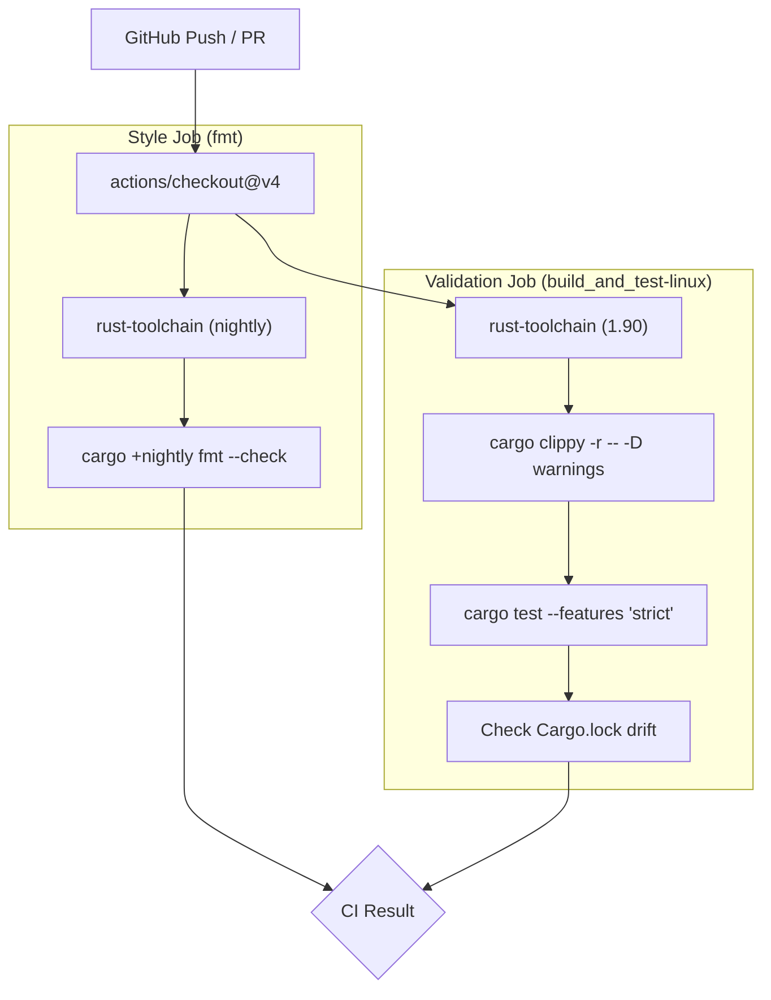
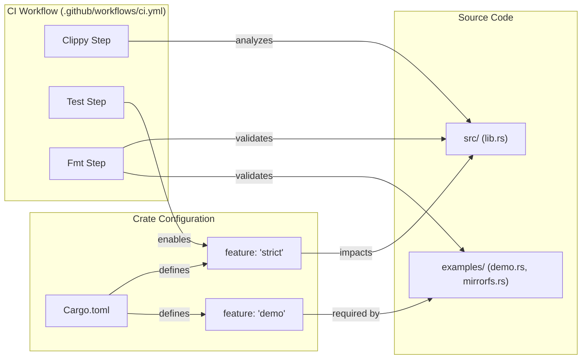

<!-- source: DeepWiki mcp.deepwiki.com · repo huggingface/nfsserve · page 5.1 CI Pipeline · fetched 2026-10-26 -->

# CI Pipeline

Relevant source files

The following files were used as context for generating this wiki page:

- [.github/workflows/ci.yml](.github/workflows/ci.yml)
- [Cargo.toml](Cargo.toml)

The `nfsserve` project utilizes GitHub Actions to ensure code quality, adherence to style guidelines, and functional correctness across the codebase. The CI pipeline is defined to trigger on every push to the `main` branch and for all pull requests, providing immediate feedback on regressions or linting violations.

### Pipeline Overview

The workflow is configured with a concurrency policy that cancels in-progress jobs for the same branch/PR if a new commit is pushed, optimizing resource usage. The pipeline is split into two primary jobs: `fmt` (formatting) and `build_and_test-linux`.

| Job Name | Purpose | Toolchain | Key Command |
| :--- | :--- | :--- | :--- |
| `fmt` | Code style enforcement | `nightly` | `cargo +nightly fmt --check` |
| `clippy` | Static analysis & linting | `1.90` | `cargo clippy -- -D warnings` |
| `test` | Functional verification | `1.90` | `cargo test --features "strict"` |
| `lock` | Dependency consistency | N/A | `git status --porcelain Cargo.lock` |

**Sources:**
- [.github/workflows/ci.yml:1-12]()
- [.github/workflows/ci.yml:13-26]()
- [.github/workflows/ci.yml:27-46]()

---

### Implementation Details

#### 1. Code Formatting (`fmt`)
The pipeline enforces the project's coding style using `rustfmt`. This job specifically uses the `nightly` toolchain to leverage the latest formatting features and ensures that the codebase remains consistent with the configuration defined in the project's root. The `--check` flag ensures that the CI fails if the code is not formatted according to the rules, rather than reformatting it in place.

**Sources:**
- [.github/workflows/ci.yml:14-25]()

#### 2. Static Analysis and Linting
The CI utilizes `clippy` to catch common mistakes and enforce Rust idioms. It is configured to treat all warnings as errors using the `-D warnings` flag. This ensures that no code with known "smells" or potential logic errors (as identified by Clippy) is merged into the main branch.

**Sources:**
- [.github/workflows/ci.yml:36-38]()

#### 3. Functional Testing and "Strict" Feature
The core of the validation process is the `cargo test` suite. Notably, tests are executed with the `--features "strict"` flag. The `strict` feature is defined in the crate's manifest and is used to toggle specific validation logic within the library during testing.

**Sources:**
- [.github/workflows/ci.yml:39-41]()
- [Cargo.toml:35-35]()

#### 4. Cargo.lock Drift Detection
To maintain deterministic builds and ensure that dependency updates are intentional, the pipeline includes a check for `Cargo.lock` drift. Since `cargo test` or `cargo clippy` might update the lockfile if `Cargo.toml` was modified without a corresponding lock update, the CI checks the git status of `Cargo.lock` after the build steps. If the file has uncommitted changes, the job fails.

**Sources:**
- [.github/workflows/ci.yml:42-45]()

---

### CI Workflow Data Flow

The following diagram illustrates the sequential execution of the CI pipeline and the tools involved in validating the `nfsserve` codebase.

**CI Execution Flow**

**Sources:**
- [.github/workflows/ci.yml:3-11]()
- [.github/workflows/ci.yml:14-25]()
- [.github/workflows/ci.yml:27-46]()

---

### Code Entity Association

The CI pipeline interacts with specific components of the repository structure and configuration files to execute its checks.

**CI to Codebase Mapping**

**Sources:**
- [.github/workflows/ci.yml:25-25]()
- [.github/workflows/ci.yml:38-41]()
- [Cargo.toml:34-36]()
- [Cargo.toml:39-48]()

---

