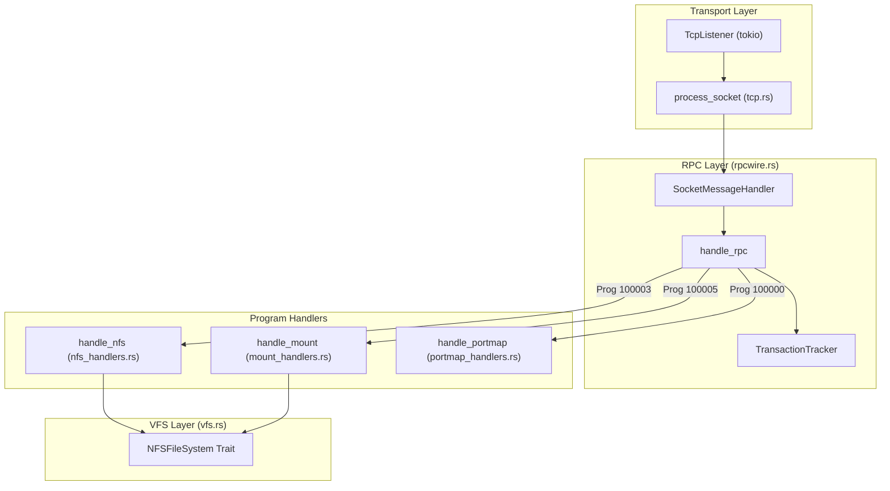
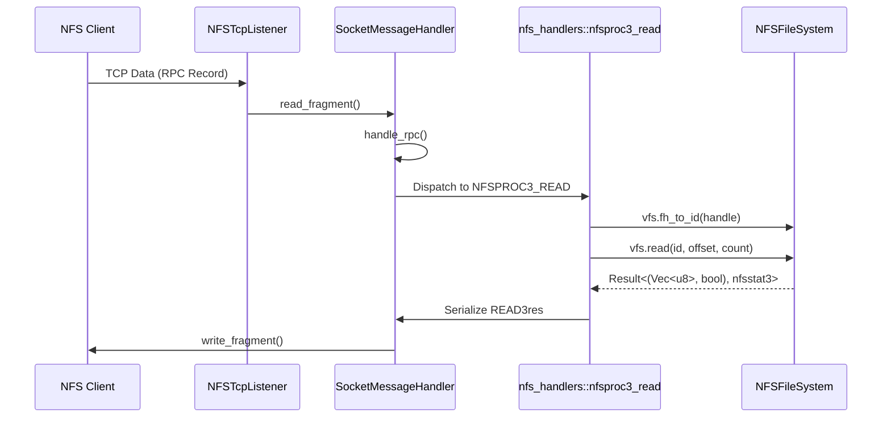

<!-- source: DeepWiki mcp.deepwiki.com · repo huggingface/nfsserve · page 6 Glossary · fetched 2026-10-26 -->

# Glossary

Relevant source files

The following files were used as context for generating this wiki page:

- [README.md](README.md)
- [src/fs_util.rs](src/fs_util.rs)
- [src/mount_handlers.rs](src/mount_handlers.rs)
- [src/nfs.rs](src/nfs.rs)
- [src/nfs_handlers.rs](src/nfs_handlers.rs)
- [src/portmap_handlers.rs](src/portmap_handlers.rs)
- [src/rpc.rs](src/rpc.rs)
- [src/rpcwire.rs](src/rpcwire.rs)
- [src/tcp.rs](src/tcp.rs)
- [src/transaction_tracker.rs](src/transaction_tracker.rs)
- [src/vfs.rs](src/vfs.rs)
- [src/write_counter.rs](src/write_counter.rs)
- [src/xdr.rs](src/xdr.rs)

This page provides definitions for codebase-specific terms, NFS/RPC protocol jargon, and Rust-specific patterns used in the `nfsserve` project. It serves as a technical reference for onboarding engineers to understand the mapping between abstract protocol concepts and their concrete implementations.

## Core Protocol Terminology

### Remote Procedure Call (RPC)
The foundation of the NFS protocol. `nfsserve` implements **ONC RPC** (Open Network Computing Remote Procedure Call) as defined in **RFC 1057**.
*   **XID (Transaction ID):** A 32-bit identifier used to match replies to calls and detect retransmissions [src/rpc.rs:156-160]().
*   **Program/Version/Procedure:** The triplet used to dispatch a request. For example, NFS v3 is Program `100003`, Version `3` [src/nfs.rs:21-22]().
*   **Record Marking (RM):** A framing mechanism for RPC over TCP. Each record consists of one or more fragments, each preceded by a 4-byte header containing a "last fragment" bit and a 31-bit length [src/rpcwire.rs:76-93]().

### External Data Representation (XDR)
The serialization format used by RPC (**RFC 1014**). It enforces big-endian byte order and 4-byte alignment (padding) [src/xdr.rs:7-12]().
*   **`XDR` Trait:** The core interface for serialization and deserialization [src/xdr.rs:9-12]().
*   **`xdr_struct!`:** A macro that generates `XDR` implementations for structs by sequentially processing fields [src/xdr.rs:165-181]().
*   **`xdr_enum_serde!`:** A macro for serializing Rust enums as `u32` XDR integers [src/xdr.rs:18-38]().

### NFS Specific Identifiers
*   **`fileid3`:** A 64-bit unique identifier for a file system object, analogous to a Unix inode number [src/nfs.rs:89-89]().
*   **`nfs_fh3` (File Handle):** An opaque identifier (up to 64 bytes) used by the client to reference an object. In `nfsserve`, this typically contains a 64-bit generation number and the 64-bit `fileid3` [src/vfs.rs:69-75]().
*   **Cookie:** A 64-bit opaque value used in `READDIR` and `READDIRPLUS` to support paginated directory listings [src/nfs.rs:90-90]().

## Codebase Entities and Patterns

### System Mapping: Protocol to Implementation
The following diagram bridges the gap between protocol-level concepts and the specific Rust entities that handle them.

**Protocol Dispatch Diagram**

**Sources:** [src/tcp.rs:33-85](), [src/rpcwire.rs:20-74](), [src/nfs_handlers.rs:118-162](), [src/vfs.rs:95-174]().

### Context and State
*   **`RPCContext`:** A struct cloned per connection that carries the VFS implementation, authentication state (`auth_unix`), the `TransactionTracker`, and export configuration [src/context.rs:10-20]().
*   **`TransactionTracker`:** Manages a `HashMap` of `(xid, client_addr)` to detect and drop retransmitted requests, ensuring idempotency for non-idempotent operations [src/transaction_tracker.rs:6-9]().
*   **`GENERATION_NUMBER`:** A value initialized at server startup (usually from system time) used to invalidate file handles from previous server instances [src/vfs.rs:49-59]().

### VFS Abstractions
*   **`NFSFileSystem`:** The primary trait users must implement. It abstracts file operations into an `async_trait` [src/vfs.rs:95-174]().
*   **`fattr3`:** A struct containing file attributes (mode, size, times, IDs) that maps to the NFS protocol's attribute structure [src/nfs.rs:260-277]().
*   **`wcc_data` (Weak Cache Consistency):** Data returned in NFS responses to help clients manage their attribute caches, containing pre-operation and post-operation attributes [src/nfs.rs:633-637]().

## Data Flow: Read Request Example
The following diagram traces the flow of a `NFSPROC3_READ` request through the system components.

**NFS Read Data Flow**

**Sources:** [src/tcp.rs:33-85](), [src/rpcwire.rs:20-74](), [src/nfs_handlers.rs:136-136](), [src/vfs.rs:121-121]().

## Glossary Table

| Term | Definition | File Pointer |
| :--- | :--- | :--- |
| **AUTH_UNIX** | Standard Unix-style authentication (UID, GID, list of groups). | [src/rpc.rs:104-111]() |
| **DuplexStream** | An in-memory async pipe used to decouple socket reading from RPC processing. | [src/rpcwire.rs:135-148]() |
| **fhandle3** | The protocol-level byte array representing an `nfs_fh3`. | [src/mount.rs:26-26]() |
| **nfsstat3** | Enum of NFS v3 error codes (e.g., `NFS3ERR_NOENT`, `NFS3ERR_ROFS`). | [src/nfs.rs:104-198]() |
| **Portmapper** | A service (Prog 100000) that maps RPC program numbers to TCP/UDP ports. | [src/portmap_handlers.rs:15-25]() |
| **sattr3** | A struct used to set attributes (e.g., via `SETATTR` or `CREATE`). | [src/nfs.rs:308-316]() |
| **WCC** | Weak Cache Consistency; allows clients to detect if a file changed between operations. | [src/nfs.rs:633-637]() |
| **WriteCounter** | A utility to track and limit the total bytes written to an XDR stream. | [src/write_counter.rs:5-10]() |

**Sources:** [src/rpc.rs:104-111](), [src/rpcwire.rs:135-148](), [src/mount.rs:26-26](), [src/nfs.rs:104-198](), [src/portmap_handlers.rs:15-25](), [src/nfs.rs:308-316](), [src/nfs.rs:633-637](), [src/write_counter.rs:5-10]().