# Page: Overview

# Overview

<details>
<summary>Relevant source files</summary>

The following files were used as context for generating this wiki page:

- [Cargo.toml](Cargo.toml)
- [README.md](README.md)
- [src/lib.rs](src/lib.rs)

</details>


`nfsserve` is a high-level, functional implementation of an **NFSv3 (Network File System version 3)** server written in Rust. It is designed to provide a user-mode filesystem API that is truly cross-platform by leveraging the native NFS clients built into Linux, macOS, and Windows [README.md:1-9]().

Unlike FUSE, which requires specialized drivers on non-Linux platforms, `nfsserve` allows developers to expose arbitrary data structures as filesystems by simply implementing a Rust trait. The operating system handles caching, metadata eviction, and robust network retries, while `nfsserve` manages the protocol-level complexities [README.md:11-21]().

## Key Design Goals

*   **Cross-Platform Compatibility**: Use the ubiquitous NFSv3 protocol to avoid platform-specific filesystem drivers [README.md:8-10]().
*   **User-Mode Flexibility**: Provide a `vfs::NFSFileSystem` trait that allows any backing store (in-memory, remote API, local disk) to be mounted as a drive [README.md:53-60]().
*   **Performance and Reliability**: Utilize `tokio` for asynchronous I/O and handle the historical robustness requirements of NFS clients [README.md:14-16](), [Cargo.toml:24-24]().
*   **Simplicity**: Provide a "localhost" server experience where a simple mount command connects the OS to the Rust process [README.md:20-21]().

## System Architecture

The system is structured as a layered protocol stack. It begins with a TCP transport layer that handles raw byte streams, moves through an RPC dispatch layer, and finally executes filesystem operations via the VFS.

### Protocol Stack and Code Mapping

The following diagram illustrates how network requests transition from raw bytes into filesystem logic, mapping conceptual stages to specific code entities.

**Diagram: Request Flow from Network to VFS**
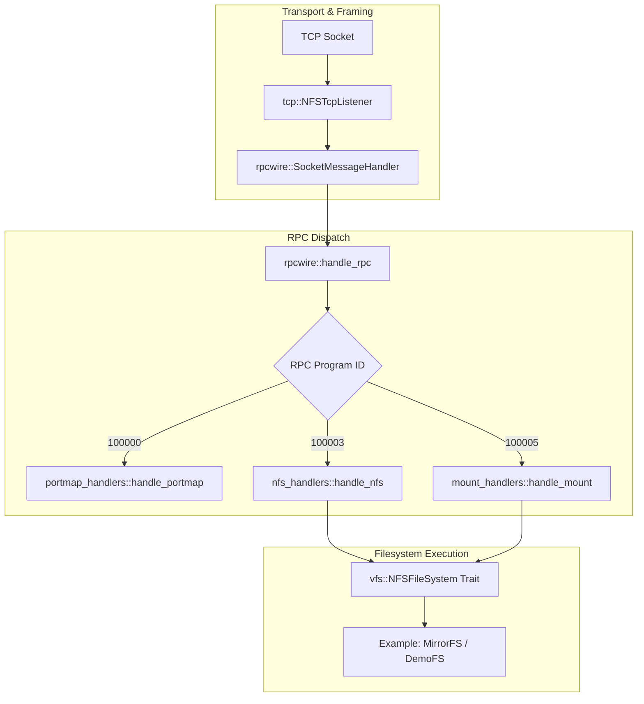
**Sources:** [src/lib.rs:3-24](), [src/rpcwire.rs:97-99](), [README.md:108-117]()

### Major Subsystems

1.  **Transport (TCP/RPC)**: The `tcp` module manages the listener and socket lifecycle [src/tcp.rs:21-21](). The `rpcwire` module implements RFC 1057 Record Marking, fragment reassembly, and the initial decoding of SUN RPC messages [README.md:97-99]().
2.  **Serialization (XDR)**: All protocol messages are encoded using External Data Representation (XDR). The `xdr` module provides the serialization and deserialization routines required for the protocol [src/xdr.rs:7-7](), [README.md:95-95]().
3.  **Protocol Handlers**:
    *   **Portmap**: A legacy mechanism for service discovery [README.md:121-129]().
    *   **Mount**: Handles the initial handshake and exports [README.md:102-102]().
    *   **NFSv3**: Implements the core filesystem operations like `READ`, `WRITE`, `LOOKUP`, and `GETATTR` [README.md:103-103]().
4.  **Virtual File System (VFS)**: The bridge between the NFS protocol and custom logic. Users implement the `NFSFileSystem` trait to define how file IDs and handles map to their data [src/vfs.rs:23-23](), [README.md:56-60]().

### Context and State Management

Every connection is associated with an `RPCContext`. This object tracks the state of the connection, including authentication credentials and the specific VFS implementation being served.

**Diagram: RPCContext and Transaction Tracking**
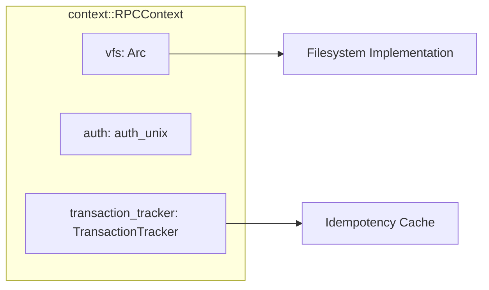
**Sources:** [src/context.rs:3-3](), [src/transaction_tracker.rs:22-22](), [README.md:93-94]()

## Implementation Status

| Feature | Status | Notes |
| :--- | :--- | :--- |
| **NFSv3 Core** | Functional | Supports READ, WRITE, LOOKUP, READDIRPLUS, etc. [README.md:3-4]() |
| **Mount Protocol** | Partial | Supports basic mounting and export listing [README.md:65-66]() |
| **Portmapper** | Minimal | Implements `PMAPPROC_GETPORT` for compatibility [README.md:131-137]() |
| **Windows Support** | Experimental | Functional on Windows 11 Pro; some legacy polling issues [README.md:72-74]() |
| **Symlinks** | Limited | Link creation is currently not supported [README.md:69-69]() |

## Further Reading

For more detailed information on specific components, please refer to the following pages:

*   **[Getting Started](#1.1)**: Learn how to add the dependency, build the project, and use the `mount` command on different operating systems.
*   **[Project Structure and Module Map](#1.2)**: A deep dive into the crate's internal organization and available feature flags like `strict` and `demo`.

---

# Page: Getting Started

# Getting Started

<details>
<summary>Relevant source files</summary>

The following files were used as context for generating this wiki page:

- [Cargo.toml](Cargo.toml)
- [README.md](README.md)
- [examples/demo.rs](examples/demo.rs)
- [examples/mirrorfs.rs](examples/mirrorfs.rs)

</details>


The `nfsserve` library provides a user-mode NFSv3 server implementation in Rust. Its primary purpose is to enable cross-platform user-mode filesystem mounts by leveraging the native NFS clients built into Linux, macOS, and Windows, avoiding the need for specialized FUSE drivers [README.md:1-21]().

## Adding as a Dependency

To use `nfsserve` in your Rust project, add it to your `Cargo.toml`. The library depends on `tokio` for its async runtime and `byteorder` for XDR serialization [Cargo.toml:20-29]().

```toml
[dependencies]
nfsserve = "0.11.0"
# Required for the async-trait implementation of VFS
async-trait = "0.1.9"
tokio = { version = "1", features = ["net", "io-util", "sync", "rt"] }
```

### Feature Flags

The crate defines two primary feature flags:
*   **`strict`**: Enables stricter linting or protocol checks [Cargo.toml:35]().
*   **`demo`**: Required to run the included examples. It enables `tracing-subscriber`, `intaglio` (for path interning), and the multi-threaded Tokio runtime [Cargo.toml:36]().

## Building and Running Examples

The project includes two main examples that demonstrate how to implement the `NFSFileSystem` trait:
1.  **DemoFS**: A simple in-memory filesystem [examples/demo.rs:75-78]().
2.  **MirrorFS**: A local filesystem proxy that mirrors a host directory over NFS [examples/mirrorfs.rs:30-37]().

### Running the Demo
To host an NFS server on `localhost:11111` using the in-memory filesystem:
```bash
cargo build --example demo --features demo
./target/debug/examples/demo
```
Sources: [README.md:28-32](), [Cargo.toml:39-43]()

## Mounting the Server

Once the server is running, use the following platform-specific commands to mount the exported filesystem. Note that the server usually listens on a non-standard port (e.g., 11111), so the `port` and `mountport` options are critical [README.md:131-133]().

### Linux
```bash
mkdir demo
mount.nfs -o user,noacl,nolock,vers=3,tcp,wsize=1048576,rsize=131072,actimeo=120,port=11111,mountport=11111 localhost:/ demo
```
Sources: [README.md:34-38]()

### macOS
```bash
mkdir demo
mount_nfs -o nolocks,vers=3,tcp,rsize=131072,actimeo=120,port=11111,mountport=11111 localhost:/ demo
```
Sources: [README.md:40-44]()

### Windows
Requires Windows Pro/Enterprise (Home edition lacks the NFS client).
```cmd
mount.exe -o anon,nolock,mtype=soft,fileaccess=6,casesensitive,lang=ansi,rsize=128,wsize=128,timeout=60,retry=2 \\127.0.0.1\ X:
```
Sources: [README.md:46-49]()

## Implementation Overview

To create a custom server, you must implement the `NFSFileSystem` trait. This trait defines how NFS procedures (like `LOOKUP`, `READ`, `WRITE`) interact with your backing storage [README.md:53-61]().

### Data Flow: From Socket to VFS
The following diagram illustrates how a network request is dispatched through the system layers to the VFS implementation.

**Request Dispatch Pipeline**
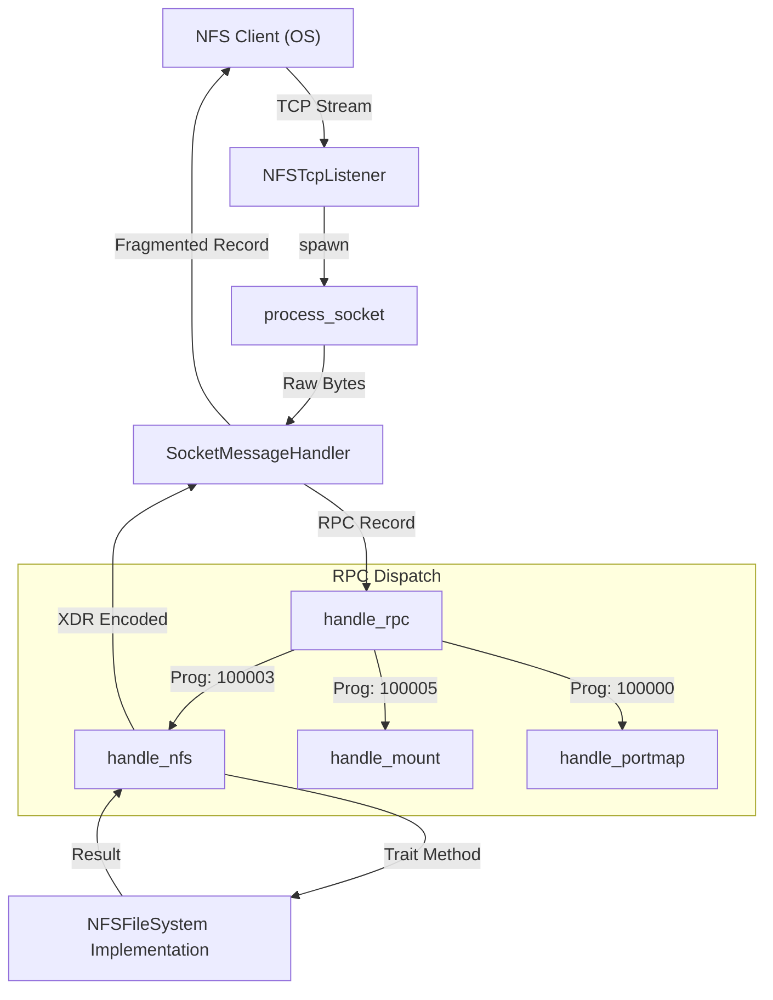
Sources: [README.md:91-103](), [README.md:108-120](), [examples/mirrorfs.rs:15]()

### Entity Mapping: Natural Language to Code
This diagram maps logical NFS concepts to the specific structs and traits used in the codebase.

**System Entity Map**
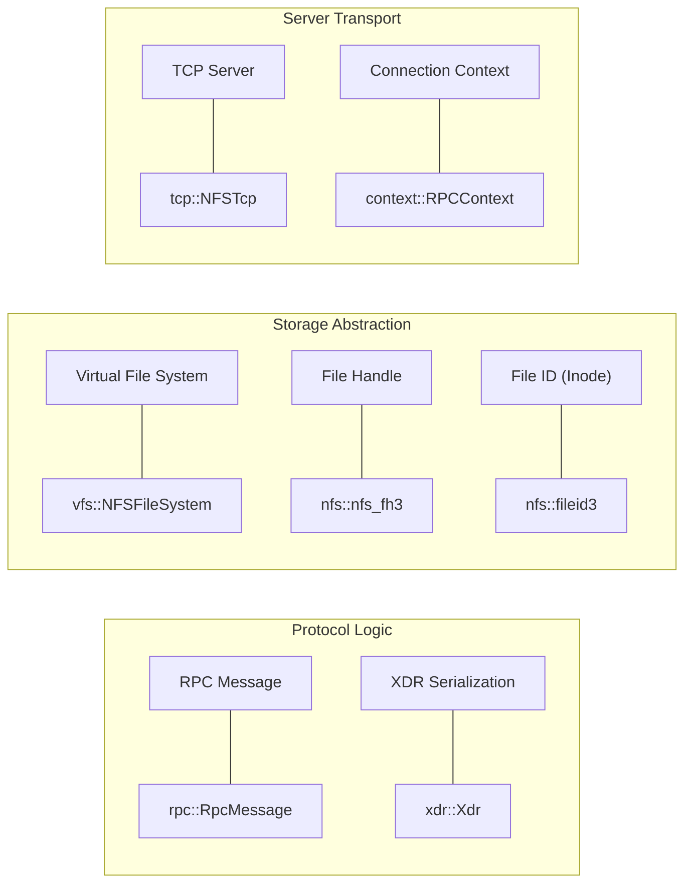
Sources: [README.md:142-153](), [examples/demo.rs:5-7](), [examples/mirrorfs.rs:14-16]()

## Key Implementation Requirements

When implementing `NFSFileSystem`, the two most critical aspects are:

1.  **64-bit ID Association**: Every file system object (file, directory, symlink) must be uniquely identifiable by a `u64` (`fileid3`) [README.md:58-60]().
2.  **File Handles (`nfs_fh3`)**: The server converts these IDs into opaque handles. By default, `nfsserve` provides a mechanism to map between `fileid3` and `nfs_fh3` [README.md:142-150]().
3.  **Pagination**: The `readdir` and `readdirplus` methods require careful implementation of cookies to support paginated directory listings [README.md:60-61]().

### Example: Starting a Service
```rust
let fs = DemoFS::default();
let listener = NFSTcpListener::bind(&"127.0.0.1:11111".to_string(), fs).await?;
listener.handle_incoming().await?;
```
Sources: [examples/demo.rs:250-255](), [examples/mirrorfs.rs:15]()

---

# Page: Project Structure and Module Map

# Project Structure and Module Map

<details>
<summary>Relevant source files</summary>

The following files were used as context for generating this wiki page:

- [Cargo.toml](Cargo.toml)
- [src/lib.rs](src/lib.rs)

</details>


This page details the crate layout of `nfsserve`, describing the organization of its source code, the distinction between public and internal modules, and the configuration of feature flags. It serves as a guide for developers to understand how the library is structured and how it is consumed by external users.

## Crate Layout and Public API

The `nfsserve` crate is organized into a modular structure that separates the low-level RPC transport and XDR serialization from the high-level NFS protocol logic and Virtual File System (VFS) abstractions.

### Source Tree (`src/`)

The source code is divided into several functional areas, with a clear boundary between internal implementation details and the public API required to implement a custom filesystem.

| Module | Exposure | Responsibility |
|:---|:---|:---|
| `tcp` | **Public** | Handles TCP connection lifecycles and the listener loop [src/lib.rs:21](). |
| `vfs` | **Public** | Defines the `NFSFileSystem` trait and file handle management [src/lib.rs:23](). |
| `nfs` | **Public** | Contains NFSv3 protocol structures and constants [src/lib.rs:15](). |
| `xdr` | **Public** | Serialization framework for External Data Representation [src/lib.rs:7](). |
| `fs_util` | **Public** | Unix-specific filesystem helpers (excluded on Windows) [src/lib.rs:18-19](). |
| `rpc` / `rpcwire` | Internal | Implements RFC 1057 Record Marking and RPC dispatch [src/lib.rs:4-5](). |
| `mount` | Internal | Implements the MOUNT protocol (RFC 1813 Appendix I) [src/lib.rs:9-10](). |
| `portmap` | Internal | Implements a minimal Portmapper (RFC 1057) [src/lib.rs:12-13](). |
| `context` | Internal | Manages per-connection state and shared resources [src/lib.rs:3](). |

### Examples (`examples/`)

The repository includes concrete implementations of the `NFSFileSystem` trait to demonstrate library usage. These are excluded from the core library build but can be run using the `demo` feature flag [Cargo.toml:39-48]().

*   **`demo.rs`**: An in-memory filesystem (`DemoFS`) showing how to manage file entries in a `Vec` [Cargo.toml:42]().
*   **`mirrorfs.rs`**: A local filesystem proxy that mirrors a host directory to an NFS export [Cargo.toml:47]().

**Sources:** [src/lib.rs:1-24](), [Cargo.toml:39-48]()

---

## Module Map and Data Flow

The following diagram illustrates the relationship between the internal modules and the public extension points.

### System Module Interconnectivity
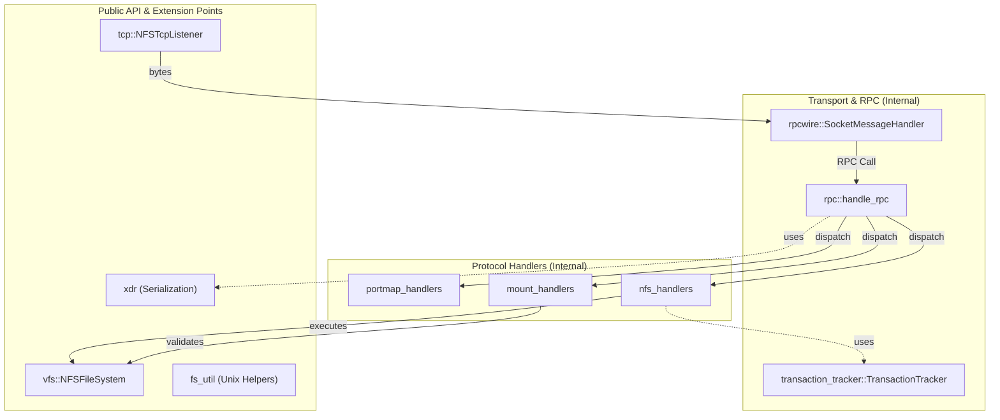
**Sources:** [src/lib.rs:3-24](), [src/tcp/mod.rs:1-50](), [src/rpc/mod.rs:1-20]()

---

## Feature Flags

The crate uses feature flags to manage dependencies and compiler behavior.

### `strict`
When enabled, this flag triggers `#![deny(warnings)]` [src/lib.rs:1](). This is primarily used in CI pipelines to ensure code quality and prevent the introduction of unused variables or deprecated calls.

### `demo`
This feature is required to run the provided examples and enables several optional dependencies [Cargo.toml:36]().
*   **`tracing-subscriber`**: Enables logging output for the demo servers [Cargo.toml:31]().
*   **`tokio/rt-multi-thread`**: Required for the multi-threaded runtime used in examples [Cargo.toml:36]().
*   **`intaglio`**: Used by `MirrorFS` for efficient path interning [Cargo.toml:32]().

**Sources:** [Cargo.toml:34-37](), [src/lib.rs:1]()

---

## External Consumption Pattern

External users interact with `nfsserve` by implementing the `NFSFileSystem` trait and passing it to the `NFSTcpListener`.

### Implementation Flow
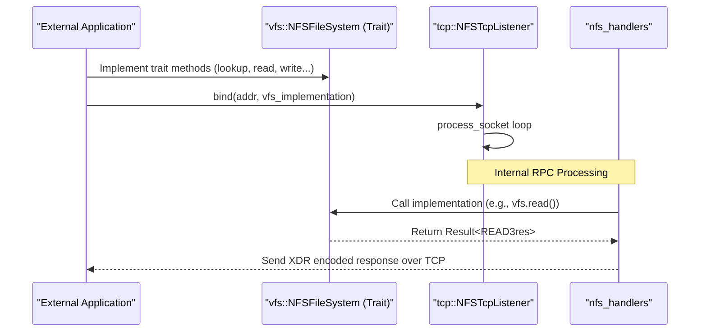

### Dependency Usage
To use `nfsserve`, a user adds it to their `Cargo.toml` [Cargo.toml:1-3](). The library relies on `tokio` for its async runtime and `byteorder` for XDR data manipulation [Cargo.toml:21-24]().

**Sources:** [src/lib.rs:21-23](), [Cargo.toml:20-29]()

---

# Page: Core Architecture

# Core Architecture

<details>
<summary>Relevant source files</summary>

The following files were used as context for generating this wiki page:

- [README.md](README.md)
- [src/lib.rs](src/lib.rs)
- [src/rpcwire.rs](src/rpcwire.rs)

</details>


The `nfsserve` library implements a layered protocol stack that transforms raw TCP byte streams into high-level virtual filesystem operations. This architecture allows the server to bridge the gap between low-level network communication and the abstract `NFSFileSystem` trait.

### Protocol Layering Overview

The system follows a strict hierarchical processing pipeline:
1.  **Transport Layer**: Manages TCP connections and raw byte buffering.
2.  **RPC Framing**: Handles RFC 1057 Record Marking to delimit messages within the stream.
3.  **RPC Dispatch**: Deserializes the SUN RPC call, verifies credentials, and routes the request to the appropriate program handler (NFS, Mount, or Portmap).
4.  **XDR Layer**: Provides the fundamental serialization/deserialization primitives used by all upper layers.
5.  **VFS Execution**: The final destination where protocol-specific requests are translated into calls against a user-provided filesystem implementation.

### System Flow Diagram

The following diagram illustrates the lifecycle of a request as it moves through the codebase entities:

**Request Flow: From Socket to VFS**
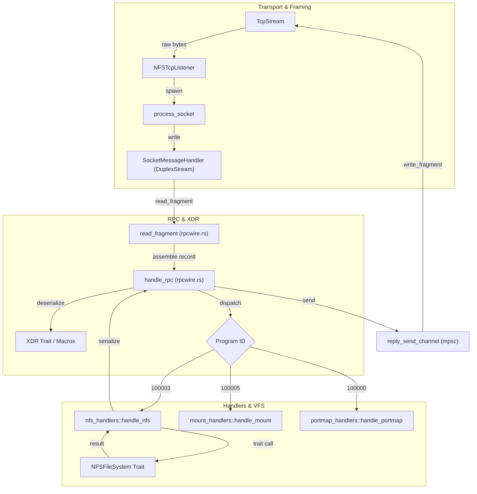
**Sources:** [src/tcp.rs:1-120](), [src/rpcwire.rs:20-74](), [src/rpcwire.rs:126-160](), [README.md:108-119]()

---

### TCP Transport Layer
The entry point for all client connections is the `NFSTcpListener`. It manages the lifecycle of `TcpStream` instances and utilizes a 128 KB read buffer loop to ingest data. Each connection is handled in a dedicated task via `process_socket`, which sets up the internal communication channels for the RPC layer.

For details, see [TCP Transport Layer](#2.1).

**Sources:** [src/tcp.rs:14-30](), [src/tcp.rs:72-100]()

---

### RPC Wire Protocol
The `rpcwire.rs` module implements the Record Marking (RM) standard defined in RFC 1057. Because TCP is a stream protocol, `nfsserve` must manually delimit RPC messages using 4-byte fragment headers. The `SocketMessageHandler` is responsible for reassembling these fragments into complete RPC records before passing them to `handle_rpc` for dispatching.

For details, see [RPC Wire Protocol](#2.2).

**Sources:** [src/rpcwire.rs:76-106](), [src/rpcwire.rs:126-150]()

---

### XDR Serialization Framework
XDR (External Data Representation) serves as the "language" of the RPC calls. The codebase uses a custom `XDR` trait and several code-generation macros (`xdr_struct!`, `xdr_enum_serde!`) to ensure that Rust structures are serialized into the BigEndian, 4-byte aligned format required by the NFS protocol.

For details, see [XDR Serialization Framework](#2.3).

**Sources:** [src/xdr.rs:1-50](), [README.md:85-86]()

---

### Request Context and Transaction Tracking
Every request is accompanied by an `RPCContext`. This structure carries vital metadata including the `NFSFileSystem` implementation, `AUTH_UNIX` credentials, and a `TransactionTracker`. The tracker is critical for protocol correctness, as it detects retransmitted XIDs (Transaction IDs) from the client to prevent executing non-idempotent operations (like `REMOVE`) multiple times.

For details, see [Request Context and Transaction Tracking](#2.4).

**Sources:** [src/context.rs:14-25](), [src/rpcwire.rs:40-45](), [src/transaction_tracker.rs:1-20]()

---

### Architectural Mapping

| Layer | Primary Code Entity | Responsibility |
| :--- | :--- | :--- |
| **Transport** | `NFSTcpListener` [src/tcp.rs:14]() | TCP accept loop and IP binding. |
| **Framing** | `read_fragment` [src/rpcwire.rs:94]() | RFC 1057 fragment reassembly. |
| **Dispatch** | `handle_rpc` [src/rpcwire.rs:20]() | Routing by Program ID (NFS/Mount/Portmap). |
| **Auth** | `auth_unix` [src/rpc.rs:40]() | Parsing UID/GID from RPC headers. |
| **State** | `TransactionTracker` [src/transaction_tracker.rs:8]() | Idempotency and retransmission detection. |
| **Logic** | `nfs_handlers` [src/nfs_handlers.rs:10]() | Translating NFS procedures to VFS calls. |

**Sources:** [src/rpcwire.rs:20-74](), [src/tcp.rs:14-30](), [src/lib.rs:1-24]()

---

# Page: TCP Transport Layer

# TCP Transport Layer

<details>
<summary>Relevant source files</summary>

The following files were used as context for generating this wiki page:

- [src/rpcwire.rs](src/rpcwire.rs)
- [src/tcp.rs](src/tcp.rs)

</details>


The TCP Transport Layer is the entry point for all network communication in `nfsserve`. It is responsible for binding to network interfaces, accepting incoming TCP connections, and managing the lifecycle of each socket. This layer bridges the gap between raw byte streams and the structured RPC messages required by the higher layers of the protocol stack.

## NFSTcpListener

The `NFSTcpListener` struct is the primary orchestrator for the transport layer [src/tcp.rs:19-26](). It encapsulates the `tokio::net::TcpListener` and holds the necessary context to initialize new connections, including the virtual filesystem (VFS) implementation, the transaction tracker, and mount signaling channels.

### Auto IP Binding
A unique feature of the listener is its ability to automatically bind to a local IP address when the string `"auto"` is provided to the `bind` function [src/tcp.rs:117-138](). This is particularly useful in environments like Windows where specific loopback IPs might be required for mounting.

The `generate_host_ip` function creates IPs in the `127.88.x.x` range [src/tcp.rs:28-30](). The `bind` logic attempts to bind to these generated IPs sequentially (up to 32 tries) until a successful bind occurs [src/tcp.rs:118-138]().

### Connection Lifecycle
The main execution loop resides in `handle_forever` [src/tcp.rs:196-214](). 
1. **Accept**: The listener waits for a new TCP connection [src/tcp.rs:198]().
2. **Context Creation**: For every connection, a new `RPCContext` is instantiated, cloning the VFS handle and the `TransactionTracker` [src/tcp.rs:199-209]().
3. **Spawn**: The connection is handed off to `process_socket` in a new asynchronous task [src/tcp.rs:211]().

**Sources:** [src/tcp.rs:19-26](), [src/tcp.rs:28-30](), [src/tcp.rs:107-144](), [src/tcp.rs:196-214]()

## The process_socket Connection Loop

The `process_socket` function manages the bidirectional data flow for a single established `TcpStream` [src/tcp.rs:33-85](). It coordinates between the raw socket and the `SocketMessageHandler` using a internal buffering strategy.

### Read Buffer and Flow
The transport layer uses a fixed-size read buffer of **128,000 bytes** (approx. 128 KB) [src/tcp.rs:48](). 

- **Inbound Data**: Raw bytes are read from the socket using `try_read` [src/tcp.rs:50](). These bytes are immediately written into a `DuplexStream` (`socksend`) that feeds the `SocketMessageHandler` [src/tcp.rs:55]().
- **Outbound Data**: The loop monitors a receiver channel (`msgrecvchan`) for processed RPC replies [src/tcp.rs:67](). When a reply arrives, it is wrapped in an RPC record fragment via `write_fragment` and sent back over the wire [src/tcp.rs:73-77]().

### Diagram: Socket Data Flow
The following diagram illustrates how raw bytes move from the `TcpStream` into the RPC processing pipeline.

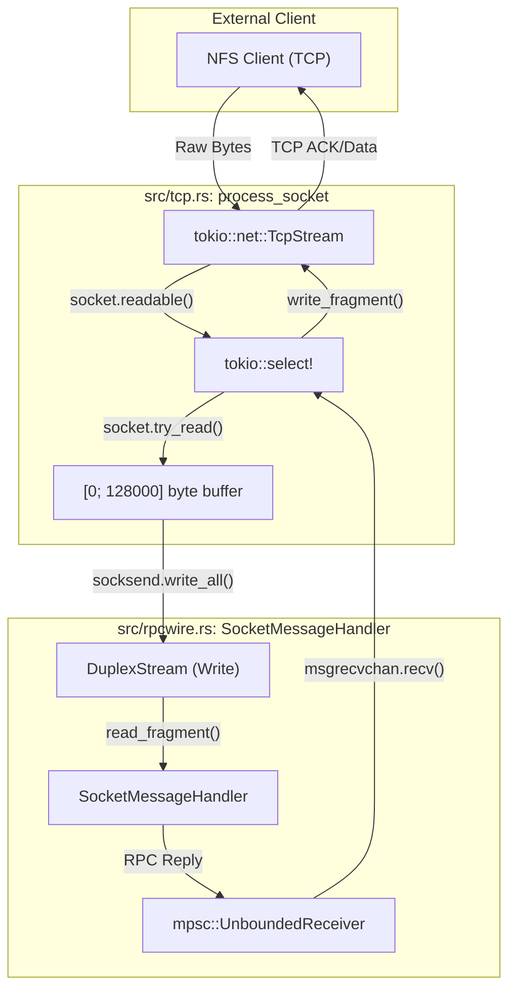
**Sources:** [src/tcp.rs:33-85](), [src/rpcwire.rs:133-148]()

## Handoff to RPC Layer

The handoff from the transport layer to the RPC layer is mediated by the `SocketMessageHandler`. This struct decouples the byte-stream nature of TCP from the message-oriented nature of RPC.

### Record Reassembly
Because TCP is a stream, RPC messages (which may span multiple fragments) must be reassembled. 
1. `process_socket` writes raw bytes into a `DuplexStream` [src/tcp.rs:55]().
2. A background task calls `SocketMessageHandler::read()` in a loop [src/tcp.rs:37-44]().
3. `read()` invokes `read_fragment`, which parses the 4-byte RFC 1057 Record Marking header to determine fragment length and whether the "Last Fragment" bit is set [src/rpcwire.rs:94-106]().
4. Once a complete record (one or more fragments) is collected in `cur_fragment`, it is dispatched to `handle_rpc` [src/rpcwire.rs:151-160]().

### Diagram: Entity Association
This diagram maps the code entities involved in the transport-to-RPC transition.

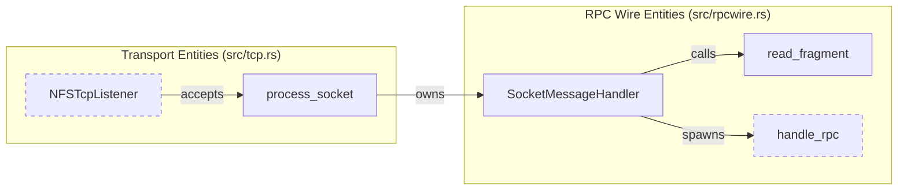

### Protocol Constants and Constraints
- **Alignment**: XDR (used by the RPC layer) requires 4-byte alignment, but the TCP layer handles raw bytes. Alignment is enforced during serialization/deserialization in the XDR layer.
- **Max Fragment Size**: While the RFC allows fragments up to $2^{31}-1$ bytes, `nfsserve` asserts that outgoing fragments are within this limit [src/rpcwire.rs:110]().
- **NoDelay**: The transport layer explicitly sets `set_nodelay(true)` on the socket to disable Nagle's algorithm, ensuring low latency for NFS operations [src/tcp.rs:35]().

**Sources:** [src/tcp.rs:33-44](), [src/rpcwire.rs:94-118](), [src/rpcwire.rs:151-170]()

---

# Page: RPC Wire Protocol

# RPC Wire Protocol

<details>
<summary>Relevant source files</summary>

The following files were used as context for generating this wiki page:

- [src/rpc.rs](src/rpc.rs)
- [src/rpcwire.rs](src/rpcwire.rs)
- [src/transaction_tracker.rs](src/transaction_tracker.rs)

</details>


The RPC Wire Protocol layer in `nfsserve` implements the Remote Procedure Call (RPC) mechanism as defined in **RFC 1057**. This layer is responsible for framing (Record Marking) over TCP, reassembling fragmented messages, dispatching calls to specific protocol handlers (NFS, Mount, Portmap), and managing transaction idempotency.

## Record Marking and Fragmentation

Because TCP is a stream-oriented transport, RPC messages must be delimited using Record Marking (RM). An RPC message is composed of one or more fragments [src/rpcwire.rs:84-85]().

### Fragment Header Structure
Each fragment is preceded by a 4-byte header [src/rpcwire.rs:95-97]():
*   **Bit 31 (MSB):** The "Last Fragment" flag. If set to 1, this is the final fragment of the RPC record [src/rpcwire.rs:98]().
*   **Bits 0-30:** The length of the fragment data in bytes [src/rpcwire.rs:99]().

### Reassembly Logic
The `read_fragment` function reads the header and the subsequent data into a buffer [src/rpcwire.rs:102-103](). The `SocketMessageHandler` loops until a fragment with the `is_last` bit is received, at which point the complete record is dispatched for processing [src/rpcwire.rs:152-157]().

**Sources:** [src/rpcwire.rs:76-118]()

## Socket Message Handling Pipeline

The `SocketMessageHandler` acts as the primary coordinator for an active TCP connection. It manages the lifecycle of reading fragments, spawning asynchronous tasks for RPC execution, and queuing replies.

### Data Flow: From Socket to Dispatch
1.  **Read:** `SocketMessageHandler::read()` extracts fragments from the `DuplexStream` [src/rpcwire.rs:151-152]().
2.  **Reassemble:** Fragments are appended to `cur_fragment` until the last fragment bit is detected [src/rpcwire.rs:153-154]().
3.  **Spawn:** A new `tokio` task is spawned to handle the complete RPC record. This allows the server to process multiple RPC calls from the same connection concurrently [src/rpcwire.rs:157-160]().
4.  **Execute:** `handle_rpc` deserializes the message and routes it [src/rpcwire.rs:20-24]().
5.  **Reply:** The result is serialized into a `write_buf` and sent back via the `reply_send_channel` [src/rpcwire.rs:168-169]().

### Code Entity Map: Socket Handling
The following diagram illustrates the relationship between the message handler, the dispatch logic, and the asynchronous task boundaries.

Title: RPC Processing Pipeline
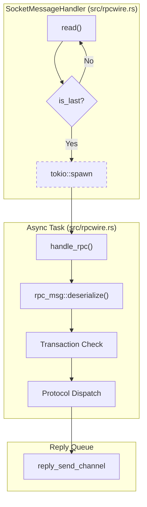
**Sources:** [src/rpcwire.rs:126-175]()

## RPC Dispatch Logic (`handle_rpc`)

The `handle_rpc` function is the central router for all incoming RPC calls. It performs several critical validation and extraction steps before handing off to specific program handlers.

### AUTH_UNIX Credential Parsing
If the RPC call contains `AUTH_UNIX` credentials (flavor 1), the server extracts the UID, GID, and machine name [src/rpcwire.rs:29-31](). These credentials are saved into the `RPCContext` for use by the filesystem layer to enforce permissions [src/rpcwire.rs:32]().

### Program Routing
The dispatcher routes calls based on the `prog` field in the `call_body` [src/rpcwire.rs:48-65]():
| Program Constant | Value | Handler Function |
| :--- | :--- | :--- |
| `nfs::PROGRAM` | 100003 | `nfs_handlers::handle_nfs` |
| `portmap::PROGRAM` | 100000 | `portmap_handlers::handle_portmap` |
| `mount::PROGRAM` | 100005 | `mount_handlers::handle_mount` |

If a program is unknown or explicitly unsupported (like `NFS_ACL_PROGRAM`), the server returns a `PROG_UNAVAIL` reply [src/rpcwire.rs:59-64]().

**Sources:** [src/rpcwire.rs:16-74](), [src/rpc.rs:94-111]()

## Retransmission Detection

NFS clients often retransmit requests if a reply is delayed. To ensure idempotency (especially for non-idempotent operations like `REMOVE` or `RENAME`), the `TransactionTracker` monitors active and recently completed requests.

### The Transaction Tracker
The `TransactionTracker` uses a `HashMap` keyed by a tuple of `(xid, client_addr)` [src/transaction_tracker.rs:8](). 
*   **XID:** The 32-bit Transaction ID provided by the client [src/rpc.rs:157]().
*   **Client Address:** The IP address of the requester, ensuring XID collisions between different clients are handled [src/transaction_tracker.rs:24]().

### Logic Flow
1.  **Check:** `is_retransmission` is called at the start of `handle_rpc` [src/rpcwire.rs:40]().
2.  **InProgress:** If the XID is new, it is marked as `TransactionState::InProgress` [src/transaction_tracker.rs:28]().
3.  **Drop:** If the XID is already in the map, the call is dropped to avoid redundant processing [src/rpcwire.rs:44]().
4.  **Complete:** Once the handler finishes, `mark_processed` updates the state to `Completed` with a timestamp [src/transaction_tracker.rs:41]().
5.  **Housekeeping:** Periodically, entries older than the `retention_period` are purged to prevent memory leaks [src/transaction_tracker.rs:46-52]().

Title: Transaction State Transitions
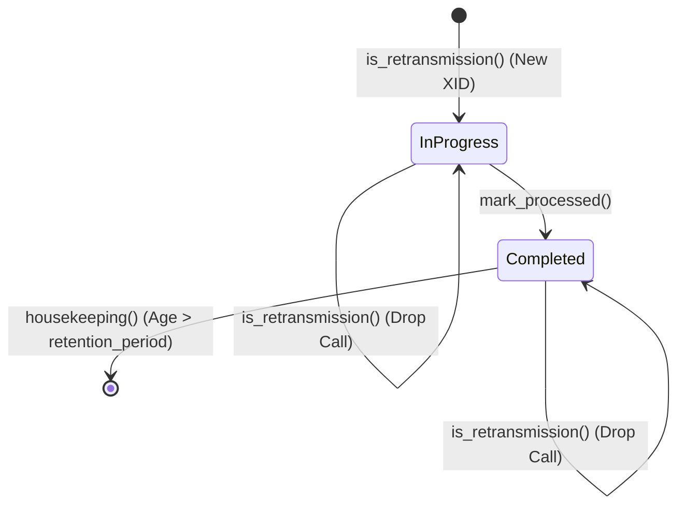
**Sources:** [src/transaction_tracker.rs:5-57](), [src/rpcwire.rs:40-68]()

## Reply Queuing Pipeline

Because RPC calls are processed concurrently in separate tasks, the replies may be generated out of order. The `SocketMessageHandler` utilizes a Multi-Producer Single-Consumer (MPSC) channel to collect these replies.

1.  **Serialization:** Handlers write their responses into a `Vec<u8>` via a `Cursor` [src/rpcwire.rs:158-160]().
2.  **Channel Send:** The completed buffer is wrapped in a `Result` (`SocketMessageType`) and sent to the `reply_send_channel` [src/rpcwire.rs:168-169]().
3.  **Fragmentation for Wire:** The component that consumes the `mpsc::UnboundedReceiver` (typically the transport layer) calls `write_fragment` to add the Record Marking header back onto the response before sending it over the raw TCP socket [src/rpcwire.rs:108-118]().

**Sources:** [src/rpcwire.rs:120-148](), [src/rpcwire.rs:157-174]()

---

# Page: XDR Serialization Framework

# XDR Serialization Framework

<details>
<summary>Relevant source files</summary>

The following files were used as context for generating this wiki page:

- [src/nfs.rs](src/nfs.rs)
- [src/xdr.rs](src/xdr.rs)

</details>


The External Data Representation (XDR) framework provides the serialization and deserialization backbone for `nfsserve`. It implements the standard defined in [RFC 1014](https://datatracker.ietf.org/doc/html/rfc1014) to ensure that data structures used in RPC and NFS protocols are transmitted in a platform-independent, big-endian format with strict alignment rules.

## The XDR Trait

The core of the framework is the `XDR` trait [src/xdr.rs:9-12](). Any type that needs to be transmitted over the wire must implement this trait. It defines two primary methods:
*   `serialize<R: Write>(&self, dest: &mut R)`: Writes the object to a byte stream.
*   `deserialize<R: Read>(&mut self, src: &mut R)`: Populates the object from a byte stream.

### Byte Ordering and Alignment
The framework enforces **Big Endian** byte ordering using the `byteorder` crate, aliased as `XDREndian` [src/xdr.rs:3-4](). 

A critical requirement of XDR is **4-byte alignment** [src/xdr.rs:113-118](). When variable-length data (like `Vec<u8>` or `nfsstring`) is serialized, the framework calculates the necessary padding to ensure the next object starts on a 4-byte boundary.

### XDR Serialization Flow
The following diagram illustrates how the `XDR` trait mediates between Rust memory structures and the Big-Endian wire format.

**Data Flow: Rust Entity to XDR Wire Format**
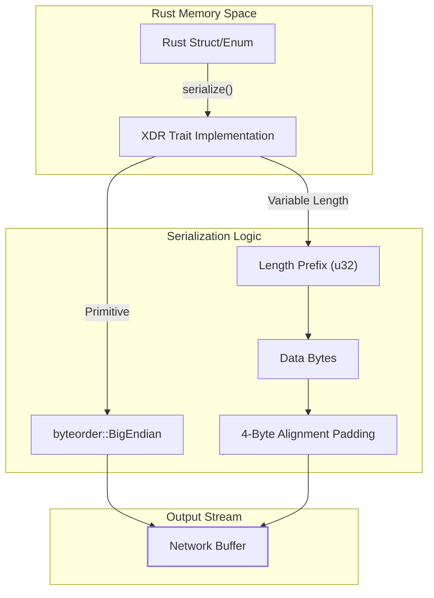
Sources: [src/xdr.rs:9-12](), [src/xdr.rs:106-131]()

---

## Primitive and Composite Implementations

The framework provides manual implementations for standard Rust types to ensure they conform to XDR specifications:

| Type | XDR Representation | Implementation Details |
| :--- | :--- | :--- |
| `bool` | 4-byte integer | `0` for false, `1` for true [src/xdr.rs:41-51]() |
| `u32` / `i32` | 4 bytes | Big-endian [src/xdr.rs:53-62](), [src/xdr.rs:75-84]() |
| `u64` / `i64` | 8 bytes | Big-endian [src/xdr.rs:64-73](), [src/xdr.rs:86-95]() |
| `[u8; N]` | N bytes | Fixed-size opaque data; no length prefix [src/xdr.rs:97-104]() |
| `Vec<u8>` | u32 + N bytes + Pad | Length-prefixed opaque data with padding [src/xdr.rs:106-131]() |
| `nfsstring` | u32 + N bytes + Pad | Wrapper around `Vec<u8>` [src/xdr.rs:133-140]() |

Sources: [src/xdr.rs:41-140]()

---

## Code Generation Macros

To reduce boilerplate when implementing the protocol, `nfsserve` uses three primary macros to automatically generate `XDR` trait implementations.

### 1. `xdr_struct!`
This macro implements `XDR` for a struct by sequentially calling `serialize`/`deserialize` on each of its fields in the order they are defined.

*   **Usage**: `xdr_struct!(StructName, field1, field2, ...);`
*   **Logic**: Iterates through the provided field identifiers and pipes them to the `dest` or `src` streams [src/xdr.rs:165-181]().

### 2. `xdr_enum_serde!`
Used for simple C-style enumerations where the value is represented as a `u32`.

*   **Logic**: It casts the enum to a `u32` during serialization [src/xdr.rs:21-23](). During deserialization, it reads a `u32` and uses `FromPrimitive` to map it back to the enum variant [src/xdr.rs:24-35]().
*   **Example**: Used for `nfsstat3` [src/nfs.rs:200]().

### 3. `xdr_bool_union!`
This macro handles a specific pattern common in NFSv3: the "Boolean Union". This is typically used for optional attributes (e.g., `pre_op_attr`).

*   **Logic**:
    *   **TRUE Case**: Serializes a `true` (4-byte `1`) followed by the data [src/xdr.rs:209-212]().
    *   **FALSE Case**: Serializes a `false` (4-byte `0`) and nothing else [src/xdr.rs:206-208]().
*   **Structure**: The macro expects a Rust enum with a `Void` variant and a data-carrying variant [src/xdr.rs:191-195]().

### Macro Association Map
This diagram maps the natural language protocol definitions to the specific Rust macros and code entities used to implement them.

**Mapping: Protocol Definitions to Code Entities**
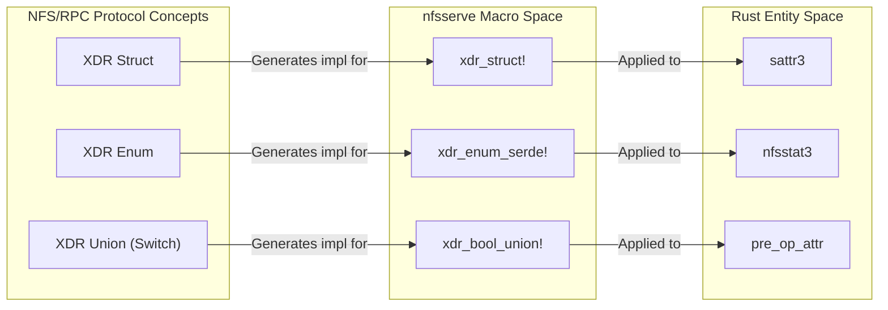
Sources: [src/xdr.rs:165-225](), [src/nfs.rs:200](), [src/nfs.rs:434]()

---

## Data Alignment Implementation

The `Vec<u8>` implementation demonstrates the 4-byte alignment logic used throughout the framework:

```rust
// Serialization Padding Logic
let pad = ((4 - length % 4) % 4) as usize;
let zeros: [u8; 4] = [0, 0, 0, 0];
if pad > 0 {
    dest.write_all(&zeros[..pad])?;
}
```
[src/xdr.rs:113-117]()

During deserialization, the same number of bytes must be consumed from the stream and discarded to keep the read pointer aligned with the next XDR object [src/xdr.rs:126-129]().

Sources: [src/xdr.rs:1-225](), [src/nfs.rs:1-100]()

---

# Page: Request Context and Transaction Tracking

# Request Context and Transaction Tracking

<details>
<summary>Relevant source files</summary>

The following files were used as context for generating this wiki page:

- [src/context.rs](src/context.rs)
- [src/transaction_tracker.rs](src/transaction_tracker.rs)

</details>


The `nfsserve` library utilizes a unified context object and a specialized transaction tracker to maintain state across the asynchronous RPC pipeline. This system ensures that filesystem operations have access to necessary metadata (credentials, port information, and VFS handles) while providing a mechanism to detect and handle RPC retransmissions from clients.

## The RPCContext Struct

The `RPCContext` is the primary container for request-scoped data. It is designed to be cloned and passed through the asynchronous task chain for every incoming connection. By wrapping heavy components like the VFS and the transaction tracker in `Arc`, the context remains cheap to clone while providing shared access to global state.

### Structure Definition
The `RPCContext` struct is defined in [src/context.rs:10-18]().

| Field | Type | Description |
| :--- | :--- | :--- |
| `local_port` | `u16` | The local port the server is listening on [src/context.rs:11](). |
| `client_addr` | `String` | The IP address and port of the remote NFS client [src/context.rs:12](). |
| `auth` | `auth_unix` | Parsed RPC AUTH_UNIX credentials (UID, GID, etc.) [src/context.rs:13](). |
| `vfs` | `Arc<dyn NFSFileSystem>` | Thread-safe reference to the underlying virtual filesystem [src/context.rs:14](). |
| `mount_signal` | `Option<mpsc::Sender<bool>>` | Channel used to signal the server when a UMNT (unmount) occurs [src/context.rs:15](). |
| `export_name` | `Arc<String>` | The name of the exported directory path [src/context.rs:16](). |
| `transaction_tracker` | `Arc<TransactionTracker>` | Shared state for detecting duplicate RPC XIDs [src/context.rs:17](). |

### Context Lifecycle and Data Flow

The following diagram illustrates how the `RPCContext` bridges the network layer to the VFS execution.

**Context Propagation Diagram**
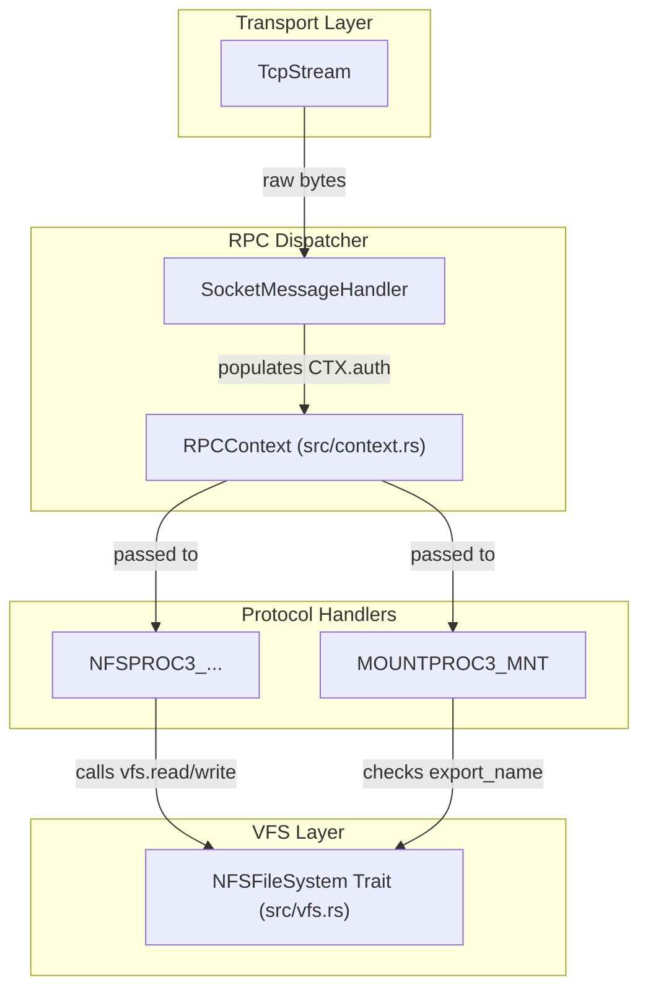
**Sources:** [src/context.rs:9-18](), [src/vfs.rs:1-10]()

---

## Transaction Tracking and Idempotency

NFS over UDP or unreliable TCP connections may result in client retransmissions. To prevent non-idempotent operations (like `REMOVE` or `CREATE`) from being executed multiple times for the same request, `nfsserve` employs a `TransactionTracker`.

### TransactionTracker Implementation
The `TransactionTracker` uses a `HashMap` to map a unique transaction key—consisting of the RPC Transaction ID (`xid`) and the `client_addr`—to its current state [src/transaction_tracker.rs:8-9]().

#### Transaction States
A transaction can be in one of two states:
1.  **InProgress**: The request has been received and is currently being processed by the VFS [src/transaction_tracker.rs:55]().
2.  **Completed(SystemTime)**: The request processing is finished, and the completion timestamp is recorded for housekeeping purposes [src/transaction_tracker.rs:56]().

### Retransmission Detection Logic
When a request arrives, the server calls `is_retransmission(xid, client_addr)`.
- If the `(xid, client_addr)` pair is not in the map, it is inserted as `InProgress` and the function returns `false` [src/transaction_tracker.rs:27-29]().
- If the pair already exists, it returns `true`, signaling the RPC layer to handle the duplicate (usually by dropping it or returning the cached response) [src/transaction_tracker.rs:30-31]().

Once the RPC handler completes its work, it calls `mark_processed(xid, client_addr)`, which updates the state to `Completed` with the current `SystemTime` [src/transaction_tracker.rs:36-43]().

### Lazy Housekeeping Strategy
To prevent the `transactions` map from growing indefinitely, the `TransactionTracker` performs "lazy housekeeping" [src/transaction_tracker.rs:46-52](). 

Every time `is_retransmission` is called, the tracker locks the mutex and iterates through the map, removing any `Completed` transactions that are older than the configured `retention_period` [src/transaction_tracker.rs:25-26](). `InProgress` transactions are never removed during housekeeping to ensure active requests are protected [src/transaction_tracker.rs:49]().

**Transaction State Machine**
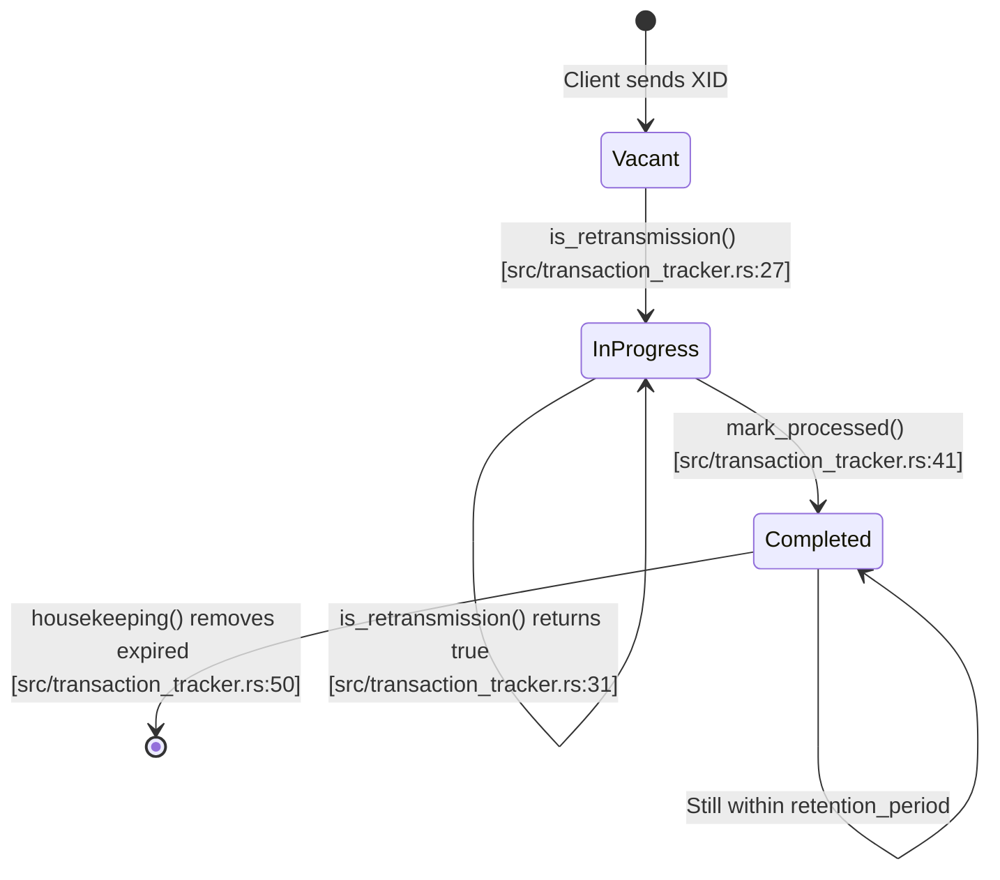

### Transaction Key Components
The tracker uniquely identifies requests using a tuple of `(u32, String)` representing:
1.  **XID**: The 32-bit transaction identifier provided in the RPC header.
2.  **Client Address**: The source address of the client, ensuring that XID collisions between different clients do not interfere with each other [src/transaction_tracker.rs:24]().

**Sources:** [src/transaction_tracker.rs:6-17](), [src/transaction_tracker.rs:19-33](), [src/transaction_tracker.rs:36-43](), [src/transaction_tracker.rs:46-57]()

---

# Page: Protocol Handlers

# Protocol Handlers

<details>
<summary>Relevant source files</summary>

The following files were used as context for generating this wiki page:

- [src/lib.rs](src/lib.rs)
- [src/rpcwire.rs](src/rpcwire.rs)

</details>


The `nfsserve` library implements the NFS v3 stack by dispatching RPC calls to specific program handlers. The dispatcher identifies the requested service by its RPC Program Number and routes the request to the appropriate handler module.

### RPC Dispatch Logic

The primary entry point for protocol multiplexing is the `handle_rpc` function in `src/rpcwire.rs`. After validating the RPC version and checking for retransmissions via the `TransactionTracker`, the dispatcher selects a handler based on the `prog` field in the RPC call header.

#### Dispatch Mapping

| RPC Program | Program Number | Handler Function | Description |
|:---|:---|:---|:---|
| **Portmap** | `100000` | `handle_portmap` | Helper service for port discovery. |
| **Mount** | `100005` | `handle_mount` | Handles initial authentication and file handle acquisition. |
| **NFS** | `100003` | `handle_nfs` | The core filesystem operation protocol (v3). |

The dispatcher also explicitly ignores and returns `PROG_UNAVAIL` for auxiliary programs often requested by modern clients, such as `NFS_ACL` (`100227`), `NFS_ID_MAP` (`100270`), and `NFS_METADATA` (`200024`) [src/rpcwire.rs:54-65]().

### Handler Selection Architecture

The following diagram illustrates how a raw byte stream is transformed into a specific protocol procedure call.

**RPC Dispatch Flow**
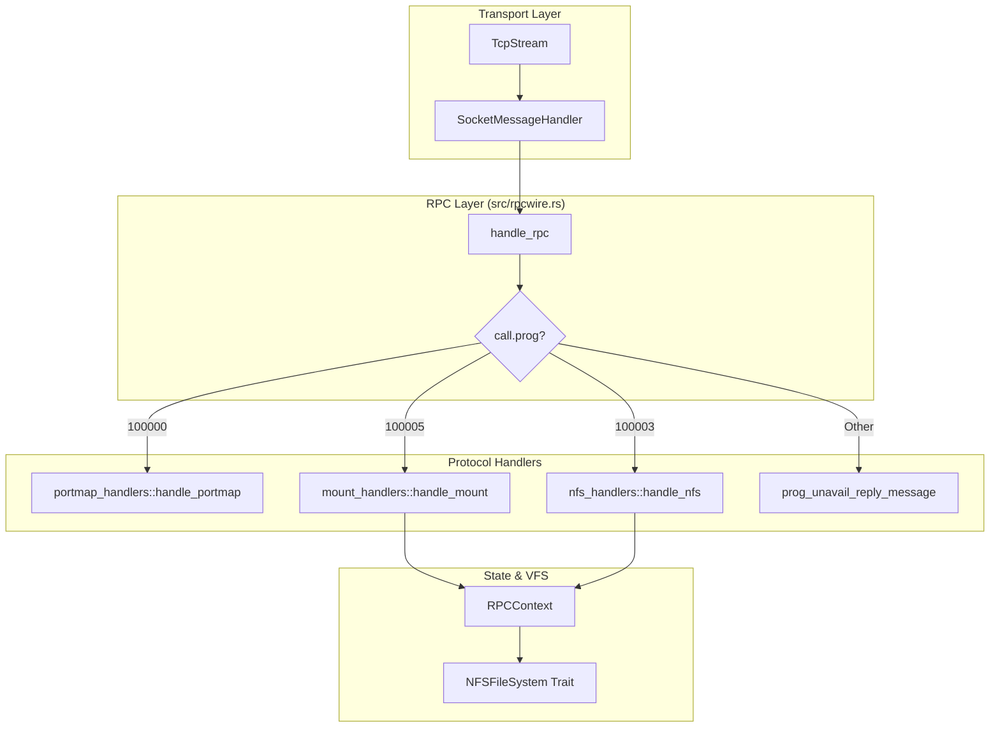
Sources: [src/rpcwire.rs:20-74](), [src/lib.rs:9-16]()

---

### [Portmap Handler](#3.1)
The Portmap handler provides a "fake" portmapper implementation. Since `nfsserve` typically runs the Mount and NFS services on the same TCP port, the Portmap handler simply directs clients to the current listener's port. It implements `PMAPPROC_GETPORT` and `PMAPPROC_NULL` while rejecting state-altering calls like `SET` or `UNSET`.

For details, see [Portmap Handler](#3.1).

### [Mount Handler](#3.2)
The Mount handler implements the MOUNT v3 protocol (RFC 1813). It acts as the gatekeeper for the filesystem, validating export paths requested by the client and returning the initial root file handle. It also handles export listing and provides a signaling mechanism (`mount_signal`) to track active mounts.

For details, see [Mount Handler](#3.2).

### [NFS v3 Handler](#3.3)
The NFS v3 handler is the most complex component, implementing the core filesystem operations. It translates RPC procedures (like `READ`, `WRITE`, `LOOKUP`, and `READDIRPLUS`) into method calls on the `NFSFileSystem` trait. It manages Weak Cache Consistency (WCC) data and ensures that filesystem capabilities (e.g., read-only status) are enforced at the protocol level.

For details, see [NFS v3 Handler](#3.3).

---

### Protocol Entity Mapping

This table maps the high-level protocol concepts to the specific internal modules and constants used in the code.

| Protocol Concept | Code Constant / Module | Source File |
|:---|:---|:---|
| **NFS Program ID** | `nfs::PROGRAM` (100003) | [src/nfs.rs]() |
| **Mount Program ID** | `mount::PROGRAM` (100005) | [src/mount.rs]() |
| **Portmap Program ID** | `portmap::PROGRAM` (100000) | [src/portmap.rs]() |
| **RPC Context** | `RPCContext` | [src/context.rs]() |
| **NFS Dispatcher** | `handle_nfs` | [src/nfs_handlers.rs]() |
| **Mount Dispatcher** | `handle_mount` | [src/mount_handlers.rs]() |
| **Portmap Dispatcher** | `handle_portmap` | [src/portmap_handlers.rs]() |

Sources: [src/rpcwire.rs:48-53](), [src/lib.rs:3-23]()

---

# Page: Portmap Handler

# Portmap Handler

<details>
<summary>Relevant source files</summary>

The following files were used as context for generating this wiki page:

- [src/portmap.rs](src/portmap.rs)
- [src/portmap_handlers.rs](src/portmap_handlers.rs)

</details>


The Portmap handler in `nfsserve` implements a subset of the Portmapper protocol (RPC program 100000) as defined in **RFC 1057 Appendix A** [src/portmap_handlers.rs:13-25](). In a standard NFS environment, the portmapper (or `rpcbind`) is a separate service that helps clients discover which TCP/UDP ports other RPC services (like `mountd` or `nfsd`) are listening on.

In `nfsserve`, the Portmap handler is "fake" in that it is embedded directly into the same process and listener as the NFS and Mount services. It exists primarily to satisfy clients that attempt to query the portmapper on the same port they initially connected to.

## Portmap Program Definition

The handler uses the `PortmapProgram` enum to represent the procedures defined in the specification.

| Procedure | Value | Status | Description |
| :--- | :--- | :--- | :--- |
| `PMAPPROC_NULL` | 0 | Implemented | Standard RPC ping/connectivity test. |
| `PMAPPROC_SET` | 1 | `proc_unavail` | Registers a new port mapping. Unsupported. |
| `PMAPPROC_UNSET` | 2 | `proc_unavail` | Unregisters a port mapping. Unsupported. |
| `PMAPPROC_GETPORT` | 3 | Implemented | Returns the port for a given program/version/protocol. |
| `PMAPPROC_DUMP` | 4 | `proc_unavail` | Lists all registered mappings. Unsupported. |
| `PMAPPROC_CALLIT` | 5 | `proc_unavail` | Indirect RPC call through the portmapper. Unsupported. |

Sources: [src/portmap_handlers.rs:29-38](), [src/portmap_handlers.rs:54-60]()

### Portmap Mapping Structure
The `mapping` struct is the primary data structure for Portmap queries, containing the program number, version, protocol (TCP/UDP), and port [src/portmap.rs:15-21]().

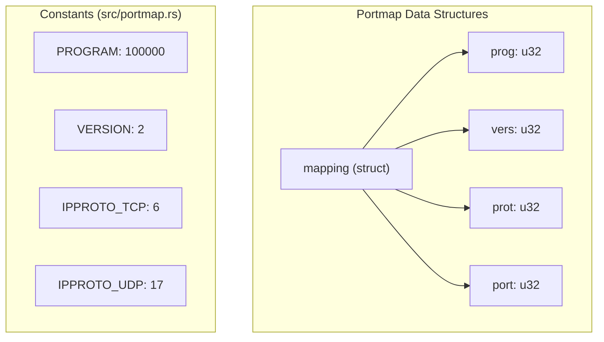
Sources: [src/portmap.rs:15-25]()

## Request Dispatching

The entry point for Portmap requests is `handle_portmap`. It performs a version check against `portmap::VERSION` (v2) before dispatching to specific procedure handlers [src/portmap_handlers.rs:40-51]().

1.  **Version Validation**: If the requested version does not match, it returns a `prog_mismatch_reply_message` [src/portmap_handlers.rs:47-51]().
2.  **Procedure Mapping**: It converts the `u32` procedure ID into a `PortmapProgram` enum using `FromPrimitive` [src/portmap_handlers.rs:52]().
3.  **Execution**: 
    *   `PMAPPROC_NULL` and `PMAPPROC_GETPORT` are routed to their respective functions [src/portmap_handlers.rs:55-56]().
    *   All other procedures return `proc_unavail_reply_message` [src/portmap_handlers.rs:57-59]().

Sources: [src/portmap_handlers.rs:40-62]()

## Procedure Implementations

### PMAPPROC_NULL
This procedure takes no arguments and returns an empty successful RPC reply. It is used by clients to verify that the Portmapper service is alive and reachable [src/portmap_handlers.rs:64-71]().

### PMAPPROC_GETPORT
This is the core of the "fake" portmapper design. When a client asks for the port of a program (such as the Mount or NFS program), `nfsserve` ignores the specific program requested and returns its own `local_port` [src/portmap_handlers.rs:76-90]().

*   **Data Flow**:
    1.  The handler deserializes a `mapping` struct from the input stream [src/portmap_handlers.rs:82-83]().
    2.  It serializes a successful RPC header to the output stream [src/portmap_handlers.rs:85]().
    3.  It retrieves the `local_port` from the `RPCContext` [src/portmap_handlers.rs:86]().
    4.  It serializes this port as a `u32` to the output [src/portmap_handlers.rs:88]().

This behavior ensures that if a client connects to `nfsserve` and asks "Where is the NFS service?", the server responds "Right here on this same port."

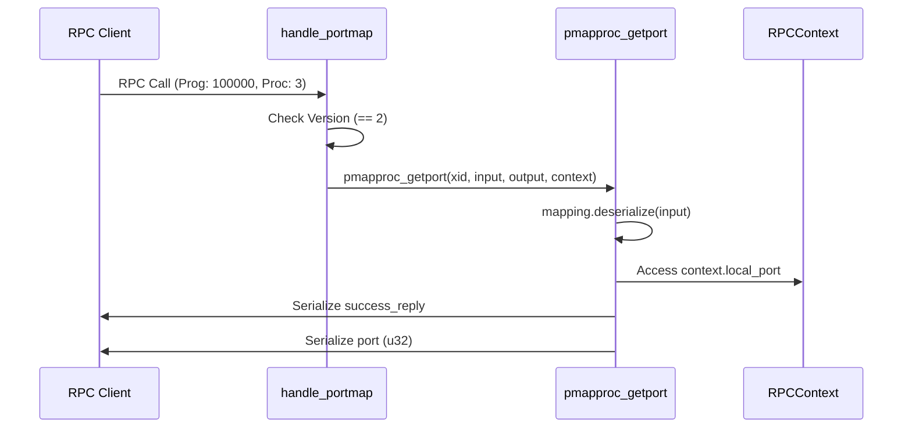
Sources: [src/portmap_handlers.rs:40-62](), [src/portmap_handlers.rs:76-90]()

## Unsupported Procedures
Procedures such as `PMAPPROC_SET`, `PMAPPROC_UNSET`, and `PMAPPROC_DUMP` return `proc_unavail` [src/portmap_handlers.rs:57-59](). 

The design rationale is that `nfsserve` is a specialized, single-purpose NFS server. It does not act as a general-purpose system portmapper; it only provides enough Portmapper functionality to satisfy NFS clients that expect a portmapper to be co-located with the service. Since the service mapping is static (everything is on the same port), registration (`SET`/`UNSET`) and complex listing (`DUMP`) are unnecessary.

Sources: [src/portmap_handlers.rs:54-60]()

---

# Page: Mount Handler

# Mount Handler

<details>
<summary>Relevant source files</summary>

The following files were used as context for generating this wiki page:

- [src/mount.rs](src/mount.rs)
- [src/mount_handlers.rs](src/mount_handlers.rs)

</details>


The Mount Handler implements the MOUNT v3 protocol as specified in **RFC 1813 Appendix I** [src/mount_handlers.rs:13-24](). It serves as the entry point for NFS clients to obtain an initial file handle for a specific exported directory. Once a client successfully "mounts" a path, it uses the returned file handle to transition to the main NFS v3 protocol.

### Protocol Overview

The Mount protocol operates on Program `100005`, Version `3` [src/mount.rs:15-16](). It is handled by the `handle_mount` function, which dispatches incoming RPC calls to specific procedure implementations [src/mount_handlers.rs:39-59]().

| Procedure | Name | Description |
| :--- | :--- | :--- |
| 0 | `MOUNTPROC3_NULL` | Ping the server to check availability [src/mount_handlers.rs:61-68](). |
| 1 | `MOUNTPROC3_MNT` | Validate a path and return a root file handle [src/mount_handlers.rs:78-122](). |
| 2 | `MOUNTPROC3_DUMP` | Returns a list of current mounts (Not fully implemented) [src/mount_handlers.rs:32](). |
| 3 | `MOUNTPROC3_UMNT` | Signals that a client has unmounted a path [src/mount_handlers.rs:176-192](). |
| 4 | `MOUNTPROC3_UMNTALL` | Signals that all paths are unmounted [src/mount_handlers.rs:194-207](). |
| 5 | `MOUNTPROC3_EXPORT` | Returns the list of exported filesystems [src/mount_handlers.rs:158-174](). |

### Mount Request Pipeline (MOUNTPROC3_MNT)

The `mountproc3_mnt` function is the core of the mount handler. It performs path validation against the configured export and interacts with the VFS to generate the initial file handle.

**Mount Logic Flow:**
1.  **Path Extraction**: Deserializes the `dirpath` from the XDR input [src/mount_handlers.rs:84-85]().
2.  **Export Validation**: Checks if the requested path starts with the `context.export_name` [src/mount_handlers.rs:88]().
3.  **Path Normalization**: Strips the export prefix and ensures the path is formatted correctly for the VFS (e.g., leading `/`) [src/mount_handlers.rs:89-93]().
4.  **VFS Lookup**: Calls `context.vfs.path_to_id(&path)` to verify the directory exists and retrieve its internal ID [src/mount_handlers.rs:101]().
5.  **Handle Generation**: Converts the ID to an `fhandle3` using `context.vfs.id_to_fh(fileid)` [src/mount_handlers.rs:103]().
6.  **Signaling**: If a `mount_signal` channel exists in the `RPCContext`, it sends `true` to notify the application of a successful mount [src/mount_handlers.rs:110-112]().
7.  **Response**: Returns `MNT3_OK` along with the file handle and supported authentication flavors (`AUTH_NULL`, `AUTH_UNIX`) [src/mount_handlers.rs:104-115]().

#### Mount Procedure Data Flow
The following diagram traces a mount request from the RPC dispatcher through the VFS.

**Title: Mount Procedure Logic**
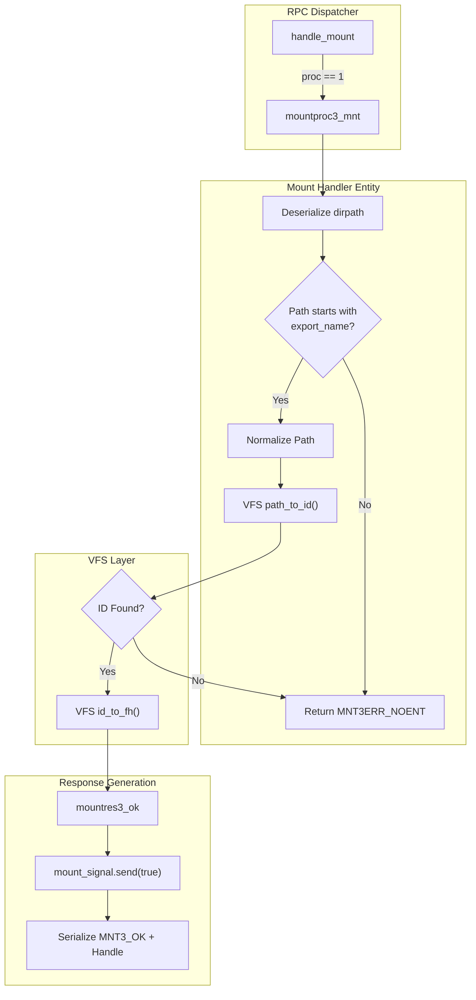
Sources: [src/mount_handlers.rs:39-122](), [src/context.rs:7-15]()

### Export Listing (MOUNTPROC3_EXPORT)

The `mountproc3_export` procedure allows clients to discover what filesystems are available for mounting. In `nfsserve`, this is currently limited to returning the single `export_name` defined in the `RPCContext` [src/mount_handlers.rs:162-174]().

The response follows the RFC structure for an `exportnode`:
*   `ex_dir`: The directory path (from `context.export_name`) [src/mount_handlers.rs:168]().
*   `ex_groups`: A list of client groups (hardcoded to `false`/empty) [src/mount_handlers.rs:170]().
*   `ex_next`: Pointer to the next export (hardcoded to `false`/empty) [src/mount_handlers.rs:172]().

Sources: [src/mount_handlers.rs:124-174]()

### Unmount Signaling

While the Mount protocol is technically stateless (the server doesn't strictly need to track unmounts for NFS v3 to function), `nfsserve` provides a mechanism to signal the host application when a client unmounts.

*   **MOUNTPROC3_UMNT**: Triggered when a client unmounts a specific path. It sends `false` via the `mount_signal` [src/mount_handlers.rs:176-192]().
*   **MOUNTPROC3_UMNTALL**: Triggered when a client signals it is unmounting all paths. It also sends `false` via the `mount_signal` [src/mount_handlers.rs:194-207]().

### Error Handling and Status Codes

The handler uses the `mountstat3` enum to communicate success or failure to the client [src/mount.rs:29-40]().

| Error Code | Value | Description |
| :--- | :--- | :--- |
| `MNT3_OK` | 0 | Success [src/mount.rs:30]() |
| `MNT3ERR_NOENT` | 2 | Export or directory does not exist [src/mount.rs:32]() |
| `MNT3ERR_ACCES` | 13 | Permission denied [src/mount.rs:34]() |
| `MNT3ERR_NOTDIR` | 20 | Attempted to mount a non-directory [src/mount.rs:35]() |
| `MNT3ERR_SERVERFAULT` | 10006 | Internal server error [src/mount.rs:39]() |

#### Entity Mapping: Protocol to Implementation
This diagram maps the RFC-defined protocol entities to the Rust types and functions in the codebase.

**Title: Mount Protocol Entity Mapping**
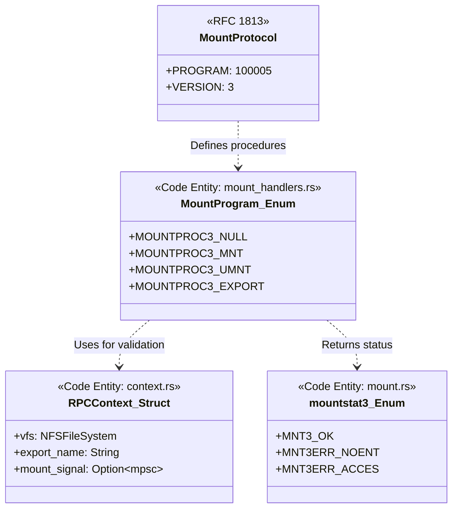
Sources: [src/mount.rs:15-41](), [src/mount_handlers.rs:28-37](), [src/context.rs:7-15]()

---

# Page: NFS v3 Handler

# NFS v3 Handler

<details>
<summary>Relevant source files</summary>

The following files were used as context for generating this wiki page:

- [src/nfs.rs](src/nfs.rs)
- [src/nfs_handlers.rs](src/nfs_handlers.rs)
- [src/write_counter.rs](src/write_counter.rs)

</details>


The NFS v3 Handler is the core logic engine of `nfsserve`, responsible for implementing the procedures defined in RFC 1813. It dispatches incoming RPC calls to specific handler functions, interacts with the `NFSFileSystem` trait to perform I/O, and manages the serialization of complex NFS response structures including Weak Cache Consistency (WCC) data.

## Dispatch Logic

The entry point for all NFS operations is `handle_nfs` [src/nfs_handlers.rs:118-162](). It verifies the NFS version [src/nfs_handlers.rs:125-129]() and maps the RPC procedure number to the `NFSProgram` enum [src/nfs_handlers.rs:130-130]().

### NFS v3 Procedure Mapping

| Procedure | Enum Variant | Handler Function |
| :--- | :--- | :--- |
| 0 | `NFSPROC3_NULL` | `nfsproc3_null` |
| 1 | `NFSPROC3_GETATTR` | `nfsproc3_getattr` |
| 2 | `NFSPROC3_SETATTR` | `nfsproc3_setattr` |
| 3 | `NFSPROC3_LOOKUP` | `nfsproc3_lookup` |
| 4 | `NFSPROC3_ACCESS` | `nfsproc3_access` |
| 6 | `NFSPROC3_READ` | `nfsproc3_read` |
| 7 | `NFSPROC3_WRITE` | `nfsproc3_write` |
| 8 | `NFSPROC3_CREATE` | `nfsproc3_create` |
| 12 | `NFSPROC3_REMOVE` | `nfsproc3_remove` |
| 13 | `NFSPROC3_RMDIR` | `nfsproc3_remove` (shared logic) |
| 14 | `NFSPROC3_RENAME` | `nfsproc3_rename` |
| 17 | `NFSPROC3_READDIRPLUS`| `nfsproc3_readdirplus` |
| 19 | `NFSPROC3_FSINFO` | `nfsproc3_fsinfo` |

**Sources:** [src/nfs_handlers.rs:89-162]()

## Procedure Implementations

### Metadata and Traversal
*   **GETATTR**: Retrieves file attributes (`fattr3`). It converts the `nfs_fh3` handle to an internal ID via `context.vfs.fh_to_id` before calling the VFS [src/nfs_handlers.rs:188-220]().
*   **LOOKUP**: Searches for a filename within a directory handle. It returns the file handle and attributes of the found object, along with the directory's post-op attributes [src/nfs_handlers.rs:223-281]().
*   **ACCESS**: Checks access permissions (READ, LOOKUP, MODIFY, EXTEND, DELETE) based on the caller's credentials [src/nfs_handlers.rs:356-407]().

### Data Operations
*   **READ**: Reads data from a file. It enforces `VFSCapabilities` and handles the `count` requested by the client [src/nfs_handlers.rs:433-499]().
*   **WRITE**: Writes data to a file. It supports different stable-storage requirements (`UNSTABLE`, `DATA_SYNC`, `FILE_SYNC`) and returns a `writeverf3` [src/nfs_handlers.rs:693-792]().
*   **READDIRPLUS**: An optimized directory listing that returns both directory entries and their associated metadata in a single call to reduce RPC round-trips [src/nfs_handlers.rs:608-691]().

### Filesystem Management
*   **FSINFO**: Returns static information about the filesystem, such as maximum read/write sizes and preferred alignment [src/nfs_handlers.rs:501-554]().
*   **FSSTAT**: Returns dynamic information, including total/free disk space and inode counts [src/nfs_handlers.rs:569-606]().

**Sources:** [src/nfs_handlers.rs:188-792](), [src/nfs.rs:101-198]()

## Weak Cache Consistency (WCC) Data

NFS v3 uses WCC data to help clients maintain cache consistency. This consists of `pre_op_attr` (attributes before the operation) and `post_op_attr` (attributes after).

The handler frequently uses the `wcc_data` struct [src/nfs.rs:420-424](). For operations like `REMOVE` or `WRITE`, the handler captures the initial state, performs the VFS action, and then captures the final state to populate this structure [src/nfs_handlers.rs:854-918]().

### Data Flow: NFS Handler to VFS
This diagram illustrates how a `NFSPROC3_LOOKUP` request is dispatched through the handler into the VFS trait.

Title: Lookup Procedure Data Flow
```mermaid
graph TD
    subgraph "RPC_Layer"
        A["handle_rpc"] -- "dispatch" --> B["handle_nfs"]
    end

    subgraph "NFS_Handler"
        B -- "proc=3" --> C["nfsproc3_lookup"]
        C -- "XDR Deserialize" --> D["diropargs3"]
        D -- "fh_to_id" --> E["fileid3 (Dir ID)"]
    end

    subgraph "VFS_Interface"
        E -- "vfs.lookup(id, name)" --> F["NFSFileSystem Trait"]
        F -- "Result" --> G["lookup_res"]
    end

    G -- "XDR Serialize" --> H["LOOKUP3resok"]
    H --> I["output buffer"]
```
**Sources:** [src/nfs_handlers.rs:118-162](), [src/nfs_handlers.rs:223-281]()

## Capabilities and Constraints

### VFSCapabilities Enforcement
The handler respects the `VFSCapabilities` flags provided by the VFS implementation [src/vfs.rs:13-20]().
*   If `read_only` is true, operations like `SETATTR`, `WRITE`, `CREATE`, and `REMOVE` return `NFS3ERR_ROFS` [src/nfs_handlers.rs:815-819]().
*   The `max_read_size` and `max_write_size` reported in `FSINFO` are derived from these capabilities [src/nfs_handlers.rs:528-531]().

### Response Size Limiting
To prevent memory exhaustion and respect RPC limits, `nfsserve` uses a `WriteCounter` [src/write_counter.rs:6-9]() to track the size of serialized responses.

In `nfsproc3_readdirplus`, the handler wraps the output stream in a `WriteCounter` and checks the `bytes_written` during entry iteration. If the size exceeds the client's requested `max_count`, the handler terminates the entry list early and sets the `EOF` flag to false [src/nfs_handlers.rs:661-681]().

Title: Response Size Limiting Logic
```mermaid
graph TD
    subgraph "Stream_Management"
        WC["WriteCounter<W>"]
        WC -- "wraps" --> OUT["output: Write"]
    end

    subgraph "ReaddirPlus_Loop"
        START["Iterate VFS Entries"] --> SER["Serialize Entry"]
        SER --> UP["Update WriteCounter.count"]
        UP --> CHECK{"count > max_count?"}
        CHECK -- "Yes" --> TRUNC["Stop & Set EOF=false"]
        CHECK -- "No" --> START
    end

    TRUNC --> FIN["Finalize Response"]
```
**Sources:** [src/write_counter.rs:6-43](), [src/nfs_handlers.rs:661-681]()

---

# Page: Virtual File System (VFS) Interface

# Virtual File System (VFS) Interface

<details>
<summary>Relevant source files</summary>

The following files were used as context for generating this wiki page:

- [src/vfs.rs](src/vfs.rs)

</details>


The Virtual File System (VFS) interface is the primary abstraction layer in `nfsserve`. It decouples the NFS protocol logic from the underlying storage mechanism. By implementing a single Rust trait, developers can expose any hierarchical data source—whether in-memory, on a local disk, or backed by a remote API—as a mountable NFS export.

### The NFSFileSystem Trait

The core of the VFS is the `NFSFileSystem` trait [src/vfs.rs:95-95](). This trait defines the contract for all filesystem operations, such as looking up files, reading data, and managing attributes. It is designed to be asynchronous, allowing implementations to perform I/O without blocking the RPC server's event loop.

For a complete breakdown of every method and its requirements, see the [NFSFileSystem Trait Reference](#4.1).

### File Handle Generation Scheme

NFS relies on "File Handles" (FH) to uniquely identify files across requests. In `nfsserve`, these handles are automatically managed to simplify implementation for the developer.

1.  **File IDs**: Implementations only need to manage 64-bit `fileid3` values (similar to Unix inodes) [src/vfs.rs:71-71]().
2.  **Generation Number**: A global `GENERATION_NUMBER` is initialized at server startup using the current system time [src/vfs.rs:49-59]().
3.  **Opaque FH**: The system combines the `GENERATION_NUMBER` and the `fileid3` to create a 128-bit opaque handle [src/vfs.rs:72-75](). This ensures that if the server restarts, old client handles safely expire (stale handles).

### VFS Component Interaction

The following diagram illustrates how the VFS interface bridges the gap between the NFS protocol handlers and concrete storage implementations.

**VFS Integration Architecture**
```mermaid
graph TD
    subgraph "Protocol Space (NFS v3)"
        [nfs_handler.rs] -- "calls" --> [NFSFileSystem]
    end

    subgraph "Abstraction Layer (VFS)"
        [NFSFileSystem] -- "identifies by" --> [fileid3]
        [NFSFileSystem] -- "uses" --> [GENERATION_NUMBER]
        [NFSFileSystem] -- "returns" --> [fattr3]
    end

    subgraph "Implementation Space"
        [NFSFileSystem] <|-- [DemoFS]
        [NFSFileSystem] <|-- [MirrorFS]
        [MirrorFS] -- "uses" --> [fs_util.rs]
    end

    style [NFSFileSystem] stroke-width:4px
```
Sources: [src/vfs.rs:49-59](), [src/vfs.rs:95-95](), [src/nfs_handler.rs:1-20]()

### Concrete Implementations

The codebase provides two reference implementations that demonstrate how to fulfill the `NFSFileSystem` contract:

| Implementation | Purpose | Key Features |
| :--- | :--- | :--- |
| **DemoFS** | In-memory testing | Uses `FSEntry` and `FSContents` to store data in a `Vec`. Ideal for ephemeral mocks. |
| **MirrorFS** | Local disk proxy | Uses `intaglio` for path interning and `std::fs` for actual I/O. Maps local paths to `fileid3`. |

*   For details on the in-memory implementation, see [DemoFS — In-Memory Filesystem](#4.2).
*   For details on the local disk proxy, see [MirrorFS — Local Filesystem Proxy](#4.3).

### Utility Pipeline

Implementing a filesystem often involves repetitive tasks like converting `std::fs::Metadata` into NFS-compatible `fattr3` structures or handling Unix permission masks. The `fs_util` module provides these common helpers.

**Metadata Conversion Flow**
```mermaid
graph LR
    subgraph "Host OS"
        [std::fs::Metadata]
    end

    subgraph "fs_util.rs"
        [metadata_to_fattr3]
        [mode_unmask]
    end

    subgraph "NFS Wire Format"
        [fattr3]
    end

    [std::fs::Metadata] --> [metadata_to_fattr3]
    [metadata_to_fattr3] --> [mode_unmask]
    [mode_unmask] --> [fattr3]
```
Sources: [src/fs_util.rs:1-50]()

For a guide on these helper functions, see [Filesystem Utilities (fs_util)](#4.4).

### Implementation Requirements
*   **Speed**: Methods like `getattr` and `lookup` must be highly optimized as they are called frequently by NFS clients [src/vfs.rs:91-91]().
*   **Pagination**: `readdir` uses a `start_after` ID rather than complex cookies to simplify stateless operation [src/vfs.rs:79-82]().
*   **Reserved IDs**: The `fileid` 0 is reserved and must not be used by any implementation [src/vfs.rs:93-93]().

Sources: [src/vfs.rs:49-107](), [src/vfs.rs:168-173]()

---

# Page: NFSFileSystem Trait Reference

# NFSFileSystem Trait Reference

<details>
<summary>Relevant source files</summary>

The following files were used as context for generating this wiki page:

- [src/nfs.rs](src/nfs.rs)
- [src/vfs.rs](src/vfs.rs)

</details>


The `NFSFileSystem` trait is the primary extension point for `nfsserve`. It defines the interface that any backend (e.g., in-memory, local disk, or remote API) must implement to be exposed as an NFSv3 share. This page provides a technical reference for the trait methods, the file handle generation scheme, and the pagination model.

## Trait Definition and Core Concepts

The trait is defined as an `#[async_trait]` to allow for non-blocking I/O operations in backends.

### File Identification (fileid3)
In `nfsserve`, files are uniquely identified by a 64-bit `fileid3` (equivalent to a Unix inode number) [src/vfs.rs:71-71](). The value `0` is reserved and must not be used by implementations [src/vfs.rs:93-93]().

### Opaque File Handles and Generation Numbers
NFS clients communicate using opaque file handles. `nfsserve` automatically constructs these handles by combining a 64-bit **Generation Number** and the 64-bit **File ID** [src/vfs.rs:72-75]().

The `GENERATION_NUMBER` is initialized once at server startup using the current system time in milliseconds [src/vfs.rs:52-59](). This ensures that if the server restarts, any file handles held by clients become "stale" (NFS3ERR_STALE), preventing accidental operations on recycled IDs after a reboot [src/vfs.rs:73-74]().

### Mapping Natural Language to Code Entities

The following diagram illustrates how abstract filesystem concepts map to specific Rust entities within the `NFSFileSystem` trait.

**Entity Mapping: Filesystem Concepts to Trait Methods**
```mermaid
graph TD
    subgraph "Natural Language Space"
        A["Identity"]
        B["Navigation"]
        C["Attributes"]
        D["Data I/O"]
        E["Management"]
    end

    subgraph "Code Entity Space (NFSFileSystem)"
        A1["root_dir()"]
        A2["fileid3"]
        B1["lookup()"]
        B2["readdir()"]
        C1["getattr()"]
        C2["setattr()"]
        D1["read()"]
        D2["write()"]
        E1["create()"]
        E2["remove()"]
        E3["rename()"]
    end

    A --> A1
    A --> A2
    B --> B1
    B --> B2
    C --> C1
    C --> C2
    D --> D1
    D --> D2
    E --> E1
    E --> E2
    E --> E3
```
Sources: [src/vfs.rs:95-173]()

## Method Reference

### Metadata and Capabilities

| Method | Description | Implementation Notes |
| :--- | :--- | :--- |
| `capabilities()` | Returns `VFSCapabilities` (`ReadOnly` or `ReadWrite`). | Used by the NFS handler to enforce permissions at the protocol level [src/vfs.rs:97-97](). |
| `root_dir()` | Returns the `fileid3` of the root directory `/`. | This is the entry point for all client mounts [src/vfs.rs:98-99](). |
| `getattr(id)` | Returns `fattr3` (attributes) for a given ID. | **Critical Path:** Must be highly optimized as NFS clients call this frequently to check for cache invalidation [src/vfs.rs:109-111](). |
| `fsinfo(id)` | Returns `fsinfo3` (static filesystem info). | Provides info like preferred read/write sizes and link counts [src/vfs.rs:202-202](). |
| `fsstat(id)` | Returns `fsstat3` (dynamic capacity info). | Provides info on total/free space [src/vfs.rs:205-205](). |

### Directory Operations

| Method | Description | Implementation Notes |
| :--- | :--- | :--- |
| `lookup(dirid, name)` | Finds the `fileid3` of a file within a directory. | Must be fast. Used for path traversal [src/vfs.rs:107-107](). |
| `readdir(dirid, start_after, max)` | Lists directory contents with pagination. | Returns `ReadDirResult`. Uses `start_after` for deterministic pagination instead of cookies [src/vfs.rs:168-173](). |
| `readdir_simple(dirid, count)` | Simplified listing (names and IDs only). | Default implementation wraps `readdir` [src/vfs.rs:177-179](). |

### File Manipulation

| Method | Description | Error Handling |
| :--- | :--- | :--- |
| `read(id, offset, count)` | Reads data from a file. | Returns `(Vec<u8>, bool)` where bool is EOF [src/vfs.rs:121-121](). |
| `write(id, offset, data)` | Writes data to a file. | Should return `NFS3ERR_ROFS` if the filesystem is read-only [src/vfs.rs:128-128](). |
| `setattr(id, sattr3)` | Updates file attributes (mode, mtime, etc). | Returns updated `fattr3` [src/vfs.rs:115-115](). |
| `create(dirid, name, attr)` | Creates a new file. | Returns `(fileid3, fattr3)` [src/vfs.rs:133-133](). |
| `remove(dirid, name)` | Deletes a file. | [src/vfs.rs:147-147]() |
| `rename(from_dir, from_name, ...)`| Moves/renames a file or directory. | [src/vfs.rs:152-158]() |

## Data Flow: Handle Resolution

The following diagram describes the internal flow when an RPC request arrives with an opaque handle and needs to be resolved to a filesystem action.

**Logic Flow: RPC Handle to VFS Method**
```mermaid
sequenceDiagram
    participant C as NFS Client
    participant H as handle_nfs (nfs_handler.rs)
    participant V as NFSFileSystem Trait
    
    C->>H: Request with nfs_fh3 (Opaque)
    H->>H: Call fh_to_id(fh)
    Note over H: Extracts 64-bit File ID<br/>Verifies Generation Number
    H->>V: Call trait method (e.g., getattr(fileid))
    V-->>H: Result<fattr3, nfsstat3>
    H-->>C: RPC Response (XDR)
```
Sources: [src/vfs.rs:72-75](), [src/vfs.rs:218-228]()

## Default Implementation Helpers

The trait provides several default methods for handle management that implementations usually do not need to override:

*   **`id_to_fh(id)`**: Packs a `fileid3` and the global `GENERATION_NUMBER` into a 64-byte `nfs_fh3` [src/vfs.rs:210-216]().
*   **`fh_to_id(fh)`**: Unpacks an `nfs_fh3`. It returns `NFS3ERR_STALE` if the handle's generation number does not match the server's current `GENERATION_NUMBER` [src/vfs.rs:218-228]().
*   **`path_to_id(path)`**: A helper that recursively calls `lookup` to resolve a full path (e.g., `"/a/b/c"`) into a `fileid3`. It starts from `root_dir()` and handles the leading slash [src/vfs.rs:230-249]().

## Pagination Strategy

`nfsserve` departs from the standard NFS cookie verifier scheme for simplicity:
1.  **No Cookie Verifiers**: The server does not maintain stateful verifiers for directory streams [src/vfs.rs:79-79]().
2.  **Deterministic Ordering**: Implementations of `readdir` must ensure that directory listing is deterministic so that `start_after` (the ID of the last entry seen by the client) correctly identifies the next entry in the sequence [src/vfs.rs:161-163]().
3.  **Truncation**: Because NFSv3 limits response size by bytes rather than entry count, the caller (NFS handler) may truncate the results provided by the `NFSFileSystem` implementation to fit the client's requested buffer size [src/vfs.rs:84-87]().

Sources: [src/vfs.rs:1-250](), [src/nfs.rs:1-106]()

---

# Page: DemoFS — In-Memory Filesystem

# DemoFS — In-Memory Filesystem

<details>
<summary>Relevant source files</summary>

The following files were used as context for generating this wiki page:

- [examples/demo.rs](examples/demo.rs)
- [src/config.rs](src/config.rs)

</details>


`DemoFS` is a reference implementation of the `NFSFileSystem` trait, providing a fully functional in-memory filesystem. It serves as both a testing tool and a pedagogical example of how to map NFS protocol operations to a custom data store. It supports basic file operations, directory navigation, and simple persistence within the lifecycle of the process.

Sources: [examples/demo.rs:75-78](), [examples/demo.rs:118-118]()

## Data Model and Storage

`DemoFS` uses a flat indexing strategy where every filesystem object (file or directory) is stored in a single `Vec<FSEntry>`. The `fileid3` (NFS file identifier) corresponds directly to the index of the entry within this vector.

### Core Structures

*   **`FSEntry`**: The primary unit of storage, containing metadata (`fattr3`), the object name, parent reference, and the actual data content. [examples/demo.rs:16-22]()
*   **`FSContents`**: An enum that distinguishes between file data (a `Vec<u8>`) and directory data (a `Vec<fileid3>` containing the IDs of child entries). [examples/demo.rs:10-13]()
*   **`DemoFS`**: The top-level structure which wraps the entry vector in a `std::sync::Mutex` to ensure thread-safe access during concurrent RPC requests. [examples/demo.rs:75-78]()

### Memory Layout Diagram
The following diagram illustrates how the `DemoFS` maps the logical directory tree to the flat `Vec` storage.

**DemoFS Storage Mapping**
```mermaid
graph TD
    subgraph "Natural Language Space"
    Root["Root Directory (/)"]
    A["File: a.txt"]
    Sub["Directory: another_dir"]
    end

    subgraph "Code Entity Space: DemoFS"
    Vec["Vec<FSEntry>"]
    E1["FSEntry [Index 1]"]
    E2["FSEntry [Index 2]"]
    E4["FSEntry [Index 4]"]
    
    Vec --> E1
    Vec --> E2
    Vec --> E4

    E1 -- "contents: FSContents::Directory([2, 3, 4])" --> E1_data
    E2 -- "contents: FSContents::File(Vec<u8>)" --> E2_data
    E4 -- "contents: FSContents::Directory([5])" --> E4_data
    end

    Root -.-> E1
    A -.-> E2
    Sub -.-> E4
```
Sources: [examples/demo.rs:10-22](), [examples/demo.rs:75-78](), [examples/demo.rs:89-106]()

## Implementation of NFS Operations

`DemoFS` implements the `NFSFileSystem` trait using `async_trait`. Because the underlying data is in memory, most operations are handled by locking the `Mutex` and performing standard `Vec` or `slice` manipulations.

### Directory Lookup and Navigation
The `lookup` function performs a linear search through the IDs stored in a directory's `FSContents::Directory` block. It explicitly handles the special Unix directory entries `.` (self) and `..` (parent).

*   **`.` (Current)**: Returns the `dirid` passed to the function. [examples/demo.rs:169-171]()
*   **`..` (Parent)**: Returns the `parent` field stored in the `FSEntry`. [examples/demo.rs:173-175]()

### ReadDir Pagination
NFS v3 requires support for paginated directory listing via a "cookie" or `start_after` mechanism. In `DemoFS`, this is implemented by using the index within the directory's child list.

| Function | Logic |
| :--- | :--- |
| `readdir` | Iterates through `FSContents::Directory(dir)`. If `start_after` is provided, it skips entries until the ID matches `start_after`, then returns the subsequent entries. |
| `getattr` | Performs a direct O(1) lookup in the `Vec` using the `id` as an index. |
| `write` | Resizes the `Vec<u8>` in `FSContents::File` if the write offset + data length exceeds current size, then copies the buffer. |

Sources: [examples/demo.rs:127-143](), [examples/demo.rs:162-185](), [examples/demo.rs:186-190](), [examples/demo.rs:218-245]()

### Concurrency Model
The implementation uses a synchronous `Mutex` (`std::sync::Mutex`) inside asynchronous trait methods. While this blocks the executor thread during the lock duration, it is acceptable for `DemoFS` as the in-memory operations (memory copies and vector lookups) are extremely fast and do not involve I/O wait.

**Request Data Flow**
```mermaid
sequenceDiagram
    participant C as NFS Client
    participant S as NFSTcpListener
    participant V as DemoFS (NFSFileSystem)
    participant M as Mutex<Vec<FSEntry>>

    C->>S: RPC NFSPROC3_WRITE (id, offset, data)
    S->>V: write(id, offset, data)
    V->>M: lock()
    M-->>V: MutexGuard
    Note over V,M: Update bytes in Vec<u8>
    Note over V,M: Update attr.size
    V->>M: drop(lock)
    V-->>S: Result<fattr3, nfsstat3>
    S-->>C: RPC Reply
```
Sources: [examples/demo.rs:76-76](), [examples/demo.rs:127-130](), [examples/demo.rs:141-143]()

## Initialization and Usage

The `Default` implementation for `DemoFS` constructs a hardcoded directory structure for demonstration purposes.

### Example Directory Structure
The default setup creates:
*   `/` (ID 1)
*   `/a.txt` (ID 2)
*   `/b.txt` (ID 3)
*   `/another_dir` (ID 4)
    *   `/another_dir/thisworks.txt` (ID 5)

Sources: [examples/demo.rs:80-112]()

### Running the Demo
The demo is executed by providing a port and an export name. It utilizes the `nfsserve::tcp::NFSTcpListener` to bind the filesystem to a network socket.

```rust
// Logic within examples/demo.rs main (implied)
let fs = DemoFS::default();
let listener = NFSTcpListener::new("0.0.0.0:11111", "demo").await?;
listener.handle_forever(fs).await?;
```

To run from the command line:
```bash
cargo run --example demo
```
Once running, it can be mounted using standard NFS clients:
```bash
mount -t nfs -o port=11111,mountport=11111,nfsvers=3 localhost:/demo /mnt/nfs
```
Sources: [examples/demo.rs:80-112](), [src/tcp.rs:1-20]() (for listener context)

---

# Page: MirrorFS — Local Filesystem Proxy

# MirrorFS — Local Filesystem Proxy

<details>
<summary>Relevant source files</summary>

The following files were used as context for generating this wiki page:

- [examples/mirrorfs.rs](examples/mirrorfs.rs)
- [src/fs_util.rs](src/fs_util.rs)

</details>


`MirrorFS` is a concrete implementation of the `NFSFileSystem` trait that acts as a proxy to the local host filesystem. Unlike `DemoFS` which is entirely in-memory, `MirrorFS` maps NFS file handles to real paths on disk, providing a bridge between the NFS protocol and standard OS file operations. It implements advanced features such as path interning for memory efficiency, just-in-time metadata refreshing, and persistent file ID mapping.

## Core Data Structures

The system relies on two primary structures to manage the relationship between the ephemeral NFS `fileid3` and the underlying host filesystem paths.

### FSMap: The ID-Path Registry
`FSMap` is the central registry for the filesystem. It maintains bidirectional mappings and handles the generation of new file IDs.

| Field | Type | Description |
|:---|:---|:---|
| `root` | `PathBuf` | The base directory on the host filesystem being exported [examples/mirrorfs.rs:32](). |
| `next_fileid` | `AtomicU64` | Thread-safe counter for generating unique `fileid3` values [examples/mirrorfs.rs:33](). |
| `intern` | `SymbolTable` | An `intaglio` symbol table used to intern `OsString` path components to reduce memory overhead [examples/mirrorfs.rs:34](). |
| `id_to_path` | `HashMap<fileid3, FSEntry>` | Maps a unique NFS file ID to its metadata and path symbols [examples/mirrorfs.rs:35](). |
| `path_to_id` | `HashMap<Vec<Symbol>, fileid3>` | Maps a sequence of interned symbols (the path) back to a file ID [examples/mirrorfs.rs:36](). |

### FSEntry: Metadata and Hierarchy
Each node in the filesystem is represented by an `FSEntry`, which caches the state of the file or directory.

*   **`name`**: A `Vec<Symbol>` representing the path components relative to the root [examples/mirrorfs.rs:23]().
*   **`fsmeta`**: The cached `fattr3` attributes (size, mtime, mode) [examples/mirrorfs.rs:24]().
*   **`children`**: For directories, a `BTreeSet<fileid3>` containing the IDs of all discovered children, used for efficient `READDIR` pagination [examples/mirrorfs.rs:27]().

### Bidirectional Mapping Flow
The following diagram illustrates how `MirrorFS` translates between the NFS Space (IDs) and the Host Space (Paths).

**Diagram: ID and Path Resolution Pipeline**
```mermaid
graph TD
    subgraph "NFS_Space"
        FID["fileid3 (u64)"]
    end

    subgraph "MirrorFS_Logic"
        FSMap["FSMap"]
        SymbolTable["intaglio::SymbolTable"]
        FSEntry["FSEntry"]
    end

    subgraph "Host_Filesystem"
        Path["std::path::PathBuf"]
    end

    FID -->|"id_to_path.get()"| FSEntry
    FSEntry -->|"name (Vec<Symbol>)"| SymbolTable
    SymbolTable -->|"intern.get()"| Path
    Path -->|"tokio::fs::metadata()"| FSEntry
    
    Path -.->|"create_entry()"| SymbolTable
    SymbolTable -.->|"path_to_id.get()"| FID
```
**Sources:** [examples/mirrorfs.rs:31-37](), [examples/mirrorfs.rs:66-72](), [examples/mirrorfs.rs:103-117]()

---

## State Synchronization and Refreshing

`MirrorFS` uses a "just-in-time" refresh strategy. Before most operations (like `getattr` or `lookup`), it checks if the host filesystem has changed relative to its internal cache.

### RefreshResult
The `refresh_entry` function returns a `RefreshResult` to signal how the cache was updated:
*   **`Delete`**: The file no longer exists on disk; `MirrorFS` removes it from the map [examples/mirrorfs.rs:41]().
*   **`Reload`**: The file exists but `mtime`, `size`, or `inode` has changed; the cache is updated [examples/mirrorfs.rs:44]().
*   **`Noop`**: The cached metadata is still valid [examples/mirrorfs.rs:46]().

### Metadata Validation
The system uses `fattr3_differ` to detect changes. It compares `fileid`, `mtime` (seconds and nanoseconds), `size`, and `ftype` [src/fs_util.rs:16-22](). If a file type changes (e.g., a file is replaced by a directory with the same name), the entry is treated as a deletion and the ID is expired [examples/mirrorfs.rs:134-143]().

### Symlink Safety
To prevent deadlocks or infinite loops during path resolution, `MirrorFS` uses `exists_no_traverse`. This utility calls `symlink_metadata()` to check for existence without following the link [src/fs_util.rs:27-29]().

**Sources:** [examples/mirrorfs.rs:39-47](), [examples/mirrorfs.rs:118-149](), [src/fs_util.rs:16-29]()

---

## Directory Operations and Pagination

Directory listing in NFS v3 (`READDIR` / `READDIRPLUS`) requires cookie-based pagination. `MirrorFS` implements this using a `BTreeSet` of child IDs.

1.  **Discovery**: When `refresh_dir_list` is called, it performs a `tokio::fs::read_dir` on the host path [examples/mirrorfs.rs:163]().
2.  **Interning**: Each filename is interned into the `SymbolTable` [examples/mirrorfs.rs:165]().
3.  **Pagination**: The `readdir` implementation uses the `cookie` provided by the client as a starting point for a `BTreeSet::range` query [examples/mirrorfs.rs:506-512]().
    *   If `cookie` is 0, it starts from the beginning.
    *   If `cookie` is non-zero, it uses `Bound::Excluded(cookie)` to fetch subsequent entries [examples/mirrorfs.rs:509]().

**Sources:** [examples/mirrorfs.rs:150-177](), [examples/mirrorfs.rs:490-530]()

---

## File I/O and Write Guarantees

`MirrorFS` maps NFS `READ` and `WRITE` calls to asynchronous `Tokio` file operations.

### Read Pipeline
1.  Resolves `fileid3` to a `PathBuf`.
2.  Opens the file using `tokio::fs::File`.
3.  Seeks to the requested `offset` [examples/mirrorfs.rs:408]().
4.  Reads up to `count` bytes into a buffer and returns them [examples/mirrorfs.rs:412-416]().

### Write and Sync
NFS clients can request different levels of stability (UNSTABLE, DATA_SYNC, FILE_SYNC). `MirrorFS` handles this via the `sync_all` method:
*   **Writing**: Uses `AsyncWriteExt::write_all_at` to write data to the host file [examples/mirrorfs.rs:445]().
*   **Commitment**: If the client requests `FILE_SYNC`, or during a `COMMIT` procedure, `MirrorFS` calls `file.sync_all().await` to ensure data is flushed to the physical disk [examples/mirrorfs.rs:451](), [examples/mirrorfs.rs:608]().

### Attribute Modification
Attribute updates (e.g., `CHMOD`, `CHOWN`, `TRUNCATE`) are handled by `path_setattr` and `file_setattr` in `fs_util.rs`. 
*   **Mode Unmasking**: The system ensures that files remain writable by the server by forcing the `0x80` (owner write) bit via `mode_unmask` [src/fs_util.rs:31-37]().
*   **Truncation**: Handled via `file.set_len(size)` [src/fs_util.rs:161]().

**Diagram: Write and Commit Workflow**
```mermaid
sequenceDiagram
    participant Client as NFS Client
    participant MFS as MirrorFS::write
    participant Util as fs_util::path_setattr
    participant Host as Host OS (FS)

    Client->>MFS: NFSPROC3_WRITE (offset, count, data, stable_how)
    MFS->>Host: tokio::fs::OpenOptions::open()
    MFS->>Host: file.write_all_at(offset, data)
    
    alt stable_how == FILE_SYNC
        MFS->>Host: file.sync_all()
        Host-->>MFS: Success
    end
    
    MFS-->>Client: write_res3 (count, committed=FILE_SYNC)
```
**Sources:** [examples/mirrorfs.rs:428-468](), [examples/mirrorfs.rs:600-615](), [src/fs_util.rs:122-178]()

---

# Page: Filesystem Utilities (fs_util)

# Filesystem Utilities (fs_util)

<details>
<summary>Relevant source files</summary>

The following files were used as context for generating this wiki page:

- [examples/mirrorfs.rs](examples/mirrorfs.rs)
- [src/fs_util.rs](src/fs_util.rs)

</details>


The `fs_util` module provides a set of helper functions designed to bridge the gap between standard Rust `std::fs` types and the NFS v3 protocol structures defined in the `nfs` module. These utilities handle metadata conversion, attribute manipulation pipelines, and safety checks for filesystem operations.

## Metadata Conversion and Comparison

The primary role of these utilities is to transform host-specific filesystem metadata into the `fattr3` structure required by the NFS v3 protocol.

### metadata_to_fattr3
The `metadata_to_fattr3` function converts a `std::fs::Metadata` object into an NFS `fattr3` structure [src/fs_util.rs:40-119](). It maps standard Unix attributes such as size, mode, UID, GID, and timestamps (`atime`, `mtime`, `ctime`) to their XDR-compatible counterparts.

*   **File Types**: It explicitly checks if the entry is a file [src/fs_util.rs:43](), symlink [src/fs_util.rs:68](), or directory [src/fs_util.rs:93]() to set the `ftype3` field.
*   **Mode Unmasking**: All modes are passed through `mode_unmask` to ensure the server retains write access [src/fs_util.rs:42]().

### Change Detection
Two functions are provided to detect changes in filesystem objects, which is critical for cache invalidation in implementations like `MirrorFS` [examples/mirrorfs.rs:130-132]().

| Function | Comparison Criteria | Source |
| :--- | :--- | :--- |
| `metadata_differ` | Inode, mtime, length, and file type. | [src/fs_util.rs:13-15]() |
| `fattr3_differ` | FileID, mtime (seconds/nseconds), size, and file type. | [src/fs_util.rs:16-22]() |

**Sources:** [src/fs_util.rs:13-119](), [examples/mirrorfs.rs:130-132]()

## Attribute Pipelines

NFS `SETATTR` requests use the `sattr3` structure, which contains optional fields for modifying file attributes. `fs_util` provides two pipelines to apply these changes.

### path_setattr
Used for operations where only a path is available. It handles:
1.  **Timestamps**: Sets `atime` and `mtime` using the `filetime` crate, supporting both server-time and client-provided time [src/fs_util.rs:123-140]().
2.  **Permissions**: Applies `mode` changes after unmasking [src/fs_util.rs:141-145]().
3.  **Truncation**: If a size is specified, it opens the file with `OpenOptions` and calls `set_len` [src/fs_util.rs:152-162]().

### file_setattr
A synchronous version that operates on an already open `std::fs::File` handle [src/fs_util.rs:167-178](). This is typically used when the filesystem implementation already has a file descriptor available, avoiding redundant path lookups.

### Attribute Modification Flow
The following diagram illustrates how a `sattr3` request is processed into host system calls.

**Title: sattr3 Attribute Application Pipeline**
```mermaid
graph TD
    subgraph "NFS Request Space"
        S["sattr3"]
    end

    subgraph "fs_util Logic"
        S --> AT["Check atime/mtime"]
        S --> MD["Check mode"]
        S --> SZ["Check size"]
        
        MD --> MU["mode_unmask()"]
    end

    subgraph "Host OS Calls (std::fs / filetime)"
        AT --> FT["filetime::set_file_times"]
        MU --> SP["std::fs::set_permissions"]
        SZ --> SL["File::set_len"]
    end

    style S stroke-width:2px
    style MU stroke-dasharray: 5 5
```
**Sources:** [src/fs_util.rs:121-178]()

## Safety and Enforcement

### Symlink Safety: exists_no_traverse
The standard `path.exists()` in Rust traverses symbolic links. In a network filesystem context, this is dangerous as recursive or malicious symlinks could cause server-side deadlocks or directory traversal attacks. `exists_no_traverse` uses `symlink_metadata()` to check for the existence of the link itself without following it [src/fs_util.rs:27-29]().

### Write-Bit Enforcement: mode_unmask
To prevent a situation where an NFS client creates a file with permissions that would lock the server process out of its own files, `mode_unmask` is applied during creation and attribute updates [src/fs_util.rs:31-37]().
*   It forces the `0x80` (Owner Write) bit to be set [src/fs_util.rs:34]().
*   It masks the result to `0x1FF` to ensure only standard Unix permission bits are returned [src/fs_util.rs:36]().

**Sources:** [src/fs_util.rs:27-37]()

## Unix Platform Specifics

The `fs_util` module relies heavily on Unix-specific extensions for metadata retrieval.

*   **MetadataExt**: Used to extract `uid`, `gid`, `ino`, `mtime`, and `size` from `std::fs::Metadata` [src/fs_util.rs:2-3]().
*   **PermissionsExt**: Used to convert raw `u32` modes into `std::fs::Permissions` and vice versa [src/fs_util.rs:35-36]().

The following diagram maps the relationship between NFS protocol entities and the underlying Unix metadata entities handled by `fs_util`.

**Title: Protocol to Unix Entity Mapping**
```mermaid
classDiagram
    class fattr3 {
        +ftype3 ftype
        +uint32 mode
        +uint64 size
        +nfstime3 mtime
        +fileid3 fileid
    }

    class Metadata {
        +file_type()
        +mode()
        +len()
        +mtime()
        +ino()
    }

    class fs_util {
        +metadata_to_fattr3(fid, Metadata)
        +fattr3_differ(fattr3, fattr3)
        +mode_unmask(uint32)
    }

    fattr3 <.. fs_util : produces
    Metadata ..> fs_util : consumes
    fs_util ..> Metadata : calls via MetadataExt
```
**Sources:** [src/fs_util.rs:1-3](), [src/fs_util.rs:40-67]()

---

# Page: Infrastructure and Tooling

# Infrastructure and Tooling

<details>
<summary>Relevant source files</summary>

The following files were used as context for generating this wiki page:

- [.github/workflows/ci.yml](.github/workflows/ci.yml)
- [Cargo.toml](Cargo.toml)
- [rustfmt.toml](rustfmt.toml)

</details>


This section provides an overview of the development lifecycle, quality assurance processes, and configuration management for the `nfsserve` project. The project utilizes standard Rust tooling integrated with GitHub Actions to ensure code correctness, performance, and adherence to a consistent style.

## Development Lifecycle Overview

The `nfsserve` infrastructure is designed to maintain high reliability for network-critical code. It combines strict linting, automated testing across feature sets, and standardized code formatting.

### Infrastructure Relationship Diagram
The following diagram illustrates how project configuration files and CI workflows interact with the source code and its dependencies.

**System Configuration and CI Flow**
```mermaid
graph TD
    subgraph "Local Development"
        [rustfmt.toml] -->|Configures| [rustfmt]
        [Cargo.toml] -->|Defines| [Features/Deps]
    end

    subgraph "CI Pipeline (.github/workflows/ci.yml)"
        [fmt_job] -->|nightly| [cargo_fmt_check]
        [build_job] -->|clippy| [lint_warnings_as_errors]
        [build_job] -->|test| [cargo_test_strict]
        [build_job] -->|lock_check| [Cargo_lock_drift]
    end

    [cargo_fmt_check] -.->|Validates| [src_code]
    [lint_warnings_as_errors] -.->|Analyzes| [src_code]
    [cargo_test_strict] -.->|Executes| [src_code]
    [Cargo_lock_drift] -.->|Verifies| [Cargo.toml]
```
**Sources:** [.github/workflows/ci.yml:14-46](), [rustfmt.toml:1-14](), [Cargo.toml:34-37]()

## CI Pipeline

The project uses GitHub Actions to run a comprehensive suite of checks on every push to the `main` branch and on all pull requests [.github/workflows/ci.yml:3-8](). The pipeline is divided into specialized jobs:

*   **Formatting:** Uses the `nightly` toolchain to enforce strict formatting rules [.github/workflows/ci.yml:21-25]().
*   **Linting:** Employs `clippy` to catch common mistakes and enforce idiomatic Rust. It is configured to treat all warnings as errors via `-D warnings` [.github/workflows/ci.yml:38]().
*   **Testing:** Executes the test suite with the `strict` feature enabled to ensure the codebase remains robust under more rigorous internal checks [.github/workflows/ci.yml:41]().
*   **Integrity:** Validates that `Cargo.lock` has not drifted from the manifest requirements [.github/workflows/ci.yml:45]().

For details, see [CI Pipeline](#5.1).

## Build Configuration and Feature Flags

Project dependencies and compilation options are managed via `Cargo.toml`. The crate is designed to be lightweight, with several optional components gated behind feature flags.

### Feature Flag Mapping
The project uses features to separate core library logic from demonstration utilities and strict validation modes.

**Feature-to-Dependency Mapping**
```mermaid
graph LR
    subgraph "Crate Features"
        F_STRICT["feature: strict"]
        F_DEMO["feature: demo"]
    end

    subgraph "Code Entities & Dependencies"
        D_TRACING["tracing-subscriber"]
        D_INTAGLIO["intaglio"]
        D_TOKIO["tokio/rt-multi-thread"]
        E_DEMO_RS["examples/demo.rs"]
        E_MIRROR_RS["examples/mirrorfs.rs"]
    end

    F_DEMO --> D_TRACING
    F_DEMO --> D_INTAGLIO
    F_DEMO --> D_TOKIO
    F_DEMO --> E_DEMO_RS
    F_DEMO --> E_MIRROR_RS
    
    F_STRICT -.->|Enables| "Internal Assertions"
```
**Sources:** [Cargo.toml:34-48]()

The `demo` feature enables additional dependencies like `intaglio` for path interning and `tracing-subscriber` for logging, which are required to run the provided examples [Cargo.toml:31-36](). The `strict` feature is used during CI to enable more aggressive internal checks [Cargo.toml:35]().

### Code Style
The project enforces a specific code style defined in `rustfmt.toml`. Key configurations include a 120-character line limit and specific rules for import grouping and granularity [rustfmt.toml:6-10]().

For details, see [Build Configuration and Feature Flags](#5.2).

**Sources:**
* [.github/workflows/ci.yml:1-46]()
* [Cargo.toml:1-48]()
* [rustfmt.toml:1-14]()

---

# Page: CI Pipeline

# CI Pipeline

<details>
<summary>Relevant source files</summary>

The following files were used as context for generating this wiki page:

- [.github/workflows/ci.yml](.github/workflows/ci.yml)
- [Cargo.toml](Cargo.toml)

</details>


The `nfsserve` project utilizes GitHub Actions to ensure code quality, adherence to style guidelines, and functional correctness across the codebase. The CI pipeline is defined to trigger on every push to the `main` branch and for all pull requests, providing immediate feedback on regressions or linting violations.

### Pipeline Overview

The workflow is configured with a concurrency policy that cancels in-progress jobs for the same branch/PR if a new commit is pushed, optimizing resource usage. The pipeline is split into two primary jobs: `fmt` (formatting) and `build_and_test-linux`.

| Job Name | Purpose | Toolchain | Key Command |
| :--- | :--- | :--- | :--- |
| `fmt` | Code style enforcement | `nightly` | `cargo +nightly fmt --check` |
| `clippy` | Static analysis & linting | `1.90` | `cargo clippy -- -D warnings` |
| `test` | Functional verification | `1.90` | `cargo test --features "strict"` |
| `lock` | Dependency consistency | N/A | `git status --porcelain Cargo.lock` |

**Sources:**
- [.github/workflows/ci.yml:1-12]()
- [.github/workflows/ci.yml:13-26]()
- [.github/workflows/ci.yml:27-46]()

---

### Implementation Details

#### 1. Code Formatting (`fmt`)
The pipeline enforces the project's coding style using `rustfmt`. This job specifically uses the `nightly` toolchain to leverage the latest formatting features and ensures that the codebase remains consistent with the configuration defined in the project's root. The `--check` flag ensures that the CI fails if the code is not formatted according to the rules, rather than reformatting it in place.

**Sources:**
- [.github/workflows/ci.yml:14-25]()

#### 2. Static Analysis and Linting
The CI utilizes `clippy` to catch common mistakes and enforce Rust idioms. It is configured to treat all warnings as errors using the `-D warnings` flag. This ensures that no code with known "smells" or potential logic errors (as identified by Clippy) is merged into the main branch.

**Sources:**
- [.github/workflows/ci.yml:36-38]()

#### 3. Functional Testing and "Strict" Feature
The core of the validation process is the `cargo test` suite. Notably, tests are executed with the `--features "strict"` flag. The `strict` feature is defined in the crate's manifest and is used to toggle specific validation logic within the library during testing.

**Sources:**
- [.github/workflows/ci.yml:39-41]()
- [Cargo.toml:35-35]()

#### 4. Cargo.lock Drift Detection
To maintain deterministic builds and ensure that dependency updates are intentional, the pipeline includes a check for `Cargo.lock` drift. Since `cargo test` or `cargo clippy` might update the lockfile if `Cargo.toml` was modified without a corresponding lock update, the CI checks the git status of `Cargo.lock` after the build steps. If the file has uncommitted changes, the job fails.

**Sources:**
- [.github/workflows/ci.yml:42-45]()

---

### CI Workflow Data Flow

The following diagram illustrates the sequential execution of the CI pipeline and the tools involved in validating the `nfsserve` codebase.

**CI Execution Flow**
```mermaid
graph TD
    Trigger["GitHub Push / PR"] --> Checkout["actions/checkout@v4"]
    
    subgraph "Style Job (fmt)"
        Checkout --> Nightly["rust-toolchain (nightly)"]
        Nightly --> Rustfmt["cargo +nightly fmt --check"]
    end

    subgraph "Validation Job (build_and_test-linux)"
        Checkout --> Stable["rust-toolchain (1.90)"]
        Stable --> Clippy["cargo clippy -r -- -D warnings"]
        Clippy --> Test["cargo test --features 'strict'"]
        Test --> LockCheck["Check Cargo.lock drift"]
    end

    Rustfmt --> Result{"CI Result"}
    LockCheck --> Result
```
**Sources:**
- [.github/workflows/ci.yml:3-11]()
- [.github/workflows/ci.yml:14-25]()
- [.github/workflows/ci.yml:27-46]()

---

### Code Entity Association

The CI pipeline interacts with specific components of the repository structure and configuration files to execute its checks.

**CI to Codebase Mapping**
```mermaid
graph LR
    subgraph "CI Workflow (.github/workflows/ci.yml)"
        CL["Clippy Step"]
        TF["Test Step"]
        FF["Fmt Step"]
    end

    subgraph "Crate Configuration"
        CT["Cargo.toml"]
        SF["feature: 'strict'"]
        DF["feature: 'demo'"]
    end

    subgraph "Source Code"
        SRC["src/ (lib.rs)"]
        EX["examples/ (demo.rs, mirrorfs.rs)"]
    end

    FF -- "validates" --> SRC
    FF -- "validates" --> EX
    CL -- "analyzes" --> SRC
    TF -- "enables" --> SF
    SF -- "impacts" --> SRC
    CT -- "defines" --> SF
    CT -- "defines" --> DF
    DF -- "required by" --> EX
```

**Sources:**
- [.github/workflows/ci.yml:25-25]()
- [.github/workflows/ci.yml:38-41]()
- [Cargo.toml:34-36]()
- [Cargo.toml:39-48]()

---

# Page: Build Configuration and Feature Flags

# Build Configuration and Feature Flags

<details>
<summary>Relevant source files</summary>

The following files were used as context for generating this wiki page:

- [.gitignore](.gitignore)
- [Cargo.toml](Cargo.toml)
- [rustfmt.toml](rustfmt.toml)

</details>


This page documents the build-time configuration of the `nfsserve` crate, including its dependency tree, the role of specific feature flags, and the project's code style enforcement via `rustfmt`.

## Purpose and Scope

The `nfsserve` build system is designed to provide a lightweight core library while offering optional components for demonstration and complex filesystem mirroring. The configuration balances high-performance asynchronous I/O (via `tokio`) with strict protocol compliance. This document details how `Cargo.toml` and `rustfmt.toml` govern the compilation and styling of the codebase.

## Dependency Analysis

The project utilizes a curated set of dependencies to handle network I/O, serialization, and error management. The choice of crates reflects the need for Big-Endian byte ordering (required by XDR) and asynchronous trait methods.

### Core Dependencies
| Crate | Purpose | Usage in Codebase |
| :--- | :--- | :--- |
| `tokio` | Async Runtime | Provides `TcpListener`, `TcpStream`, and filesystem primitives [Cargo.toml:24-24](). |
| `byteorder` | Serialization | Handles Big-Endian encoding/decoding for XDR [Cargo.toml:21-21](). |
| `async-trait` | Abstraction | Enables `async` methods in the `NFSFileSystem` trait [Cargo.toml:27-27](). |
| `anyhow` | Error Handling | Provides flexible error reporting across the RPC stack [Cargo.toml:26-26](). |
| `tracing` | Logging | Structured diagnostic events for request/response cycles [Cargo.toml:25-25](). |
| `filetime` | Metadata | Sets file access/modification times in `fs_util` [Cargo.toml:28-28](). |
| `num-traits` | Enums | Simplifies conversion between primitive types and XDR enums [Cargo.toml:22-23](). |

### Optional/Demo Dependencies
| Crate | Purpose | Usage in Codebase |
| :--- | :--- | :--- |
| `intaglio` | String Interning | Used in `mirrorfs.rs` for efficient path storage [Cargo.toml:32-32](). |
| `tracing-subscriber` | Logging Output | Enables console logging for the demo examples [Cargo.toml:31-31](). |

**Sources:** [Cargo.toml:20-32]()

## Feature Flags

The crate defines two primary feature flags that control the inclusion of optional dependencies and specific compiler behaviors.

### The `strict` Flag
The `strict` feature [Cargo.toml:35-35]() is used primarily in CI environments. While it does not currently pull in additional dependencies, it is used by the CI pipeline to enforce a "warning-free" build environment.

### The `demo` Flag
The `demo` feature [Cargo.toml:36-36]() is required to build the provided examples (`demo.rs` and `mirrorfs.rs`). It enables:
1.  **Multi-threaded Runtime**: Enables `tokio/rt-multi-thread` for parallel request processing in examples.
2.  **Path Interning**: Pulls in `intaglio` for the `MirrorFS` implementation.
3.  **Logging**: Enables `tracing-subscriber` to allow the examples to output logs to stdout.

### Feature Dependency Mapping
The following diagram illustrates how feature flags pull in specific crate functionality.

**Diagram: Feature Flag Dependency Graph**
```mermaid
graph TD
    subgraph "Feature_Flags"
        "feature:strict"["feature:strict"]
        "feature:demo"["feature:demo"]
    end

    subgraph "Optional_Dependencies"
        "intaglio"["intaglio (v1.6)"]
        "tracing-subscriber"["tracing-subscriber (v0.3)"]
        "tokio_multi"["tokio/rt-multi-thread"]
    end

    subgraph "Required_By"
        "example:demo"["examples/demo.rs"]
        "example:mirrorfs"["examples/mirrorfs.rs"]
    end

    "feature:demo" --> "intaglio"
    "feature:demo" --> "tracing-subscriber"
    "feature:demo" --> "tokio_multi"
    "example:demo" -.-> "feature:demo"
    "example:mirrorfs" -.-> "feature:demo"
```
**Sources:** [Cargo.toml:34-48]()

## Code Style and Formatting

The project enforces a specific coding style via `rustfmt.toml`. This ensures consistency across the complex XDR macro expansions and asynchronous code.

### Key Formatting Rules
The configuration utilizes several "unstable" (nightly) features to improve readability of imports and comments.

| Setting | Value | Description |
| :--- | :--- | :--- |
| `max_width` | 120 | Allows longer lines for complex function signatures [rustfmt.toml:10-10](). |
| `group_imports` | `StdExternalCrate` | Separates standard library, external crates, and local modules [rustfmt.toml:5-5](). |
| `imports_granularity` | `Module` | Consolidates imports from the same module into a single block [rustfmt.toml:6-6](). |
| `wrap_comments` | `true` | Automatically wraps long documentation and code comments [rustfmt.toml:2-2](). |
| `match_block_trailing_comma` | `true` | Ensures consistent diffs in large `match` statements [rustfmt.toml:8-8](). |

**Sources:** [rustfmt.toml:1-14]()

## Build Artifacts and CI Integration

The build process is managed by Cargo, with specific configurations for library versus executable output.

### Target Management
-   **Library**: The core logic is compiled as a library (`[lib]`) with doctests disabled [Cargo.toml:17-18]().
-   **Examples**: Examples are only compiled when the `demo` feature is active [Cargo.toml:41-41](), [Cargo.toml:46-46]().
-   **Git Ignore**: The `.gitignore` file excludes the `target/` directory and platform-specific debug symbols like `*.pdb` [.gitignore:4-14]().

### Build Pipeline Flow
The following diagram shows the relationship between the build configuration and the resulting binary entities.

**Diagram: Build Configuration to Entity Mapping**
```mermaid
graph LR
    "Cargo.toml" -- "defines" --> "nfsserve_lib"["Crate: nfsserve (Library)"]
    "Cargo.toml" -- "requires:demo" --> "demo_bin"["Binary: examples/demo.rs"]
    "Cargo.toml" -- "requires:demo" --> "mirrorfs_bin"["Binary: examples/mirrorfs.rs"]
    
    subgraph "Entity_Space"
        "nfsserve_lib"
        "demo_bin"
        "mirrorfs_bin"
    end

    "rustfmt.toml" -- "styles" --> "nfsserve_lib"
    "rustfmt.toml" -- "styles" --> "demo_bin"
    "rustfmt.toml" -- "styles" --> "mirrorfs_bin"
```
**Sources:** [Cargo.toml:1-48](), [rustfmt.toml:1-14](), [.gitignore:1-18]()

---

# Page: Glossary

# Glossary

<details>
<summary>Relevant source files</summary>

The following files were used as context for generating this wiki page:

- [README.md](README.md)
- [src/fs_util.rs](src/fs_util.rs)
- [src/mount_handlers.rs](src/mount_handlers.rs)
- [src/nfs.rs](src/nfs.rs)
- [src/nfs_handlers.rs](src/nfs_handlers.rs)
- [src/portmap_handlers.rs](src/portmap_handlers.rs)
- [src/rpc.rs](src/rpc.rs)
- [src/rpcwire.rs](src/rpcwire.rs)
- [src/tcp.rs](src/tcp.rs)
- [src/transaction_tracker.rs](src/transaction_tracker.rs)
- [src/vfs.rs](src/vfs.rs)
- [src/write_counter.rs](src/write_counter.rs)
- [src/xdr.rs](src/xdr.rs)

</details>


This page provides definitions for codebase-specific terms, NFS/RPC protocol jargon, and Rust-specific patterns used in the `nfsserve` project. It serves as a technical reference for onboarding engineers to understand the mapping between abstract protocol concepts and their concrete implementations.

## Core Protocol Terminology

### Remote Procedure Call (RPC)
The foundation of the NFS protocol. `nfsserve` implements **ONC RPC** (Open Network Computing Remote Procedure Call) as defined in **RFC 1057**.
*   **XID (Transaction ID):** A 32-bit identifier used to match replies to calls and detect retransmissions [src/rpc.rs:156-160]().
*   **Program/Version/Procedure:** The triplet used to dispatch a request. For example, NFS v3 is Program `100003`, Version `3` [src/nfs.rs:21-22]().
*   **Record Marking (RM):** A framing mechanism for RPC over TCP. Each record consists of one or more fragments, each preceded by a 4-byte header containing a "last fragment" bit and a 31-bit length [src/rpcwire.rs:76-93]().

### External Data Representation (XDR)
The serialization format used by RPC (**RFC 1014**). It enforces big-endian byte order and 4-byte alignment (padding) [src/xdr.rs:7-12]().
*   **`XDR` Trait:** The core interface for serialization and deserialization [src/xdr.rs:9-12]().
*   **`xdr_struct!`:** A macro that generates `XDR` implementations for structs by sequentially processing fields [src/xdr.rs:165-181]().
*   **`xdr_enum_serde!`:** A macro for serializing Rust enums as `u32` XDR integers [src/xdr.rs:18-38]().

### NFS Specific Identifiers
*   **`fileid3`:** A 64-bit unique identifier for a file system object, analogous to a Unix inode number [src/nfs.rs:89-89]().
*   **`nfs_fh3` (File Handle):** An opaque identifier (up to 64 bytes) used by the client to reference an object. In `nfsserve`, this typically contains a 64-bit generation number and the 64-bit `fileid3` [src/vfs.rs:69-75]().
*   **Cookie:** A 64-bit opaque value used in `READDIR` and `READDIRPLUS` to support paginated directory listings [src/nfs.rs:90-90]().

## Codebase Entities and Patterns

### System Mapping: Protocol to Implementation
The following diagram bridges the gap between protocol-level concepts and the specific Rust entities that handle them.

**Protocol Dispatch Diagram**
```mermaid
graph TD
    subgraph "Transport Layer"
        TCP["TcpListener (tokio)"] --> PS["process_socket (tcp.rs)"]
    end

    subgraph "RPC Layer (rpcwire.rs)"
        PS --> SMH["SocketMessageHandler"]
        SMH --> HRPC["handle_rpc"]
        HRPC --> TT["TransactionTracker"]
    end

    subgraph "Program Handlers"
        HRPC -->|Prog 100003| HNFS["handle_nfs (nfs_handlers.rs)"]
        HRPC -->|Prog 100005| HMNT["handle_mount (mount_handlers.rs)"]
        HRPC -->|Prog 100000| HPM["handle_portmap (portmap_handlers.rs)"]
    end

    subgraph "VFS Layer (vfs.rs)"
        HNFS --> VFS["NFSFileSystem Trait"]
        HMNT --> VFS
    end
```
**Sources:** [src/tcp.rs:33-85](), [src/rpcwire.rs:20-74](), [src/nfs_handlers.rs:118-162](), [src/vfs.rs:95-174]().

### Context and State
*   **`RPCContext`:** A struct cloned per connection that carries the VFS implementation, authentication state (`auth_unix`), the `TransactionTracker`, and export configuration [src/context.rs:10-20]().
*   **`TransactionTracker`:** Manages a `HashMap` of `(xid, client_addr)` to detect and drop retransmitted requests, ensuring idempotency for non-idempotent operations [src/transaction_tracker.rs:6-9]().
*   **`GENERATION_NUMBER`:** A value initialized at server startup (usually from system time) used to invalidate file handles from previous server instances [src/vfs.rs:49-59]().

### VFS Abstractions
*   **`NFSFileSystem`:** The primary trait users must implement. It abstracts file operations into an `async_trait` [src/vfs.rs:95-174]().
*   **`fattr3`:** A struct containing file attributes (mode, size, times, IDs) that maps to the NFS protocol's attribute structure [src/nfs.rs:260-277]().
*   **`wcc_data` (Weak Cache Consistency):** Data returned in NFS responses to help clients manage their attribute caches, containing pre-operation and post-operation attributes [src/nfs.rs:633-637]().

## Data Flow: Read Request Example
The following diagram traces the flow of a `NFSPROC3_READ` request through the system components.

**NFS Read Data Flow**
```mermaid
sequenceDiagram
    participant C as NFS Client
    participant T as NFSTcpListener
    participant R as SocketMessageHandler
    participant H as nfs_handlers::nfsproc3_read
    participant V as NFSFileSystem

    C->>T: TCP Data (RPC Record)
    T->>R: read_fragment()
    R->>R: handle_rpc()
    R->>H: Dispatch to NFSPROC3_READ
    H->>V: vfs.fh_to_id(handle)
    H->>V: vfs.read(id, offset, count)
    V-->>H: Result<(Vec<u8>, bool), nfsstat3>
    H->>R: Serialize READ3res
    R->>C: write_fragment()
```
**Sources:** [src/tcp.rs:33-85](), [src/rpcwire.rs:20-74](), [src/nfs_handlers.rs:136-136](), [src/vfs.rs:121-121]().

## Glossary Table

| Term | Definition | File Pointer |
| :--- | :--- | :--- |
| **AUTH_UNIX** | Standard Unix-style authentication (UID, GID, list of groups). | [src/rpc.rs:104-111]() |
| **DuplexStream** | An in-memory async pipe used to decouple socket reading from RPC processing. | [src/rpcwire.rs:135-148]() |
| **fhandle3** | The protocol-level byte array representing an `nfs_fh3`. | [src/mount.rs:26-26]() |
| **nfsstat3** | Enum of NFS v3 error codes (e.g., `NFS3ERR_NOENT`, `NFS3ERR_ROFS`). | [src/nfs.rs:104-198]() |
| **Portmapper** | A service (Prog 100000) that maps RPC program numbers to TCP/UDP ports. | [src/portmap_handlers.rs:15-25]() |
| **sattr3** | A struct used to set attributes (e.g., via `SETATTR` or `CREATE`). | [src/nfs.rs:308-316]() |
| **WCC** | Weak Cache Consistency; allows clients to detect if a file changed between operations. | [src/nfs.rs:633-637]() |
| **WriteCounter** | A utility to track and limit the total bytes written to an XDR stream. | [src/write_counter.rs:5-10]() |

**Sources:** [src/rpc.rs:104-111](), [src/rpcwire.rs:135-148](), [src/mount.rs:26-26](), [src/nfs.rs:104-198](), [src/portmap_handlers.rs:15-25](), [src/nfs.rs:308-316](), [src/nfs.rs:633-637](), [src/write_counter.rs:5-10]().