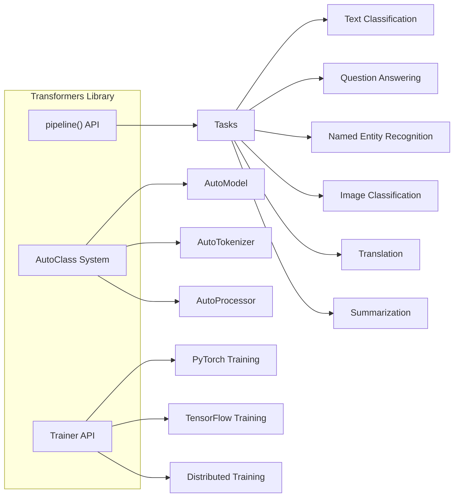
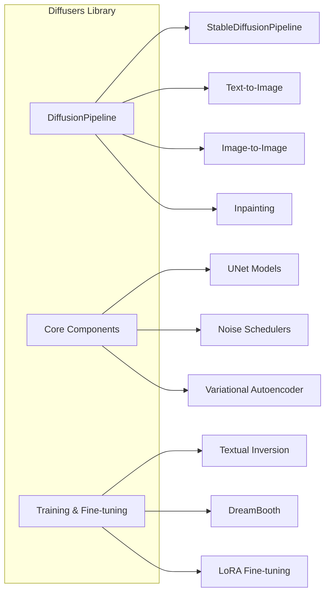
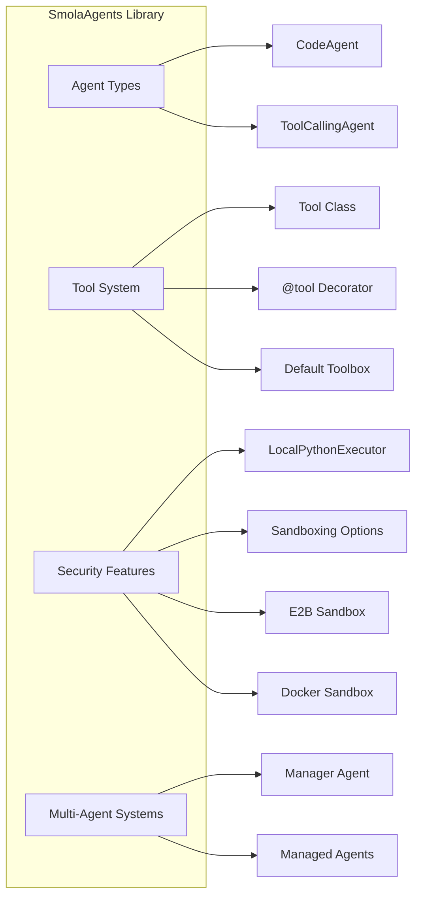
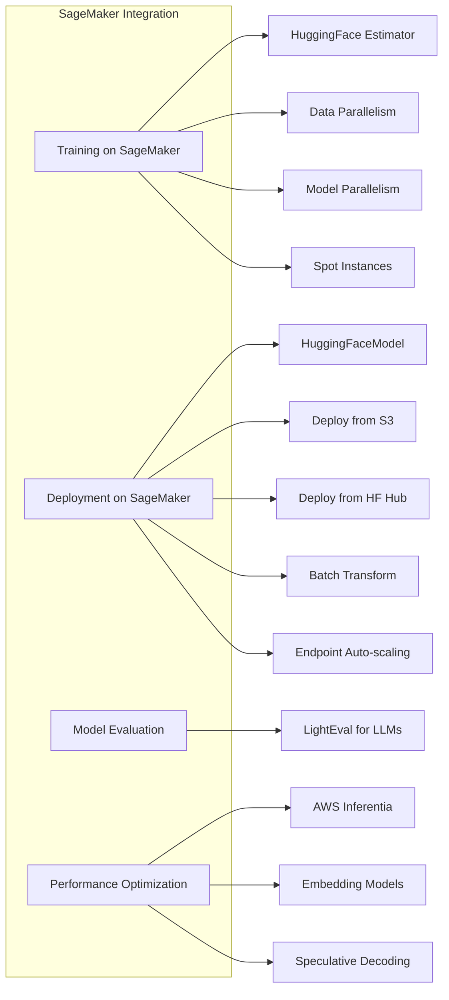
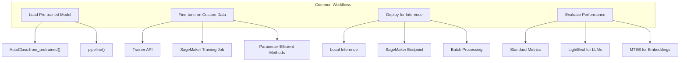

<!-- source: DeepWiki mcp.deepwiki.com · repo huggingface/notebooks · page 1 Overview · fetched 2026-10-26 -->

# Overview

Relevant source files

The following files were used as context for generating this wiki page:

- [sagemaker/29_deploy_llms_on_inferentia2/sagemaker-notebook.ipynb](sagemaker/29_deploy_llms_on_inferentia2/sagemaker-notebook.ipynb)
- [sagemaker/30_evaluate_llms_with_lighteval/sagemaker-notebook.ipynb](sagemaker/30_evaluate_llms_with_lighteval/sagemaker-notebook.ipynb)
- [sagemaker/31_deploy_embedding_models/assets/cw.png](sagemaker/31_deploy_embedding_models/assets/cw.png)
- [sagemaker/31_deploy_embedding_models/sagemaker-notebook.ipynb](sagemaker/31_deploy_embedding_models/sagemaker-notebook.ipynb)
- [sagemaker/32_train_deploy_embedding_models/sagemaker-notebook.ipynb](sagemaker/32_train_deploy_embedding_models/sagemaker-notebook.ipynb)
- [sagemaker/32_train_deploy_embedding_models/scripts/requirements.txt](sagemaker/32_train_deploy_embedding_models/scripts/requirements.txt)
- [sagemaker/32_train_deploy_embedding_models/scripts/run_mnr.py](sagemaker/32_train_deploy_embedding_models/scripts/run_mnr.py)
- [sagemaker/README.md](sagemaker/README.md)
- [smolagents_doc/en/guided_tour.ipynb](smolagents_doc/en/guided_tour.ipynb)
- [smolagents_doc/en/pytorch/guided_tour.ipynb](smolagents_doc/en/pytorch/guided_tour.ipynb)
- [smolagents_doc/en/pytorch/secure_code_execution.ipynb](smolagents_doc/en/pytorch/secure_code_execution.ipynb)
- [smolagents_doc/en/secure_code_execution.ipynb](smolagents_doc/en/secure_code_execution.ipynb)
- [smolagents_doc/en/tensorflow/guided_tour.ipynb](smolagents_doc/en/tensorflow/guided_tour.ipynb)
- [smolagents_doc/en/tensorflow/secure_code_execution.ipynb](smolagents_doc/en/tensorflow/secure_code_execution.ipynb)
- [transformers_doc/quicktour.ipynb](transformers_doc/quicktour.ipynb)
- [transformers_doc/training.ipynb](transformers_doc/training.ipynb)

The Hugging Face Notebooks repository provides a comprehensive collection of educational notebooks that demonstrate how to use various Hugging Face libraries and tools. These notebooks serve as practical guides and examples for working with state-of-the-art machine learning models across a range of tasks including natural language processing, computer vision, generative AI, and agent systems.

This overview page summarizes the main components and libraries found in the repository, their purposes, and how they relate to each other. For more detailed information about specific libraries, please refer to their dedicated pages: [Transformers Library](#2), [Diffusers Library](#3), [SmolaAgents Library](#4), and [SageMaker Integration](#5).

## Repository Structure

The Hugging Face Notebooks repository is organized around several core libraries and tools, each with its own set of notebooks demonstrating various capabilities and use cases.

```mermaid
flowchart TD
    subgraph "Hugging Face Notebooks Repository"
        Transformers["Transformers Library Notebooks"]
        Diffusers["Diffusers Library Notebooks"]
        SmolaAgents["SmolaAgents Library Notebooks"]
        SageMaker["SageMaker Integration Notebooks"]
        Others["Additional Tools Notebooks"]
    end

    Transformers --> NLP["NLP Tasks"]
    Transformers --> CV["Computer Vision Tasks"]
    Transformers --> Training["Model Training & Fine-tuning"]
    
    Diffusers --> SD["Stable Diffusion"]
    Diffusers --> DB["DreamBooth & Textual Inversion"]
    Diffusers --> CP["Custom Pipelines"]
    
    SmolaAgents --> CodeExec["Secure Code Execution"]
    SmolaAgents --> ToolSystem["Tool System"]
    SmolaAgents --> MultiAgent["Multi-agent Systems"]
    SmolaAgents --> RAG["RAG Integration"]
    
    SageMaker --> SMTraining["Training on SageMaker"]
    SageMaker --> SMDeployment["Model Deployment"]
    SageMaker --> SMDistributed["Distributed Training"]
    
    Others --> DSServer["Datasets Server API"]
    Others --> SetFit["SetFit Framework"]
```

Sources: 
- [smolagents_doc/en/secure_code_execution.ipynb]()
- [sagemaker/README.md]()
- [smolagents_doc/en/guided_tour.ipynb]()

## Major Libraries

### Transformers Library

The Transformers library provides access to state-of-the-art NLP and computer vision models in a unified interface. The notebooks for this library demonstrate how to use these models for various tasks through simple APIs.

The Transformers library includes key components:

1. **Pipeline API**: Provides a simple interface for using pre-trained models for common tasks without requiring deep understanding of model architecture.
   
2. **AutoClass System**: Offers a convenient way to load pre-trained models and tokenizers that automatically handles architecture-specific details.

3. **Trainer API**: Simplifies the process of fine-tuning models on custom datasets with optimized training loops.

Sources:
- [transformers_doc/quicktour.ipynb]() 
- [transformers_doc/training.ipynb]()

### Diffusers Library

The Diffusers library enables working with generative image models, particularly diffusion models like Stable Diffusion. The notebooks demonstrate image generation, personalization, and customization.

The Diffusers library focuses on:

1. **Diffusion Pipelines**: End-to-end pipelines for generating images from text prompts, modifying existing images, or filling in missing parts.

2. **Model Components**: Modular components that can be customized or combined to create new diffusion models.

3. **Personalization Techniques**: Methods like Textual Inversion, DreamBooth, and LoRA for adapting pre-trained models to specific concepts or styles.

Sources:
- Repository structure information provided

### SmolaAgents Library

The SmolaAgents library provides a framework for building AI agents that can execute code and interact with tools. The notebooks demonstrate agent construction, tool integration, and secure execution.

Key components of SmolaAgents include:

1. **Agent Types**:
   - **CodeAgent**: Executes Python code snippets for tasks
   - **ToolCallingAgent**: Makes structured tool calls in JSON format

2. **Tool System**: Framework for defining, managing, and using tools that agents can access.

3. **Security Features**: Options for secure code execution, including a custom Python interpreter and sandboxing alternatives.

4. **Multi-Agent Systems**: Capabilities for creating hierarchical agent structures with manager and specialized agents.

Sources:
- [smolagents_doc/en/secure_code_execution.ipynb]()
- [smolagents_doc/en/guided_tour.ipynb]()
- [smolagents_doc/en/pytorch/guided_tour.ipynb]()
- [smolagents_doc/en/tensorflow/guided_tour.ipynb]()

### SageMaker Integration

The notebooks demonstrate how to integrate Hugging Face libraries with Amazon SageMaker for training and deploying models at scale.

The SageMaker integration covers:

1. **Training Integration**: Using SageMaker for efficient model training with features like distributed training and spot instances.

2. **Deployment Options**: Various methods for deploying models to production endpoints.

3. **Performance Optimization**: Techniques for improving inference speed and cost-efficiency.

4. **Evaluation**: Tools for benchmarking and evaluating models.

Sources:
- [sagemaker/README.md]()
- [sagemaker/30_evaluate_llms_with_lighteval/sagemaker-notebook.ipynb]()
- [sagemaker/29_deploy_llms_on_inferentia2/sagemaker-notebook.ipynb]()
- [sagemaker/31_deploy_embedding_models/sagemaker-notebook.ipynb]()
- [sagemaker/32_train_deploy_embedding_models/sagemaker-notebook.ipynb]()

## Core Workflows

The repository demonstrates several core workflows that span multiple libraries:

These core workflows represent the typical journey from loading pre-trained models to deploying them for production use:

1. **Model Loading**: Using `AutoClass` implementations to load pre-trained models from the Hugging Face Hub or local storage.

2. **Fine-tuning**: Adapting pre-trained models to specific tasks or domains using various training techniques.

3. **Deployment**: Serving models for inference in different environments, from local development to cloud-based production.

4. **Evaluation**: Assessing model performance on relevant benchmarks and task-specific metrics.

Sources:
- [transformers_doc/quicktour.ipynb]()
- [transformers_doc/training.ipynb]()
- [sagemaker/README.md]()
- [sagemaker/30_evaluate_llms_with_lighteval/sagemaker-notebook.ipynb]()

## Library Interoperability

The notebooks also demonstrate how the different Hugging Face libraries can be used together or interchangeably with other frameworks:

| Library | Key Integrations | Use Cases |
|---------|-----------------|-----------|
| Transformers | PyTorch, TensorFlow, Flax | Model training and inference across different frameworks |
| Diffusers | Transformers (for text encoders) | Text-to-image generation using language models |
| SmolaAgents | Transformers, LiteLLM, MLX | Using various LLM backends for agent systems |
| All Libraries | SageMaker | Training, deployment, and scaling in AWS |

This interoperability allows developers to:
- Choose the most suitable framework for their use case
- Combine components from different libraries
- Scale workloads from local development to production systems

Sources:
- [smolagents_doc/en/guided_tour.ipynb]()
- [sagemaker/README.md]()

## Getting Started

To start using the notebooks in this repository:

1. Choose the library that matches your task (Transformers for NLP/CV, Diffusers for image generation, SmolaAgents for agent systems)
2. Navigate to the corresponding section in the repository
3. Follow the example notebooks that demonstrate your specific use case
4. Adapt the examples to your own data and requirements

For more detailed information about each library and its capabilities, refer to the dedicated documentation pages:
- [Transformers Library](#2)
- [Diffusers Library](#3)
- [SmolaAgents Library](#4)
- [SageMaker Integration](#5)
- [Additional Tools](#6)

Sources:
- Repository structure information provided

---

