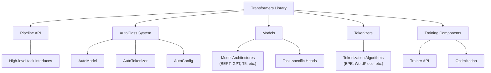
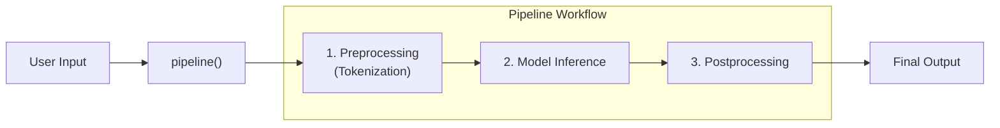
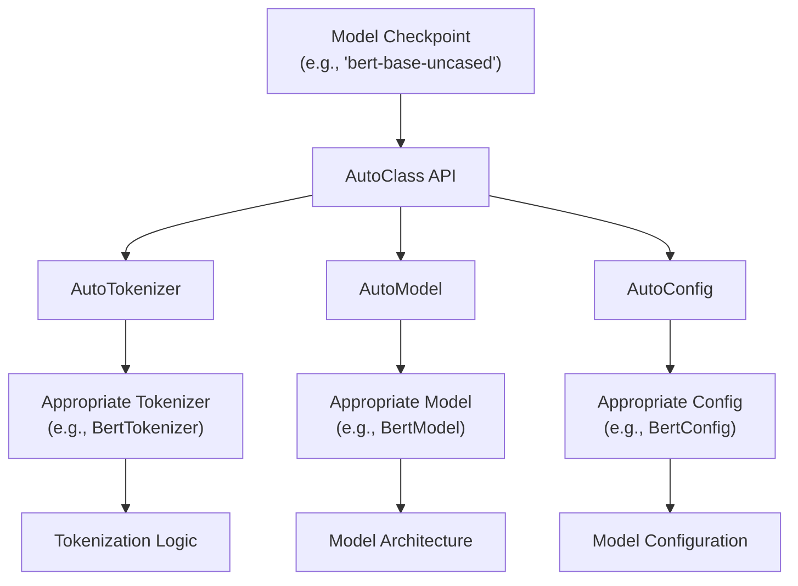
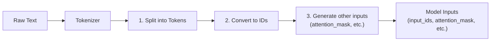
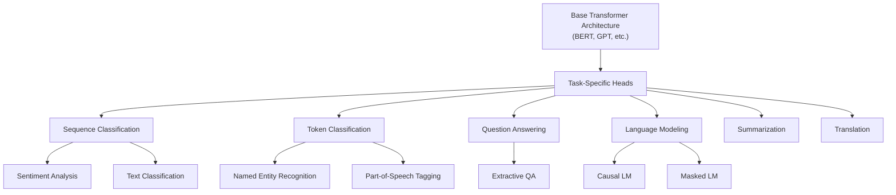
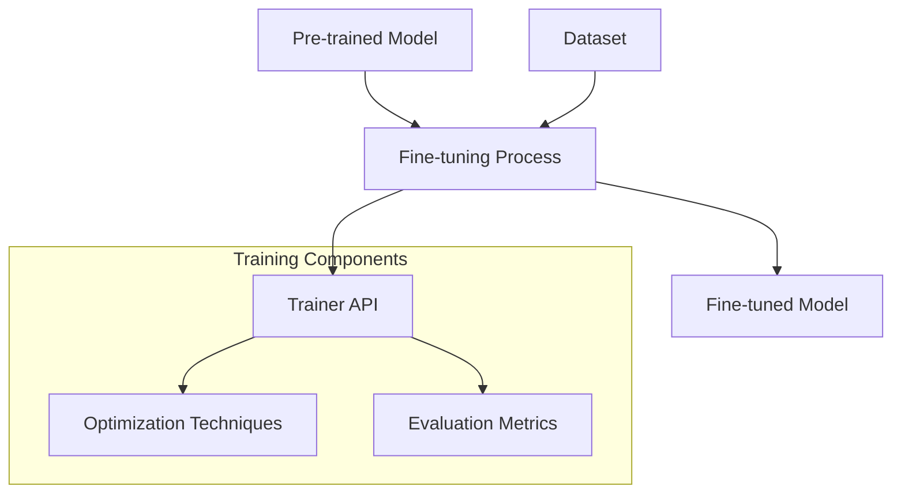
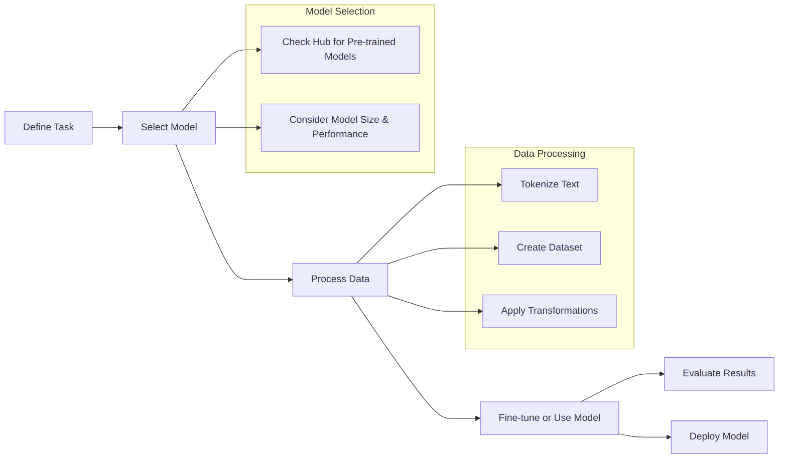

<!-- source: DeepWiki mcp.deepwiki.com · repo huggingface/notebooks · page 2 Transformers Library · fetched 2026-10-26 -->

# Transformers Library

<details>
<summary>Relevant source files</summary>

The following files were used as context for generating this wiki page:

- [examples/images/question_answering.png](examples/images/question_answering.png)
- [examples/images/token_classification.png](examples/images/token_classification.png)
- [examples/language_modeling.ipynb](examples/language_modeling.ipynb)
- [examples/language_modeling_from_scratch.ipynb](examples/language_modeling_from_scratch.ipynb)
- [examples/multiple_choice.ipynb](examples/multiple_choice.ipynb)
- [examples/question_answering.ipynb](examples/question_answering.ipynb)
- [examples/summarization.ipynb](examples/summarization.ipynb)
- [examples/text_classification.ipynb](examples/text_classification.ipynb)
- [examples/token_classification.ipynb](examples/token_classification.ipynb)
- [examples/tokenizer_training.ipynb](examples/tokenizer_training.ipynb)
- [examples/translation.ipynb](examples/translation.ipynb)
- [transformers_doc/preprocessing.ipynb](transformers_doc/preprocessing.ipynb)
- [transformers_doc/quicktour.ipynb](transformers_doc/quicktour.ipynb)
- [transformers_doc/task_summary.ipynb](transformers_doc/task_summary.ipynb)
- [transformers_doc/tokenizer_summary.ipynb](transformers_doc/tokenizer_summary.ipynb)
- [transformers_doc/training.ipynb](transformers_doc/training.ipynb)

</details>


The Transformers library provides a unified API for using state-of-the-art NLP and computer vision models. It offers easy access to pre-trained models for various tasks while abstracting away model architecture details. This document gives an overview of the library's core components and their relationships. For specific task implementations, see individual task pages ([NLP Tasks](#2.2), [Computer Vision](#2.3), [Training](#2.4)).

## Core Components

The Transformers library is built around several key components that work together to provide a flexible interface for using pre-trained models:



Sources: 
- [transformers_doc/quicktour.ipynb:25-100]()
- [transformers_doc/task_summary.ipynb:25-62]()

## Pipeline API

The Pipeline API provides the simplest way to use pre-trained models for inference on specific tasks. It handles all the preprocessing and postprocessing needed for the given task.



### Supported Tasks

| Category | Tasks |
|----------|-------|
| **Text** | Sentiment analysis, text generation, named entity recognition, question answering, fill-mask, summarization, translation, feature extraction |
| **Image** | Image classification, image segmentation, object detection |
| **Audio** | Audio classification, automatic speech recognition |

Example usage:

```python
from transformers import pipeline

# Sentiment analysis pipeline
classifier = pipeline("sentiment-analysis")
result = classifier("We are very happy to show you the 🤗 Transformers library.")
# Returns: [{'label': 'POSITIVE', 'score': 0.9998}]
```

Sources:
- [transformers_doc/quicktour.ipynb:82-132]()
- [transformers_doc/quicktour.ipynb:142-202]()
- [transformers_doc/task_summary.ipynb:61-128]()

## AutoClass System

The AutoClass system is a key component that automatically instantiates the right architecture based on a model checkpoint name or path. This allows for a consistent interface regardless of the underlying model architecture.



Main AutoClass types:

1. **AutoTokenizer**: Loads the appropriate tokenizer for a checkpoint
2. **AutoModel**: Loads the base model (without task-specific heads)
3. **AutoModelForXxx**: Task-specific variants (e.g., `AutoModelForSequenceClassification`)

Example usage:

```python
from transformers import AutoTokenizer, AutoModelForSequenceClassification

# Load tokenizer and model for sentiment analysis
tokenizer = AutoTokenizer.from_pretrained("distilbert-base-uncased")
model = AutoModelForSequenceClassification.from_pretrained("distilbert-base-uncased")
```

Sources:
- [transformers_doc/quicktour.ipynb:400-462]()
- [transformers_doc/quicktour.ipynb:554-574]()
- [examples/text_classification.ipynb:959-964]()

## Tokenization

Tokenizers are responsible for converting raw text into a format that models can understand, implementing preprocessing steps like splitting text into tokens, converting tokens to IDs, and generating attention masks.



### Tokenization Methods

| Method | Description | Used by |
|--------|-------------|---------|
| **WordPiece** | Splits words into subwords, using ## prefix for subword tokens | BERT, DistilBERT |
| **BPE (Byte-Pair Encoding)** | Starts with characters and iteratively merges most frequent pairs | GPT-2, RoBERTa |
| **SentencePiece** | Character-based tokenization that handles different languages uniformly | XLNet, T5 |

Example usage:

```python
from transformers import AutoTokenizer

tokenizer = AutoTokenizer.from_pretrained("bert-base-cased")
encoded_input = tokenizer("Hello, how are you?")
# Returns: {'input_ids': [101, 8667, 117, 1293, 1105, 1115, 136, 102], 'token_type_ids': [0, 0, 0, 0, 0, 0, 0, 0], 'attention_mask': [1, 1, 1, 1, 1, 1, 1, 1]}
```

Sources:
- [transformers_doc/preprocessing.ipynb:73-116]()
- [transformers_doc/tokenizer_summary.ipynb:62-72]()
- [examples/text_classification.ipynb:617-671]()

## Models and Tasks

The Transformers library supports a wide variety of models and tasks, with task-specific model heads on top of base transformer architectures.



### Major Tasks

1. **Sequence Classification**: Predicting a class for an entire input sequence
   - Examples: Sentiment analysis, entailment, spam detection

2. **Token Classification**: Predicting a class for each token in the input
   - Examples: Named Entity Recognition (NER), Part-of-Speech (POS) tagging

3. **Question Answering**: Extracting an answer from a context given a question
   - Model identifies the start and end positions of the answer in the context

4. **Language Modeling**:
   - Causal: Predicting the next token (Used in GPT models)
   - Masked: Predicting masked tokens in a sequence (Used in BERT models)

5. **Generation Tasks**:
   - Summarization: Creating shorter versions of texts
   - Translation: Converting text from one language to another

Sources:
- [transformers_doc/task_summary.ipynb:67-72]()
- [examples/text_classification.ipynb:111-143]()
- [examples/question_answering.ipynb:124-129]()
- [examples/token_classification.ipynb:128-134]()

## Training and Fine-tuning

The Transformers library provides tools for fine-tuning pre-trained models on specific tasks and datasets.



### Training Approaches

1. **Using the Trainer API**: High-level API that handles the training loop, evaluation, and optimization
   ```python
   from transformers import Trainer, TrainingArguments
   trainer = Trainer(
       model=model,
       args=training_args,
       train_dataset=train_dataset,
       eval_dataset=eval_dataset
   )
   trainer.train()
   ```

2. **Using TensorFlow/Keras**: For TensorFlow users
   ```python
   # Compile and fit
   model.compile(optimizer=tf.keras.optimizers.Adam(learning_rate=5e-5))
   model.fit(tf_train_dataset, validation_data=tf_validation_dataset)
   ```

3. **Custom PyTorch Training Loop**: For more control over the training process

### Common Fine-tuning Steps

1. Load pre-trained model and tokenizer
2. Prepare and preprocess dataset
3. Define training arguments (batch size, learning rate, etc.)
4. Initialize trainer with model, datasets, and arguments
5. Start training
6. Evaluate the model
7. Save or share the fine-tuned model

Sources:
- [transformers_doc/training.ipynb:26-33]()
- [transformers_doc/training.ipynb:193-246]()
- [transformers_doc/training.ipynb:322-354]()
- [examples/text_classification.ipynb:928-1007]()

## Practical Workflow

The typical workflow when using the Transformers library involves these steps:



### Common Use Patterns

1. **Quick Inference with Pipelines**:
   ```python
   from transformers import pipeline
   classifier = pipeline("sentiment-analysis")
   result = classifier("This is a great product!")
   ```

2. **Custom Inference with AutoModels**:
   ```python
   from transformers import AutoTokenizer, AutoModelForSequenceClassification
   tokenizer = AutoTokenizer.from_pretrained("model-name")
   model = AutoModelForSequenceClassification.from_pretrained("model-name")
   inputs = tokenizer("Text to classify", return_tensors="pt")
   outputs = model(**inputs)
   ```

3. **Fine-tuning for a Specific Task**:
   ```python
   from transformers import Trainer, TrainingArguments
   # [Define model, tokenizer, dataset...]
   trainer = Trainer(model=model, args=args, train_dataset=train_dataset)
   trainer.train()
   ```

Sources:
- [transformers_doc/quicktour.ipynb:142-202]()
- [examples/text_classification.ipynb:928-1007]()
- [transformers_doc/training.ipynb:193-354]()

## Integration with Other Libraries

The Transformers library integrates well with other PyTorch and TensorFlow ecosystems and libraries.

### PyTorch Ecosystem

- Compatible with PyTorch DataLoaders
- Works with PyTorch Lightning for simplified training
- Integrates with torchvision for vision tasks

### TensorFlow Ecosystem

- Works with tf.data for efficient data loading
- Compatible with Keras API for model definition and training
- Supports TensorFlow Extended (TFX) for production pipelines

### Other Integrations

- **Datasets Library**: For data loading and processing
- **Tokenizers Library**: For fast tokenization
- **Hugging Face Hub**: For sharing and loading models
- **Accelerate**: For distributed training

Sources:
- [transformers_doc/training.ipynb:397-506]()
- [examples/text_classification.ipynb:93-109]()

## Conclusion

The Transformers library provides a comprehensive framework for using state-of-the-art models across various NLP and CV tasks. Its main strengths include:

1. **Ease of use**: Simple API for both beginners and experts
2. **Flexibility**: Supports multiple frameworks and use cases
3. **Extensibility**: Easy to add custom components and behaviors
4. **Community support**: Large ecosystem of pre-trained models
5. **State-of-the-art implementations**: Constantly updated with latest research

For specific task implementations, refer to the task-specific pages in this wiki.

Sources:
- [transformers_doc/quicktour.ipynb:19-34]()
- [transformers_doc/task_summary.ipynb:25-62]()

---

