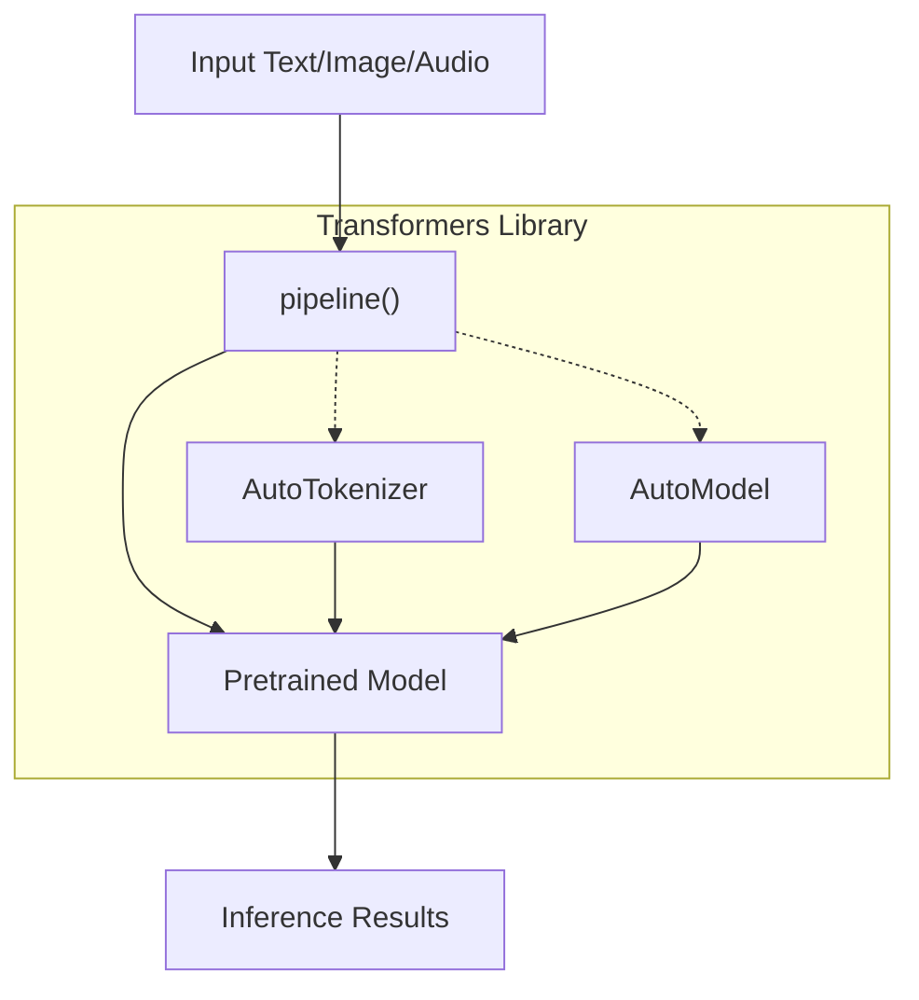
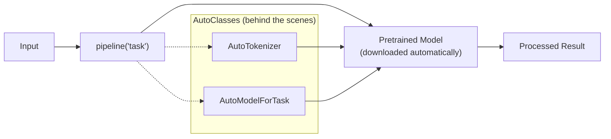
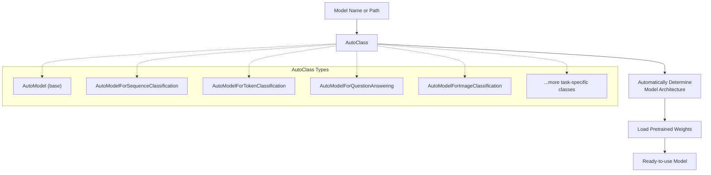
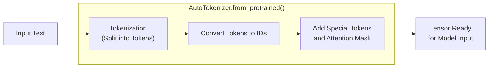
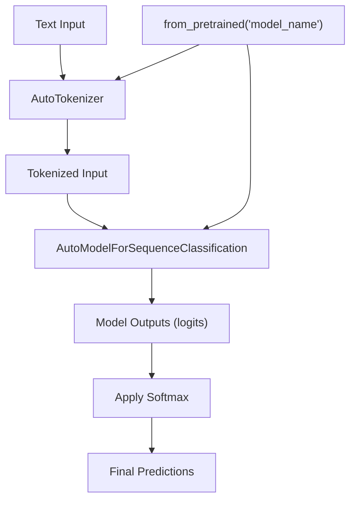

<!-- source: DeepWiki mcp.deepwiki.com · repo huggingface/notebooks · page 2.1 Quick Start with Transformers · fetched 2026-10-26 -->

# Quick Start with Transformers

<details>
<summary>Relevant source files</summary>

The following files were used as context for generating this wiki page:

- [transformers_doc/en/pytorch/quicktour.ipynb](transformers_doc/en/pytorch/quicktour.ipynb)
- [transformers_doc/en/quicktour.ipynb](transformers_doc/en/quicktour.ipynb)
- [transformers_doc/en/tensorflow/quicktour.ipynb](transformers_doc/en/tensorflow/quicktour.ipynb)
- [transformers_doc/es/pytorch/quicktour.ipynb](transformers_doc/es/pytorch/quicktour.ipynb)
- [transformers_doc/es/quicktour.ipynb](transformers_doc/es/quicktour.ipynb)
- [transformers_doc/es/tensorflow/quicktour.ipynb](transformers_doc/es/tensorflow/quicktour.ipynb)
- [transformers_doc/quicktour.ipynb](transformers_doc/quicktour.ipynb)
- [transformers_doc/training.ipynb](transformers_doc/training.ipynb)

</details>


This guide provides a rapid introduction to using the 🤗 Transformers library, focusing on the easiest ways to start using pretrained models for inference. You'll learn how to use the `pipeline()` function for quick inference and how to leverage the AutoClass system to load pretrained models and tokenizers.

For more advanced usage and fine-tuning models, see [Training and Fine-tuning Transformers](#2.4).

## Overview

The 🤗 Transformers library provides simple, efficient access to state-of-the-art transformer models for natural language processing, computer vision, and audio tasks. This guide will help you:

1. Use `pipeline()` for out-of-the-box inference
2. Understand how to work with the AutoClass system
3. Learn how to process inputs and interpret outputs



Sources: [transformers_doc/quicktour.ipynb:26-107](transformers_doc/quicktour.ipynb:26-107)

## Getting Started

Before you begin, make sure you have the Transformers library installed:

```bash
pip install transformers datasets
```

You'll also need to install your preferred machine learning framework:

```bash
pip install torch  # PyTorch
# or
pip install tensorflow  # TensorFlow
```

Sources: [transformers_doc/quicktour.ipynb:8-42](transformers_doc/quicktour.ipynb:8-42)

## The Pipeline API

The `pipeline()` function is the simplest way to use pretrained models for inference. It handles all the preprocessing and postprocessing for you, allowing you to focus on your task rather than implementation details.

### Supported Tasks

The `pipeline()` function supports many common tasks across different modalities:

| **Task** | **Description** | **Modality** | **Pipeline Identifier** |
|----------|----------------|--------------|-------------------------|
| Text classification | Assign a label to text | NLP | `sentiment-analysis` |
| Text generation | Generate text from a prompt | NLP | `text-generation` |
| Named entity recognition | Label words with entity types | NLP | `ner` |
| Question answering | Extract answers from context | NLP | `question-answering` |
| Fill-mask | Fill in masked words | NLP | `fill-mask` |
| Summarization | Summarize long text | NLP | `summarization` |
| Translation | Translate text | NLP | `translation_xx_to_yy` |
| Image classification | Classify images | Vision | `image-classification` |
| Image segmentation | Classify image pixels | Vision | `image-segmentation` |
| Object detection | Detect objects in images | Vision | `object-detection` |
| Audio classification | Classify audio | Audio | `audio-classification` |
| Automatic speech recognition | Transcribe speech to text | Audio | `automatic-speech-recognition` |

Sources: [transformers_doc/quicktour.ipynb:81-101](transformers_doc/quicktour.ipynb:81-101)

### Basic Pipeline Usage

Using the `pipeline()` function is as simple as specifying your task:



For example, to analyze sentiment in text:

1. Create a pipeline for sentiment analysis:
   ```python
   from transformers import pipeline
   classifier = pipeline("sentiment-analysis")
   ```

2. Apply it to your text:
   ```python
   classifier("We are very happy to show you the 🤗 Transformers library.")
   # Output: [{'label': 'POSITIVE', 'score': 0.9998}]
   ```

3. Process multiple inputs as a list:
   ```python
   results = classifier([
       "We are very happy to show you the 🤗 Transformers library.",
       "We hope you don't hate it."
   ])
   # Returns a list of dictionaries with results
   ```

Sources: [transformers_doc/quicktour.ipynb:109-172](transformers_doc/quicktour.ipynb:109-172)

### Processing Datasets

The `pipeline()` can also process entire datasets. Here's an example with speech recognition:

1. Create a pipeline:
   ```python
   from transformers import pipeline
   speech_recognizer = pipeline(
       "automatic-speech-recognition", 
       model="facebook/wav2vec2-base-960h"
   )
   ```

2. Load a dataset:
   ```python
   from datasets import load_dataset, Audio
   dataset = load_dataset("PolyAI/minds14", name="en-US", split="train")
   ```

3. Ensure matching sampling rates:
   ```python
   dataset = dataset.cast_column(
       "audio", 
       Audio(sampling_rate=speech_recognizer.feature_extractor.sampling_rate)
   )
   ```

4. Process samples:
   ```python
   results = speech_recognizer(dataset[:4]["audio"])
   # Process and extract transcriptions
   ```

Sources: [transformers_doc/quicktour.ipynb:178-264](transformers_doc/quicktour.ipynb:178-264)

### Using Custom Models in a Pipeline

You can customize the `pipeline()` by specifying a different pretrained model:

1. Choose a model from the Hugging Face Hub:
   ```python
   model_name = "nlptown/bert-base-multilingual-uncased-sentiment"
   ```

2. Load the model and tokenizer:
   ```python
   from transformers import AutoTokenizer, AutoModelForSequenceClassification
   
   model = AutoModelForSequenceClassification.from_pretrained(model_name)
   tokenizer = AutoTokenizer.from_pretrained(model_name)
   ```

3. Create a pipeline with your custom model and tokenizer:
   ```python
   classifier = pipeline("sentiment-analysis", model=model, tokenizer=tokenizer)
   classifier("Nous sommes très heureux de vous présenter la bibliothèque 🤗 Transformers.")
   # Output: [{'label': '5 stars', 'score': 0.7273}]
   ```

Sources: [transformers_doc/quicktour.ipynb:269-360](transformers_doc/quicktour.ipynb:269-360)

## The AutoClass System

Under the hood, the `pipeline()` function uses the AutoClass system to automatically load the right model architecture and tokenizer based on the model name or task. Understanding the AutoClass system gives you more control over the process.



Sources: [transformers_doc/quicktour.ipynb:367-405](transformers_doc/quicktour.ipynb:367-405)

### AutoTokenizer

Tokenizers convert text into numbers that models can understand. The tokenization process involves:

1. Splitting text into tokens (words, subwords, or characters)
2. Converting tokens to IDs from the model's vocabulary
3. Adding special tokens and attention masks

To use a tokenizer:

```python
from transformers import AutoTokenizer

model_name = "nlptown/bert-base-multilingual-uncased-sentiment"
tokenizer = AutoTokenizer.from_pretrained(model_name)

# Process a single input
encoding = tokenizer("We are very happy to show you the 🤗 Transformers library.")
# Returns a dictionary with input_ids, attention_mask, etc.

# Process multiple inputs with padding and truncation
batch = tokenizer(
    ["We are very happy to show you the 🤗 Transformers library.", 
     "We hope you don't hate it."],
    padding=True,
    truncation=True,
    max_length=512,
    return_tensors="pt",  # for PyTorch tensors
)
```

The tokenizer returns a dictionary with:
- `input_ids`: numerical representations of tokens
- `attention_mask`: indicates which tokens should be attended to
- `token_type_ids`: (for some models) differentiates between segments



Sources: [transformers_doc/quicktour.ipynb:390-520](transformers_doc/quicktour.ipynb:390-520)

### AutoModel

The AutoModel classes automatically determine the right model architecture for your task. You select the appropriate AutoModel variant based on what you're trying to accomplish:

| **Task** | **AutoModel Class** |
|----------|---------------------|
| Base transformer | `AutoModel` |
| Text classification | `AutoModelForSequenceClassification` |
| Token classification | `AutoModelForTokenClassification` |
| Question answering | `AutoModelForQuestionAnswering` |
| Language generation | `AutoModelForCausalLM` |
| Masked language modeling | `AutoModelForMaskedLM` |
| Image classification | `AutoModelForImageClassification` |
| Speech recognition | `AutoModelForSpeechSeq2Seq` |

To load a model:

```python
from transformers import AutoModelForSequenceClassification

model_name = "nlptown/bert-base-multilingual-uncased-sentiment"
model = AutoModelForSequenceClassification.from_pretrained(model_name)
```

Then you can pass your preprocessed inputs to the model:

```python
outputs = model(**batch)
```

The model outputs the final activations in the `logits` attribute, which you can then process as needed:

```python
from torch import nn
import torch

# Apply softmax to get probabilities
predictions = nn.functional.softmax(outputs.logits, dim=-1)
```

Sources: [transformers_doc/quicktour.ipynb:523-608](transformers_doc/quicktour.ipynb:523-608)

### Complete Workflow Example

Here's a complete example showing how to load a model, process inputs, and get predictions:



1. Set up the tokenizer and model:
   ```python
   from transformers import AutoTokenizer, AutoModelForSequenceClassification
   import torch.nn as nn
   
   model_name = "distilbert-base-uncased-finetuned-sst-2-english"
   tokenizer = AutoTokenizer.from_pretrained(model_name)
   model = AutoModelForSequenceClassification.from_pretrained(model_name)
   ```

2. Process inputs:
   ```python
   inputs = tokenizer(
       "This movie was fantastic! I really enjoyed it.",
       return_tensors="pt"
   )
   ```

3. Forward pass through model:
   ```python
   outputs = model(**inputs)
   ```

4. Process outputs:
   ```python
   predictions = nn.functional.softmax(outputs.logits, dim=-1)
   print(predictions)
   ```

Sources: [transformers_doc/quicktour.ipynb:523-626](transformers_doc/quicktour.ipynb:523-626)

### Saving and Loading Models

After using or fine-tuning a model, you can save it for future use:

```python
# Save model and tokenizer
save_directory = "./my_saved_model"
tokenizer.save_pretrained(save_directory)
model.save_pretrained(save_directory)

# Load model and tokenizer later
loaded_tokenizer = AutoTokenizer.from_pretrained(save_directory)
loaded_model = AutoModelForSequenceClassification.from_pretrained(save_directory)
```

You can even convert between PyTorch and TensorFlow models:

```python
# Convert from TensorFlow to PyTorch
pt_model = AutoModelForSequenceClassification.from_pretrained(
    "path/to/tf_model", 
    from_tf=True
)

# Convert from PyTorch to TensorFlow
tf_model = TFAutoModelForSequenceClassification.from_pretrained(
    "path/to/pt_model", 
    from_pt=True
)
```

Sources: [transformers_doc/quicktour.ipynb:583-632](transformers_doc/quicktour.ipynb:583-632)

## Framework-Specific Usage

### PyTorch

In PyTorch, you typically use the model like this:

```python
# Load model and tokenizer
tokenizer = AutoTokenizer.from_pretrained("model_name")
model = AutoModelForSequenceClassification.from_pretrained("model_name")

# Process inputs
inputs = tokenizer("Hello world!", return_tensors="pt")

# Forward pass
outputs = model(**inputs)

# Process outputs
import torch.nn.functional as F
probs = F.softmax(outputs.logits, dim=-1)
```

Sources: [transformers_doc/en/pytorch/quicktour.ipynb:495-562](transformers_doc/en/pytorch/quicktour.ipynb:495-562)

### TensorFlow

In TensorFlow, the usage is similar:

```python
# Load model and tokenizer
tokenizer = AutoTokenizer.from_pretrained("model_name")
model = TFAutoModelForSequenceClassification.from_pretrained("model_name")

# Process inputs
inputs = tokenizer("Hello world!", return_tensors="tf")

# Forward pass
outputs = model(inputs)

# Process outputs
import tensorflow as tf
probs = tf.nn.softmax(outputs.logits, axis=-1)
```

Sources: [transformers_doc/en/tensorflow/quicktour.ipynb:493-563](transformers_doc/en/tensorflow/quicktour.ipynb:493-563)

## Next Steps

Now that you're familiar with the basics of the 🤗 Transformers library, you can:

- Explore more advanced tasks with different pipeline types
- Use specific models from the [Hugging Face Hub](https://huggingface.co/models)
- Learn about fine-tuning models on your own data in [Training and Fine-tuning Transformers](#2.4)
- Explore how to use transformers for specific tasks like [NLP Tasks with Transformers](#2.2) or [Computer Vision with Transformers](#2.3)

By mastering these fundamentals, you're well on your way to leveraging the power of transformer models for your applications.

---

