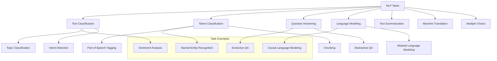
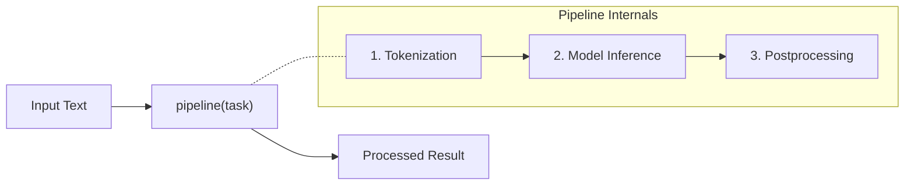
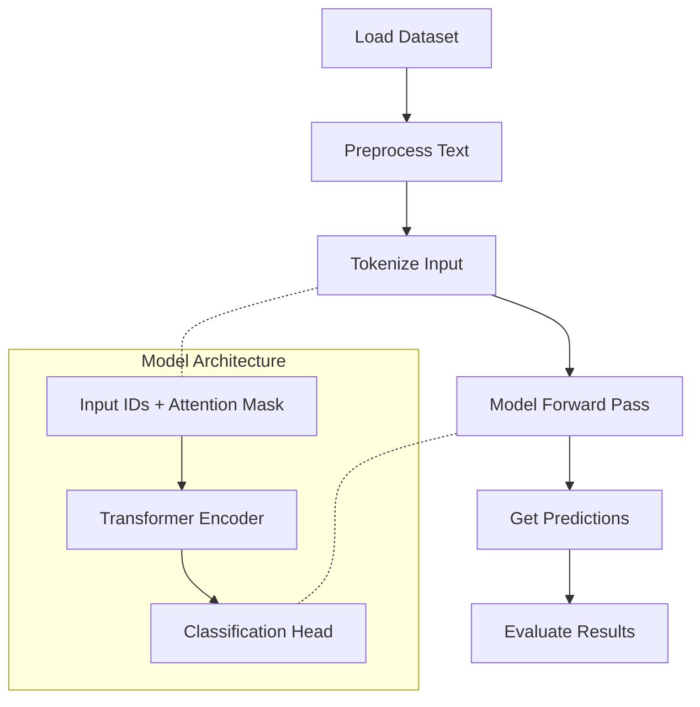
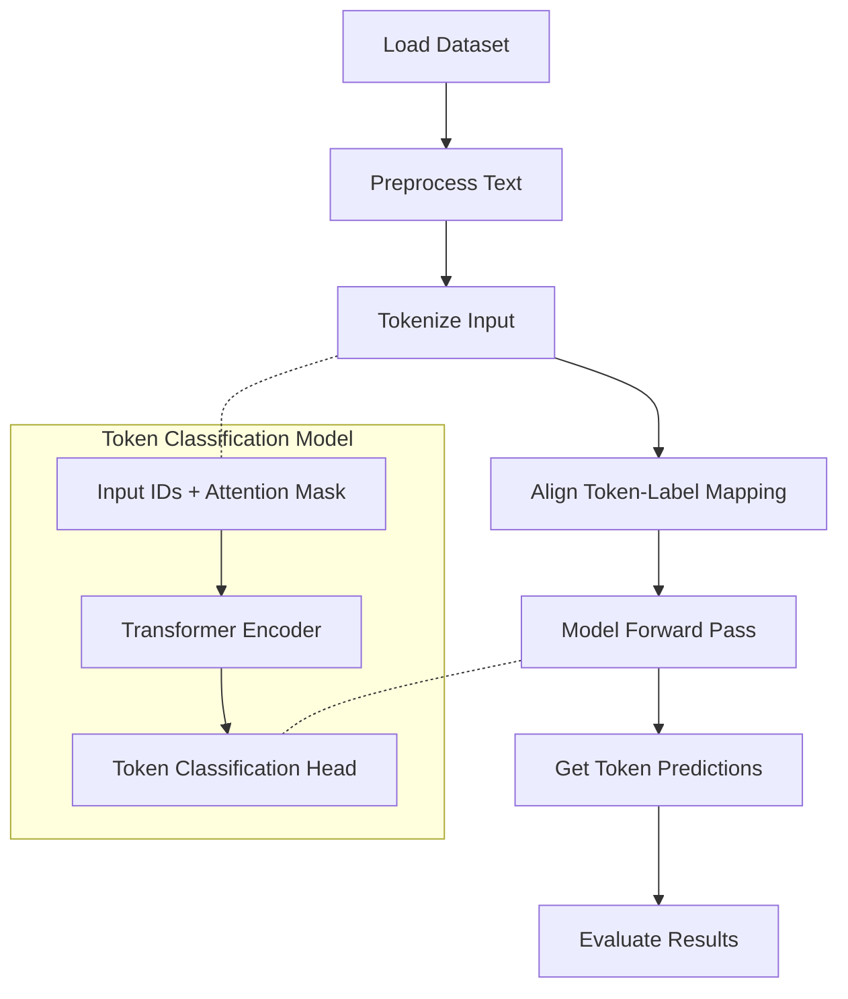
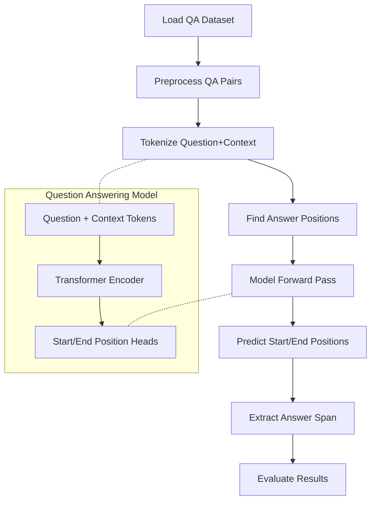
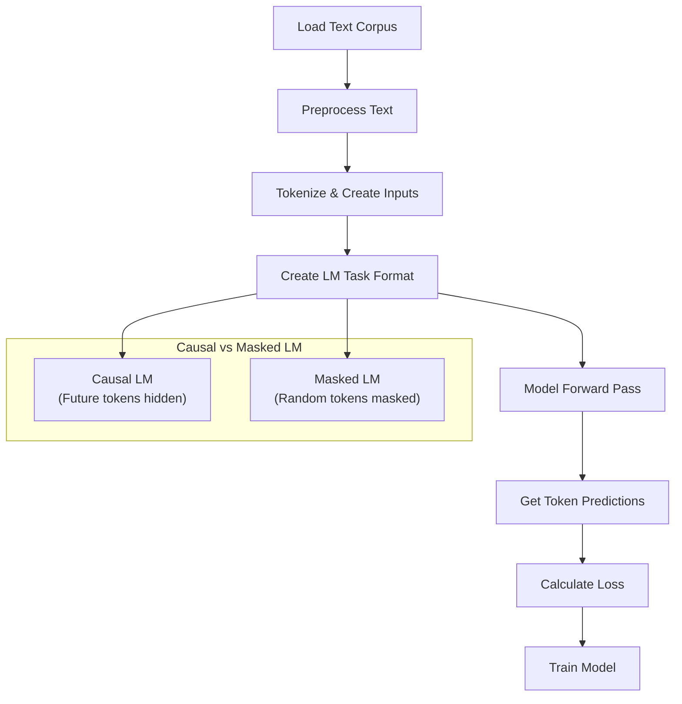
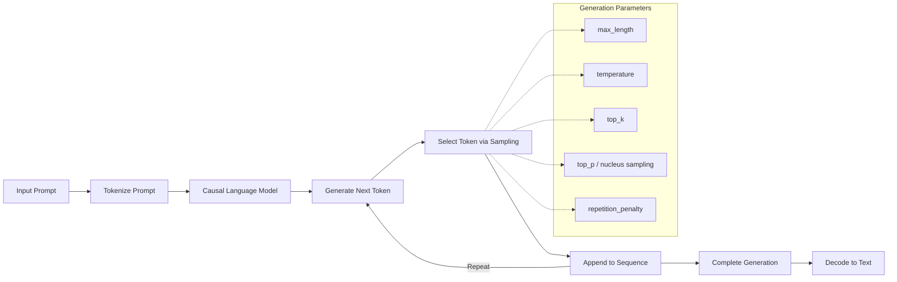

<!-- source: DeepWiki mcp.deepwiki.com · repo huggingface/notebooks · page 2.2 NLP Tasks with Transformers · fetched 2026-10-26 -->

# NLP Tasks with Transformers

<details>
<summary>Relevant source files</summary>

The following files were used as context for generating this wiki page:

- [examples/images/question_answering.png](examples/images/question_answering.png)
- [examples/images/token_classification.png](examples/images/token_classification.png)
- [examples/language_modeling.ipynb](examples/language_modeling.ipynb)
- [examples/language_modeling_from_scratch.ipynb](examples/language_modeling_from_scratch.ipynb)
- [examples/multiple_choice.ipynb](examples/multiple_choice.ipynb)
- [examples/question_answering.ipynb](examples/question_answering.ipynb)
- [examples/summarization.ipynb](examples/summarization.ipynb)
- [examples/text_classification.ipynb](examples/text_classification.ipynb)
- [examples/token_classification.ipynb](examples/token_classification.ipynb)
- [examples/tokenizer_training.ipynb](examples/tokenizer_training.ipynb)
- [examples/translation.ipynb](examples/translation.ipynb)
- [transformers_doc/en/language_modeling.ipynb](transformers_doc/en/language_modeling.ipynb)
- [transformers_doc/en/masked_language_modeling.ipynb](transformers_doc/en/masked_language_modeling.ipynb)
- [transformers_doc/en/pytorch/language_modeling.ipynb](transformers_doc/en/pytorch/language_modeling.ipynb)
- [transformers_doc/en/pytorch/masked_language_modeling.ipynb](transformers_doc/en/pytorch/masked_language_modeling.ipynb)
- [transformers_doc/en/pytorch/question_answering.ipynb](transformers_doc/en/pytorch/question_answering.ipynb)
- [transformers_doc/en/pytorch/sequence_classification.ipynb](transformers_doc/en/pytorch/sequence_classification.ipynb)
- [transformers_doc/en/pytorch/token_classification.ipynb](transformers_doc/en/pytorch/token_classification.ipynb)
- [transformers_doc/en/question_answering.ipynb](transformers_doc/en/question_answering.ipynb)
- [transformers_doc/en/sequence_classification.ipynb](transformers_doc/en/sequence_classification.ipynb)
- [transformers_doc/en/tensorflow/language_modeling.ipynb](transformers_doc/en/tensorflow/language_modeling.ipynb)
- [transformers_doc/en/tensorflow/masked_language_modeling.ipynb](transformers_doc/en/tensorflow/masked_language_modeling.ipynb)
- [transformers_doc/en/tensorflow/question_answering.ipynb](transformers_doc/en/tensorflow/question_answering.ipynb)
- [transformers_doc/en/tensorflow/sequence_classification.ipynb](transformers_doc/en/tensorflow/sequence_classification.ipynb)
- [transformers_doc/en/tensorflow/token_classification.ipynb](transformers_doc/en/tensorflow/token_classification.ipynb)
- [transformers_doc/en/token_classification.ipynb](transformers_doc/en/token_classification.ipynb)
- [transformers_doc/preprocessing.ipynb](transformers_doc/preprocessing.ipynb)
- [transformers_doc/task_summary.ipynb](transformers_doc/task_summary.ipynb)
- [transformers_doc/tokenizer_summary.ipynb](transformers_doc/tokenizer_summary.ipynb)

</details>


This page provides a detailed guide on using the Transformers library for various Natural Language Processing (NLP) tasks. We'll cover the most common NLP tasks and how to implement them using the Hugging Face Transformers library, focusing on practical examples and implementation details. For a quick introduction to the Transformers library, see [Quick Start with Transformers](#2.1). For information about computer vision tasks, see [Computer Vision with Transformers](#2.3).

## Overview of NLP Tasks

The Transformers library supports a wide range of NLP tasks through specialized model architectures and pipelines. Here are the primary NLP tasks covered in this guide:



Sources:
- [transformers_doc/task_summary.ipynb]()
- [examples/text_classification.ipynb]()
- [examples/token_classification.ipynb]()
- [examples/question_answering.ipynb]()
- [examples/language_modeling.ipynb]()

## The Pipeline API

Transformers provides a high-level `pipeline` API that allows for quick implementation of NLP tasks without detailed knowledge of the underlying model architecture. Each pipeline wraps a pre-trained model with its preprocessing and postprocessing steps.



### Common NLP Pipelines

| Task | Pipeline Name | Description | Example Usage |
|------|--------------|-------------|--------------|
| Text Classification | `text-classification` | Assign a label to a text | Sentiment analysis |
| Token Classification | `ner` | Assign a label to each token | Named entity recognition |
| Question Answering | `question-answering` | Extract answer from context | Finding information in text |
| Text Generation | `text-generation` | Generate text from a prompt | Completing sentences |
| Summarization | `summarization` | Create shorter version of text | Condensing articles |
| Translation | `translation_xx_to_yy` | Translate between languages | en-to-fr translation |
| Text2Text Generation | `text2text-generation` | Transform text to text | Paraphrasing |
| Fill-Mask | `fill-mask` | Fill in masked tokens | Completing sentences |

Sources:
- [transformers_doc/task_summary.ipynb]()
- [transformers_doc/preprocessing.ipynb]()

## Text Classification

Text classification assigns a label or category to an entire sequence of text. Common applications include sentiment analysis, topic classification, and spam detection.

### Implementation Flow



### Key Components

1. **Dataset**: Text classification tasks often use datasets like GLUE, which contains multiple sentence and sentence-pair classification tasks.

2. **Model**: `AutoModelForSequenceClassification` is the primary class for text classification tasks.

3. **Preprocessing**: Converting raw text into input suitable for the model using a tokenizer.

4. **Training**: Using the `Trainer` API for fine-tuning or the TensorFlow/PyTorch native training loops.

5. **Evaluation**: Common metrics include accuracy, F1 score, and Matthews correlation coefficient.

### Example Workflow

```python
# Load model and tokenizer
tokenizer = AutoTokenizer.from_pretrained("distilbert-base-uncased")
model = AutoModelForSequenceClassification.from_pretrained("distilbert-base-uncased", num_labels=2)

# Preprocess data
def preprocess_function(examples):
    return tokenizer(examples["text"], truncation=True)

tokenized_dataset = dataset.map(preprocess_function, batched=True)

# Train model
trainer = Trainer(
    model=model,
    train_dataset=tokenized_dataset["train"],
    eval_dataset=tokenized_dataset["validation"],
    tokenizer=tokenizer,
)
trainer.train()
```

Sources:
- [examples/text_classification.ipynb:117-143]()
- [examples/text_classification.ipynb:936-1007]()
- [transformers_doc/en/sequence_classification.ipynb]()

## Token Classification

Token classification assigns a label to individual tokens in a text sequence. The most common token classification task is Named Entity Recognition (NER), which identifies entities like persons, organizations, and locations.

### Implementation Flow



### Key Components

1. **Dataset**: NER datasets like CoNLL-2003, WNUT-17 that contain token-level annotations.

2. **Model**: `AutoModelForTokenClassification` is used for token-level prediction tasks.

3. **Preprocessing**: Special handling is needed to align word-level labels with subword tokens.

4. **Evaluation**: Metrics like precision, recall, F1-score at the entity level using the `seqeval` library.

### Handling Subword Tokens

A key challenge in token classification is aligning labels with subword tokens. The following steps are typically used:

1. Map each token to its corresponding word using the `word_ids` method
2. Assign special tokens (like `[CLS]`, `[SEP]`) the label `-100` to ignore them in loss calculation
3. For words split into multiple tokens, typically only label the first token and mark others as `-100`

```python
def tokenize_and_align_labels(examples):
    tokenized_inputs = tokenizer(examples["tokens"], truncation=True, is_split_into_words=True)
    labels = []
    
    for i, label in enumerate(examples["ner_tags"]):
        word_ids = tokenized_inputs.word_ids(batch_index=i)
        previous_word_idx = None
        label_ids = []
        
        for word_idx in word_ids:
            if word_idx is None:
                label_ids.append(-100)  # Special tokens
            elif word_idx != previous_word_idx:
                label_ids.append(label[word_idx])  # Label first token of word
            else:
                label_ids.append(-100)  # Ignore other tokens of word
                
            previous_word_idx = word_idx
            
        labels.append(label_ids)
    
    tokenized_inputs["labels"] = labels
    return tokenized_inputs
```

Sources:
- [transformers_doc/en/token_classification.ipynb:305-324]()
- [examples/token_classification.ipynb]()
- [transformers_doc/en/pytorch/token_classification.ipynb]()

## Question Answering

Question answering tasks involve generating answers to questions. The most common approach with Transformers is extractive question answering, where the answer is extracted as a span of text from a provided context.

### Implementation Flow



### Key Components

1. **Dataset**: Common QA datasets include SQuAD, TriviaQA, and Natural Questions.

2. **Model**: `AutoModelForQuestionAnswering` predicts the start and end positions of the answer in the context.

3. **Preprocessing**:
   - Special handling for long contexts using a sliding window approach with stride
   - Tracking token positions to map back to original text

4. **Evaluation**: Metrics like Exact Match (EM) and F1 score.

### Handling Long Contexts

Question answering often deals with long contexts that exceed model's maximum input length. This is handled by:

1. Breaking the context into overlapping chunks with a sliding window
2. Processing each chunk separately
3. Aggregating predictions across chunks
4. Selecting the best answer span based on confidence scores

```python
# Configuration for handling long contexts
max_length = 384  # Maximum sequence length
doc_stride = 128  # Overlap between chunks

# Example preprocessing for QA
tokenized_examples = tokenizer(
    questions,
    contexts,
    stride=doc_stride,
    max_length=max_length,
    padding="max_length",
    truncation="only_second",
    return_overflowing_tokens=True,
    return_offsets_mapping=True
)
```

Sources:
- [examples/question_answering.ipynb:636-637]()
- [examples/question_answering.ipynb:147-153]()
- [transformers_doc/en/pytorch/question_answering.ipynb]()

## Language Modeling

Language modeling is the task of predicting the next word or token in a sequence. There are two main types of language modeling tasks:

1. **Causal Language Modeling**: Predicting the next token based on previous tokens (unidirectional)
2. **Masked Language Modeling**: Predicting masked tokens in a sequence using context from both directions (bidirectional)

### Implementation Flow



### Key Components

1. **Causal Language Modeling**:
   - Used primarily for text generation
   - Models: GPT-2, GPT-Neo, OPT, BLOOM
   - Class: `AutoModelForCausalLM`
   - Each token can only attend to previous tokens

2. **Masked Language Modeling**:
   - Used for learning bidirectional representations
   - Models: BERT, RoBERTa, DistilBERT
   - Class: `AutoModelForMaskedLM`
   - Random tokens are masked and predicted using full context

3. **Data Preprocessing**:
   - For causal LM: Simple tokenization, possibly with padding/truncation
   - For masked LM: Need to mask random tokens with special token like `[MASK]`

### Example: Creating Training Data for Causal LM

```python
def tokenize_function(examples):
    return tokenizer(examples["text"])

# Process dataset
tokenized_dataset = dataset.map(
    tokenize_function,
    batched=True,
    remove_columns=["text"]
)

# Create input-target pairs for causal LM (shift tokens to create targets)
def group_texts(examples):
    # Concatenate all texts and chunk by block_size
    concatenated = {k: sum(examples[k], []) for k in examples.keys()}
    total_length = len(concatenated[list(examples.keys())[0]])
    
    # Create blocks of max_length tokens
    result = {
        k: [t[i : i + block_size] for i in range(0, total_length, block_size)]
        for k, t in concatenated.items()
    }
    
    # Create input_ids and labels for causal LM
    result["labels"] = result["input_ids"].copy()
    
    return result
```

Sources:
- [examples/language_modeling.ipynb:129-139]()
- [transformers_doc/en/language_modeling.ipynb]()
- [transformers_doc/en/masked_language_modeling.ipynb]()

## Text Generation

Text generation leverages causal language modeling to generate new text from a prompt. It's used for tasks like story generation, chatbots, and content creation.

### Implementation Flow



### Key Parameters for Text Generation

| Parameter | Description | Effect |
|-----------|-------------|--------|
| `max_length` | Maximum length of generated text | Limits output size |
| `temperature` | Controls randomness | Higher = more random, Lower = more deterministic |
| `top_k` | Sample from top k most likely tokens | Restricts token choice to most probable |
| `top_p` | Sample from smallest set of tokens whose cumulative probability exceeds p | Maintains diversity while removing unlikely tokens |
| `repetition_penalty` | Penalizes repeated tokens | Reduces repetitive text |
| `do_sample` | Use sampling vs greedy decoding | True = use sampling, False = greedy |
| `num_return_sequences` | Number of sequences to generate | Multiple outputs for same prompt |

### Example Generation

```python
from transformers import pipeline, set_seed

# Initialize text generation pipeline
generator = pipeline("text-generation", model="gpt2")

# Generate text with various parameters
set_seed(42)
generated_text = generator(
    "Transformers library can be used to",
    max_length=50,
    num_return_sequences=2,
    do_sample=True,
    temperature=0.7,
    top_k=50,
    top_p=0.95,
    repetition_penalty=1.2
)
```

Sources:
- [transformers_doc/en/language_modeling.ipynb]()
- [transformers_doc/en/pytorch/language_modeling.ipynb]()

## Other NLP Tasks

Beyond the core tasks covered above, the Transformers library supports several other important NLP tasks:

### Summarization

Text summarization generates a concise version of a longer text.

1. **Models**: BART, T5, Pegasus, LED
2. **Class**: `AutoModelForSeq2SeqLM`
3. **Evaluation**: ROUGE scores

### Machine Translation

Translates text from one language to another.

1. **Models**: T5, mBART, NLLB, M2M100
2. **Class**: `AutoModelForSeq2SeqLM`
3. **Evaluation**: BLEU, METEOR scores

### Multiple Choice

Selects the correct answer from multiple options.

1. **Models**: BERT, RoBERTa
2. **Class**: `AutoModelForMultipleChoice`
3. **Preprocessing**: Special format with question and all choices

Sources:
- [examples/summarization.ipynb]()
- [examples/translation.ipynb]()
- [examples/multiple_choice.ipynb]()

## Common Data Processing Patterns

Across all NLP tasks, certain data processing patterns appear consistently:

### Tokenization

Converting text to tokens is a fundamental step in all NLP tasks. The Transformers library provides a unified tokenizer interface:

```python
from transformers import AutoTokenizer

tokenizer = AutoTokenizer.from_pretrained("model-name")

# Basic tokenization
encoded = tokenizer("Here is some text to encode", padding=True, truncation=True)

# Batch tokenization
batch_encoded = tokenizer(
    ["First sentence", "Second sentence"],
    padding=True,
    truncation=True,
    return_tensors="pt"  # Return PyTorch tensors (use "tf" for TensorFlow)
)
```

### Dataset Loading and Processing

The Datasets library simplifies working with NLP datasets:

```python
from datasets import load_dataset

# Load dataset
dataset = load_dataset("glue", "sst2")

# Preprocess dataset using map
tokenized_dataset = dataset.map(
    lambda examples: tokenizer(examples["sentence"], padding="max_length", truncation=True),
    batched=True
)

# Prepare for training
train_dataset = tokenized_dataset["train"]
eval_dataset = tokenized_dataset["validation"]
```

### Training with the Trainer API

The `Trainer` API provides a unified interface for training across tasks:

```python
from transformers import Trainer, TrainingArguments

training_args = TrainingArguments(
    output_dir="./results",
    evaluation_strategy="epoch",
    learning_rate=2e-5,
    per_device_train_batch_size=16,
    per_device_eval_batch_size=16,
    num_train_epochs=3,
)

trainer = Trainer(
    model=model,
    args=training_args,
    train_dataset=train_dataset,
    eval_dataset=eval_dataset,
    tokenizer=tokenizer,
    compute_metrics=compute_metrics,
)

trainer.train()
```

Sources:
- [transformers_doc/preprocessing.ipynb]()
- [examples/text_classification.ipynb:995-1007]()
- [examples/token_classification.ipynb:538-562]()

## Summary

The Transformers library provides comprehensive support for a wide range of NLP tasks:

- **Text Classification**: Categorizing text into predefined classes
- **Token Classification**: Labeling individual tokens in a sequence
- **Question Answering**: Extracting answers from context
- **Language Modeling**: Predicting tokens in a sequence
- **Text Generation**: Creating new text from prompts
- **Summarization**: Condensing text while preserving meaning
- **Translation**: Converting text between languages
- **Multiple Choice**: Selecting correct answers from options

Each task follows a similar workflow:
1. Load and preprocess data
2. Fine-tune a pre-trained model
3. Evaluate performance
4. Deploy for inference

The library's unified API makes it easy to switch between tasks while following consistent patterns, minimizing the learning curve for implementing different NLP capabilities.

---

