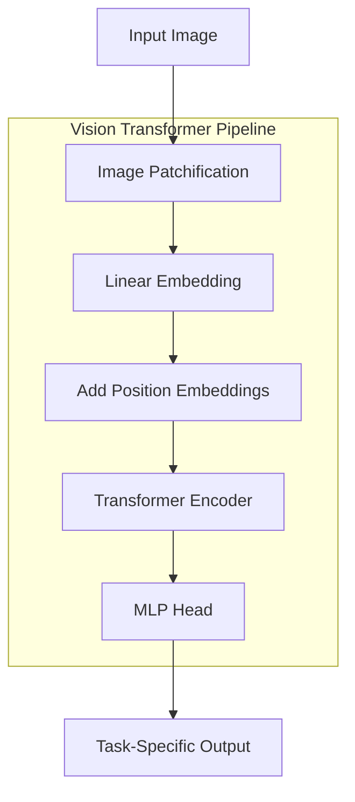
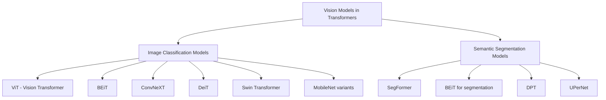
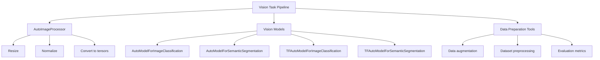
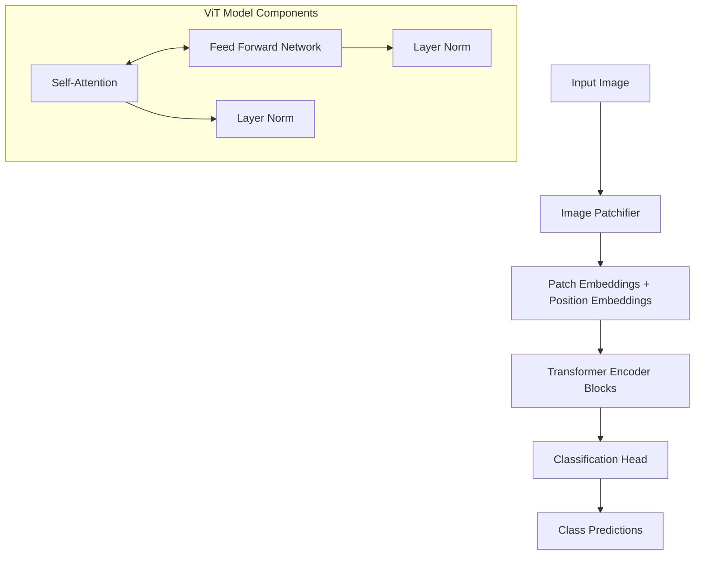
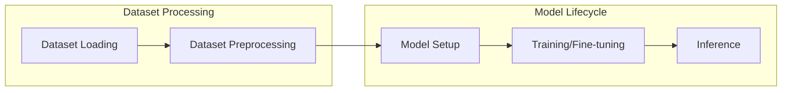
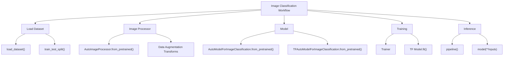
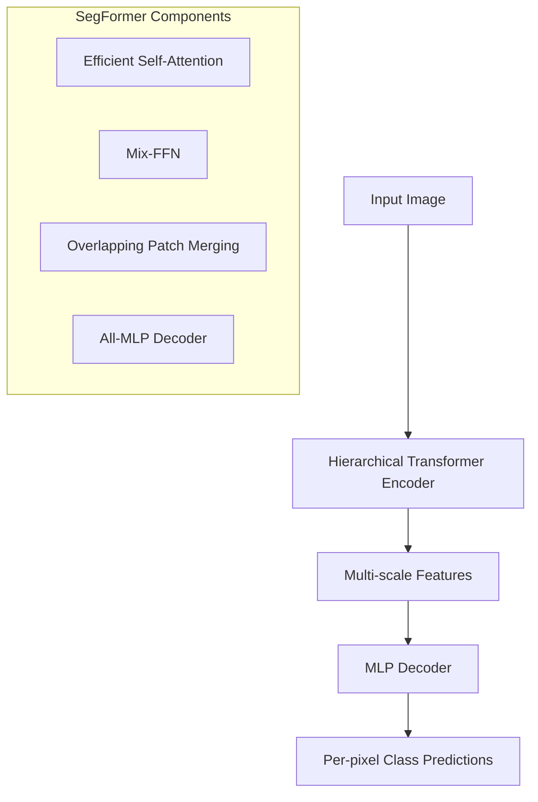
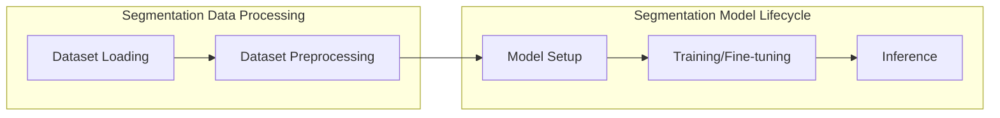
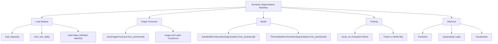

<!-- source: DeepWiki mcp.deepwiki.com · repo huggingface/notebooks · page 2.3 Computer Vision with Transformers · fetched 2026-10-26 -->

# Computer Vision with Transformers

<details>
<summary>Relevant source files</summary>

The following files were used as context for generating this wiki page:

- [transformers_doc/en/image_classification.ipynb](transformers_doc/en/image_classification.ipynb)
- [transformers_doc/en/pytorch/image_classification.ipynb](transformers_doc/en/pytorch/image_classification.ipynb)
- [transformers_doc/en/pytorch/semantic_segmentation.ipynb](transformers_doc/en/pytorch/semantic_segmentation.ipynb)
- [transformers_doc/en/semantic_segmentation.ipynb](transformers_doc/en/semantic_segmentation.ipynb)
- [transformers_doc/en/tensorflow/image_classification.ipynb](transformers_doc/en/tensorflow/image_classification.ipynb)
- [transformers_doc/en/tensorflow/semantic_segmentation.ipynb](transformers_doc/en/tensorflow/semantic_segmentation.ipynb)

</details>


This document provides a comprehensive overview of using the 🤗 Transformers library for computer vision tasks. We'll cover how to leverage transformer architectures for image classification and semantic segmentation, including model selection, data preparation, training, and inference. For NLP tasks with Transformers, see [NLP Tasks with Transformers](#2.2).

## Overview of Vision Transformers

Vision Transformers adapt the transformer architecture (originally designed for NLP) to computer vision tasks. Unlike traditional convolutional neural networks (CNNs), vision transformers process images by:

1. Splitting images into fixed-size patches
2. Linearly embedding these patches
3. Adding positional embeddings
4. Passing the resulting sequence through transformer encoder blocks



Sources: `transformers_doc/en/tensorflow/image_classification.ipynb`, `transformers_doc/en/pytorch/image_classification.ipynb`

## Supported Computer Vision Tasks

The Transformers library supports several computer vision tasks, with the primary ones being:

| Task | Description | Primary Model Classes | Example Models |
|------|-------------|------------------------|----------------|
| Image Classification | Assigning a label or class to an entire image | `AutoModelForImageClassification` | ViT, BEiT, DeiT |
| Semantic Segmentation | Assigning a class label to every pixel in an image | `AutoModelForSemanticSegmentation` | SegFormer, BEiT, UPerNet |

Sources: `transformers_doc/en/image_classification.ipynb`, `transformers_doc/en/semantic_segmentation.ipynb`

## Supported Vision Model Architectures

The Transformers library supports a wide range of vision model architectures:



Sources: `transformers_doc/en/image_classification.ipynb:65-70`, `transformers_doc/en/semantic_segmentation.ipynb:62-70`

## Core Components for Vision Tasks

When working with vision models in the Transformers library, several key components are used:



Sources: `transformers_doc/en/tensorflow/image_classification.ipynb`, `transformers_doc/en/semantic_segmentation.ipynb`

## Image Classification with Transformers

### Model Architecture

For image classification, the Vision Transformer (ViT) is the foundational architecture, which follows this structure:



Sources: `transformers_doc/en/tensorflow/image_classification.ipynb`, `transformers_doc/en/image_classification.ipynb`

### Workflow for Image Classification

The typical workflow for image classification involves:

1. Loading and preprocessing a dataset
2. Setting up an image processor
3. Defining data augmentation transforms
4. Loading a pre-trained model
5. Fine-tuning the model
6. Using the model for inference



Sources: `transformers_doc/en/tensorflow/image_classification.ipynb:94-159`, `transformers_doc/en/image_classification.ipynb:94-168`

### Example Code Structure



Sources: `transformers_doc/en/tensorflow/image_classification.ipynb`, `transformers_doc/en/image_classification.ipynb`

## Semantic Segmentation with Transformers

### Model Architecture

For semantic segmentation, models like SegFormer follow this architecture:



Sources: `transformers_doc/en/semantic_segmentation.ipynb`, `transformers_doc/en/tensorflow/semantic_segmentation.ipynb`

### Workflow for Semantic Segmentation

The typical workflow for semantic segmentation involves:

1. Loading and preprocessing a dataset with segmentation maps
2. Setting up an image processor with label reduction (if needed)
3. Defining data transformations for images and segmentation maps
4. Loading a pre-trained segmentation model
5. Fine-tuning the model using an IoU metric
6. Using the model for inference



Sources: `transformers_doc/en/semantic_segmentation.ipynb:97-192`, `transformers_doc/en/tensorflow/semantic_segmentation.ipynb:97-192`

### Example Code Structure



Sources: `transformers_doc/en/semantic_segmentation.ipynb`, `transformers_doc/en/tensorflow/semantic_segmentation.ipynb`

## Framework Implementations

The Transformers library supports both PyTorch and TensorFlow for computer vision tasks:

| Feature | PyTorch | TensorFlow |
|---------|---------|------------|
| Image Classification | `AutoModelForImageClassification` | `TFAutoModelForImageClassification` |
| Semantic Segmentation | `AutoModelForSemanticSegmentation` | `TFAutoModelForSemanticSegmentation` |
| Training Interface | `Trainer` class | Keras `model.fit()` |
| Callbacks | Built into `Trainer` | Keras callbacks system |
| Data Format | PyTorch tensors | TensorFlow tensors |
| Data Pipeline | `Dataset.with_transform()` | `Dataset.to_tf_dataset()` |

Sources: `transformers_doc/en/tensorflow/image_classification.ipynb`, `transformers_doc/en/image_classification.ipynb`, `transformers_doc/en/semantic_segmentation.ipynb`, `transformers_doc/en/tensorflow/semantic_segmentation.ipynb`

## Using Vision Transformers

### Data Preparation

Common data preparation steps for vision transformer tasks:

1. **Loading datasets**:
   ```python
   from datasets import load_dataset
   dataset = load_dataset("food101", split="train[:5000]")
   ```

2. **Data splitting**:
   ```python
   dataset = dataset.train_test_split(test_size=0.2)
   ```

3. **Label mapping**:
   ```python
   labels = dataset["train"].features["label"].names
   id2label = {str(i): label for i, label in enumerate(labels)}
   label2id = {label: str(i) for i, label in enumerate(labels)}
   ```

Sources: `transformers_doc/en/tensorflow/image_classification.ipynb:115-187`, `transformers_doc/en/semantic_segmentation.ipynb:113-190`

### Model Initialization

Vision Transformer models are typically initialized with:

1. **Image Processor**:
   ```python
   from transformers import AutoImageProcessor
   image_processor = AutoImageProcessor.from_pretrained("google/vit-base-patch16-224-in21k")
   ```

2. **Classification Model**:
   ```python
   from transformers import AutoModelForImageClassification
   model = AutoModelForImageClassification.from_pretrained(
       "google/vit-base-patch16-224-in21k",
       num_labels=len(labels),
       id2label=id2label,
       label2id=label2id
   )
   ```

3. **Segmentation Model**:
   ```python
   from transformers import AutoModelForSemanticSegmentation
   model = AutoModelForSemanticSegmentation.from_pretrained(
       "nvidia/mit-b0",  # SegFormer model
       id2label=id2label,
       label2id=label2id
   )
   ```

Sources: `transformers_doc/en/tensorflow/image_classification.ipynb:237-240`, `transformers_doc/en/image_classification.ipynb:237-240`, `transformers_doc/en/semantic_segmentation.ipynb:213-216`

### Training

Models are trained differently based on the framework:

**PyTorch (using Trainer)**:
```python
from transformers import TrainingArguments, Trainer

training_args = TrainingArguments(
    output_dir="my_vision_model",
    per_device_train_batch_size=16,
    evaluation_strategy="epoch",
    num_train_epochs=3,
    # Other arguments...
)

trainer = Trainer(
    model=model,
    args=training_args,
    train_dataset=train_dataset,
    eval_dataset=val_dataset,
    compute_metrics=compute_metrics,
)

trainer.train()
```

**TensorFlow**:
```python
# Compile the model
model.compile(optimizer=optimizer)

# Define callbacks
callbacks = [
    KerasMetricCallback(metric_fn=compute_metrics, eval_dataset=eval_dataset),
    PushToHubCallback(output_dir="model_directory", tokenizer=image_processor)
]

# Train the model
model.fit(
    train_dataset,
    validation_data=val_dataset,
    epochs=num_epochs,
    callbacks=callbacks
)
```

Sources: `transformers_doc/en/tensorflow/image_classification.ipynb:454-596`, `transformers_doc/en/image_classification.ipynb:526-579`

### Inference

Inference can be performed using the `pipeline` API or manually:

**Using pipeline**:
```python
from transformers import pipeline

# For image classification
classifier = pipeline("image-classification", model="my_trained_model")
result = classifier(image)

# For semantic segmentation
segmenter = pipeline("image-segmentation", model="my_segmentation_model")
result = segmenter(image)
```

**Manual inference for classification**:
```python
# Process the image
inputs = image_processor(image, return_tensors="pt")  # or "tf" for TensorFlow

# Get predictions
outputs = model(**inputs)
logits = outputs.logits

# Get predicted class
predicted_class_id = logits.argmax(-1).item()
predicted_label = model.config.id2label[predicted_class_id]
```

**Manual inference for segmentation**:
```python
# Process the image
inputs = image_processor(image, return_tensors="pt")  # or "tf" for TensorFlow

# Get predictions
outputs = model(**inputs)
logits = outputs.logits

# Resize logits to original image size and get class per pixel
upsampled_logits = nn.functional.interpolate(
    logits,
    size=image.size[::-1],  # Height, width
    mode="bilinear",
    align_corners=False,
)
pred_seg = upsampled_logits.argmax(dim=1)[0]
```

Sources: `transformers_doc/en/tensorflow/image_classification.ipynb:634-743`, `transformers_doc/en/semantic_segmentation.ipynb:534-617`

## Practical Considerations

When working with Vision Transformers, keep these considerations in mind:

1. **Resource requirements**: Vision transformers generally require more computational resources than comparable CNNs
2. **Data augmentation**: Crucial for good performance, especially with limited datasets
3. **Patch size**: Impacts both performance and computational requirements
4. **Transfer learning**: Most effective when fine-tuning from pre-trained models
5. **Evaluation metrics**: Use task-appropriate metrics (accuracy for classification, IoU for segmentation)

Sources: `transformers_doc/en/tensorflow/image_classification.ipynb`, `transformers_doc/en/semantic_segmentation.ipynb`

---

