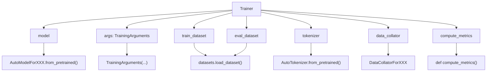
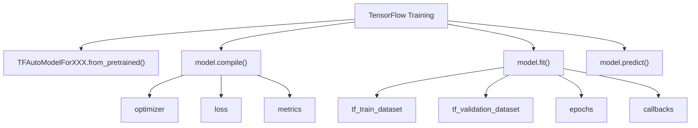
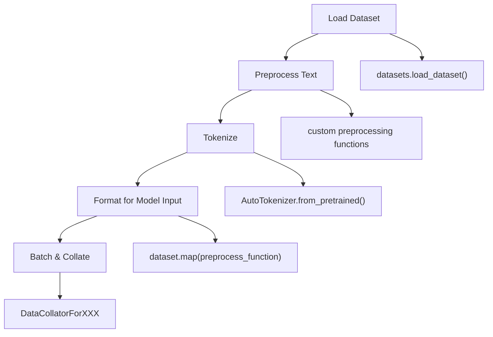
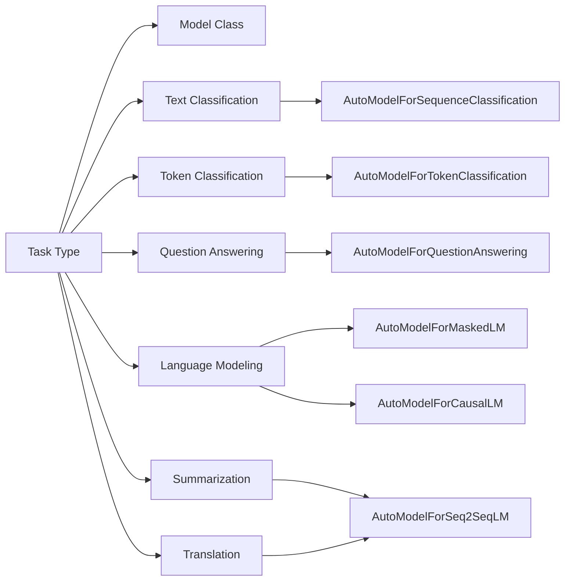

<!-- source: DeepWiki mcp.deepwiki.com · repo huggingface/notebooks · page 2.4 Training and Fine-tuning Transformers · fetched 2026-10-26 -->

# Training and Fine-tuning Transformers

<details>
<summary>Relevant source files</summary>

The following files were used as context for generating this wiki page:

- [examples/images/question_answering.png](examples/images/question_answering.png)
- [examples/images/token_classification.png](examples/images/token_classification.png)
- [examples/language_modeling.ipynb](examples/language_modeling.ipynb)
- [examples/language_modeling_from_scratch.ipynb](examples/language_modeling_from_scratch.ipynb)
- [examples/multiple_choice.ipynb](examples/multiple_choice.ipynb)
- [examples/question_answering.ipynb](examples/question_answering.ipynb)
- [examples/summarization.ipynb](examples/summarization.ipynb)
- [examples/text_classification.ipynb](examples/text_classification.ipynb)
- [examples/token_classification.ipynb](examples/token_classification.ipynb)
- [examples/tokenizer_training.ipynb](examples/tokenizer_training.ipynb)
- [examples/translation.ipynb](examples/translation.ipynb)
- [transformers_doc/en/pytorch/question_answering.ipynb](transformers_doc/en/pytorch/question_answering.ipynb)
- [transformers_doc/en/pytorch/sequence_classification.ipynb](transformers_doc/en/pytorch/sequence_classification.ipynb)
- [transformers_doc/en/pytorch/token_classification.ipynb](transformers_doc/en/pytorch/token_classification.ipynb)
- [transformers_doc/en/question_answering.ipynb](transformers_doc/en/question_answering.ipynb)
- [transformers_doc/en/sequence_classification.ipynb](transformers_doc/en/sequence_classification.ipynb)
- [transformers_doc/en/tensorflow/question_answering.ipynb](transformers_doc/en/tensorflow/question_answering.ipynb)
- [transformers_doc/en/tensorflow/sequence_classification.ipynb](transformers_doc/en/tensorflow/sequence_classification.ipynb)
- [transformers_doc/en/tensorflow/token_classification.ipynb](transformers_doc/en/tensorflow/token_classification.ipynb)
- [transformers_doc/en/token_classification.ipynb](transformers_doc/en/token_classification.ipynb)

</details>


This page covers the process of training and fine-tuning transformer models using the Hugging Face Transformers library. We'll explore the different training approaches available, including the Trainer API for PyTorch users and TensorFlow/Keras integration for TensorFlow users. This guide focuses on practical training workflows across various NLP tasks such as text classification, token classification, question answering, and language modeling.

For information about using pre-trained models without fine-tuning, see [Quick Start with Transformers](#2.1).

## Core Training Components

The Transformers library offers multiple ways to train models, with components designed to streamline the process while maintaining flexibility. The central components of the training ecosystem include:

```mermaid
graph TD
    Training["Training Components"] --> Trainer["Trainer API"]
    Training --> TF["TensorFlow/Keras"]
    Training --> Pytorch["PyTorch Native"]
    Training --> Args["TrainingArguments"]
    Training --> DC["Data Collators"]
    
    Trainer --> Train["train()"]
    Trainer --> Eval["evaluate()"]
    Trainer --> Predict["predict()"]
    Trainer --> Push["push_to_hub()"]
    
    Args --> EvalStrategy["evaluation_strategy"]
    Args --> SaveStrategy["save_strategy"]
    Args --> LR["learning_rate"]
    Args --> BSizes["batch_sizes"]
    Args --> Epochs["num_train_epochs"]
    Args --> WDecay["weight_decay"]
    
    DC --> TokenClass["DataCollatorForTokenClassification"]
    DC --> LM["DataCollatorForLanguageModeling"]
    DC --> Padding["DataCollatorWithPadding"]
    DC --> QA["DataCollatorForQuestionAnswering"]
```



Sources:
- [examples/text_classification.ipynb:984-1007]()
- [examples/question_answering.ipynb:984-1006]() 
- [transformers_doc/en/token_classification.ipynb:539-550]()

### Trainer API (PyTorch)

The `Trainer` class provides a high-level API for PyTorch-based training. It handles the training loop, evaluation, and model saving with minimal code.



The `Trainer` simplifies the fine-tuning process by managing:
- Training and evaluation loops
- Gradient accumulation and mixed precision
- Checkpointing and model saving
- Logging and TensorBoard integration
- Model pushing to the Hugging Face Hub

Sources:
- [examples/text_classification.ipynb:1009-1017]()
- [transformers_doc/en/token_classification.ipynb:552-560]()

### TensorFlow Training

For TensorFlow users, models can be fine-tuned using Keras's familiar API:



TensorFlow training involves:
1. Converting datasets to TensorFlow format
2. Configuring optimization parameters
3. Using Keras callbacks for checkpointing and logging
4. Integration with TensorFlow's ecosystem

Sources:
- [transformers_doc/en/tensorflow/token_classification.ipynb:368-370]()
- [transformers_doc/en/tensorflow/sequence_classification.ipynb]()

## Data Preparation for Fine-tuning

Proper data preparation is crucial for effective fine-tuning. The process typically follows these steps:



Sources:
- [examples/text_classification.ipynb:787-908]()
- [examples/question_answering.ipynb:633-638]()
- [transformers_doc/en/token_classification.ipynb:305-324]()

### Loading Datasets

Datasets are typically loaded using the 🤗 Datasets library:

```python
from datasets import load_dataset
dataset = load_dataset("glue", "cola")  # Example with GLUE benchmark
```

For custom datasets, you can load from local files:

```python
dataset = load_dataset("text", data_files={"train": "path_to_train.txt", "validation": "path_to_validation.txt"})
```

Sources:
- [examples/text_classification.ipynb:295-297]()
- [examples/question_answering.ipynb:272-273]()
- [examples/language_modeling.ipynb:176-177]()

### Tokenization and Preprocessing

Each task requires specific preprocessing. The general pattern involves:

1. Loading a tokenizer that matches your model
2. Creating a preprocessing function
3. Applying the function to the entire dataset

Example for text classification:

```python
tokenizer = AutoTokenizer.from_pretrained(model_checkpoint)

def preprocess_function(examples):
    return tokenizer(examples["text"], truncation=True)

tokenized_dataset = dataset.map(preprocess_function, batched=True)
```

For more complex tasks like question answering or token classification, additional alignment between tokens and labels is required.

Sources:
- [examples/text_classification.ipynb:657-663]()
- [transformers_doc/en/token_classification.ipynb:305-324]()
- [examples/question_answering.ipynb:633-638]()

## Model Selection and Initialization

Selecting the right model type for your task is crucial:



Models are initialized with pretrained weights and adapted to your specific task:

```python
from transformers import AutoModelForSequenceClassification

# For a classification task with 2 labels
model = AutoModelForSequenceClassification.from_pretrained(
    "distilbert-base-uncased", 
    num_labels=2
)
```

Sources:
- [examples/text_classification.ipynb:960-963]()
- [transformers_doc/en/token_classification.ipynb:517-519]()
- [examples/question_answering.ipynb:960-963]()

## Training Configuration 

The `TrainingArguments` class controls all aspects of the training process:

```python
from transformers import TrainingArguments

training_args = TrainingArguments(
    output_dir="./results",               # Directory to save model checkpoints
    evaluation_strategy="epoch",          # Evaluate every epoch
    learning_rate=2e-5,                   # Recommended LR for transformers
    per_device_train_batch_size=16,       # Batch size for training
    per_device_eval_batch_size=16,        # Batch size for evaluation
    num_train_epochs=3,                   # Number of training epochs
    weight_decay=0.01,                    # Weight decay for regularization
    load_best_model_at_end=True,          # Load best model at the end of training
    push_to_hub=True,                     # Push model to the Hugging Face Hub
)
```

Key parameters include:
- Learning rate: Usually between 1e-5 and 5e-5
- Batch size: Adjust based on your GPU memory
- Number of epochs: Typically 2-5 is sufficient
- Evaluation strategy: When to perform evaluation
- Saving strategy: When to save checkpoints

Sources:
- [examples/text_classification.ipynb:984-1007]()
- [transformers_doc/en/token_classification.ipynb:539-550]()
- [examples/question_answering.ipynb:984-1006]()

## Fine-tuning for Specific Tasks

The Transformers library supports fine-tuning for a wide range of NLP tasks. Here are the most common ones:

### Text Classification

Used for sentiment analysis, topic classification, and other tasks where the goal is to assign a label to a text sequence.

```python
from transformers import AutoModelForSequenceClassification, Trainer

model = AutoModelForSequenceClassification.from_pretrained(
    "distilbert-base-uncased", 
    num_labels=num_labels
)

trainer = Trainer(
    model=model,
    args=training_args,
    train_dataset=tokenized_dataset["train"],
    eval_dataset=tokenized_dataset["validation"],
    tokenizer=tokenizer,
    compute_metrics=compute_metrics
)

trainer.train()
```

Sources:
- [examples/text_classification.ipynb:960-1020]()
- [transformers_doc/en/sequence_classification.ipynb]()

### Token Classification

Used for named entity recognition (NER), part-of-speech tagging, and other tasks where labels are assigned to individual tokens.

```python
from transformers import AutoModelForTokenClassification, Trainer

model = AutoModelForTokenClassification.from_pretrained(
    "distilbert-base-uncased", 
    num_labels=len(label_list),
    id2label=id2label,
    label2id=label2id
)

trainer = Trainer(
    model=model,
    args=training_args,
    train_dataset=tokenized_dataset["train"],
    eval_dataset=tokenized_dataset["test"],
    tokenizer=tokenizer,
    data_collator=data_collator,
    compute_metrics=compute_metrics,
)

trainer.train()
```

Token classification requires careful handling of subword tokenization and label alignment.

Sources:
- [transformers_doc/en/token_classification.ipynb:517-562]()
- [examples/token_classification.ipynb]()

### Question Answering

Used for extractive question answering where the answer is a span of text from a context.

```python
from transformers import AutoModelForQuestionAnswering, Trainer

model = AutoModelForQuestionAnswering.from_pretrained(model_checkpoint)

trainer = Trainer(
    model=model,
    args=training_args,
    train_dataset=tokenized_datasets["train"],
    eval_dataset=tokenized_datasets["validation"],
    tokenizer=tokenizer,
    data_collator=data_collator,
    post_process_function=post_processing_function,
    compute_metrics=compute_metrics,
)

trainer.train()
```

Question answering models require special handling of long contexts with a sliding window approach and careful post-processing.

Sources:
- [examples/question_answering.ipynb:960-1018]()
- [transformers_doc/en/question_answering.ipynb]()

### Language Modeling

Two main types of language modeling are supported:

1. **Masked Language Modeling**: Pre-training task for BERT-like models where random tokens are masked and the model predicts them.
2. **Causal Language Modeling**: Next-token prediction, used for GPT-like models.

```python
# For masked language modeling
from transformers import AutoModelForMaskedLM, DataCollatorForLanguageModeling

model = AutoModelForMaskedLM.from_pretrained(model_checkpoint)
data_collator = DataCollatorForLanguageModeling(tokenizer=tokenizer, mlm_probability=0.15)

# For causal language modeling
from transformers import AutoModelForCausalLM

model = AutoModelForCausalLM.from_pretrained(model_checkpoint)
data_collator = DataCollatorForLanguageModeling(tokenizer=tokenizer, mlm=False)
```

Sources:
- [examples/language_modeling.ipynb]()
- [examples/language_modeling_from_scratch.ipynb]()

## Training Tokenizers

In addition to fine-tuning models, you can also train custom tokenizers on your specific corpus:

```python
from transformers import AutoTokenizer

# Load an existing tokenizer to use as a base
tokenizer = AutoTokenizer.from_pretrained("gpt2")

# Train a new tokenizer with the same algorithm but on your data
new_tokenizer = tokenizer.train_new_from_iterator(text_iterator, vocab_size=25000)

# Save the new tokenizer
new_tokenizer.save_pretrained("my-new-tokenizer")
```

For more control, you can use the 🤗 Tokenizers library to build custom tokenizers with specific components.

Sources:
- [examples/tokenizer_training.ipynb:317-318]()
- [examples/tokenizer_training.ipynb:378-379]()

## Saving and Sharing Models

After training, you can save your model locally or share it on the Hugging Face Hub:

```python
# Save locally
trainer.save_model("./my-finetuned-model")

# Push to Hugging Face Hub
trainer.push_to_hub()
```

Pushing to the Hub makes your model accessible for inference via:
- The Hugging Face website
- The `pipeline()` API
- The Inference API (REST)

Sources:
- [examples/text_classification.ipynb:1019-1020]()
- [transformers_doc/en/token_classification.ipynb:578-579]()

## Best Practices for Training

Here are some best practices to ensure effective and efficient transformer training:

| Practice | Description |
|----------|-------------|
| Start with a pre-trained model | Fine-tuning is usually more efficient than training from scratch |
| Use an appropriate learning rate | Usually between 1e-5 and 5e-5 for transformers |
| Choose the right batch size | As large as your GPU memory allows |
| Apply gradient accumulation | For effectively larger batch sizes when memory is limited |
| Use mixed precision training | For faster training without significant accuracy loss |
| Monitor multiple metrics | Not just loss but also task-specific metrics |
| Save checkpoints regularly | To resume training in case of interruptions |
| Use early stopping | To prevent overfitting |
| Clean and preprocess data | Garbage in, garbage out |
| Balance dataset when possible | For classification tasks with imbalanced classes |

Sources:
- [examples/text_classification.ipynb:984-1007]()
- [transformers_doc/en/token_classification.ipynb:539-550]()
- [examples/question_answering.ipynb:984-1006]()

## Advanced Training Techniques

For more complex or specialized training scenarios, consider these advanced techniques:

### Distributed Training

Training across multiple GPUs using PyTorch's DistributedDataParallel or TensorFlow's distribution strategies:

```python
# In TrainingArguments
training_args = TrainingArguments(
    ...
    fp16=True,                      # Mixed precision training
    gradient_accumulation_steps=4,  # Effectively increases batch size
    sharded_ddp="zero_dp_2",        # Sharded DDP for memory efficiency
    deepspeed="ds_config.json",     # DeepSpeed integration
)
```

### Custom Training Loops

For maximum control, you can implement custom training loops using the base PyTorch or TensorFlow models:

```python
# PyTorch example (simplified)
model = AutoModelForSequenceClassification.from_pretrained(...)
optimizer = AdamW(model.parameters(), lr=2e-5)

for epoch in range(num_epochs):
    for batch in dataloader:
        outputs = model(**batch)
        loss = outputs.loss
        loss.backward()
        optimizer.step()
        optimizer.zero_grad()
```

This provides full control over the training process, allowing for advanced techniques like custom learning rate schedules, gradient manipulation, and specialized regularization.

Sources:
- [examples/text_classification.ipynb:984-1007]()
- [examples/language_modeling_from_scratch.ipynb]()

## Conclusion

The Hugging Face Transformers library provides flexible and powerful tools for training and fine-tuning transformer models. Whether you need a simple fine-tuning process using the Trainer API or a customized training loop, the library offers solutions for a wide range of NLP tasks.

This page covered the main components and workflows for training transformers, including data preparation, model selection, training configuration, and task-specific fine-tuning. By following these patterns and best practices, you can effectively leverage the power of transformer models for your specific use cases.

---

