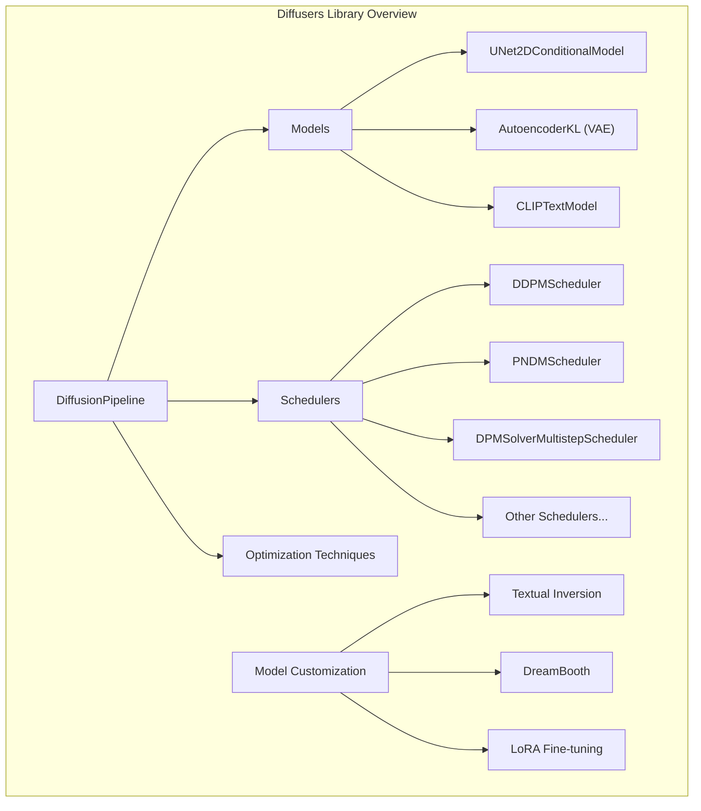
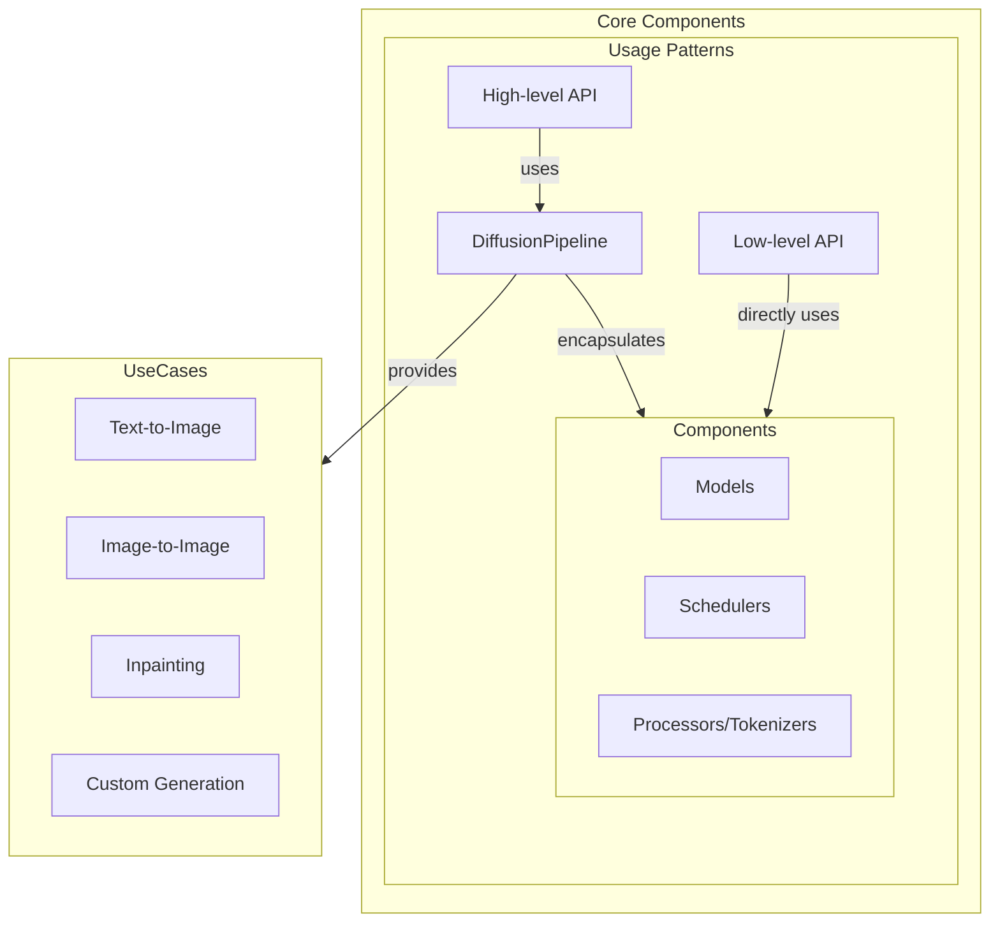
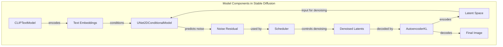
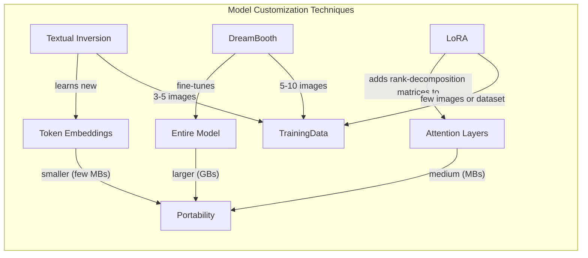

<!-- source: DeepWiki mcp.deepwiki.com · repo huggingface/notebooks · page 3 Diffusers Library · fetched 2026-10-26 -->

# Diffusers Library

<details>
<summary>Relevant source files</summary>

The following files were used as context for generating this wiki page:

- [diffusers/.gitignore](diffusers/.gitignore)
- [diffusers/CLIP_Guided_Stable_diffusion_with_diffusers.ipynb](diffusers/CLIP_Guided_Stable_diffusion_with_diffusers.ipynb)
- [diffusers/README.md](diffusers/README.md)
- [diffusers/diffusers_intro.ipynb](diffusers/diffusers_intro.ipynb)
- [diffusers/image_2_image_using_diffusers.ipynb](diffusers/image_2_image_using_diffusers.ipynb)
- [diffusers/in_painting_with_stable_diffusion_using_diffusers.ipynb](diffusers/in_painting_with_stable_diffusion_using_diffusers.ipynb)
- [diffusers/latent_diffusion_upscaler.ipynb](diffusers/latent_diffusion_upscaler.ipynb)
- [diffusers/sd_101_guide.ipynb](diffusers/sd_101_guide.ipynb)
- [diffusers/sd_dreambooth_inference.ipynb](diffusers/sd_dreambooth_inference.ipynb)
- [diffusers/sd_dreambooth_training.ipynb](diffusers/sd_dreambooth_training.ipynb)
- [diffusers/sd_textual_inversion_training.ipynb](diffusers/sd_textual_inversion_training.ipynb)
- [diffusers/stable_conceptualizer_inference.ipynb](diffusers/stable_conceptualizer_inference.ipynb)
- [diffusers/stable_diffusion.ipynb](diffusers/stable_diffusion.ipynb)
- [diffusers/training_example.ipynb](diffusers/training_example.ipynb)
- [diffusers_doc/en/basic_training.ipynb](diffusers_doc/en/basic_training.ipynb)
- [diffusers_doc/en/loading.ipynb](diffusers_doc/en/loading.ipynb)
- [diffusers_doc/en/lora.ipynb](diffusers_doc/en/lora.ipynb)
- [diffusers_doc/en/pytorch/basic_training.ipynb](diffusers_doc/en/pytorch/basic_training.ipynb)
- [diffusers_doc/en/pytorch/loading.ipynb](diffusers_doc/en/pytorch/loading.ipynb)
- [diffusers_doc/en/pytorch/lora.ipynb](diffusers_doc/en/pytorch/lora.ipynb)
- [diffusers_doc/en/pytorch/quicktour.ipynb](diffusers_doc/en/pytorch/quicktour.ipynb)
- [diffusers_doc/en/pytorch/stable_diffusion.ipynb](diffusers_doc/en/pytorch/stable_diffusion.ipynb)
- [diffusers_doc/en/pytorch/write_own_pipeline.ipynb](diffusers_doc/en/pytorch/write_own_pipeline.ipynb)
- [diffusers_doc/en/quicktour.ipynb](diffusers_doc/en/quicktour.ipynb)
- [diffusers_doc/en/stable_diffusion.ipynb](diffusers_doc/en/stable_diffusion.ipynb)
- [diffusers_doc/en/tensorflow/basic_training.ipynb](diffusers_doc/en/tensorflow/basic_training.ipynb)
- [diffusers_doc/en/tensorflow/loading.ipynb](diffusers_doc/en/tensorflow/loading.ipynb)
- [diffusers_doc/en/tensorflow/lora.ipynb](diffusers_doc/en/tensorflow/lora.ipynb)
- [diffusers_doc/en/tensorflow/quicktour.ipynb](diffusers_doc/en/tensorflow/quicktour.ipynb)
- [diffusers_doc/en/tensorflow/stable_diffusion.ipynb](diffusers_doc/en/tensorflow/stable_diffusion.ipynb)
- [diffusers_doc/en/tensorflow/write_own_pipeline.ipynb](diffusers_doc/en/tensorflow/write_own_pipeline.ipynb)
- [diffusers_doc/en/write_own_pipeline.ipynb](diffusers_doc/en/write_own_pipeline.ipynb)

</details>


The Diffusers Library is a powerful toolbox by Hugging Face for working with state-of-the-art diffusion models for generative AI. This page provides an overview of its architecture, core components, and functionalities, focusing on image generation capabilities. For specific integration with other Hugging Face libraries like Transformers, see [Transformers Library](#2).

## Overview

The Diffusers Library provides a modular framework for implementing and using diffusion models. Diffusion models are a class of generative models that work by gradually denoising random Gaussian noise through a series of steps to generate high-quality outputs such as images, audio, or other data types.



Sources:
- [diffusers_doc/en/stable_diffusion.ipynb]()
- [diffusers/CLIP_Guided_Stable_diffusion_with_diffusers.ipynb]()
- [diffusers/stable_diffusion.ipynb]()
- [diffusers_doc/en/write_own_pipeline.ipynb]()

## Core Architecture

The Diffusers Library is built around three main components:

1. **Pipelines**: Ready-to-use end-to-end systems for inference
2. **Models**: Neural network components that perform diffusion and related tasks
3. **Schedulers**: Components that control the diffusion process across steps

These components can be used together through pipelines or accessed individually for custom implementations.



Sources:
- [diffusers_doc/en/write_own_pipeline.ipynb]()
- [diffusers_doc/en/quicktour.ipynb]()
- [diffusers_doc/en/pytorch/write_own_pipeline.ipynb]()

## Diffusion Pipelines

The `DiffusionPipeline` is the main interface for using pre-trained diffusion models. It provides a simple API to load models from the Hugging Face Hub and run inference.

### Core Pipeline Functionality

```python
from diffusers import DiffusionPipeline

# Load a pre-trained pipeline
pipeline = DiffusionPipeline.from_pretrained("model_id")

# Move to GPU for faster inference
pipeline = pipeline.to("cuda")

# Run inference
output = pipeline(prompt="a photo of an astronaut riding a horse on mars")
```

The `DiffusionPipeline` automatically selects the appropriate pipeline class based on the model configuration. The most popular pipeline is the `StableDiffusionPipeline` for text-to-image generation.

Sources:
- [diffusers/stable_diffusion.ipynb:29-33]()
- [diffusers_doc/en/stable_diffusion.ipynb:29-33]()
- [diffusers_doc/en/quicktour.ipynb]()

### Types of Pipelines

The library offers various specialized pipelines for different tasks:

| Pipeline Type | Description | Example Use Case |
|---------------|-------------|------------------|
| `StableDiffusionPipeline` | Text-to-image generation | Creating images from text descriptions |
| `StableDiffusionImg2ImgPipeline` | Image-to-image translation | Transforming existing images based on text |
| `StableDiffusionInpaintPipeline` | Image inpainting | Filling in masked portions of images |
| `DDPMPipeline` | Basic diffusion | Unconditional image generation |
| `DiffusionPipeline` | Generic base class | Custom pipelines and other generation tasks |

Sources:
- [diffusers/stable_diffusion.ipynb]()
- [diffusers/in_painting_with_stable_diffusion_using_diffusers.ipynb]()
- [diffusers_doc/en/write_own_pipeline.ipynb]()

## Models

The Diffusers Library includes various model implementations that form the building blocks of diffusion systems.

### Key Models



1. **UNet2DConditionalModel**: The core diffusion model that predicts noise residuals at each step
2. **AutoencoderKL**: A variational autoencoder (VAE) that encodes images to and from latent space
3. **CLIPTextModel**: Text encoder that converts prompts into embeddings to condition the UNet
4. **CLIPFeatureExtractor**: Processes images for CLIP models in CLIP-guided diffusion

Sources:
- [diffusers_doc/en/stable_diffusion.ipynb]()
- [diffusers_doc/en/write_own_pipeline.ipynb]()
- [diffusers/CLIP_Guided_Stable_diffusion_with_diffusers.ipynb]()

## Schedulers

Schedulers control the diffusion process by defining how noise is added and removed during sampling. Different schedulers offer tradeoffs between quality and speed.

### Available Schedulers

```python
# List compatible schedulers
pipeline.scheduler.compatibles
```

| Scheduler | Description | Typical Steps | Strengths |
|-----------|-------------|---------------|-----------|
| `DDPMScheduler` | Original DDPM algorithm | 1000 | High quality, slow |
| `DDIMScheduler` | Deterministic diffusion | 50-100 | Good quality-speed balance |
| `PNDMScheduler` | Default in Stable Diffusion | 50 | Good default choice |
| `DPMSolverMultistepScheduler` | High-order solver | 20-25 | Very fast, good quality |
| `EulerDiscreteScheduler` | Euler method-based | 30-50 | Good for ancestral sampling |
| `LMSDiscreteScheduler` | Linear multistep | 30-50 | Good stability |

```python
# Switch to a faster scheduler
from diffusers import DPMSolverMultistepScheduler
pipeline.scheduler = DPMSolverMultistepScheduler.from_config(pipeline.scheduler.config)
```

Sources:
- [diffusers_doc/en/stable_diffusion.ipynb:168-183]()
- [diffusers_doc/en/pytorch/stable_diffusion.ipynb:168-183]()
- [diffusers_doc/en/tensorflow/stable_diffusion.ipynb:168-183]()

## Optimization Techniques

The Diffusers Library provides several optimization techniques to improve inference performance.

### Speed Optimization

1. **Float16 Precision**:
   ```python
   pipeline = DiffusionPipeline.from_pretrained("model_id", torch_dtype=torch.float16)
   ```

2. **Efficient Schedulers**:
   ```python
   from diffusers import DPMSolverMultistepScheduler
   pipeline.scheduler = DPMSolverMultistepScheduler.from_config(pipeline.scheduler.config)
   ```

3. **Reduced Inference Steps**:
   ```python
   pipeline(prompt="...", num_inference_steps=20)
   ```

### Memory Optimization

1. **Attention Slicing**: Reduces memory usage but slightly increases inference time
   ```python
   pipeline.enable_attention_slicing()
   ```

2. **Model Offloading**: Moves model components to CPU when not in use
   ```python
   pipeline.enable_model_cpu_offload()
   ```

3. **xFormers Memory Efficient Attention**: Third-party optimization for attention
   ```python
   pipeline.enable_xformers_memory_efficient_attention()
   ```

Sources:
- [diffusers_doc/en/stable_diffusion.ipynb:62-230]()
- [diffusers_doc/en/pytorch/stable_diffusion.ipynb:62-230]()
- [diffusers_doc/en/tensorflow/stable_diffusion.ipynb:62-230]()

## Model Customization Techniques

The library supports various techniques for personalizing diffusion models to create custom content.



### 1. Textual Inversion

Teaches new concepts to diffusion models by learning new token embeddings with just a few images. Minimal storage requirements.

```python
# Loading a textual inversion concept
pipe = StableDiffusionPipeline.from_pretrained("runwayml/stable-diffusion-v1-5")
pipe.load_textual_inversion("sd-concepts-library/cat-toy")

# Using the concept in a prompt
image = pipe("A <cat-toy> sitting on a chair").images[0]
```

Sources:
- [diffusers/sd_textual_inversion_training.ipynb]()
- [diffusers/stable_conceptualizer_inference.ipynb]()

### 2. DreamBooth

A more comprehensive fine-tuning approach that adapts the entire diffusion model to learn specific subjects.

```python
# Training a DreamBooth model
# The training script is more complex and requires several components
```

Sources:
- [diffusers/sd_dreambooth_training.ipynb]()
- [diffusers/sd_dreambooth_inference.ipynb]()

### 3. LoRA (Low-Rank Adaptation)

A memory-efficient fine-tuning technique that adds pairs of rank-decomposition matrices to existing weights.

```python
# Loading and using a LoRA model
from diffusers import StableDiffusionPipeline
import torch

# Load base model
pipe = StableDiffusionPipeline.from_pretrained("runwayml/stable-diffusion-v1-5", torch_dtype=torch.float16)

# Load LoRA weights
pipe.unet.load_attn_procs("julien-c/pokemon-lora")

# Use the model with LoRA weights
image = pipe("a pokemon in the style of monet").images[0]
```

Sources:
- [diffusers_doc/en/lora.ipynb]()
- [diffusers_doc/en/pytorch/lora.ipynb]()
- [diffusers_doc/en/tensorflow/lora.ipynb]()

## Using Custom Pipelines

The Diffusers Library allows you to create custom pipelines by combining models and schedulers directly.

### Basic Example

```python
# Load components separately
from diffusers import UNet2DModel, DDPMScheduler
import torch

# Load model and scheduler
model = UNet2DModel.from_pretrained("google/ddpm-cat-256")
scheduler = DDPMScheduler.from_pretrained("google/ddpm-cat-256")

# Manual denoising loop
sample = torch.randn((1, 3, 256, 256))
for t in scheduler.timesteps:
    model_input = scheduler.scale_model_input(sample, t)
    noise_prediction = model(model_input, t).sample
    sample = scheduler.step(noise_prediction, t, sample).prev_sample
```

Sources:
- [diffusers_doc/en/write_own_pipeline.ipynb]()
- [diffusers_doc/en/pytorch/write_own_pipeline.ipynb]()
- [diffusers_doc/en/tensorflow/write_own_pipeline.ipynb]()

### CLIP-Guided Diffusion

```python
# Example of more advanced custom pipeline
from diffusers import StableDiffusionPipeline, DPMSolverMultistepScheduler
from transformers import CLIPModel, CLIPTextModel, CLIPTokenizer
import torch

# Load components
model_id = "CompVis/stable-diffusion-v1-4"
pipe = StableDiffusionPipeline.from_pretrained(model_id)
clip_model = CLIPModel.from_pretrained("openai/clip-vit-large-patch14")
```

Sources:
- [diffusers/CLIP_Guided_Stable_diffusion_with_diffusers.ipynb]()

## Training Diffusion Models

The library provides tools for training diffusion models from scratch or fine-tuning existing ones.

### Basic Training Example

```python
from diffusers import UNet2DModel, DDPMScheduler, DDPMPipeline
import torch

# Initialize model and scheduler
model = UNet2DModel(
    sample_size=32,
    in_channels=3,
    out_channels=3,
    layers_per_block=2,
    block_out_channels=(64, 128, 256, 512),
    down_block_types=("DownBlock2D", "DownBlock2D", "DownBlock2D", "AttnDownBlock2D"),
    up_block_types=("AttnUpBlock2D", "UpBlock2D", "UpBlock2D", "UpBlock2D"),
)
scheduler = DDPMScheduler(num_train_timesteps=1000, beta_schedule="squaredcos_cap_v2")

# Set up optimizer
optimizer = torch.optim.AdamW(model.parameters(), lr=1e-4)

# Training loop (simplified)
for epoch in range(100):
    for batch in train_dataloader:
        # Forward pass, loss calculation, and optimization steps
```

Sources:
- [diffusers/training_example.ipynb]()
- [diffusers_doc/en/basic_training.ipynb]()
- [diffusers_doc/en/pytorch/basic_training.ipynb]()
- [diffusers_doc/en/tensorflow/basic_training.ipynb]()

## Conclusion

The Diffusers Library provides a comprehensive set of tools for working with diffusion models. Its modular architecture allows for easy use through pre-configured pipelines while also enabling customization for advanced users. The library supports state-of-the-art models like Stable Diffusion and provides optimization techniques to improve performance on various hardware configurations.

With support for model personalization techniques like Textual Inversion, DreamBooth, and LoRA, users can adapt pre-trained models to their specific needs with minimal resources. The extensive documentation and examples make it accessible to both beginners and experienced practitioners in the field of generative AI.

---

