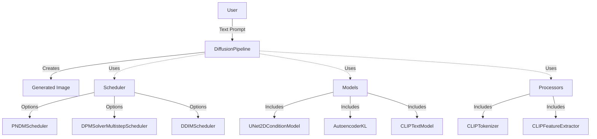
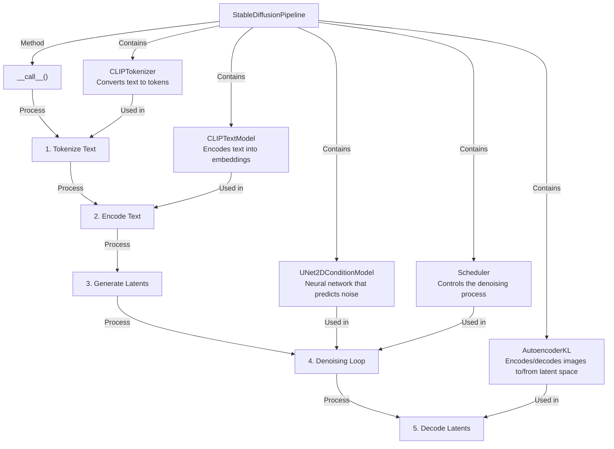
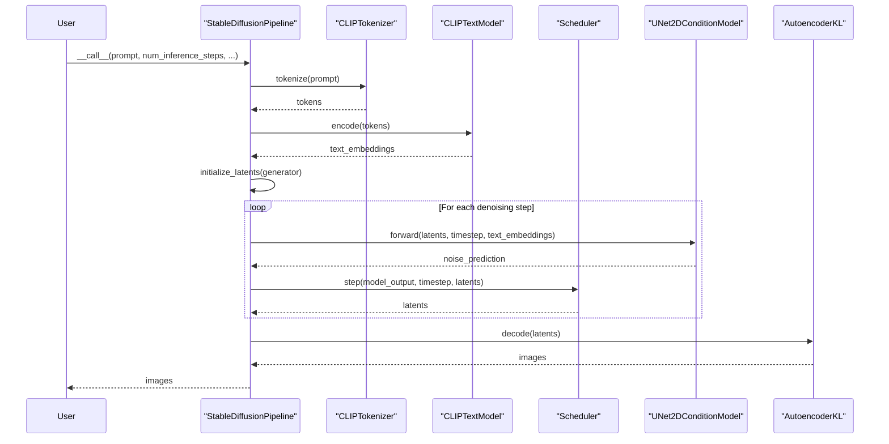

<!-- source: DeepWiki mcp.deepwiki.com · repo huggingface/notebooks · page 3.1 Stable Diffusion with Diffusers · fetched 2026-10-26 -->

# Stable Diffusion with Diffusers

<details>
<summary>Relevant source files</summary>

The following files were used as context for generating this wiki page:

- [diffusers/.gitignore](diffusers/.gitignore)
- [diffusers/CLIP_Guided_Stable_diffusion_with_diffusers.ipynb](diffusers/CLIP_Guided_Stable_diffusion_with_diffusers.ipynb)
- [diffusers/README.md](diffusers/README.md)
- [diffusers/diffusers_intro.ipynb](diffusers/diffusers_intro.ipynb)
- [diffusers/image_2_image_using_diffusers.ipynb](diffusers/image_2_image_using_diffusers.ipynb)
- [diffusers/in_painting_with_stable_diffusion_using_diffusers.ipynb](diffusers/in_painting_with_stable_diffusion_using_diffusers.ipynb)
- [diffusers/latent_diffusion_upscaler.ipynb](diffusers/latent_diffusion_upscaler.ipynb)
- [diffusers/sd_101_guide.ipynb](diffusers/sd_101_guide.ipynb)
- [diffusers/sd_dreambooth_inference.ipynb](diffusers/sd_dreambooth_inference.ipynb)
- [diffusers/sd_dreambooth_training.ipynb](diffusers/sd_dreambooth_training.ipynb)
- [diffusers/sd_textual_inversion_training.ipynb](diffusers/sd_textual_inversion_training.ipynb)
- [diffusers/stable_conceptualizer_inference.ipynb](diffusers/stable_conceptualizer_inference.ipynb)
- [diffusers/stable_diffusion.ipynb](diffusers/stable_diffusion.ipynb)
- [diffusers/training_example.ipynb](diffusers/training_example.ipynb)
- [diffusers_doc/en/lora.ipynb](diffusers_doc/en/lora.ipynb)
- [diffusers_doc/en/pytorch/lora.ipynb](diffusers_doc/en/pytorch/lora.ipynb)
- [diffusers_doc/en/pytorch/stable_diffusion.ipynb](diffusers_doc/en/pytorch/stable_diffusion.ipynb)
- [diffusers_doc/en/stable_diffusion.ipynb](diffusers_doc/en/stable_diffusion.ipynb)
- [diffusers_doc/en/tensorflow/lora.ipynb](diffusers_doc/en/tensorflow/lora.ipynb)
- [diffusers_doc/en/tensorflow/stable_diffusion.ipynb](diffusers_doc/en/tensorflow/stable_diffusion.ipynb)

</details>


This document provides a comprehensive guide to using Stable Diffusion models with the Hugging Face Diffusers library. It covers how to set up and run text-to-image generation efficiently, optimize performance, and improve output quality. For information about fine-tuning Stable Diffusion models with techniques like DreamBooth, see [Model Personalization Techniques](#3.2), and for building custom diffusion pipelines, see [Custom Diffusion Pipelines](#3.3).

## Overview of Stable Diffusion with Diffusers

Stable Diffusion is a text-to-image latent diffusion model created by researchers from CompVis, Stability AI, and LAION. The Diffusers library provides an easy-to-use API for loading, configuring, and running these models efficiently.



Sources: [diffusers_doc/en/stable_diffusion.ipynb:14-21](), [diffusers/stable_diffusion.ipynb:12-18]()

## Components of Stable Diffusion

Stable Diffusion is implemented through the `StableDiffusionPipeline` class, which is a subclass of `DiffusionPipeline` that orchestrates several interacting components:



Sources: [diffusers_doc/en/stable_diffusion.ipynb:29-32](), [diffusers/stable_diffusion.ipynb:330-333]()

## Basic Usage

Using Stable Diffusion with Diffusers is straightforward:

1. Load the pipeline:
```python
from diffusers import DiffusionPipeline
import torch

# Load the pipeline
model_id = "runwayml/stable-diffusion-v1-5"
pipeline = DiffusionPipeline.from_pretrained(model_id, torch_dtype=torch.float16)
pipeline = pipeline.to("cuda")  # Move to GPU
```

2. Generate images from text:
```python
# Set a seed for reproducibility
generator = torch.Generator("cuda").manual_seed(0)

# Generate an image
prompt = "portrait photo of a old warrior chief"
image = pipeline(prompt, generator=generator).images[0]
```

Sources: [diffusers_doc/en/stable_diffusion.ipynb:29-33](), [diffusers_doc/en/stable_diffusion.ipynb:48-49](), [diffusers_doc/en/stable_diffusion.ipynb:93-96](), [diffusers_doc/en/stable_diffusion.ipynb:111-112]()

## Generation Process

The image generation process with Stable Diffusion follows these steps:



Sources: [diffusers_doc/en/stable_diffusion.ipynb:111-112](), [diffusers/stable_diffusion.ipynb:330-333]()

## Optimization Techniques

Stable Diffusion can be optimized for better performance in terms of speed, memory usage, and output quality.

### Speed Optimization

1. **Use float16 precision**:
   ```python
   pipeline = DiffusionPipeline.from_pretrained(model_id, torch_dtype=torch.float16)
   ```

2. **Use more efficient schedulers**:
   ```python
   from diffusers import DPMSolverMultistepScheduler
   pipeline.scheduler = DPMSolverMultistepScheduler.from_config(pipeline.scheduler.config)
   ```

3. **Reduce inference steps**:
   ```python
   image = pipeline(prompt, generator=generator, num_inference_steps=20).images[0]
   ```

Sources: [diffusers_doc/en/stable_diffusion.ipynb:136-140](), [diffusers_doc/en/stable_diffusion.ipynb:199-201](), [diffusers_doc/en/stable_diffusion.ipynb:217-219]()

### Memory Optimization

1. **Enable attention slicing** to reduce memory usage:
   ```python
   pipeline.enable_attention_slicing()
   ```

This allows you to run larger batch sizes or on GPUs with less memory.

Sources: [diffusers_doc/en/stable_diffusion.ipynb:318](), [diffusers_doc/en/stable_diffusion.ipynb:334-335]()

### Quality Optimization

There are several ways to improve the quality of generated images:

1. **Use better checkpoints**: Try models like `runwayml/stable-diffusion-v1-5` or `stabilityai/stable-diffusion-2-1` for potentially better results.

2. **Replace pipeline components** with improved versions:
   ```python
   from diffusers import AutoencoderKL
   vae = AutoencoderKL.from_pretrained("stabilityai/sd-vae-ft-mse", torch_dtype=torch.float16).to("cuda")
   pipeline.vae = vae
   ```

3. **Improve prompt engineering**:
   - Be specific and detailed
   - Include style information
   - Add technical details like camera types or lighting

Sources: [diffusers_doc/en/stable_diffusion.ipynb:399-402](), [diffusers_doc/en/stable_diffusion.ipynb:442-443](), [diffusers_doc/en/stable_diffusion.ipynb:427-432]()

## Available Models and Pipelines

Several Stable Diffusion model versions are available:

| Model ID | Description |
|----------|-------------|
| `CompVis/stable-diffusion-v1-4` | Original Stable Diffusion v1.4 |
| `runwayml/stable-diffusion-v1-5` | Improved v1.5 version |
| `stabilityai/stable-diffusion-2-1-base` | Base model of v2.1 |
| `stabilityai/stable-diffusion-2-1` | Full v2.1 (higher resolution) |

Sources: [diffusers/stable_diffusion.ipynb:102-111]()

## Compatible Schedulers

Stable Diffusion supports various schedulers that determine the denoising process:

```python
pipeline.scheduler.compatibles
[
    diffusers.schedulers.scheduling_lms_discrete.LMSDiscreteScheduler,
    diffusers.schedulers.scheduling_unipc_multistep.UniPCMultistepScheduler,
    diffusers.schedulers.scheduling_k_dpm_2_discrete.KDPM2DiscreteScheduler,
    diffusers.schedulers.scheduling_deis_multistep.DEISMultistepScheduler,
    diffusers.schedulers.scheduling_euler_discrete.EulerDiscreteScheduler,
    diffusers.schedulers.scheduling_dpmsolver_multistep.DPMSolverMultistepScheduler,
    diffusers.schedulers.scheduling_ddpm.DDPMScheduler,
    diffusers.schedulers.scheduling_dpmsolver_singlestep.DPMSolverSinglestepScheduler,
    diffusers.schedulers.scheduling_k_dpm_2_ancestral_discrete.KDPM2AncestralDiscreteScheduler,
    diffusers.schedulers.scheduling_heun_discrete.HeunDiscreteScheduler,
    diffusers.schedulers.scheduling_pndm.PNDMScheduler,
    diffusers.schedulers.scheduling_euler_ancestral_discrete.EulerAncestralDiscreteScheduler,
    diffusers.schedulers.scheduling_ddim.DDIMScheduler,
]
```

Different schedulers offer trade-offs between speed and quality. For example, the default `PNDMScheduler` typically requires ~50 inference steps, while `DPMSolverMultistepScheduler` can yield good results with only ~20-25 steps.

Sources: [diffusers_doc/en/stable_diffusion.ipynb:168-183](), [diffusers_doc/en/stable_diffusion.ipynb:190-191]()

## Advanced Usage

### Batch Generation

You can generate multiple images at once using batch processing:

```python
def get_inputs(batch_size=1):
    generator = [torch.Generator("cuda").manual_seed(i) for i in range(batch_size)]
    prompts = batch_size * [prompt]
    num_inference_steps = 20
    return {"prompt": prompts, "generator": generator, "num_inference_steps": num_inference_steps}

images = pipeline(**get_inputs(batch_size=8)).images
```

Sources: [diffusers_doc/en/stable_diffusion.ipynb:255-261](), [diffusers_doc/en/stable_diffusion.ipynb:334-335]()

### Visualization Tools

For visualizing batches of images, you can use the `image_grid` function:

```python
from PIL import Image

def image_grid(imgs, rows=2, cols=2):
    w, h = imgs[0].size
    grid = Image.new("RGB", size=(cols * w, rows * h))
    
    for i, img in enumerate(imgs):
        grid.paste(img, box=(i % cols * w, i // cols * h))
    return grid

grid = image_grid(images, rows=2, cols=4)
```

Sources: [diffusers_doc/en/stable_diffusion.ipynb:276-286](), [diffusers_doc/en/stable_diffusion.ipynb:334-335]()

## Extensions and Alternative Approaches

Stable Diffusion can be extended and enhanced with several techniques:

1. **CLIP Guidance**: Use CLIP models to guide the generation process for better text-image alignment.
2. **DreamBooth**: Fine-tune Stable Diffusion on a few images of a specific concept to personalize the model.
3. **Textual Inversion**: Teach the model new concepts by learning new embeddings for specific tokens.
4. **LoRA (Low-Rank Adaptation)**: Efficiently fine-tune the model with low-rank decomposition matrices.

Sources: [diffusers/CLIP_Guided_Stable_diffusion_with_diffusers.ipynb:19-21](), [diffusers/sd_dreambooth_training.ipynb:9-15](), [diffusers_doc/en/lora.ipynb:7-42]()

## Best Practices

1. **Always use float16 precision** for better performance with minimal quality loss.
2. **Experiment with different schedulers** to find the best trade-off between speed and quality.
3. **Utilize attention slicing** when working with limited GPU memory.
4. **Craft detailed prompts** for better results, including style information and technical details.
5. **Try different model checkpoints** for different use cases.
6. **Set a seed with the generator** for reproducible results.

Sources: [diffusers_doc/en/stable_diffusion.ipynb:154-157](), [diffusers_doc/en/stable_diffusion.ipynb:136-140](), [diffusers_doc/en/stable_diffusion.ipynb:318](), [diffusers_doc/en/stable_diffusion.ipynb:427-432]()

## Conclusion

This guide covered the basics of using Stable Diffusion with the Diffusers library, including how to load models, generate images, optimize performance, and improve results. With these tools and techniques, you can efficiently create high-quality images from text descriptions and further customize the models to your specific needs.

For more advanced topics like model personalization with DreamBooth and Textual Inversion, or building custom diffusion pipelines, refer to the dedicated sections of the documentation.

---

