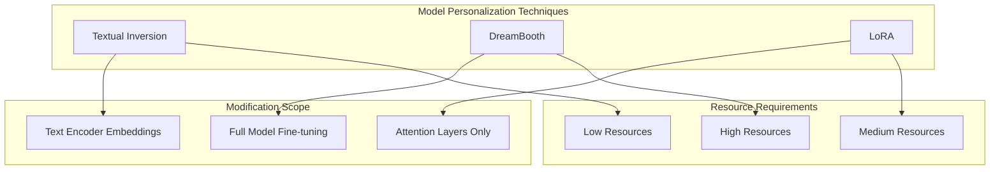
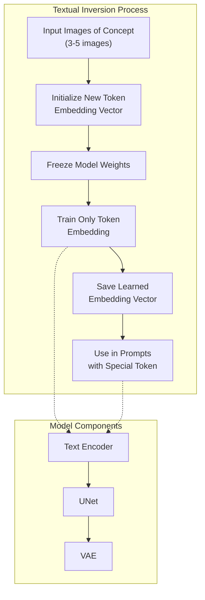
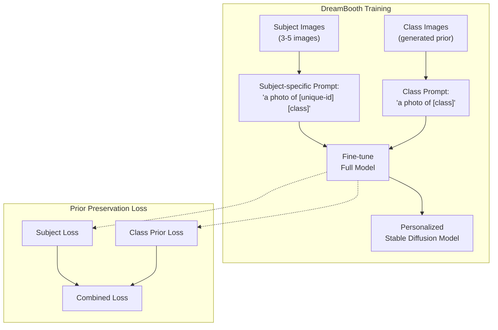
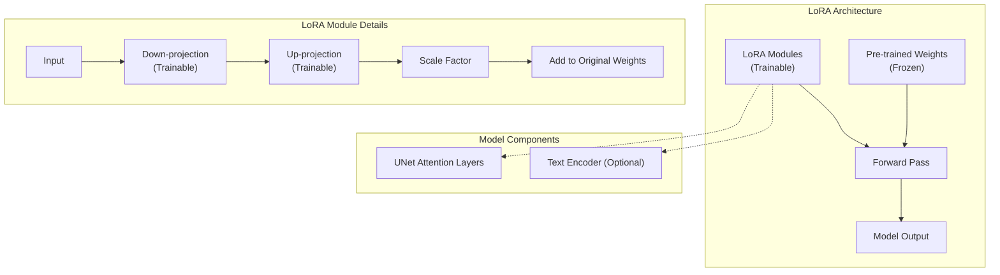
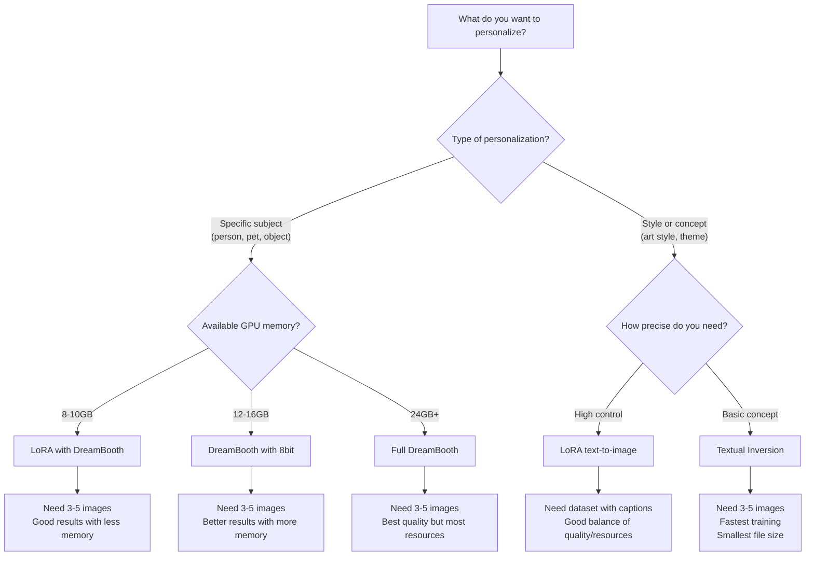

<!-- source: DeepWiki mcp.deepwiki.com · repo huggingface/notebooks · page 3.2 Model Personalization Techniques · fetched 2026-10-26 -->

# Model Personalization Techniques

<details>
<summary>Relevant source files</summary>

The following files were used as context for generating this wiki page:

- [diffusers/.gitignore](diffusers/.gitignore)
- [diffusers/CLIP_Guided_Stable_diffusion_with_diffusers.ipynb](diffusers/CLIP_Guided_Stable_diffusion_with_diffusers.ipynb)
- [diffusers/README.md](diffusers/README.md)
- [diffusers/diffusers_intro.ipynb](diffusers/diffusers_intro.ipynb)
- [diffusers/image_2_image_using_diffusers.ipynb](diffusers/image_2_image_using_diffusers.ipynb)
- [diffusers/in_painting_with_stable_diffusion_using_diffusers.ipynb](diffusers/in_painting_with_stable_diffusion_using_diffusers.ipynb)
- [diffusers/latent_diffusion_upscaler.ipynb](diffusers/latent_diffusion_upscaler.ipynb)
- [diffusers/sd_101_guide.ipynb](diffusers/sd_101_guide.ipynb)
- [diffusers/sd_dreambooth_inference.ipynb](diffusers/sd_dreambooth_inference.ipynb)
- [diffusers/sd_dreambooth_training.ipynb](diffusers/sd_dreambooth_training.ipynb)
- [diffusers/sd_textual_inversion_training.ipynb](diffusers/sd_textual_inversion_training.ipynb)
- [diffusers/stable_conceptualizer_inference.ipynb](diffusers/stable_conceptualizer_inference.ipynb)
- [diffusers/stable_diffusion.ipynb](diffusers/stable_diffusion.ipynb)
- [diffusers/training_example.ipynb](diffusers/training_example.ipynb)
- [diffusers_doc/en/dreambooth.ipynb](diffusers_doc/en/dreambooth.ipynb)
- [diffusers_doc/en/lora.ipynb](diffusers_doc/en/lora.ipynb)
- [diffusers_doc/en/pytorch/dreambooth.ipynb](diffusers_doc/en/pytorch/dreambooth.ipynb)
- [diffusers_doc/en/pytorch/lora.ipynb](diffusers_doc/en/pytorch/lora.ipynb)
- [diffusers_doc/en/pytorch/stable_diffusion.ipynb](diffusers_doc/en/pytorch/stable_diffusion.ipynb)
- [diffusers_doc/en/pytorch/text_inversion.ipynb](diffusers_doc/en/pytorch/text_inversion.ipynb)
- [diffusers_doc/en/stable_diffusion.ipynb](diffusers_doc/en/stable_diffusion.ipynb)
- [diffusers_doc/en/tensorflow/dreambooth.ipynb](diffusers_doc/en/tensorflow/dreambooth.ipynb)
- [diffusers_doc/en/tensorflow/lora.ipynb](diffusers_doc/en/tensorflow/lora.ipynb)
- [diffusers_doc/en/tensorflow/stable_diffusion.ipynb](diffusers_doc/en/tensorflow/stable_diffusion.ipynb)
- [diffusers_doc/en/tensorflow/text_inversion.ipynb](diffusers_doc/en/tensorflow/text_inversion.ipynb)
- [diffusers_doc/en/text_inversion.ipynb](diffusers_doc/en/text_inversion.ipynb)

</details>


This document explains key techniques for personalizing diffusion models within the Hugging Face diffusers library. Model personalization allows you to teach pre-trained text-to-image models (like Stable Diffusion) new concepts or subjects using only a few example images. The following personalization techniques are covered:

- Textual Inversion: Teaches new concepts to a model by learning new token embeddings
- DreamBooth: Fine-tunes models to learn specific subjects while preserving class knowledge
- LoRA (Low-Rank Adaptation): Efficiently fine-tunes models through parameter-efficient training

For general information about diffusion models and basic usage, see the pages on the [Diffusers Library](#3) and [Stable Diffusion with Diffusers](#3.1).

## Overview of Personalization Techniques

Each personalization technique offers different trade-offs between ease of training, computational requirements, and customization level.



### Comparison of Techniques

| Technique | What's Trained | Memory Requirement | Training Time | Use Case |
|-----------|----------------|-------------------|---------------|----------|
| Textual Inversion | Token embeddings only | Low | Fastest | New styles or concepts |
| DreamBooth | Entire model | High | Slowest | Detailed subject personalization |
| LoRA | Rank decomposition matrices | Medium | Fast | Efficient subject and style learning |

Sources:
- [diffusers/sd_textual_inversion_training.ipynb:11-26]()
- [diffusers/sd_dreambooth_training.ipynb:9-19]()
- [diffusers_doc/en/pytorch/lora.ipynb:21-33]()

## Textual Inversion

Textual Inversion teaches new concepts to Stable Diffusion with just a few example images (3-5) by optimizing a new token embedding vector that represents the concept.



### How It Works

1. Initialize a new special token (e.g., "S*") in the tokenizer vocabulary
2. Freeze all model weights except the embedding for this new token
3. Train the model to associate this token with your concept images
4. Use the learned embedding in prompts like "A photo of S* in the jungle"

### Implementation Details

Textual Inversion training requires:
- A small dataset of 3-5 images representing your concept
- Training for approximately 3,000-5,000 steps
- Relatively low GPU memory (can run on consumer GPUs)

### Example Usage

After training, the learned concept can be loaded and used with a regular Stable Diffusion pipeline:

```python
from diffusers import StableDiffusionPipeline
import torch

# Load model with learned concept
pipe = StableDiffusionPipeline.from_pretrained("runwayml/stable-diffusion-v1-5", torch_dtype=torch.float16)
pipe.to("cuda")

# Load your learned concept embedding
pipe.load_textual_inversion("learned_concept.bin")

# Generate image using concept
prompt = "A photo of <learned-concept> in the jungle"
image = pipe(prompt).images[0]
```

Sources:
- [diffusers/sd_textual_inversion_training.ipynb:9-48]()
- [diffusers/sd_textual_inversion_training.ipynb:158-166]()
- [diffusers_doc/en/text_inversion.ipynb:14-22]()

## DreamBooth

DreamBooth is a technique to personalize text-to-image models given just a few (3-5) images of a subject. It fine-tunes the entire model to generate contextual images of the subject in different scenes, poses, and views.



### How It Works

1. Uses a unique identifier to represent your subject (e.g., "sks dog" for a specific dog)
2. Fine-tunes the entire diffusion model using this identifier
3. Employs "prior preservation loss" to prevent language drift and maintain class knowledge
4. Generates class samples during training to avoid overfitting

### Implementation Details

DreamBooth requires:
- 3-5 images of your subject (more consistent quality with more images)
- Higher GPU memory (16GB+ recommended, though 8bit optimizers can reduce this)
- Prior preservation to prevent overfitting and maintain class knowledge
- Training for 800-1500 steps typically

### Resource Requirements

DreamBooth is more resource-intensive than Textual Inversion, but offers several options:
- Full precision training (requires 24GB+ VRAM)
- 8bit optimizer training (works with ~12GB VRAM)
- CPU offloading (works with 8GB VRAM but is slower)
- LoRA with DreamBooth (works with ~8GB VRAM)

Sources:
- [diffusers/sd_dreambooth_training.ipynb:9-19]()
- [diffusers_doc/en/dreambooth.ipynb:14-42]()
- [diffusers_doc/en/pytorch/dreambooth.ipynb:14-42]()

## LoRA (Low-Rank Adaptation)

LoRA is a training method that accelerates training of large models while consuming less memory. It adds pairs of rank-decomposition weight matrices (called update matrices) to existing weights, and only trains these newly added weights.



### Key Advantages

1. **Memory Efficiency**: Trains significantly fewer parameters than full fine-tuning
2. **Prevents Catastrophic Forgetting**: Original weights remain frozen
3. **Portability**: LoRA weights are much smaller (typically <100MB)
4. **Adaptability**: Scale parameter controls strength of adaptation
5. **Hardware Accessibility**: Can run on consumer GPUs (even 8GB VRAM)

### Technical Implementation

LoRA works by:
1. Adding pairs of low-rank decomposition matrices to model weights
2. Focusing on attention layers (most commonly)
3. Freezing original model weights
4. Training only the added rank-decomposition matrices

In diffusers, LoRA is primarily applied to the attention layers of the UNet model, with optional support for the text encoder in DreamBooth scenarios.

### LoRA with Text-to-Image vs. DreamBooth

LoRA can be used for both general text-to-image training and DreamBooth-style subject personalization:

- **Text-to-Image LoRA**: Fine-tune on a dataset of images with captions to learn a style or theme
- **DreamBooth LoRA**: Fine-tune on a few images of a specific subject with class preservation

### Example Usage

Loading and using a trained LoRA model:

```python
from diffusers import StableDiffusionPipeline
import torch

# Load base model
pipe = StableDiffusionPipeline.from_pretrained(
    "runwayml/stable-diffusion-v1-5", 
    torch_dtype=torch.float16
)
pipe.to("cuda")

# Load LoRA weights
pipe.unet.load_attn_procs("path-to-lora-weights")

# Adjust LoRA scale (optional)
pipe.set_adapters_scale(0.8)  # Controls strength of adaptation

# Generate image
prompt = "A photo of a pokemon in the forest"
image = pipe(prompt).images[0]
```

Sources:
- [diffusers_doc/en/pytorch/lora.ipynb:21-35]()
- [diffusers_doc/en/lora.ipynb:21-35]()
- [diffusers_doc/en/tensorflow/lora.ipynb:21-35]()

## Choosing the Right Technique

Here's a decision flowchart to help you select the appropriate personalization technique:



### When to Use Each Technique

- **Textual Inversion**: When you need to learn a simple style or concept and have limited GPU resources
- **DreamBooth**: When you need the highest quality personalization of a specific subject and have adequate GPU resources
- **LoRA**: When you want a good balance between quality and resource efficiency

## Technical Details and Integration

### File Structure and Components

The personalization techniques are integrated into the diffusers library through several key files and classes:

- **Textual Inversion**: Primarily implemented in the text encoder components
- **DreamBooth**: Modifies the entire UNet model and potentially the text encoder
- **LoRA**: Focuses on the attention processors in the UNet model

Sources:
- [diffusers/sd_textual_inversion_training.ipynb:120-150]()
- [diffusers/sd_dreambooth_training.ipynb:120-160]()
- [diffusers_doc/en/pytorch/lora.ipynb:62-110]()

## Best Practices

### Training Data Preparation

For all personalization techniques:
- Use 3-5 clear images of your subject/concept
- Ensure images have consistent quality
- Vary the background, pose, and perspective for better generalization
- Crop images to focus on the subject
- Remove other subjects to avoid confusion

### Training Parameters

| Technique | Learning Rate | Training Steps | Batch Size |
|-----------|---------------|----------------|------------|
| Textual Inversion | 5e-4 to 1e-3 | 3000-5000 | 1-4 |
| DreamBooth | 1e-6 to 5e-6 | 800-1500 | 1-4 |
| LoRA | 1e-4 | 1000-3000 | 1-8 |

### Integration with Existing Workflows

All these personalization techniques can be combined with other diffusers features:
- Use with different schedulers for faster inference
- Compatible with various prompt engineering techniques
- Can be combined with other optimization methods like attention slicing

Sources:
- [diffusers/sd_textual_inversion_training.ipynb:190-220]()
- [diffusers_doc/en/stable_diffusion.ipynb:60-90]()
- [diffusers_doc/en/pytorch/lora.ipynb:127-147]()

## Conclusion

Model personalization techniques like Textual Inversion, DreamBooth, and LoRA provide powerful ways to customize diffusion models with minimal data. Each technique offers different trade-offs between ease of use, computational requirements, and results quality. By understanding these differences, you can choose the most appropriate technique for your specific needs and hardware constraints.

Sources:
- [diffusers/sd_textual_inversion_training.ipynb]()
- [diffusers/sd_dreambooth_training.ipynb]()
- [diffusers_doc/en/pytorch/lora.ipynb]()
- [diffusers_doc/en/dreambooth.ipynb]()
- [diffusers_doc/en/text_inversion.ipynb]()

---

