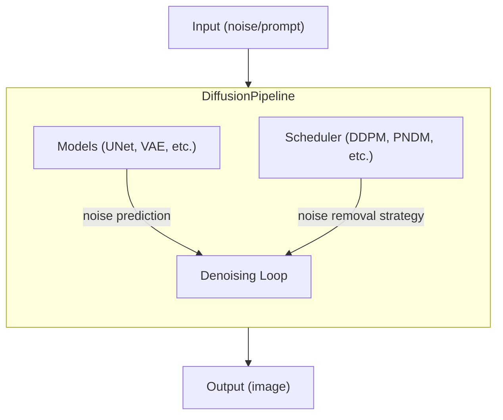
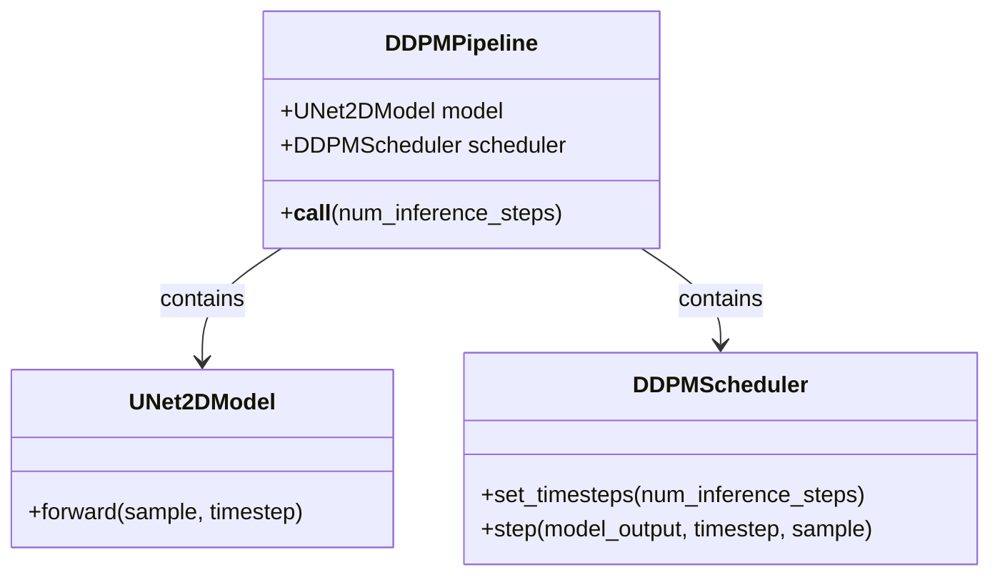
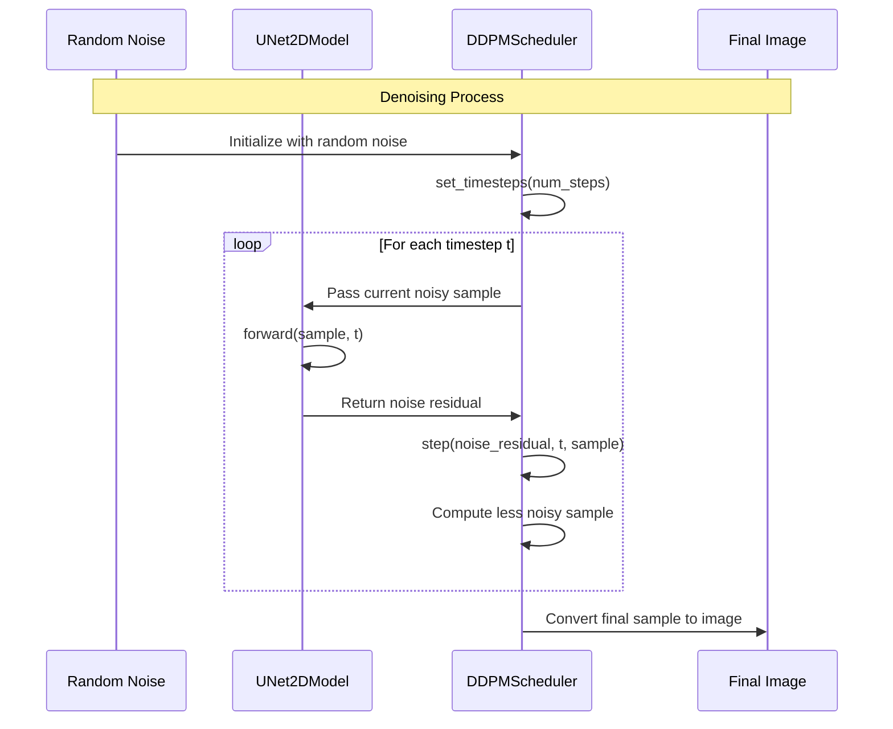
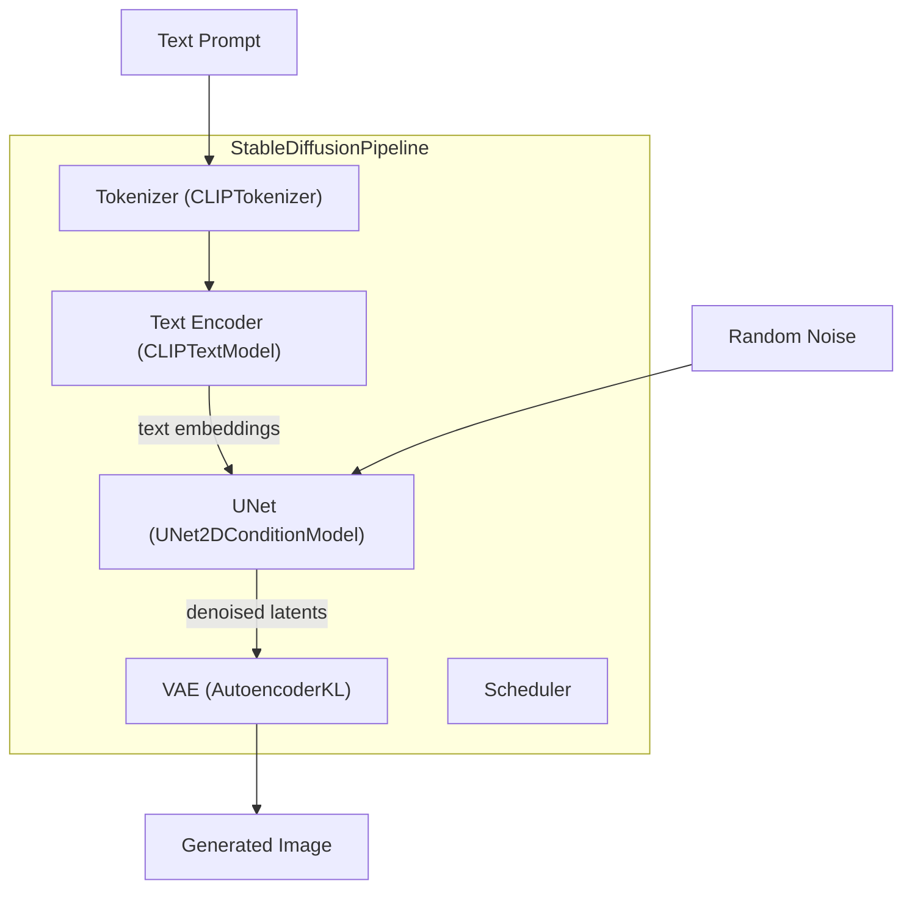
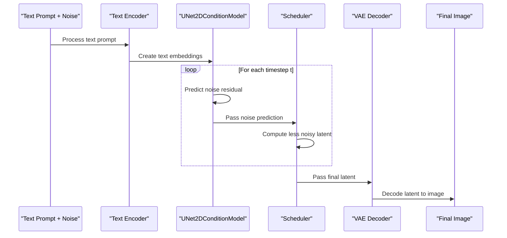
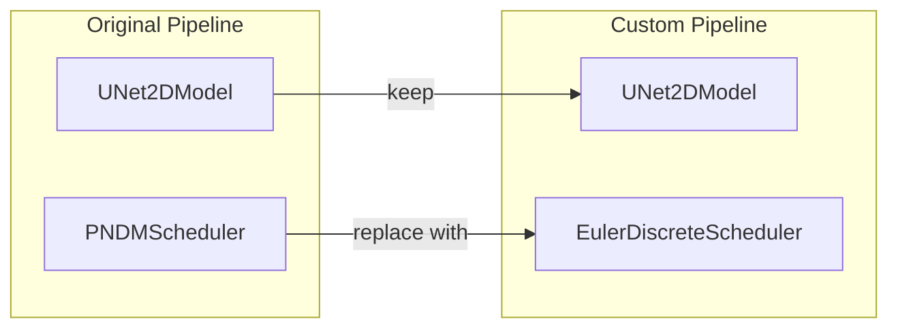

<!-- source: DeepWiki mcp.deepwiki.com · repo huggingface/notebooks · page 3.3 Custom Diffusion Pipelines · fetched 2026-10-26 -->

# Custom Diffusion Pipelines

Relevant source files

The following files were used as context for generating this wiki page:

- [diffusers_doc/en/basic_training.ipynb](diffusers_doc/en/basic_training.ipynb)
- [diffusers_doc/en/loading.ipynb](diffusers_doc/en/loading.ipynb)
- [diffusers_doc/en/pytorch/basic_training.ipynb](diffusers_doc/en/pytorch/basic_training.ipynb)
- [diffusers_doc/en/pytorch/loading.ipynb](diffusers_doc/en/pytorch/loading.ipynb)
- [diffusers_doc/en/pytorch/quicktour.ipynb](diffusers_doc/en/pytorch/quicktour.ipynb)
- [diffusers_doc/en/pytorch/write_own_pipeline.ipynb](diffusers_doc/en/pytorch/write_own_pipeline.ipynb)
- [diffusers_doc/en/quicktour.ipynb](diffusers_doc/en/quicktour.ipynb)
- [diffusers_doc/en/tensorflow/basic_training.ipynb](diffusers_doc/en/tensorflow/basic_training.ipynb)
- [diffusers_doc/en/tensorflow/loading.ipynb](diffusers_doc/en/tensorflow/loading.ipynb)
- [diffusers_doc/en/tensorflow/quicktour.ipynb](diffusers_doc/en/tensorflow/quicktour.ipynb)
- [diffusers_doc/en/tensorflow/write_own_pipeline.ipynb](diffusers_doc/en/tensorflow/write_own_pipeline.ipynb)
- [diffusers_doc/en/write_own_pipeline.ipynb](diffusers_doc/en/write_own_pipeline.ipynb)

This page explains how to build and customize diffusion pipelines by understanding and manipulating their core components. While the `DiffusionPipeline` class provides a convenient high-level API for inference, understanding how to unbundle and customize pipelines gives you the flexibility to create tailored diffusion systems for specific use cases. For information about using pre-built diffusion pipelines, see [Diffusers Library](#3).

## Understanding Pipeline Components

At its core, a diffusion pipeline consists of two primary components:

1. **Models** - Neural networks that predict the noise residual at each denoising step (e.g., UNet2DModel)
2. **Schedulers** - Algorithms that control how noise is added during training and removed during inference

The simplicity of diffusion systems comes from this consistent pattern: initialize components, generate noise, run a denoising loop that alternates between model prediction and scheduler updates, and convert the result to an image.

Sources: [diffusers_doc/en/write_own_pipeline.ipynb:14-22]()

## Deconstructing a Basic Pipeline

To understand how pipelines work, let's deconstruct a basic DDPM (Denoising Diffusion Probabilistic Model) pipeline. This will reveal the core pattern that all diffusion systems follow.

### Basic Pipeline Components

A basic DDPM pipeline contains:
- A `UNet2DModel` that predicts noise residuals
- A `DDPMScheduler` that guides the denoising process

Sources: [diffusers_doc/en/write_own_pipeline.ipynb:39-44](), [diffusers_doc/en/write_own_pipeline.ipynb:69-72]()

### Denoising Process

The denoising process follows these steps:

1. Set the number of timesteps for the denoising process 
2. Create random noise as the starting point
3. Iterate through the timesteps from noisiest to least noisy
4. At each step:
   - The model predicts the noise residual
   - The scheduler uses this prediction to compute a less noisy sample
5. Convert the final output to an image

Sources: [diffusers_doc/en/write_own_pipeline.ipynb:88-89](), [diffusers_doc/en/write_own_pipeline.ipynb:153-159]()

### Code Implementation

Here's how you would manually implement the same flow that happens inside a DDPMPipeline:

1. Load the model and scheduler
2. Set the number of denoising steps
3. Create random noise
4. Run the denoising loop
5. Convert the result to an image

The key parts of the denoising loop are:
- Getting the noise prediction from the model: `noisy_residual = model(input, t).sample`
- Using the scheduler to calculate the next sample: `previous_noisy_sample = scheduler.step(noisy_residual, t, input).prev_sample`

Sources: [diffusers_doc/en/write_own_pipeline.ipynb:134-138](), [diffusers_doc/en/write_own_pipeline.ipynb:153-159](), [diffusers_doc/en/write_own_pipeline.ipynb:177-183]()

## Building Complex Diffusion Pipelines

While the basic pattern remains the same, more complex pipelines like Stable Diffusion incorporate additional components and techniques.

### Stable Diffusion Components

Stable Diffusion is a latent diffusion model that works with more components:

Sources: [diffusers_doc/en/write_own_pipeline.ipynb:225-233]()

### Customizing Stable Diffusion

The complexity comes from:

1. **Text conditioning** - Converting prompts to embeddings using a tokenizer and text encoder
2. **Latent diffusion** - Working in a compressed latent space rather than pixel space
3. **Classifier-free guidance** - Balancing prompt adherence with generation quality

Despite this complexity, the denoising loop remains similar to the basic pipeline:

Sources: [diffusers_doc/en/write_own_pipeline.ipynb:452-471](), [diffusers_doc/en/write_own_pipeline.ipynb:494-497]()

## Creating Your Own Pipeline

To create a custom diffusion pipeline, you can:

1. Start with individual components and assemble them manually
2. Customize an existing pipeline by swapping components
3. Modify the denoising process for specialized use cases

### Starting from Scratch

When creating a pipeline from scratch, follow these steps:

1. Initialize all required models and the scheduler
2. Process your inputs (text, images, etc.)
3. Implement the denoising loop
4. Post-process and return the results

### Customizing Existing Pipelines

A common customization is to swap the scheduler to trade off between speed and quality. For example:

Sources: [diffusers_doc/en/write_own_pipeline.ipynb:249-251]()

## Best Practices

When creating custom diffusion pipelines:

1. **Start simple** - Understand basic pipelines before tackling complex ones
2. **Swap one component at a time** - Changing multiple components simultaneously can make debugging difficult
3. **Reuse model weights** - Load model weights once and reuse them across pipelines to save memory
4. **Scale inputs properly** - Ensure inputs are properly scaled for the models (e.g., [-1, 1] range)
5. **Handle edge cases** - Consider edge cases like batch processing, error handling, etc.

## Next Steps

After mastering custom pipelines, you might want to:

1. Contribute your pipeline to the Diffusers library
2. Explore advanced techniques like LoRA fine-tuning or textual inversion
3. Optimize your pipeline for specific hardware or latency requirements

For information on contributing pipelines to the Diffusers library, refer to the official documentation. To explore model personalization techniques, see [Model Personalization Techniques](#3.2).

Sources: [diffusers_doc/en/write_own_pipeline.ipynb:540-547]()

---

