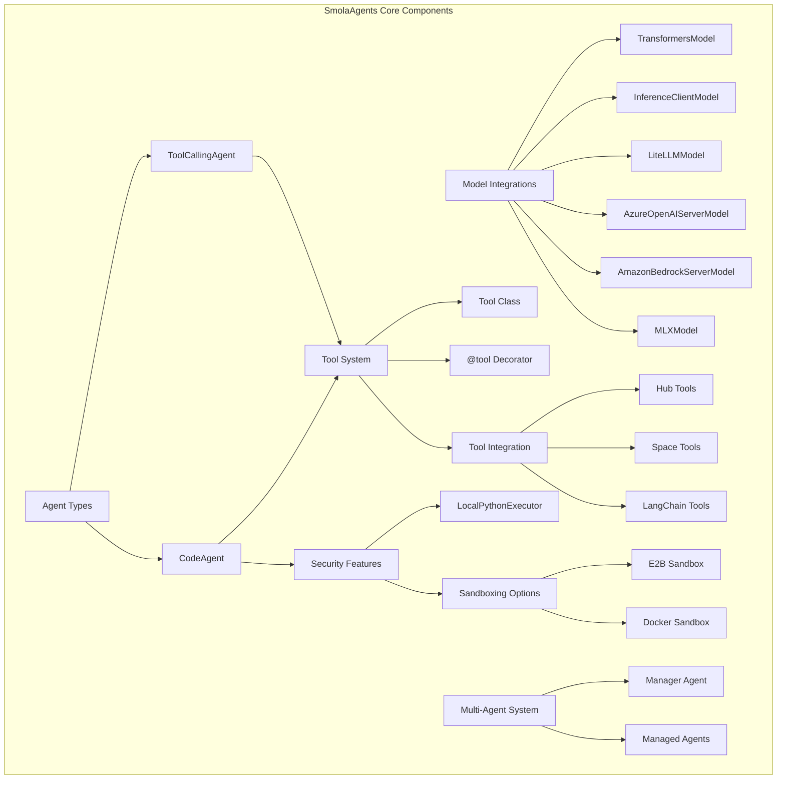
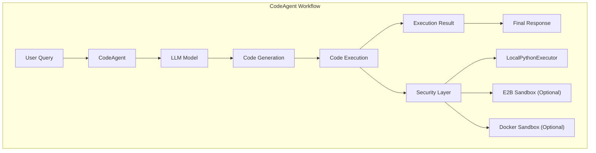
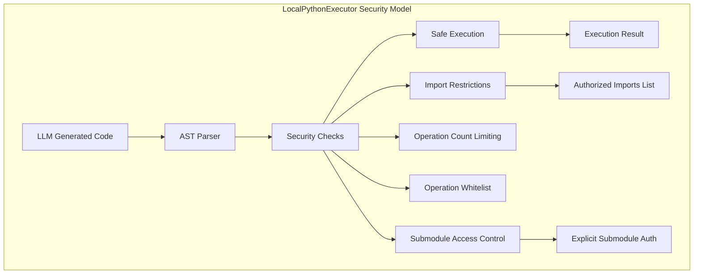
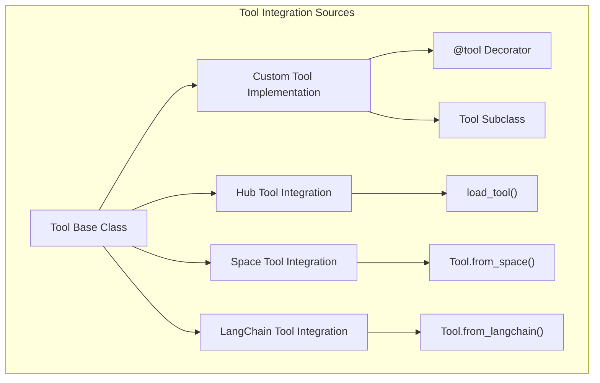
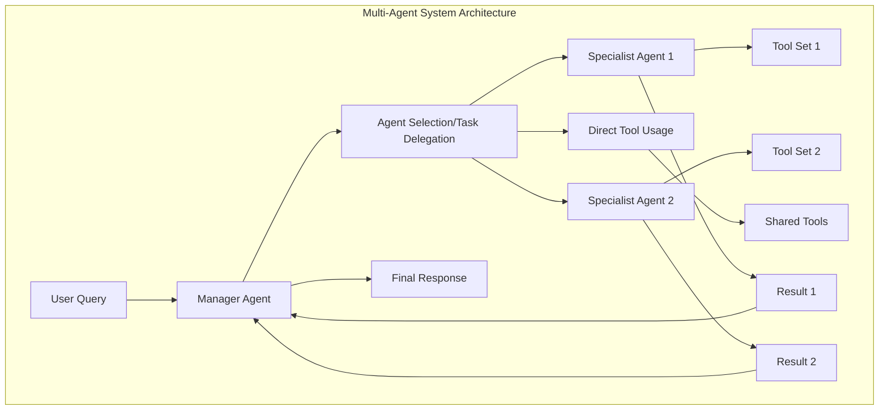
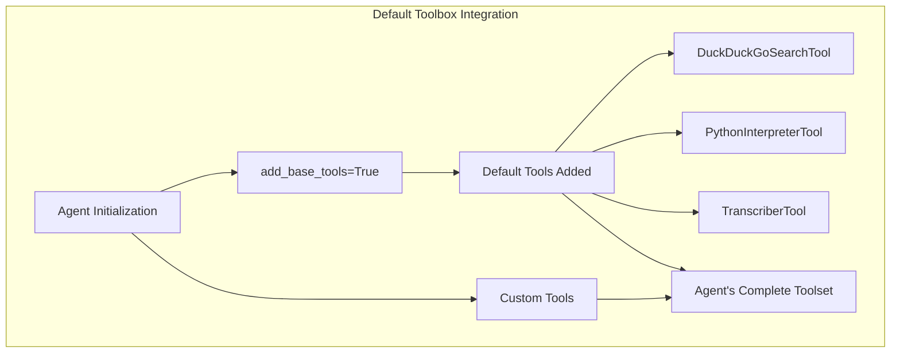
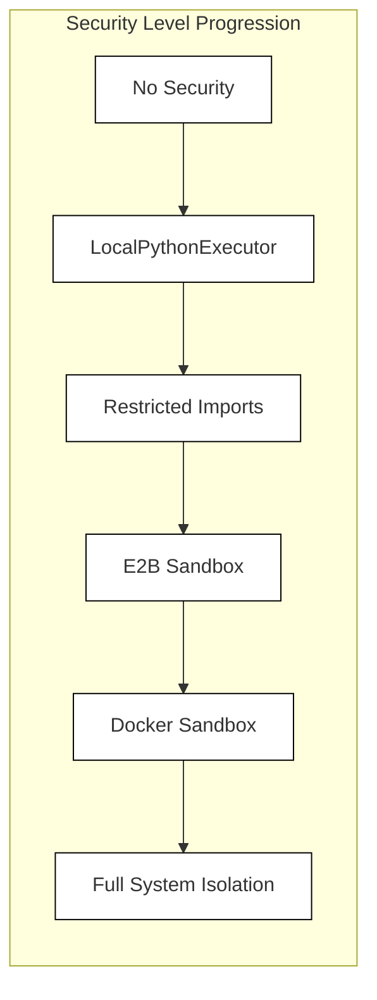
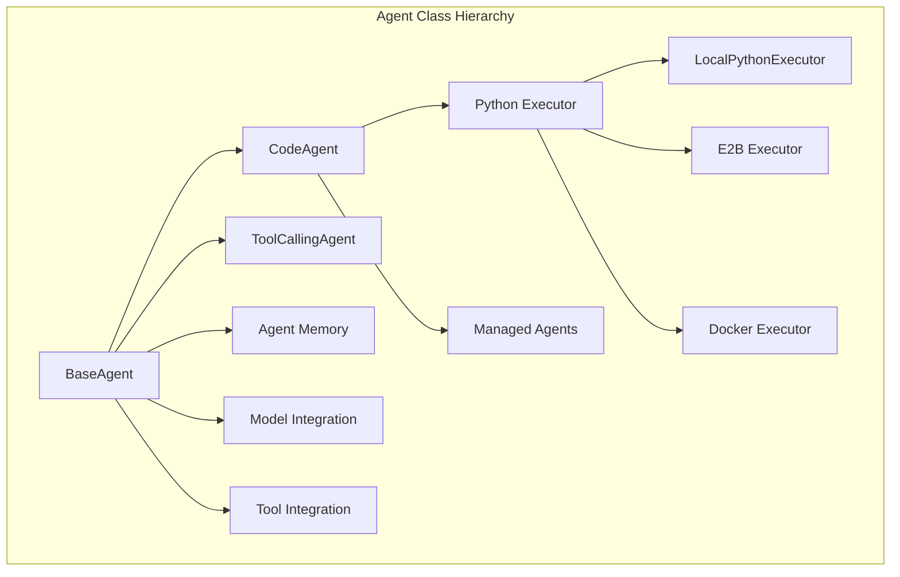

<!-- source: DeepWiki mcp.deepwiki.com · repo huggingface/notebooks · page 4 SmolaAgents Library · fetched 2026-10-26 -->

# SmolaAgents Library

<details>
<summary>Relevant source files</summary>

The following files were used as context for generating this wiki page:

- [smolagents_doc/en/guided_tour.ipynb](smolagents_doc/en/guided_tour.ipynb)
- [smolagents_doc/en/multiagents.ipynb](smolagents_doc/en/multiagents.ipynb)
- [smolagents_doc/en/pytorch/guided_tour.ipynb](smolagents_doc/en/pytorch/guided_tour.ipynb)
- [smolagents_doc/en/pytorch/multiagents.ipynb](smolagents_doc/en/pytorch/multiagents.ipynb)
- [smolagents_doc/en/pytorch/rag.ipynb](smolagents_doc/en/pytorch/rag.ipynb)
- [smolagents_doc/en/pytorch/secure_code_execution.ipynb](smolagents_doc/en/pytorch/secure_code_execution.ipynb)
- [smolagents_doc/en/pytorch/text_to_sql.ipynb](smolagents_doc/en/pytorch/text_to_sql.ipynb)
- [smolagents_doc/en/pytorch/tools.ipynb](smolagents_doc/en/pytorch/tools.ipynb)
- [smolagents_doc/en/rag.ipynb](smolagents_doc/en/rag.ipynb)
- [smolagents_doc/en/secure_code_execution.ipynb](smolagents_doc/en/secure_code_execution.ipynb)
- [smolagents_doc/en/tensorflow/guided_tour.ipynb](smolagents_doc/en/tensorflow/guided_tour.ipynb)
- [smolagents_doc/en/tensorflow/multiagents.ipynb](smolagents_doc/en/tensorflow/multiagents.ipynb)
- [smolagents_doc/en/tensorflow/rag.ipynb](smolagents_doc/en/tensorflow/rag.ipynb)
- [smolagents_doc/en/tensorflow/secure_code_execution.ipynb](smolagents_doc/en/tensorflow/secure_code_execution.ipynb)
- [smolagents_doc/en/tensorflow/tools.ipynb](smolagents_doc/en/tensorflow/tools.ipynb)
- [smolagents_doc/en/tools.ipynb](smolagents_doc/en/tools.ipynb)

</details>


## Purpose and Scope

SmolaAgents is a library for building AI agents with a focus on secure code execution and flexible tool integration. It provides a framework to create agents that can execute Python code, use tools, and collaborate in multi-agent systems. This document covers the core architecture, components, and security features of SmolaAgents.

For information about specific implementations like Retrieval-Augmented Generation with SmolaAgents, see [RAG Integration](#4.4).

## Architecture Overview



Sources: `smolagents_doc/en/secure_code_execution.ipynb`, `smolagents_doc/en/guided_tour.ipynb`, `smolagents_doc/en/tools.ipynb`, `smolagents_doc/en/multiagents.ipynb`

## Agent Types

SmolaAgents provides two main types of agents:

### CodeAgent

The `CodeAgent` executes Python code to perform actions. It is the default agent type and has these characteristics:

- Writes and executes Python code snippets at each step
- Uses a secure `LocalPythonExecutor` by default
- Can be configured with sandboxing options for enhanced security
- Supports additional authorized imports for extending functionality



Sources: `smolagents_doc/en/guided_tour.ipynb`, `smolagents_doc/en/secure_code_execution.ipynb`

### ToolCallingAgent

The `ToolCallingAgent` uses a structured JSON-like format for tool calls instead of executing code:

- Actions are written as JSON blobs specifying tool names and arguments
- No code execution, so it doesn't require security features like `additional_authorized_imports`
- Useful for cases where structured tool calling is preferred over code-based approaches

Sources: `smolagents_doc/en/guided_tour.ipynb`

## Secure Code Execution

Security is a central feature of SmolaAgents, especially for the `CodeAgent` that executes LLM-generated code.

### LocalPythonExecutor

The `LocalPythonExecutor` is a custom Python interpreter rebuilt from the ground up with security in mind:

- Parses code into Abstract Syntax Tree (AST) and executes operations individually
- Restricts imports to an authorized list
- Prevents access to submodules unless explicitly authorized
- Caps the total number of operations to prevent infinite loops
- Raises errors for any unauthorized operations



Sources: `smolagents_doc/en/secure_code_execution.ipynb`

### Sandboxing Options

SmolaAgents supports two approaches to sandboxing for enhanced security:

1. **Running code snippets in a sandbox**: Only the code execution happens in the sandbox
   - Set up with `executor_type="e2b"` or `executor_type="docker"`
   - Simpler to configure but doesn't support multi-agent setups
   - No need to transfer API keys to the sandbox

2. **Running the entire agent system in a sandbox**: The entire agent, including model and tools, runs in the sandbox
   - Provides complete isolation
   - Supports multi-agent systems
   - Requires more manual configuration

#### E2B Sandbox

E2B provides a cloud-based sandbox environment:

```python
# Quick setup with CodeAgent
agent = CodeAgent(model=InferenceClientModel(), tools=[], executor_type="e2b")
```

#### Docker Sandbox

Docker offers a container-based sandbox solution:

```python
# Quick setup with CodeAgent
agent = CodeAgent(model=InferenceClientModel(), tools=[], executor_type="docker")
```

Sources: `smolagents_doc/en/secure_code_execution.ipynb`

## Tool System

Tools are functions that agents can use to interact with external systems and perform specific tasks.

### Creating Tools

Tools can be created in two ways:

1. Using the `@tool` decorator:

```python
@tool
def search_tool(query: str) -> str:
    """Search for information on the web.
    
    Args:
        query: The search query.
    """
    # Implementation
    pass
```

2. Subclassing the `Tool` class:

```python
class SearchTool(Tool):
    name = "search_tool"
    description = "Search for information on the web."
    inputs = {
        "query": {
            "type": "string",
            "description": "The search query."
        }
    }
    output_type = "string"
    
    def forward(self, query: str):
        # Implementation
        pass
```

### Tool Integration

SmolaAgents supports integrating tools from various sources:

1. **Hub Tools**: Load tools shared on the Hugging Face Hub
   ```python
   tool = load_tool("username/tool-name", trust_remote_code=True)
   ```

2. **Space Tools**: Import Gradio Spaces as tools
   ```python
   tool = Tool.from_space("username/space-name", name="tool_name", description="Tool description")
   ```

3. **LangChain Tools**: Use tools from the LangChain ecosystem
   ```python
   langchain_tool = load_tools(["serpapi"])[0]
   tool = Tool.from_langchain(langchain_tool)
   ```



Sources: `smolagents_doc/en/tools.ipynb`, `smolagents_doc/en/guided_tour.ipynb`

## Multi-Agent Systems

SmolaAgents supports building hierarchical multi-agent systems where a manager agent orchestrates other agents.

### Manager and Managed Agents

The multi-agent architecture typically consists of:

1. **Manager Agent**: Coordinates the overall task and delegates to specialized agents
2. **Managed Agents**: Specialized agents that handle specific subtasks



Example setup:

```python
# Create specialized agents
web_agent = ToolCallingAgent(
    tools=[DuckDuckGoSearchTool(), visit_webpage],
    model=model,
    name="web_search_agent",
    description="This agent handles web searching and browsing."
)

# Create manager agent with managed agents
manager_agent = CodeAgent(
    model=model,
    tools=[],
    managed_agents=[web_agent],
    add_base_tools=True
)
```

Sources: `smolagents_doc/en/multiagents.ipynb`

## Model Integrations

SmolaAgents supports various model integrations to power the agents:

| Model Class | Description | Use Case |
|-------------|-------------|----------|
| `TransformersModel` | Uses local Transformers models | When you want to run models locally |
| `InferenceClientModel` | Uses Hugging Face Inference API | For accessing hosted models from various providers |
| `LiteLLMModel` | Connects to 100+ different models/providers | When you need flexibility across providers |
| `AzureOpenAIServerModel` | Uses Azure-hosted OpenAI models | For enterprise deployments on Azure |
| `AmazonBedrockServerModel` | Uses Amazon Bedrock models | For AWS-based deployments |
| `MLXModel` | Uses Apple's MLX framework | For efficient local inference on Apple Silicon |

Example usage:

```python
# Using InferenceClientModel
model = InferenceClientModel(model_id="meta-llama/Llama-3.1-70B-Instruct")
agent = CodeAgent(tools=[], model=model)

# Using LiteLLMModel for OpenAI
model = LiteLLMModel(model_id="gpt-4o")
agent = CodeAgent(tools=[], model=model)
```

Sources: `smolagents_doc/en/guided_tour.ipynb`

## Default Toolbox

SmolaAgents includes a default toolbox that can be added with `add_base_tools=True`:

- `DuckDuckGoSearchTool`: Performs web searches using DuckDuckGo
- `PythonInterpreterTool`: Runs Python code (added to `ToolCallingAgent` only)
- `TranscriberTool`: Transcribes audio to text using Whisper-Turbo



Sources: `smolagents_doc/en/guided_tour.ipynb`

## Security Considerations

The security model in SmolaAgents addresses several potential risks:

- **LLM errors**: Unintentional generation of harmful code
- **Supply chain attacks**: Using compromised LLMs
- **Prompt injection**: Malicious prompts from web browsing
- **Public agent exploitation**: Adversarial inputs to public-facing agents

Security best practices:

1. Use the `LocalPythonExecutor` for basic protection
2. Limit authorized imports to necessary packages
3. Use sandboxing (`E2B` or `Docker`) for critical applications
4. Set resource limits (memory, CPU) for sandboxed execution
5. Run with minimal privileges
6. Ensure proper cleanup of resources



Sources: `smolagents_doc/en/secure_code_execution.ipynb`

## Key Components and Implementation

The core components of SmolaAgents include:

### Agent Class Hierarchy

The base agent classes manage the interaction between models and tools:



### LocalPythonExecutor Implementation

The `LocalPythonExecutor` provides security features:

- AST parsing and controlled execution
- Import restrictions
- Submodule access control
- Operation limits

### Tool System Implementation

The tool system is implemented through:

- `Tool` base class for inheritance
- `@tool` decorator for function decoration
- Standardized input/output definitions
- Serialization for Hub sharing

By combining these components, SmolaAgents provides a flexible framework for building secure, capable AI agents with code execution abilities, tool integration, and multi-agent collaboration.

Sources: `smolagents_doc/en/secure_code_execution.ipynb`, `smolagents_doc/en/guided_tour.ipynb`, `smolagents_doc/en/tools.ipynb`

---

