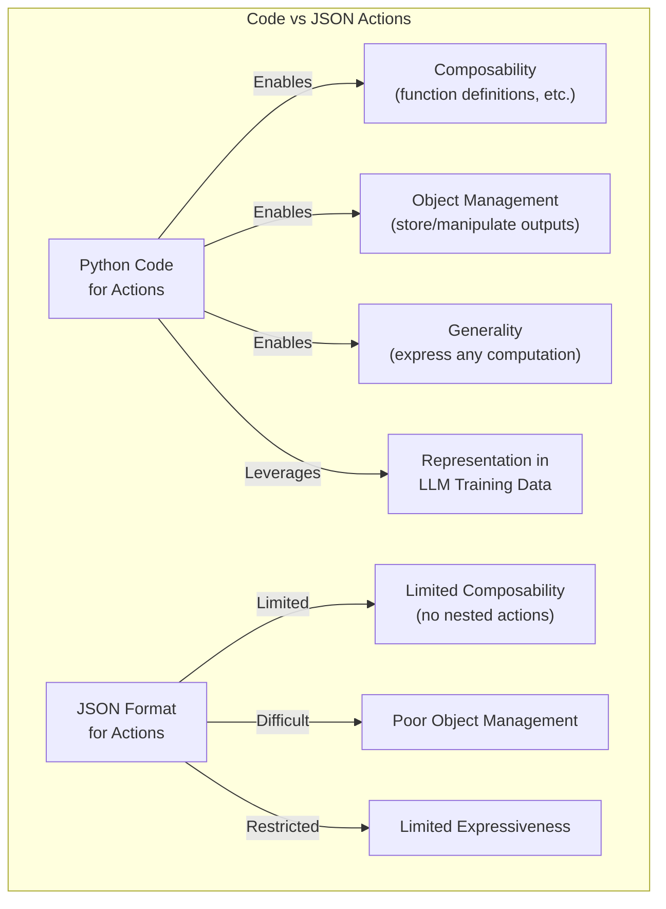
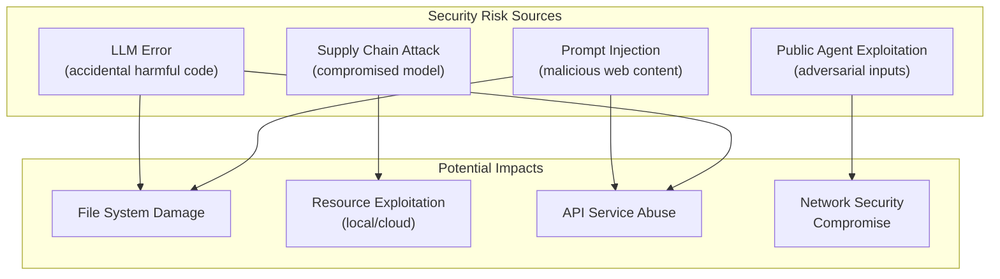
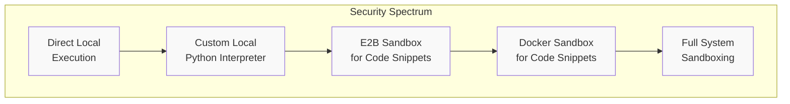
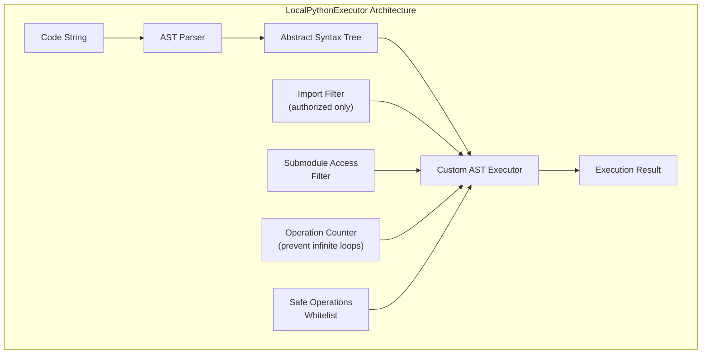
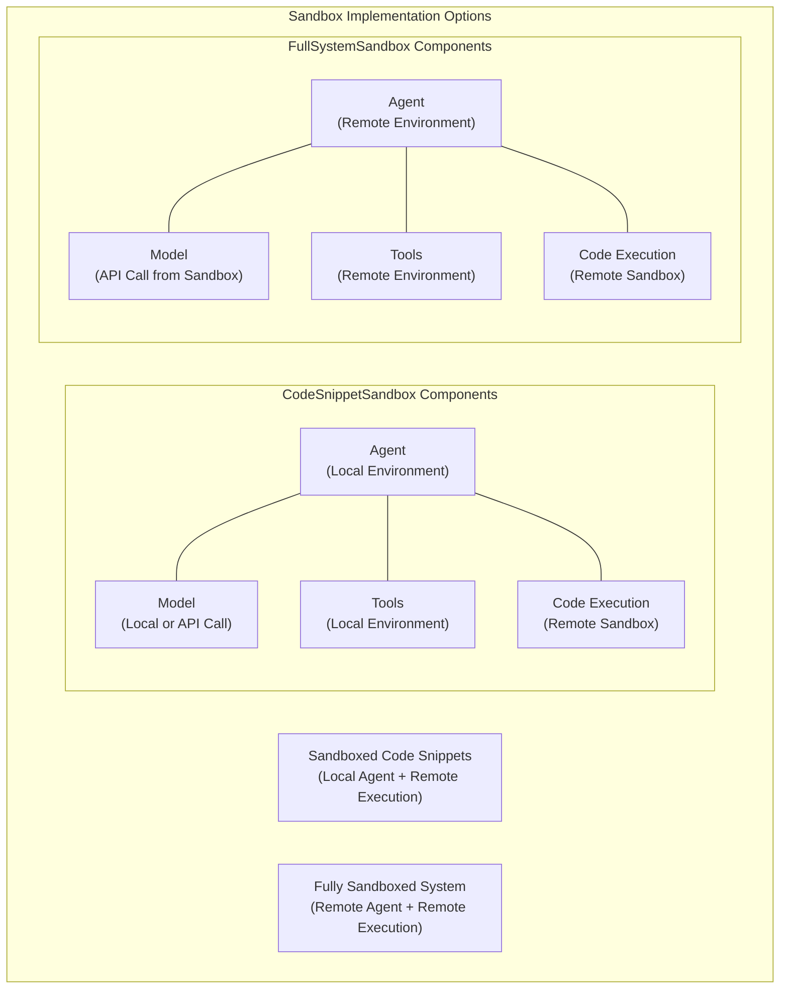
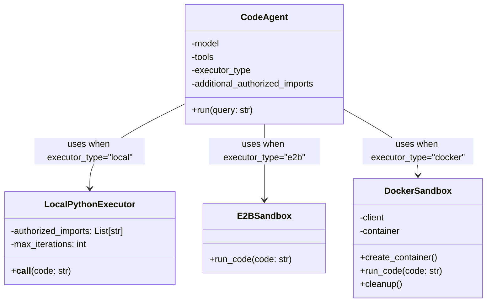

<!-- source: DeepWiki mcp.deepwiki.com · repo huggingface/notebooks · page 4.1 Secure Code Execution · fetched 2026-10-26 -->

# Secure Code Execution

<details>
<summary>Relevant source files</summary>

The following files were used as context for generating this wiki page:

- [smolagents_doc/en/guided_tour.ipynb](smolagents_doc/en/guided_tour.ipynb)
- [smolagents_doc/en/pytorch/guided_tour.ipynb](smolagents_doc/en/pytorch/guided_tour.ipynb)
- [smolagents_doc/en/pytorch/secure_code_execution.ipynb](smolagents_doc/en/pytorch/secure_code_execution.ipynb)
- [smolagents_doc/en/secure_code_execution.ipynb](smolagents_doc/en/secure_code_execution.ipynb)
- [smolagents_doc/en/tensorflow/guided_tour.ipynb](smolagents_doc/en/tensorflow/guided_tour.ipynb)
- [smolagents_doc/en/tensorflow/secure_code_execution.ipynb](smolagents_doc/en/tensorflow/secure_code_execution.ipynb)

</details>


## Purpose and Scope

This document explains the security considerations and implementation details for executing code in AI agents within the SmolaAgents library. It covers the built-in security mechanisms, sandbox options, and best practices for running LLM-generated code safely. The focus is on the technical implementation of secure code execution rather than general agent concepts (see [Guided Tour](#4) for a broader introduction to agents).

## Why Code-Based Agents?

The SmolaAgents library emphasizes the use of code (specifically Python) for expressing agent actions rather than structured formats like JSON. This approach leverages several advantages of code as an execution medium:



The diagram illustrates key advantages of code-based actions:
1. **Composability**: Code allows defining reusable functions and nested operations
2. **Object management**: Output from one action can be stored and manipulated
3. **Generality**: Code can express virtually any computation possible
4. **Training representation**: LLMs have been trained on substantial amounts of code, making code generation a strength

Sources: [smolagents_doc/en/secure_code_execution.ipynb:41-56]()

## Security Risks in Code Execution

When an AI agent executes code, particularly code generated by an LLM, several security risks emerge:



Key risk categories include:
- **LLM errors**: Unintentional generation of harmful code
- **Supply chain attacks**: Compromised or malicious models
- **Prompt injection**: Malicious content tricking the agent
- **Public exploitation**: Adversarial inputs to public-facing agents

These risks highlight the importance of security measures when executing LLM-generated code.

Sources: [smolagents_doc/en/secure_code_execution.ipynb:69-78]()

## Security Implementation Spectrum

SmolaAgents provides a spectrum of security options, each offering different trade-offs between security, convenience, and isolation:



The diagram shows increasing security levels from left to right, with a corresponding increase in setup complexity.

Sources: [smolagents_doc/en/secure_code_execution.ipynb:87-89]()

## LocalPythonExecutor

The `LocalPythonExecutor` is the foundation of SmolaAgents' security model, providing a secure alternative to the standard Python interpreter.

### Architecture and Security Features



Key security features:
1. **Import restrictions**: Only explicitly authorized modules can be imported
2. **Submodule filtering**: Prevents access to potentially harmful submodules
3. **Operation counting**: Prevents infinite loops and resource exhaustion
4. **Operation whitelisting**: Only explicitly defined operations are allowed

### Usage Example

The `LocalPythonExecutor` can be configured with a list of authorized imports:

```python
custom_executor = LocalPythonExecutor(["numpy"])
```

The executor blocks potentially harmful operations:
- Shell commands
- Unauthorized imports
- Access to dangerous submodules
- Infinite loops

Sources: [smolagents_doc/en/secure_code_execution.ipynb:95-156]()

## Sandbox Approaches

For higher security requirements, SmolaAgents offers two sandbox approaches with different security properties and capabilities.

### Sandbox Architecture Options



The diagram illustrates the two approaches:
1. **Code Snippet Sandboxing**: Only the code execution happens in a sandbox
2. **Full System Sandboxing**: The entire agent system runs in a sandbox

Sources: [smolagents_doc/en/secure_code_execution.ipynb:180-197]()

### E2B Sandbox Integration

E2B provides a cloud-based sandbox environment for secure code execution.

#### Quick Setup

```python
from smolagents import CodeAgent, InferenceClientModel

agent = CodeAgent(model=InferenceClientModel(), tools=[], executor_type="e2b")
```

With this simple configuration, code generated by the agent is executed in the E2B sandbox rather than locally.

#### Multi-Agent Setup

For multi-agent systems, the entire agent system needs to run within the sandbox:

```python
from e2b_code_interpreter import Sandbox
import os

# Create sandbox and install dependencies
sandbox = Sandbox()
sandbox.commands.run("pip install smolagents")

# Define and run agent code within the sandbox
agent_code = """
import os
from smolagents import CodeAgent, InferenceClientModel

# Initialize agents
agent = CodeAgent(
    model=InferenceClientModel(token=os.getenv("HF_TOKEN")),
    tools=[],
    name="coder_agent"
)

manager_agent = CodeAgent(
    model=InferenceClientModel(token=os.getenv("HF_TOKEN")),
    managed_agents=[agent],
)

# Run the agent
response = manager_agent.run("What's the 20th Fibonacci number?")
print(response)
"""

# Execute agent code in sandbox
sandbox.run_code(agent_code, envs={'HF_TOKEN': os.getenv('HF_TOKEN')})
```

Sources: [smolagents_doc/en/secure_code_execution.ipynb:203-339]()

### Docker Sandbox Integration

Docker provides an alternative containerized environment for secure code execution.

#### Quick Setup

```python
from smolagents import CodeAgent, InferenceClientModel

agent = CodeAgent(model=InferenceClientModel(), tools=[], executor_type="docker")
```

Similar to E2B, this simple configuration executes code in a Docker container.

#### Advanced Setup

For more complex setups, including multi-agent systems:

1. Create a Dockerfile:
```dockerfile
FROM python:3.10-bullseye

# Install dependencies
RUN apt-get update && \
    apt-get install -y --no-install-recommends \
        build-essential \
        python3-dev && \
    pip install --no-cache-dir --upgrade pip && \
    pip install --no-cache-dir smolagents && \
    apt-get clean && \
    rm -rf /var/lib/apt/lists/*

# Set working directory
WORKDIR /app

# Run with limited privileges
USER nobody

# Default command
CMD ["python", "-c", "print('Container ready')"]
```

2. Create a sandbox manager to run agent code within the Docker container

Sources: [smolagents_doc/en/secure_code_execution.ipynb:345-534]()

### Sandbox Best Practices

When implementing a sandboxed environment, follow these key practices:

| Category | Best Practices |
|----------|----------------|
| Resource Management | • Set memory and CPU limits<br>• Implement execution timeouts<br>• Monitor resource usage |
| Security | • Run with minimal privileges<br>• Disable unnecessary network access<br>• Use environment variables for secrets |
| Environment | • Keep dependencies minimal<br>• Use fixed package versions<br>• Update base images regularly |
| Cleanup | • Ensure proper resource cleanup<br>• Avoid dangling containers |

Sources: [smolagents_doc/en/secure_code_execution.ipynb:540-566]()

## Security Approach Comparison

The two sandbox approaches offer different security and usability trade-offs:

| Aspect | Code Snippet Sandboxing | Full System Sandboxing |
|--------|-------------------------|------------------------|
| **Setup Complexity** | Simple (`executor_type="e2b"`) | More complex, requires manual configuration |
| **API Keys** | No need to transfer to sandbox | May require sharing secrets with sandbox |
| **Environment Protection** | Better local environment protection | Complete isolation of the agent system |
| **Multi-Agent Support** | Doesn't support multi-agents | Supports multi-agent architectures |
| **State Transfer** | Requires state transfer between environments | Everything runs in one environment |
| **Flexibility** | Limited to specific code execution | More flexible for complex architectures |
| **Latency** | Lower latency | Potentially higher latency |

Choose the approach that best fits your security requirements and application complexity:
- For simple agents, code snippet sandboxing provides good security with easy setup
- For complex multi-agent systems requiring complete isolation, full system sandboxing is more appropriate

Sources: [smolagents_doc/en/secure_code_execution.ipynb:572-624]()

## Implementation Example

Here's a code entity diagram showing the relationship between key classes in the secure execution system:



This diagram shows how the `CodeAgent` can be configured to use different executor implementations based on the `executor_type` parameter.

Sources: [smolagents_doc/en/guided_tour.ipynb:381-421](), [smolagents_doc/en/secure_code_execution.ipynb:121-156](), [smolagents_doc/en/secure_code_execution.ipynb:244-250](), [smolagents_doc/en/secure_code_execution.ipynb:386-392]()

---

