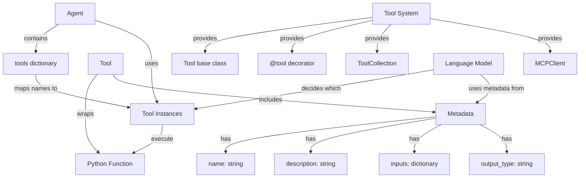
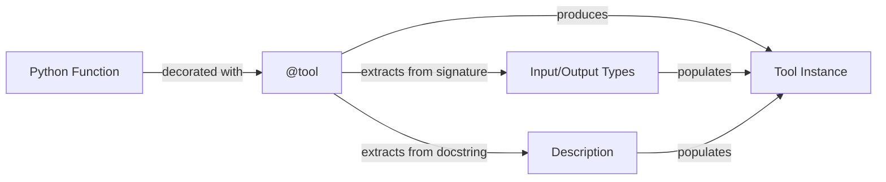
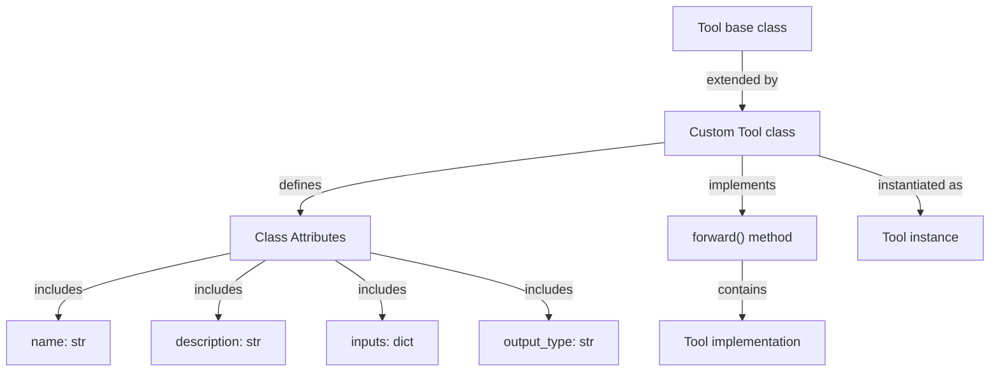
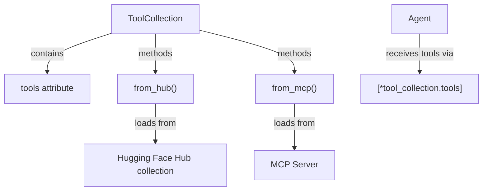
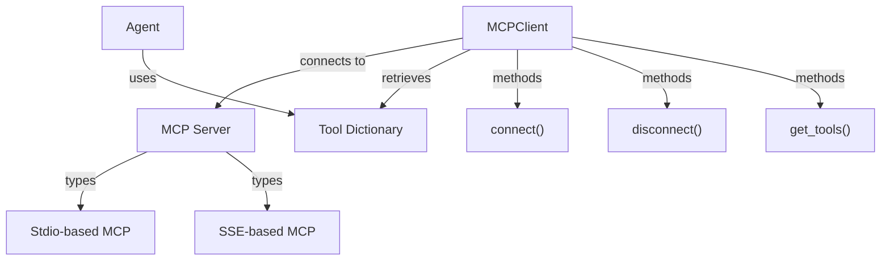

<!-- source: DeepWiki mcp.deepwiki.com · repo huggingface/notebooks · page 4.2 Tool System · fetched 2026-10-26 -->

# Tool System

<details>
<summary>Relevant source files</summary>

The following files were used as context for generating this wiki page:

- [smolagents_doc/en/multiagents.ipynb](smolagents_doc/en/multiagents.ipynb)
- [smolagents_doc/en/pytorch/multiagents.ipynb](smolagents_doc/en/pytorch/multiagents.ipynb)
- [smolagents_doc/en/pytorch/rag.ipynb](smolagents_doc/en/pytorch/rag.ipynb)
- [smolagents_doc/en/pytorch/text_to_sql.ipynb](smolagents_doc/en/pytorch/text_to_sql.ipynb)
- [smolagents_doc/en/pytorch/tools.ipynb](smolagents_doc/en/pytorch/tools.ipynb)
- [smolagents_doc/en/rag.ipynb](smolagents_doc/en/rag.ipynb)
- [smolagents_doc/en/tensorflow/multiagents.ipynb](smolagents_doc/en/tensorflow/multiagents.ipynb)
- [smolagents_doc/en/tensorflow/rag.ipynb](smolagents_doc/en/tensorflow/rag.ipynb)
- [smolagents_doc/en/tensorflow/tools.ipynb](smolagents_doc/en/tensorflow/tools.ipynb)
- [smolagents_doc/en/tools.ipynb](smolagents_doc/en/tools.ipynb)

</details>


The Tool System is a fundamental component of the SmolaAgents library that enables AI agents to interact with external functions, services, and capabilities. It provides a structured way for language models to understand and execute functions with appropriate metadata, creating a bridge between natural language instructions and executable code.

For information about secure execution of tools and code, see [Secure Code Execution](#4.1), and for implementing tools in multi-agent systems, see [Multi-agent Systems](#4.3).

## Tool System Architecture

The Tool System connects language models to executable functions by wrapping those functions with metadata that helps the model understand how to use them properly.



Sources:
- [smolagents_doc/en/tools.ipynb:44-60]()
- [smolagents_doc/en/tools.ipynb:96-107]()

## Creating Tools

There are two primary methods for creating tools in SmolaAgents:

### Using the `@tool` Decorator (Recommended for Simple Tools)

The `@tool` decorator is the simplest way to create a tool. It automatically extracts metadata from the function signature and docstring.



Example of a web page visitor tool using the decorator:

```python
@tool
def visit_webpage(url: str) -> str:
    """Visits a webpage at the given URL and returns its content as a markdown string.

    Args:
        url: The URL of the webpage to visit.

    Returns:
        The content of the webpage converted to Markdown, or an error message if the request fails.
    """
    # Implementation...
```

Sources:
- [smolagents_doc/en/tools.ipynb:105-106]()
- [smolagents_doc/en/multiagents.ipynb:126-152]()

### Subclassing `Tool` (For Complex Tools)

For more complex tools that require additional attributes or methods, you can subclass the `Tool` class.



Required components when subclassing `Tool`:
1. `name`: String identifier for the tool
2. `description`: String explaining the tool's purpose (used in prompts)
3. `inputs`: Dictionary defining the expected inputs, their types and descriptions
4. `output_type`: String specifying the output type
5. `forward()`: Method containing the implementation logic

Example of a Hugging Face model retrieval tool:

```python
class HFModelDownloadsTool(Tool):
    name = "model_download_counter"
    description = """
    This is a tool that returns the most downloaded model of a given task on the Hugging Face Hub.
    It returns the name of the checkpoint."""
    inputs = {
        "task": {
            "type": "string",
            "description": "the task category (such as text-classification, depth-estimation, etc)",
        }
    }
    output_type = "string"

    def forward(self, task: str):
        from huggingface_hub import list_models
        model = next(iter(list_models(filter=task, sort="downloads", direction=-1)))
        return model.id

model_downloads_tool = HFModelDownloadsTool()
```

Sources:
- [smolagents_doc/en/tools.ipynb:68-89]()
- [smolagents_doc/en/tools.ipynb:96-107]()
- [smolagents_doc/en/rag.ipynb:119-151]()

## Using Tools with Agents

To use tools with an agent, you simply pass them to the agent's constructor:

```python
from smolagents import CodeAgent, InferenceClientModel

model = InferenceClientModel(model_id="Qwen/Qwen2.5-Coder-32B-Instruct")
agent = CodeAgent(tools=[model_downloads_tool], model=model)

agent.run("What is the most downloaded text-to-video model on Hugging Face?")
```

The agent will have access to all tools in its `tools` dictionary, which maps tool names to tool instances.

Sources:
- [smolagents_doc/en/tools.ipynb:215-223]()
- [smolagents_doc/en/rag.ipynb:176-181]()

## Managing an Agent's Toolbox

You can dynamically manage the tools available to an agent by modifying its `tools` attribute:

```python
# Create agent with only base tools
agent = CodeAgent(tools=[], model=model, add_base_tools=True)

# Add a new tool
agent.tools[model_download_tool.name] = model_download_tool
```

This allows you to add, remove, or replace tools at runtime.

Sources:
- [smolagents_doc/en/tools.ipynb:287-305]()

## Tool Collections

SmolaAgents provides the `ToolCollection` class to help manage groups of tools:



### Loading from Hugging Face Hub

You can load a collection of tools from the Hugging Face Hub:

```python
from smolagents import ToolCollection, CodeAgent

image_tool_collection = ToolCollection.from_hub(
    collection_slug="huggingface-tools/diffusion-tools-6630bb19a942c2306a2cdb6f",
    token="<YOUR_HUGGINGFACEHUB_API_TOKEN>"
)
agent = CodeAgent(tools=[*image_tool_collection.tools], model=model, add_base_tools=True)
```

Sources:
- [smolagents_doc/en/tools.ipynb:351-377]()

### Loading from MCP Servers

You can load tools from Model-Centric Protocol (MCP) servers:

```python
# For stdio-based MCP servers
with ToolCollection.from_mcp(server_parameters, trust_remote_code=True) as tool_collection:
    agent = CodeAgent(tools=[*tool_collection.tools], model=model, add_base_tools=True)
    agent.run("Please find a remedy for hangover.")

# For SSE-based MCP servers
with ToolCollection.from_mcp({"url": "http://127.0.0.1:8000/sse"}, trust_remote_code=True) as tool_collection:
    agent = CodeAgent(tools=[*tool_collection.tools], add_base_tools=True)
    agent.run("Please find a remedy for hangover.")
```

Sources:
- [smolagents_doc/en/tools.ipynb:418-450]()

## Special Tool Types

SmolaAgents supports several specialized tool types that enhance agent capabilities:

### Gradio Space Tools

Convert any Gradio Space on Hugging Face Hub into a tool:

```python
image_generation_tool = Tool.from_space(
    "black-forest-labs/FLUX.1-schnell",
    name="image_generator",
    description="Generate an image from a prompt"
)
```

This uses the `gradio-client` library to call the Space's API.

Sources:
- [smolagents_doc/en/tools.ipynb:176-196]()

### LangChain Tools

Import tools from the LangChain ecosystem:

```python
from langchain.agents import load_tools
from smolagents import Tool

search_tool = Tool.from_langchain(load_tools(["serpapi"])[0])
```

Sources:
- [smolagents_doc/en/tools.ipynb:255-275]()

### MCPClient Tools

For more control over MCP tools, use the `MCPClient` class directly:



Example usage:

```python
from smolagents import MCPClient, CodeAgent

# Using context manager (recommended)
with MCPClient(server_parameters) as tools:
    agent = CodeAgent(tools=tools, model=model, add_base_tools=True)
    agent.run("Please find the latest research on COVID-19 treatment.")

# Manual connection management
try:
    mcp_client = MCPClient(server_parameters)
    tools = mcp_client.get_tools()
    agent = CodeAgent(tools=tools, model=model, add_base_tools=True)
    result = agent.run("What are the recent therapeutic approaches for Alzheimer's disease?")
finally:
    mcp_client.disconnect()
```

MCPClient can connect to multiple servers at once:

```python
with MCPClient([server_params1, server_params2]) as tools:
    agent = CodeAgent(tools=tools, model=model, add_base_tools=True)
```

Sources:
- [smolagents_doc/en/tools.ipynb:474-577]()

## Sharing and Loading Tools

### Sharing Tools to Hugging Face Hub

Tools can be shared to the Hub as Space repositories:

```python
model_downloads_tool.push_to_hub("{your_username}/hf-model-downloads", token="<YOUR_HUGGINGFACEHUB_API_TOKEN>")
```

Requirements for sharing:
- Methods must be self-contained
- Imports should be defined within tool functions
- If overriding `__init__`, it should only take `self` as an argument

Sources:
- [smolagents_doc/en/tools.ipynb:130-149]()

### Loading Tools from Hugging Face Hub

Tools can be loaded from the Hub using `load_tool()` or `Tool.from_hub()`:

```python
from smolagents import load_tool

model_download_tool = load_tool(
    "{your_username}/hf-model-downloads",
    trust_remote_code=True  # Required as running tools executes custom code
)
```

Sources:
- [smolagents_doc/en/tools.ipynb:157-162]()

## Tool System Security Considerations

When using tools, especially those from external sources, consider these security implications:

1. **Hub Tools**: Require `trust_remote_code=True` as they execute custom code
2. **MCP Servers**:
   - Stdio-based servers execute code directly on your machine
   - SSE-based servers are safer but still require caution
3. **Tool Collection**: Loads tools only when called by the agent to improve startup performance

Always verify the source and integrity of tools before using them, especially in production environments.

Sources:
- [smolagents_doc/en/tools.ipynb:397-406]()
- [smolagents_doc/en/tools.ipynb:583-585]()

## Tool System in Action: Example Use Cases

The Tool System enables powerful agent capabilities across various domains:

1. **Web Browsing**: Agents can search the web and visit pages using tools like `DuckDuckGoSearchTool` and `visit_webpage`
2. **SQL Queries**: Tools can execute SQL queries against databases
3. **RAG Systems**: Retrieval tools can fetch relevant information from knowledge bases
4. **Image Generation**: Tools can generate images via Stable Diffusion models
5. **Multi-agent Systems**: Tools enable agents to collaborate on complex tasks

These examples demonstrate how the Tool System forms the foundation for agent capabilities in SmolaAgents.

Sources:
- [smolagents_doc/en/multiagents.ipynb:105-111]()
- [smolagents_doc/en/pytorch/text_to_sql.ipynb:161-183]()
- [smolagents_doc/en/rag.ipynb:119-151]()

---

